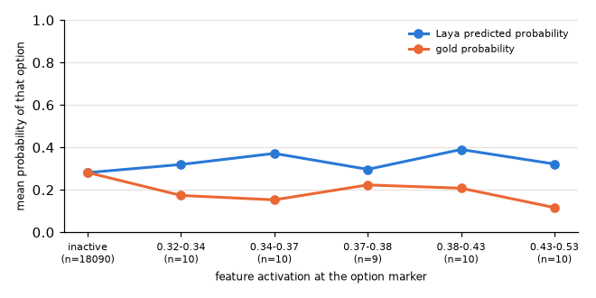

# Feature 6051

Critérios em que aparece: pred_error

**Interpretação (preencher):** 

---

## Maiores ativações

**tr_customer_service_000113 / action** (choice, customer_service) | ativação 1.438 em `estado` | opções ['answer_directly', 'close_no_action', 'escalate_to_human', 'execute_refund', 'request_information'] | Laya: **close_no_action** [0.21, 0.279, 0.086, 0.268, 0.157] | gabarito: **answer_directly**

```
[CLS]choice question: What should the assistant do next with this conversation?[SEP]
▸ [MASK] answer_directly: The assistant can resolve this itself with information it already has.
▸ [MASK] close_no_action: No further action is warranted; the matter is settled.
▸ [MASK] escalate_to_human: Hand off to a human agent with the appropriate authority.
▸ [MASK] execute_refund: Issue the refund or credit the customer is owed.
▸ [MASK] request_information: More detail is needed from the customer before anything can be done.

[SEP]

{"account": {"lifetime_value_usd": 47, "prior_tickets_90d": 0, "seats": 1, "tenure_months": 1, "tier": "standard"}, "orders": [{"amount_usd": 87, "date": "2026-01-11", "id": "A-32698", "status": "settled"}, {"amount_usd": 87, "date": "2026-03-25", "id": "A-92735", "status": "refunded"}], "thread": [{"role": "customer", "text": "Hi there! I've been using the standard plan for about a month now and I really enjoy the interface, but I've noticed the page load times are getting quite slow today. Is there anything I should check on my end?"}, {"role": "agent", "text": "Welcome to the platform! I'd be happy⟦ to⟧ help you look into those load times. Are you experiencing this slowness on all pages, or is it specifically when you try to generate reports?"}, {"role": "customer", "text": "It seems to be happening everywhere, especially when I try to save my work. I paid $87 for this month and I have a very important hard deadline this evening, so I'm a bit worried about getting everything finished in time."}, {"role": "agent", "text": "I understand the importance of meeting your deadline. Could you tell me which web browser you are currently using and if you have tried clearing your cache recently?"}, {"role": "customer", "text": "I'm using the latest version of Chrome and I did try clearing the cache, but the lag persists. I really need to have this project submitted by 5:00 PM today, so any guidance on how to speed things up would be greatly appreciated."}]}[SEP]
```

**tr_customer_service_000120 / action** (choice, customer_service) | ativação 1.405 em `estado` | opções ['answer_directly', 'close_no_action', 'escalate_to_human', 'execute_refund', 'request_information'] | Laya: **close_no_action** [0.207, 0.234, 0.119, 0.224, 0.216] | gabarito: **escalate_to_human**

```
[CLS]choice question: What should the assistant do next with this conversation?[SEP]
▸ [MASK] answer_directly: The assistant can resolve this itself with information it already has.
▸ [MASK] close_no_action: No further action is warranted; the matter is settled.
▸ [MASK] escalate_to_human: Hand off to a human agent with the appropriate authority.
▸ [MASK] execute_refund: Issue the refund or credit the customer is owed.
▸ [MASK] request_information: More detail is needed from the customer before anything can be done.

[SEP]

{"account": {"lifetime_value_usd": 683, "prior_tickets_90d": 2, "seats": 1, "tenure_months": 8, "tier": "premium"}, "orders": [{"amount_usd": 29, "date": "2026-03-13", "id": "A-34569", "status": "pending"}, {"amount_usd": 29, "date": "2026-02-22", "id": "A-11297", "status": "refunded"}, {"amount_usd": 29, "date": "2026-01-21", "id": "A-20004", "status": "failed"}], "thread": [{"role": "customer", "text": "I am trying to remove two seats from my Premium plan, but the dashboard still shows them as active and billable for the next cycle. I've been a customer for eight months and this is the third time I've had to report this exact issue with the $29 per seat charge."}, {"role": "agent", "text": "I can certainly look into those seat settings for you.⟦ To⟧ clarify, are these seats currently assigned to specific users, or are they currently vacant in your dashboard?"}, {"role": "customer", "text": "They are vacant. I unassigned the users last week, but the total seat count refuses to decrease when I try to update the subscription preferences."}, {"role": "agent", "text": "Thank you for that detail. When you attempt to reduce the count, are you receiving a specific error message, or does the page simply refresh without saving the changes?"}, {"role": "customer", "text": "The page just refreshes. I've already had two tickets about this in the past that were resolved temporarily, but the bug seems to have returned."}, {"role": "agent", "text": "I see the history here in your account. Could you please provide a screenshot of the billing page as it appears now so I can verify the current seat allocation against our backend records?"}, {"role": "customer", "text": "I'll attach the screenshot now. I just need to ensure I am not billed for these two extra seats again because I shouldn't be paying for capacity I'm not using."}]}[SEP]
```

**tr_customer_service_000044 / action** (choice, customer_service) | ativação 1.342 em `estado` | opções ['answer_directly', 'close_no_action', 'escalate_to_human', 'execute_refund', 'request_information'] | Laya: **close_no_action** [0.192, 0.261, 0.19, 0.122, 0.235] | gabarito: **escalate_to_human**

```
[CLS]choice question: What should the assistant do next with this conversation?[SEP]
▸ [MASK] answer_directly: The assistant can resolve this itself with information it already has.
▸ [MASK] close_no_action: No further action is warranted; the matter is settled.
▸ [MASK] escalate_to_human: Hand off to a human agent with the appropriate authority.
▸ [MASK] execute_refund: Issue the refund or credit the customer is owed.
▸ [MASK] request_information: More detail is needed from the customer before anything can be done.

[SEP]

{"account": {"lifetime_value_usd": 754, "prior_tickets_90d": 0, "seats": 1, "tenure_months": 8, "tier": "free"}, "orders": [{"amount_usd": 897, "date": "2026-03-17", "id": "A-13529", "status": "pending"}], "thread": [{"role": "customer", "text": "I've been trying to downgrade my account to the free tier for over an hour now and the dashboard just keeps looping me back to the billing page without saving the changes. I've already spent nearly $900 with you guys over the last eight months, and I shouldn't have to jump through hoops just to stop being charged."}, {"role": "agent", "text": "I'm sorry for the frustration you're experiencing with the downgrade process.⟦ To⟧ help me investigate why the system isn't processing your request, could you please specify if you're receiving a particular error code or if the page simply refreshes without an update?"}, {"role": "customer", "text": "There's no error code, it just flashes a message saying 'Action could not be completed at this time' and stays on the paid plan. It's ridiculous because I can see the $897 total in my billing history, so the system clearly knows who I am, but it won't let me move to the free plan."}, {"role": "agent", "text": "Thank you for clarifying that for me. I'll need to look into the back-end logs for your account to see what's triggering that message. Could you tell me which browser and version you are currently using, and if you have attempted the change from a different device?"}, {"role": "customer", "text": "I'm on the latest version of Chrome and I've already tried it on my phone too with the exact same result. I just want someone to actually look at my account and explain why the downgrade isn't sticking when I've been a customer here for months."}]}[SEP]
```

**tr_customer_service_000260 / category** (choice, customer_service) | ativação 1.313 em `estado` | opções ['account', 'billing', 'delivery', 'refund', 'technical'] | Laya: **refund** [0.23, 0.231, 0.054, 0.318, 0.166] | gabarito: **billing**

```
[CLS]choice question: What is this customer conversation primarily about?[SEP]
▸ [MASK] account: Login, plan changes, profile or access management.
▸ [MASK] billing: A charge, invoice, subscription or payment problem.
▸ [MASK] delivery: Shipping, fulfilment or delivery of a physical item.
▸ [MASK] refund: The customer is explicitly asking for money back.
▸ [MASK] technical: The product or service is not working as expected.

[SEP]

{"account": {"lifetime_value_usd": 708, "prior_tickets_90d": 0, "seats": 1, "tenure_months": 14, "tier": "free"}, "thread": [{"role": "customer", "text": "My latest invoice shows a $45 fee that I didn’t expect; my plan is still the free tier."}, {"role": "agent", "text": "⟦I⟧ see. Could you tell me the invoice number or the date it was issued so I can review the line items?"}, {"role": "customer", "text": "It’s invoice #2026‑08‑15‑001, dated August 15. I need an explanation before the 30th, otherwise I’ll have to reconsider using the service."}, {"role": "agent", "text": "Got it, thank you. I’ll examine the charges and see why that amount appeared. May I also confirm the email address on the account?"}, {"role": "customer", "text": "The account uses sarah.l@example.com. Please get back to me with details before the 30th; I can’t wait indefinitely."}]}[SEP]
```

**tr_customer_service_000296 / needs_human** (noul, customer_service) | ativação 1.303 em `estado` | opções ['false', 'true'] | Laya: **true** [0.322, 0.678] | gabarito: **true**

```
[CLS]noul question: This conversation requires a human agent rather than automated handling.[SEP]
▸ [MASK] false: Automation can carry this to resolution.
▸ [MASK] true: A human must take over: judgement, authority or empathy is required.

[SEP]

{"account": {"lifetime_value_usd": 154, "prior_tickets_90d": 0, "seats": 1, "tenure_months": 2, "tier": "free"}, "thread": [{"role": "customer", "text": "We have a launch in two hours and need to reassign seats on our free plan—add three new users and remove two that left. This has to happen now."}, {"role": "agent", "text": "I understand the timing is tight. Could you give me the email addresses of the users you’d like to add and the ones you want removed?"}, {"role": "customer", "text": "Add: alice@example.com, bob@example.com, carol@example.com. Remove: dave@example.com and eve@example.com. I need the changes reflected instantly."}, {"role": "agent", "text": "Thanks for the list. I’ll process those seat changes right away. Would you like⟦ a⟧ confirmation email once the updates are applied?"}, {"role": "customer", "text": "Yes, send the confirmation now and make sure the seats are active before our launch; we can’t afford any delay."}]}[SEP]
```

## Ativações medianas (faixa 40-60%, mediana 0.544)

**tr_customer_service_000082 / action** (choice, customer_service) | ativação 0.563 em `opção` | opções ['answer_directly', 'close_no_action', 'escalate_to_human', 'execute_refund', 'request_information'] | Laya: **execute_refund** [0.212, 0.166, 0.145, 0.358, 0.118] | gabarito: **escalate_to_human**

```
[CLS]choice question: What should the assistant do next with this conversation?[SEP]
▸ [MASK] answer_directly: The assistant can resolve this itself with information it already has.
▸ [MASK] close_no_action: No further action is warranted; the matter is settled.
▸ [MASK] escalate_to⟦_⟧human: Hand off to a human agent with the appropriate authority.
▸ [MASK] execute_refund: Issue the refund or credit the customer is owed.
▸ [MASK] request_information: More detail is needed from the customer before anything can be done.

[SEP]

{"account": {"lifetime_value_usd": 2703, "prior_tickets_90d": 2, "seats": 40, "tenure_months": 49, "tier": "premium"}, "thread": [{"role": "customer", "text": "I need an update on my refund now! You promised it after my last ticket and it’s been weeks—this is urgent."}, {"role": "agent", "text": "I’m sorry for the delay. Could you provide the transaction date or reference number so I can locate the refund request?"}, {"role": "customer", "text": "The purchase was on February 14th, reference #A1B2C3. I’ve been waiting far too long and need the money back immediately."}, {"role": "agent", "text": "Thank you for the details. I’ll check the status right away and get back to you as soon as I have more information."}, {"role": "customer", "text": "Please expedite this – I expect a resolution today."}]}[SEP]
```

**tr_customer_service_000164 / urgency** (score, customer_service) | ativação 0.527 em `estado` | opções ['0', '1', '2', '3'] | Laya: **1** [0.165, 0.429, 0.173, 0.233] | gabarito: **1**

```
[CLS]score question: How time-sensitive is this conversation?[SEP]
▸ [MASK] level 0: No time pressure; can wait indefinitely.
▸ [MASK] level 1: Routine; handle within the normal queue.
▸ [MASK] level 2: Elevated; should be handled within the same week.
▸ [MASK] level 3: Critical; requires action within the same day.

[SEP]

{"account": {"lifetime_value_usd": 1212, "prior_tickets_90d": 0, "seats": 1, "tenure_months": 33, "tier": "standard"}, "thread": [{"role": "customer", "text": "I’m looking at this shipment I just opened and the casing is completely cracked. It looks like it was tossed around in a warehouse for a week before getting here. This is ridiculous."}, {"role": "agent", "text": "I am very sorry to hear that your item arrived in that condition. Could you please provide your order number so I can pull up the shipping details?"}, {"role": "customer", "text": "The order number is 88492. I’ve been a loyal customer for nearly three years, and honestly, I’ve never seen something packaged so poorly."}, {"role": "agent", "text": "Thank you for sharing that information. I see your account history here. To better understand what happened, could you please send over a few photos of the damaged casing and the box it arrived in?"}, {"role": "customer", "text": "I shouldn't have to jump through hoops just because your shipping team is incompetent. Do you really need me to go through the trouble of uploading pictures?"}, {"role⟦":⟧ "agent", "text": "I understand your frustration, and I apologize for the inconvenience. The photos are a standard requirement for our quality control team to document transit damage."}, {"role": "customer", "text": "Fine, I’ll get them to you, but I expect someone to actually look at this instead of just pushing it aside."}]}[SEP]
```

**tr_customer_service_000278 / needs_human** (noul, customer_service) | ativação 0.544 em `estado` | opções ['false', 'true'] | Laya: **true** [0.434, 0.566] | gabarito: **true**

```
[CLS]noul question: This conversation requires a human agent rather than automated handling.[SEP]
▸ [MASK] false: Automation can carry this to resolution.
▸ [MASK] true: A human must take over: judgement, authority or empathy is required.

[SEP]

{"account": {"lifetime_value_usd": 15, "prior_tickets_90d": 5, "seats": 1, "tenure_months": 1, "tier": "standard"}, "orders": [{"amount_usd": 9, "date": "2026-02-06", "id": "A-62464", "status": "settled"}, {"amount_usd": 9, "date": "2026-02-03", "id": "A-26499", "status": "pending"}, {"amount_usd": 9, "date": "2026-03-25", "id": "A-56006", "status": "failed"}], "thread": [{"role": "customer", "text": "I’m incredibly frustrated. I’ve been trying to get my $9 refund for a month now and have opened five separate tickets with zero success. I need this cleared up before my deadline on Wednesday."}, {"role": "agent", "text": "I hear your frustration regarding the delay. I see you’ve reached out several times recently; could you confirm the date of your most recent correspondence regarding this charge?"}, {"role": "customer", "text": "I sent the last follow-up yesterday. This is my first month as a standard customer, and honestly, the lack of support is making this a terrible experience."}, {"role": "agent", "text⟦":⟧ "I apologize for the lack of progress thus far. I am looking through the five tickets you mentioned to identify which department has the pending request; could you verify the email address associated with those specific submissions?"}, {"role": "customer", "text": "It’s the same email address I’m using right now. Please look into this; I really need that money back before my deadline."}]}[SEP]
```

**tr_customer_service_000138 / action** (choice, customer_service) | ativação 0.514 em `opção` | opções ['answer_directly', 'close_no_action', 'escalate_to_human', 'execute_refund', 'request_information'] | Laya: **close_no_action** [0.246, 0.319, 0.082, 0.102, 0.25] | gabarito: **escalate_to_human**

```
[CLS]choice question: What should the assistant do next with this conversation?[SEP]
▸ [MASK] answer_directly: The assistant can resolve this itself with information it already has.
▸ [MASK] close_no_action: No further action is warranted; the matter is settled.
▸ [MASK] escalate_to⟦_⟧human: Hand off to a human agent with the appropriate authority.
▸ [MASK] execute_refund: Issue the refund or credit the customer is owed.
▸ [MASK] request_information: More detail is needed from the customer before anything can be done.

[SEP]

{"account": {"lifetime_value_usd": 247, "prior_tickets_90d": 1, "seats": 1, "tenure_months": 3, "tier": "standard"}, "thread": [{"role": "customer", "text": "Good afternoon, I need the data export we discussed last month. This is my third month on the standard plan, and the previous ticket promised the export but never arrived."}, {"role": "agent", "text": "I’m sorry you haven’t received the export yet. Could you remind me of the ticket number so I can locate the original request?"}, {"role": "customer", "text": "The ticket was #7890, opened on July 20th. I was told it would be ready within 48 hours, but I still have nothing."}, {"role": "agent", "text": "Thank you for the details. I’ll pull up the logs for that ticket. In the meantime, could you confirm the email address you’d like the export sent to?"}, {"role": "customer", "text": "Please send it to me at alex.tan@example.com. I need the data before the end of the month, so any update would be great."}]}[SEP]
```

**tr_customer_service_000274 / category** (choice, customer_service) | ativação 0.587 em `estado` | opções ['account', 'billing', 'delivery', 'refund', 'technical'] | Laya: **refund** [0.202, 0.117, 0.078, 0.37, 0.233] | gabarito: **technical**

```
[CLS]choice question: What is this customer conversation primarily about?[SEP]
▸ [MASK] account: Login, plan changes, profile or access management.
▸ [MASK] billing: A charge, invoice, subscription or payment problem.
▸ [MASK] delivery: Shipping, fulfilment or delivery of a physical item.
▸ [MASK] refund: The customer is explicitly asking for money back.
▸ [MASK] technical: The product or service is not working as expected.

[SEP]

{"account": {"lifetime_value_usd": 2198, "prior_tickets_90d": 0, "seats": 1, "tenure_months": 72, "tier": "free"}, "thread":⟦ [⟧{"role": "customer", "text": "I need to export the data from my account. I’ve been on the free plan for seventy-two months, and I can’t keep hoping the export button works."}, {"role": "agent", "text": "I’m sorry that’s been so difficult. Can you tell me what you see when you open the export option?"}, {"role": "customer", "text": "Nothing. It looks the same as it has for days. I haven’t submitted a ticket before, so there’s no earlier trail."}, {"role": "agent", "text": "Thank you. Are you trying to export all records, or a specific collection?"}, {"role": "customer", "text": "All of it, if I can. I’m not asking for much, just a way out that doesn’t require more waiting."}]}[SEP]
```

## Estatísticas (conjunto de descoberta, dev e teste)

**pred / error**

| split | decisões | ativas | ativas e Laya errou | taxa | lift | q (BH) | OR (CMH) | q (CMH) |
|---|---|---|---|---|---|---|---|---|
| discovery | 5100 | 25 | 24 | 0.960 | 1.51 | 0.000941 | 8.14 | 0.0738 |
| dev | 900 | 6 | 6 | 1.000 | 1.52 | nan | nan | nan |
| test | 2000 | 8 | 8 | 1.000 | 1.57 | nan | nan | nan |

**corr / error**

| split | decisões | ativas | ativas e Laya errou | taxa | lift | q (BH) | OR (CMH) | q (CMH) |
|---|---|---|---|---|---|---|---|---|
| discovery | 5100 | 3 | 2 | 0.667 | 1.05 | nan | nan | nan |
| dev | 900 | 0 | 0 | nan | nan | nan | nan | nan |
| test | 2000 | 0 | 0 | nan | nan | nan | nan | nan |

**state / error**

| split | decisões | ativas | ativas e Laya errou | taxa | lift | q (BH) | OR (CMH) | q (CMH) |
|---|---|---|---|---|---|---|---|---|
| discovery | 5100 | 403 | 248 | 0.615 | 0.97 | 0.691 | 0.95 | 0.799 |
| dev | 900 | 47 | 39 | 0.830 | 1.26 | 0.533 | 2.98 | 0.0819 |
| test | 2000 | 146 | 103 | 0.705 | 1.11 | 0.5 | 1.41 | 0.265 |

Confusão mais sobre-representada (pred): `disposition|0>2` (n=19, lift 16.22, p=3.8e-21). Formato `pergunta|índice previsto>índice correto`.

Confusão mais sobre-representada (corr): `disposition|1>0` (n=1, lift 1700.00, p=nan). Formato `pergunta|índice previsto>índice correto`.

Confusão mais sobre-representada (state): `action|1>2` (n=35, lift 3.54, p=1.05e-11). Formato `pergunta|índice previsto>índice correto`.



