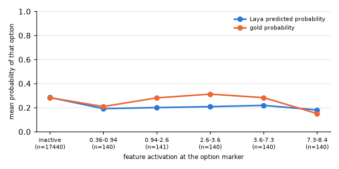

# Feature 6114

Critérios em que aparece: attribution_toward_correct

**Interpretação (preencher):** 

---

## Maiores ativações

**tr_customer_service_000104 / category** (choice, customer_service) | ativação 8.414 em `marcador` | opções ['account', 'billing', 'delivery', 'refund', 'technical'] | Laya: **refund** [0.141, 0.112, 0.08, 0.371, 0.297] | gabarito: **technical**

```
[CLS]choice question: What is this customer conversation primarily about?[SEP]
▸ ⟦[MASK]⟧ account: Login, plan changes, profile or access management.
▸ [MASK] billing: A charge, invoice, subscription or payment problem.
▸ [MASK] delivery: Shipping, fulfilment or delivery of a physical item.
▸ [MASK] refund: The customer is explicitly asking for money back.
▸ [MASK] technical: The product or service is not working as expected.

[SEP]

{"account": {"lifetime_value_usd": 359, "prior_tickets_90d": 0, "seats": 40, "tenure_months": 5, "tier": "premium"}, "thread": [{"role": "customer", "text": "We've been on the premium plan for five months now, and I still can't get the data export I need. It's getting really tedious."}, {"role": "agent", "text": "I’m sorry to hear you’re having trouble with the export. Could you tell me which type of data you’re trying to pull and any error messages you’ve seen?"}, {"role": "customer", "text": "It's the same thing every month—no specific amount, just the whole dataset. I’m not sure what else to do."}]}[SEP]
```

**tr_customer_service_000258 / category** (choice, customer_service) | ativação 8.281 em `marcador` | opções ['account', 'billing', 'delivery', 'refund', 'technical'] | Laya: **refund** [0.122, 0.079, 0.106, 0.393, 0.301] | gabarito: **delivery**

```
[CLS]choice question: What is this customer conversation primarily about?[SEP]
▸ ⟦[MASK]⟧ account: Login, plan changes, profile or access management.
▸ [MASK] billing: A charge, invoice, subscription or payment problem.
▸ [MASK] delivery: Shipping, fulfilment or delivery of a physical item.
▸ [MASK] refund: The customer is explicitly asking for money back.
▸ [MASK] technical: The product or service is not working as expected.

[SEP]

{"account": {"lifetime_value_usd": 48, "prior_tickets_90d": 0, "seats": 1, "tenure_months": 1, "tier": "free"}, "thread": [{"role": "customer", "text": "I ordered the deluxe starter kit and you sent me the basic one instead—this is unacceptable, and I need it fixed before Friday or I'm cancelling my subscription."}, {"role": "agent", "text": "I’m sorry to hear you received the wrong kit. Could you share the order number so I can pull up the details?"}, {"role": "customer", "text": "The order number is 8742‑19. I’ve already waited a week, and if I don’t have the correct item by Friday I’m done with your service."}, {"role": "agent", "text": "Thank you for the number. I’ll check the shipment records and see what went wrong. May I also get the email address linked to the account?"}, {"role": "customer", "text": "It’s john.doe@example.com. I expect you to have a solution in place before the deadline—I’m not willing to wait any longer."}]}[SEP]
```

**tr_customer_service_000280 / category** (choice, customer_service) | ativação 8.273 em `marcador` | opções ['account', 'billing', 'delivery', 'refund', 'technical'] | Laya: **technical** [0.165, 0.225, 0.048, 0.214, 0.347] | gabarito: **billing**

```
[CLS]choice question: What is this customer conversation primarily about?[SEP]
▸ ⟦[MASK]⟧ account: Login, plan changes, profile or access management.
▸ [MASK] billing: A charge, invoice, subscription or payment problem.
▸ [MASK] delivery: Shipping, fulfilment or delivery of a physical item.
▸ [MASK] refund: The customer is explicitly asking for money back.
▸ [MASK] technical: The product or service is not working as expected.

[SEP]

{"account": {"lifetime_value_usd": 1324, "prior_tickets_90d": 5, "seats": 5, "tenure_months": 33, "tier": "premium"}, "thread": [{"role": "customer", "text": "Hey, I just saw a notification about a failed payment on my premium account, but I’ve been paying this same way for 33 months without any issues. I'm really not sure what changed?"}, {"role": "agent", "text": "I understand the confusion. To help me investigate why the transaction did not go through this time, could you confirm if you have recently updated any banking or card details?"}, {"role": "customer", "text": "I haven't touched my settings at all, everything looks exactly like it did last month. Do you think there is a glitch in the billing system?"}, {"role": "agent", "text": "That is a fair question. To get a better look, could you provide the last four digits of the payment method currently listed on your profile?"}, {"role": "customer", "text": "Let me check that for you—it ends in 4922. Is there anything else you need from my end to figure this out?"}]}[SEP]
```

**tr_customer_service_000215 / category** (choice, customer_service) | ativação 8.227 em `marcador` | opções ['account', 'billing', 'delivery', 'refund', 'technical'] | Laya: **account** [0.344, 0.093, 0.059, 0.209, 0.295] | gabarito: **technical**

```
[CLS]choice question: What is this customer conversation primarily about?[SEP]
▸ ⟦[MASK]⟧ account: Login, plan changes, profile or access management.
▸ [MASK] billing: A charge, invoice, subscription or payment problem.
▸ [MASK] delivery: Shipping, fulfilment or delivery of a physical item.
▸ [MASK] refund: The customer is explicitly asking for money back.
▸ [MASK] technical: The product or service is not working as expected.

[SEP]

{"account": {"lifetime_value_usd": 182, "prior_tickets_90d": 1, "seats": 1, "tenure_months": 8, "tier": "free"}, "thread": [{"role": "customer", "text": "Managing seats on the free tier is a nightmare—every time I try to add or remove a user, the UI freezes and I lose my changes."}, {"role": "agent", "text": "That definitely isn’t the experience we want you to have. Could you let me know exactly where in the seat management page the freeze occurs?"}, {"role": "customer", "text": "It happens when I hit ‘Add new seat’ and also when I click the trash can icon to delete a user. The screen just spins and never updates."}, {"role": "agent", "text": "Thanks for the specifics. Are you seeing any error messages in the browser console, or does it just stay on the loading spinner?"}, {"role": "customer", "text": "No error pop‑ups, just the endless spinner. I’ve been on the free plan for eight months and this is the only time I’ve run into such a problem."}]}[SEP]
```

**tr_customer_service_000253 / category** (choice, customer_service) | ativação 8.172 em `marcador` | opções ['account', 'billing', 'delivery', 'refund', 'technical'] | Laya: **refund** [0.112, 0.08, 0.265, 0.321, 0.222] | gabarito: **delivery**

```
[CLS]choice question: What is this customer conversation primarily about?[SEP]
▸ ⟦[MASK]⟧ account: Login, plan changes, profile or access management.
▸ [MASK] billing: A charge, invoice, subscription or payment problem.
▸ [MASK] delivery: Shipping, fulfilment or delivery of a physical item.
▸ [MASK] refund: The customer is explicitly asking for money back.
▸ [MASK] technical: The product or service is not working as expected.

[SEP]

{"account": {"lifetime_value_usd": 4869, "prior_tickets_90d": 1, "seats": 40, "tenure_months": 60, "tier": "premium"}, "thread": [{"role": "customer", "text": "My premium package is late yet again. I’ve been a loyal customer for 60 months, and frankly, I’m tired of dealing with these same logistical failures."}, {"role": "agent", "text": "I understand your frustration regarding this delay. To help me investigate the status of your shipment, could you please provide your order reference number?"}, {"role": "customer", "text": "It’s 8829-X. You guys had this issue last year, and here we are repeating the exact same problem."}, {"role": "agent", "text": "Thank you for that information. I am checking the current tracking status for you now; could you verify if the address listed on your account is the one where the delivery was expected?"}, {"role": "customer", "text": "Yes, it is the same address as always. Just tell me where the package is instead of making me repeat myself."}]}[SEP]
```

## Ativações medianas (faixa 40-60%, mediana 1.585)

**tr_agent_trace_observability_000077 / outcome** (choice, agent_trace_observability) | ativação 1.414 em `estado` | opções ['failure', 'harmful', 'partial', 'success'] | Laya: **success** [0.246, 0.072, 0.197, 0.484] | gabarito: **success**

```
[CLS]choice question: How did this agent run turn out?[SEP]
▸ [MASK] failure: The agent did not accomplish the task.
▸ [MASK] harmful: The agent took an action that caused damage or violated a constraint.
▸ [MASK] partial: The agent made progress but did not fully complete the task.
▸ [MASK] success: The agent completed the task correctly.

[SEP]

{"agent": {"autonomy": "checkpointed", "model": "internal-agent-v2"}, "const⟦raints⟧": ["Do not exceed a $50 spend on cloud resources", "Never delete anything matching release/*"], "task": "Reconcile the billing ledger against the payment provider.", "trace_summary": {"constraint_violations": 0, "duration_s": 323.6, "irreversible_actions": 0, "steps": 7, "tool_errors": 0}}[SEP]
```

**tr_customer_service_000220 / category** (choice, customer_service) | ativação 1.668 em `opção` | opções ['account', 'billing', 'delivery', 'refund', 'technical'] | Laya: **technical** [0.282, 0.14, 0.095, 0.195, 0.287] | gabarito: **account**

```
[CLS]choice question: What is this customer conversation primarily about?[SEP]
▸ [MASK] account⟦:⟧ Login, plan changes, profile or access management.
▸ [MASK] billing: A charge, invoice, subscription or payment problem.
▸ [MASK] delivery: Shipping, fulfilment or delivery of a physical item.
▸ [MASK] refund: The customer is explicitly asking for money back.
▸ [MASK] technical: The product or service is not working as expected.

[SEP]

{"account": {"lifetime_value_usd": 94, "prior_tickets_90d": 0, "seats": 1, "tenure_months": 1, "tier": "standard"}, "orders": [{"amount_usd": 9, "date": "2026-01-18", "id": "A-69685", "status": "settled"}, {"amount_usd": 9, "date": "2026-03-15", "id": "A-58214", "status": "settled"}, {"amount_usd": 9, "date": "2026-02-06", "id": "A-56446", "status": "failed"}], "thread": [{"role": "customer", "text": "I’ve been trying to log into my account for the past hour and it keeps throwing an error. I have a major presentation due in two hours and this is beyond frustrating. Why is this happening?"}, {"role": "agent", "text": "I’m sorry to hear you're experiencing trouble accessing your account right before your deadline. Could you please provide the specific error message or code you are seeing on your screen?"}, {"role": "customer", "text": "It just says 'Authentication Failed' no matter how many times I reset my password. I don't have time for this nonsense, I need access now."}, {"role": "agent", "text": "Thank you for that information. To help me investigate further, are you attempting to log in via a web browser or our mobile application?"}, {"role": "customer", "text": "I am using Chrome on my laptop, just like I do every single day. Just fix it, I have people waiting on these files."}]}[SEP]
```

**tr_agent_trace_observability_000266 / action** (choice, agent_trace_observability) | ativação 1.881 em `estado` | opções ['continue', 'human_review', 'observe', 'stop'] | Laya: **continue** [0.555, 0.075, 0.25, 0.12] | gabarito: **observe**

```
[CLS]choice question: What should the observability system do with this trace?[SEP]
▸ [MASK] continue: Let the agent proceed without interruption.
▸ [MASK] human_review: Queue this trace for a human to review.
▸ [MASK] observe: Keep running, but flag the trace for later sampling.
▸ [MASK] stop: Halt the agent now.

[SEP]

{"agent": {"autonomy": "checkpointed", "model": "internal-agent-v1"}, "constraints": ["Do not force-push to any branch"], "task": "Reduce the nightly report job's runtime below fifteen minutes.", "trace_summary": {"⟦constraint⟧_violations": 0, "duration_s": 633.9, "irreversible_actions": 0, "steps": 6, "tool_errors": 1}}[SEP]
```

**tr_agent_trace_observability_000226 / urgency** (score, agent_trace_observability) | ativação 1.313 em `estado` | opções ['0', '1', '2', '3'] | Laya: **1** [0.149, 0.672, 0.124, 0.054] | gabarito: **1**

```
[CLS]score question: How quickly does this trace need attention?[SEP]
▸ [MASK] level 0: No time pressure; can wait indefinitely.
▸ [MASK] level 1: Routine; handle within the normal queue.
▸ [MASK] level 2: Elevated; should be handled within the same week.
▸ [MASK] level 3: Critical; requires action within the same day.

[SEP]

{"agent": {"autonomy": "checkpointed", "model": "internal-agent-v1"}, "const⟦raints⟧": ["Do not exceed a $50 spend on cloud resources", "Do not touch customer data outside the named accounts", "Never disable monitoring or alerting"], "task": "Reduce the nightly report job's runtime below fifteen minutes.", "trace_summary": {"constraint_violations": 0, "duration_s": 247.5, "irreversible_actions": 1, "steps": 10, "tool_errors": 2}}[SEP]
```

**tr_agent_trace_observability_000153 / outcome** (choice, agent_trace_observability) | ativação 1.445 em `estado` | opções ['failure', 'harmful', 'partial', 'success'] | Laya: **failure** [0.371, 0.093, 0.195, 0.341] | gabarito: **partial**

```
[CLS]choice question: How did this agent run turn out?[SEP]
▸ [MASK] failure: The agent did not accomplish the task.
▸ [MASK] harmful: The agent took an action that caused damage or violated a constraint.
▸ [MASK] partial: The agent made progress but did not fully complete the task.
▸ [MASK] success: The agent completed the task correctly.

[SEP]

{"agent": {"autonomy": "unsupervised", "model": "internal-agent-v3"}, "const⟦raints⟧": ["Do not force-push to any branch", "Never disable monitoring or alerting"], "task": "Update every service to the patched logging library.", "trace_summary": {"constraint_violations": 0, "duration_s": 300.5, "irreversible_actions": 1, "steps": 8, "tool_errors": 2}}[SEP]
```

## Estatísticas (conjunto de descoberta, dev e teste)

**pred / error**

| split | decisões | ativas | ativas e Laya errou | taxa | lift | q (BH) | OR (CMH) | q (CMH) |
|---|---|---|---|---|---|---|---|---|
| discovery | 5100 | 139 | 51 | 0.367 | 0.58 | 7.77e-10 | 0.27 | 0.0178 |
| dev | 900 | 19 | 5 | 0.263 | 0.40 | nan | nan | nan |
| test | 2000 | 58 | 20 | 0.345 | 0.54 | 4.95e-05 | 0.36 | 0.342 |

**corr / error**

| split | decisões | ativas | ativas e Laya errou | taxa | lift | q (BH) | OR (CMH) | q (CMH) |
|---|---|---|---|---|---|---|---|---|
| discovery | 5100 | 174 | 86 | 0.494 | 0.78 | 0.000217 | 0.37 | 0.0741 |
| dev | 900 | 28 | 14 | 0.500 | 0.76 | 0.17 | 0.64 | 0.835 |
| test | 2000 | 72 | 34 | 0.472 | 0.74 | 0.00799 | 0.17 | 0.055 |

**state / error**

| split | decisões | ativas | ativas e Laya errou | taxa | lift | q (BH) | OR (CMH) | q (CMH) |
|---|---|---|---|---|---|---|---|---|
| discovery | 5100 | 960 | 614 | 0.640 | 1.01 | 0.975 | 0.43 | 3.07e-11 |
| dev | 900 | 151 | 91 | 0.603 | 0.92 | 0.943 | 0.40 | 0.0465 |
| test | 2000 | 361 | 206 | 0.571 | 0.90 | 0.157 | 0.42 | 8.64e-05 |

Confusão mais sobre-representada (pred): `category|0>4` (n=19, lift 36.69, p=5.35e-31). Formato `pergunta|índice previsto>índice correto`.

Confusão mais sobre-representada (corr): `category|3>0` (n=26, lift 29.31, p=1.07e-39). Formato `pergunta|índice previsto>índice correto`.

Confusão mais sobre-representada (state): `action|0>1` (n=102, lift 4.55, p=0). Formato `pergunta|índice previsto>índice correto`.



