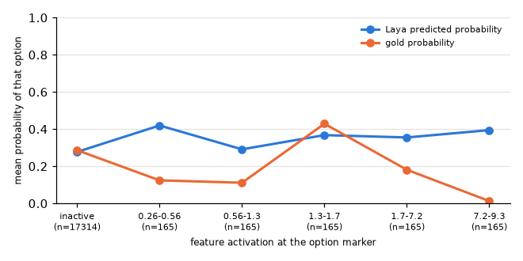

# Feature 6211

Critérios em que aparece: pred_error_stratified, attribution_toward_wrong

**Interpretação (preencher):** 

---

## Maiores ativações

**tr_customer_service_000295 / action** (choice, customer_service) | ativação 9.344 em `marcador` | opções ['answer_directly', 'close_no_action', 'escalate_to_human', 'execute_refund', 'request_information'] | Laya: **close_no_action** [0.289, 0.347, 0.09, 0.097, 0.177] | gabarito: **escalate_to_human**

```
[CLS]choice question: What should the assistant do next with this conversation?[SEP]
▸ [MASK] answer_directly: The assistant can resolve this itself with information it already has.
▸ ⟦[MASK]⟧ close_no_action: No further action is warranted; the matter is settled.
▸ [MASK] escalate_to_human: Hand off to a human agent with the appropriate authority.
▸ [MASK] execute_refund: Issue the refund or credit the customer is owed.
▸ [MASK] request_information: More detail is needed from the customer before anything can be done.

[SEP]

{"account": {"lifetime_value_usd": 4435, "prior_tickets_90d": 1, "seats": 3, "tenure_months": 49, "tier": "enterprise"}, "thread": [{"role": "customer", "text": "Our enterprise dashboard is crawling—pages take over a minute to load, and our team can’t meet the rollout deadline tomorrow. This needs to be fixed ASAP."}, {"role": "agent", "text": "I’m sorry you’re seeing that slowdown. Could you tell me which modules are affected and whether the latency started after the recent update you mentioned in ticket #98765?"}, {"role": "customer", "text": "It’s the analytics and reporting sections, and yes, the issue reappeared after the last patch. We need an immediate investigation; let me know what you can do before the deadline."}]}[SEP]
```

**tr_customer_service_000077 / action** (choice, customer_service) | ativação 9.312 em `marcador` | opções ['answer_directly', 'close_no_action', 'escalate_to_human', 'execute_refund', 'request_information'] | Laya: **close_no_action** [0.212, 0.364, 0.13, 0.124, 0.171] | gabarito: **request_information**

```
[CLS]choice question: What should the assistant do next with this conversation?[SEP]
▸ [MASK] answer_directly: The assistant can resolve this itself with information it already has.
▸ ⟦[MASK]⟧ close_no_action: No further action is warranted; the matter is settled.
▸ [MASK] escalate_to_human: Hand off to a human agent with the appropriate authority.
▸ [MASK] execute_refund: Issue the refund or credit the customer is owed.
▸ [MASK] request_information: More detail is needed from the customer before anything can be done.

[SEP]

{"account": {"lifetime_value_usd": 579, "prior_tickets_90d": 2, "seats": 1, "tenure_months": 11, "tier": "free"}, "thread": [{"role": "customer", "text": "I noticed an unexpected charge on my account today. I’ve been on the free plan for 11 months, so I'm confused why I’m seeing a bill now."}, {"role": "agent", "text": "Thank you for bringing this to our attention. I would like to investigate this charge for you; could you confirm the date the transaction appeared on your statement?"}, {"role": "customer", "text": "It appeared on my dashboard yesterday morning. I’ve had issues with incorrect billing promises before, so I’d appreciate it if you could clarify what this is for."}]}[SEP]
```

**tr_customer_service_000161 / action** (choice, customer_service) | ativação 9.312 em `marcador` | opções ['answer_directly', 'close_no_action', 'escalate_to_human', 'execute_refund', 'request_information'] | Laya: **close_no_action** [0.236, 0.444, 0.149, 0.07, 0.102] | gabarito: **escalate_to_human**

```
[CLS]choice question: What should the assistant do next with this conversation?[SEP]
▸ [MASK] answer_directly: The assistant can resolve this itself with information it already has.
▸ ⟦[MASK]⟧ close_no_action: No further action is warranted; the matter is settled.
▸ [MASK] escalate_to_human: Hand off to a human agent with the appropriate authority.
▸ [MASK] execute_refund: Issue the refund or credit the customer is owed.
▸ [MASK] request_information: More detail is needed from the customer before anything can be done.

[SEP]

{"account": {"lifetime_value_usd": 2849, "prior_tickets_90d": 0, "seats": 40, "tenure_months": 72, "tier": "enterprise"}, "thread": [{"role": "customer", "text": "I’m a bit lost on how to downgrade my enterprise account; everything I try just loops back to the same page."}, {"role": "agent", "text": "Sorry for the confusion—could you tell me which part of the portal is giving you trouble?"}, {"role": "customer", "text": "When I click “Change Plan” nothing happens, and I need the downgrade done before Friday, so I’m not sure what to do next."}]}[SEP]
```

**tr_customer_service_000131 / action** (choice, customer_service) | ativação 9.125 em `marcador` | opções ['answer_directly', 'close_no_action', 'escalate_to_human', 'execute_refund', 'request_information'] | Laya: **close_no_action** [0.19, 0.421, 0.153, 0.13, 0.105] | gabarito: **request_information**

```
[CLS]choice question: What should the assistant do next with this conversation?[SEP]
▸ [MASK] answer_directly: The assistant can resolve this itself with information it already has.
▸ ⟦[MASK]⟧ close_no_action: No further action is warranted; the matter is settled.
▸ [MASK] escalate_to_human: Hand off to a human agent with the appropriate authority.
▸ [MASK] execute_refund: Issue the refund or credit the customer is owed.
▸ [MASK] request_information: More detail is needed from the customer before anything can be done.

[SEP]

{"account": {"lifetime_value_usd": 1583, "prior_tickets_90d": 2, "seats": 1, "tenure_months": 72, "tier": "standard"}, "orders": [{"amount_usd": 299, "date": "2026-02-13", "id": "A-60442", "status": "failed"}], "thread": [{"role": "customer", "text": "Good afternoon, I’ve noticed that my recent payment for the standard plan didn’t go through. I’ve been subscribed for six years now, and I’ve previously raised two tickets about billing that were only partially resolved."}, {"role": "agent", "text": "I’m sorry for the inconvenience. Could you provide the date of the attempted transaction and any reference number you received?"}, {"role": "customer", "text": "The payment attempt was on August 10, and the reference number shown on my bank statement is TXN‑20230810‑001. Please advise what steps we should take next."}]}[SEP]
```

**tr_customer_service_000202 / action** (choice, customer_service) | ativação 9.039 em `marcador` | opções ['answer_directly', 'close_no_action', 'escalate_to_human', 'execute_refund', 'request_information'] | Laya: **close_no_action** [0.249, 0.458, 0.104, 0.055, 0.132] | gabarito: **escalate_to_human**

```
[CLS]choice question: What should the assistant do next with this conversation?[SEP]
▸ [MASK] answer_directly: The assistant can resolve this itself with information it already has.
▸ ⟦[MASK]⟧ close_no_action: No further action is warranted; the matter is settled.
▸ [MASK] escalate_to_human: Hand off to a human agent with the appropriate authority.
▸ [MASK] execute_refund: Issue the refund or credit the customer is owed.
▸ [MASK] request_information: More detail is needed from the customer before anything can be done.

[SEP]

{"account": {"lifetime_value_usd": 271, "prior_tickets_90d": 1, "seats": 1, "tenure_months": 11, "tier": "free"}, "thread": [{"role": "customer", "text": "Your new analytics dashboard stopped updating two hours ago, and I’ve been trying to get this fixed all day—this is unacceptable!"}, {"role": "agent", "text": "I understand your frustration. Can you tell me which browser and version you’re using, and whether you see any error messages?"}, {"role": "customer", "text": "I’m on Chrome 115, and the page just shows a blank screen with a 500 error. I need this working by tomorrow’s reporting deadline, so I expect a quick response."}]}[SEP]
```

## Ativações medianas (faixa 40-60%, mediana 1.652)

**tr_invoice_processing_000134 / discrepancy_severity** (score, invoice_processing) | ativação 1.934 em `marcador` | opções ['0', '1', '2', '3'] | Laya: **0** [0.325, 0.258, 0.205, 0.212] | gabarito: **0**

```
[CLS]score question: How material is any discrepancy between the invoice, the order and the delivery?[SEP]
▸ ⟦[MASK]⟧ level 0: None: everything reconciles.
▸ [MASK] level 1: Trivial: rounding or a cosmetic difference.
▸ [MASK] level 2: Moderate: a real difference worth confirming.
▸ [MASK] level 3: Material: a large or unexplained difference.

[SEP]

{"delivery": {"condition": "accepted", "date": "2026-03-15", "received_qty": 10}, "invoice": {"currency": "USD", "id": "INV-2026-2470", "lines": [{"qty": 10, "sku": "SKU-529", "total_usd": 1797.7, "unit_usd": 179.77}], "total_usd": 1797.7, "vendor": "Pallas Industrial"}, "payment": {"days_until_due": 2, "discount_expires_in_days": 3, "early_payment_discount_pct": 2.0, "status": "scheduled", "terms": "net 30"}, "purchase_order": {"freight_terms": "freight prepaid by vendor, not separately billable", "id": null, "lines": [{"qty": 10, "unit_usd": 179.77}], "total_usd": 1797.7}, "vendor_history": {"disputes_12m": 0, "invoices_12m": 43, "prior_invoice_ids": ["INV-2026-2034"]}}[SEP]
```

**tr_invoice_processing_000079 / discrepancy_severity** (score, invoice_processing) | ativação 1.557 em `marcador` | opções ['0', '1', '2', '3'] | Laya: **0** [0.435, 0.23, 0.202, 0.132] | gabarito: **2**

```
[CLS]score question: How material is any discrepancy between the invoice, the order and the delivery?[SEP]
▸ ⟦[MASK]⟧ level 0: None: everything reconciles.
▸ [MASK] level 1: Trivial: rounding or a cosmetic difference.
▸ [MASK] level 2: Moderate: a real difference worth confirming.
▸ [MASK] level 3: Material: a large or unexplained difference.

[SEP]

{"delivery": {"condition": "accepted", "date": "2026-03-16", "received_qty": 380}, "invoice": {"currency": "USD", "id": "INV-2026-7833", "lines": [{"qty": 380, "sku": "SKU-873", "total_usd": 103420.8, "unit_usd": 272.16}], "total_usd": 103420.8, "vendor": "Pallas Industrial"}, "payment": {"days_until_due": 2, "discount_expires_in_days": null, "early_payment_discount_pct": null, "status": "scheduled", "terms": "net 30"}, "purchase_order": {"freight_terms": "freight prepaid by vendor, not separately billable", "id": "PO-8346", "lines": [{"qty": 400, "unit_usd": 272.16}], "total_usd": 108864.0}, "vendor_history": {"disputes_12m": 0, "invoices_12m": 43, "prior_invoice_ids": ["INV-2026-8967", "INV-2026-2028", "INV-2026-4787", "INV-2026-5782"]}}[SEP]
```

**tr_customer_service_000172 / action** (choice, customer_service) | ativação 2.754 em `opção` | opções ['answer_directly', 'close_no_action', 'escalate_to_human', 'execute_refund', 'request_information'] | Laya: **escalate_to_human** [0.222, 0.228, 0.248, 0.104, 0.197] | gabarito: **escalate_to_human**

```
[CLS]choice question: What should the assistant do next with this conversation?[SEP]
▸ [MASK] answer_directly: The assistant can resolve this itself with information it already has.
▸ [MASK] close_no⟦_⟧action: No further action is warranted; the matter is settled.
▸ [MASK] escalate_to_human: Hand off to a human agent with the appropriate authority.
▸ [MASK] execute_refund: Issue the refund or credit the customer is owed.
▸ [MASK] request_information: More detail is needed from the customer before anything can be done.

[SEP]

{"account": {"lifetime_value_usd": 131, "prior_tickets_90d": 0, "seats": 5, "tenure_months": 5, "tier": "premium"}, "thread": [{"role": "customer", "text": "Hi, I'm really scratching my head here. My package says it was delivered yesterday, but I've been checking my porch all morning and there's absolutely nothing. I've been with you for five months on the premium plan and this has never happened."}, {"role": "agent", "text": "I’m sorry to hear that you haven't received your package yet. Could you please confirm the tracking number you are referring to so I can take a look?"}, {"role": "customer", "text": "The tracking number is 94001000. I'm just so confused because the status hasn't updated since yesterday morning. I really need this by tomorrow afternoon for a presentation."}, {"role": "agent", "text": "Thank you for providing that number. I am pulling up your account details now. Could you tell me if you have checked with any neighbors or a building manager in the meantime?"}, {"role": "customer", "text": "I did check with my neighbor, but they didn't see anything. I'm worried because I'm on a tight timeline here. Is there any way to see exactly where the driver left it?"}, {"role": "agent", "text": "I understand your concern given your upcoming deadline. I need to reach out to our logistics partner to get more information on the delivery scan; could you confirm the exact address on file?"}, {"role": "customer", "text": "It's 442 Maple Drive. I just hope this gets sorted out quickly because I really can't miss this deadline."}]}[SEP]
```

**tr_customer_service_000234 / action** (choice, customer_service) | ativação 1.320 em `estado` | opções ['answer_directly', 'close_no_action', 'escalate_to_human', 'execute_refund', 'request_information'] | Laya: **close_no_action** [0.192, 0.47, 0.13, 0.1, 0.108] | gabarito: **request_information**

```
[CLS]choice question: What should the assistant do next with this conversation?[SEP]
▸ [MASK] answer_directly: The assistant can resolve this itself with information it already has.
▸ [MASK] close_no_action: No further action is warranted; the matter is settled.
▸ [MASK] escalate_to_human: Hand off to a human agent with the appropriate authority.
▸ [MASK] execute_refund: Issue the refund or credit the customer is owed.
▸ [MASK] request_information: More detail is needed from the customer before anything can be done.

[SEP]

{"account": {"lifetime_value_usd": 1458, "prior_tickets_90d": 0, "seats": 3, "tenure_months": 33, "tier": "premium"}, "thread": [{"role": "customer", "text": "I’ve been paying for this premium plan for 33 months without a single hitch, but now I’m completely locked out and I have a hard deadline in two hours. Why is the login screen just spinning?"}, {"role": "agent", "text": "I’m sorry to hear you're experiencing this frustration right now. Could you please confirm the exact error message or code you are seeing when the page hangs?"}, {"role": "customer", "text": "⟦There⟧ is no code! It’s just a blank page after I enter my credentials. I have a massive report due for my firm by noon and I can’t get in to export the data. This is ridiculous."}, {"role": "agent", "text": "I understand the urgency of this report. To help me narrow down the cause, are you accessing the portal through a browser or our desktop application?"}, {"role": "customer", "text": "I’m using Chrome on my desktop. I’ve already cleared my cache and tried an incognito window, so don't even suggest that. Fix this now."}]}[SEP]
```

**tr_customer_service_000154 / urgency** (score, customer_service) | ativação 1.568 em `estado` | opções ['0', '1', '2', '3'] | Laya: **1** [0.15, 0.609, 0.094, 0.147] | gabarito: **1**

```
[CLS]score question: How time-sensitive is this conversation?[SEP]
▸ [MASK] level 0: No time pressure; can wait indefinitely.
▸ [MASK] level 1: Routine; handle within the normal queue.
▸ [MASK] level 2: Elevated; should be handled within the same week.
▸ [MASK] level 3: Critical; requires action within the same day.

[SEP]

{"account": {"lifetime_value_usd": 1803, "prior_tickets_90d": 0, "seats": 1, "tenure_months": 19, "tier": "free"}, "orders": [{"amount_usd": 198, "date": "2026-02-24", "id": "A-56491", "status": "refunded"}, {"amount_usd": 198, "date": "2026-02-25", "id": "A-17184", "status": "settled"}], "thread": [{"role": "customer", "text": "My attempt to upload a PDF to the project folder keeps timing out after a few seconds."}, {"role": "agent", "text": "Understood. Are you seeing any error messages,⟦ or⟧ does the process simply stop?"}, {"role": "customer", "text": "It just stops; the spinner spins forever, no error text appears."}, {"role": "agent", "text": "Thanks for clarifying. Have you tried clearing your browser cache or using a different browser?"}, {"role": "customer", "text": "I tried Chrome incognito and it behaved the same way."}]}[SEP]
```

## Estatísticas (conjunto de descoberta, dev e teste)

**pred / error**

| split | decisões | ativas | ativas e Laya errou | taxa | lift | q (BH) | OR (CMH) | q (CMH) |
|---|---|---|---|---|---|---|---|---|
| discovery | 5100 | 637 | 514 | 0.807 | 1.27 | 7.01e-22 | 2.57 | 0.0012 |
| dev | 900 | 116 | 89 | 0.767 | 1.17 | 0.0605 | 2.09 | 0.401 |
| test | 2000 | 241 | 192 | 0.797 | 1.25 | 1.51e-07 | 5.11 | 0.00274 |

**corr / error**

| split | decisões | ativas | ativas e Laya errou | taxa | lift | q (BH) | OR (CMH) | q (CMH) |
|---|---|---|---|---|---|---|---|---|
| discovery | 5100 | 136 | 13 | 0.096 | 0.15 | 4.1e-39 | 0.27 | 0.0749 |
| dev | 900 | 29 | 2 | 0.069 | 0.11 | 5.88e-10 | 0.00 | 0.244 |
| test | 2000 | 52 | 3 | 0.058 | 0.09 | 1.5e-17 | 0.00 | 0.359 |

**state / error**

| split | decisões | ativas | ativas e Laya errou | taxa | lift | q (BH) | OR (CMH) | q (CMH) |
|---|---|---|---|---|---|---|---|---|
| discovery | 5100 | 397 | 257 | 0.647 | 1.02 | 0.891 | 1.25 | 0.18 |
| dev | 900 | 83 | 47 | 0.566 | 0.86 | 0.838 | 0.71 | 0.474 |
| test | 2000 | 147 | 94 | 0.639 | 1.00 | 1 | 1.13 | 0.755 |

Confusão mais sobre-representada (pred): `action|1>2` (n=125, lift 8.01, p=0). Formato `pergunta|índice previsto>índice correto`.

Confusão mais sobre-representada (corr): `discrepancy_severity|2>0` (n=5, lift 37.50, p=1.25e-08). Formato `pergunta|índice previsto>índice correto`.

Confusão mais sobre-representada (state): `discrepancy_severity|0>3` (n=26, lift 5.22, p=2.56e-13). Formato `pergunta|índice previsto>índice correto`.



