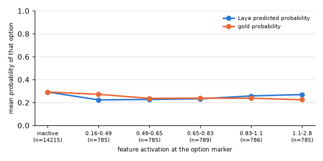

# Feature 6418

Critérios em que aparece: pred_error_stratified, attribution_toward_correct

**Interpretação (preencher):** 

---

## Maiores ativações

**tr_invoice_processing_000036 / matches_order** (noul, invoice_processing) | ativação 5.805 em `estado` | opções ['false', 'true'] | Laya: **true** [0.478, 0.522] | gabarito: **false**

```
[CLS]noul question: The invoice reconciles with the purchase order and the recorded delivery.[SEP]
▸ [MASK] false: There is a discrepancy against the order or the delivery.
▸ [MASK] true: Line items, quantities and amounts reconcile.

[SEP]

{"delivery": {"condition": "accepted", "date": "2026-03-15", "received_qty": 250}, "invoice": {"currency": "USD", "id": "INV-2026-5401", "lines": [{"qty": 250, "sku": "SKU-440", "total_usd": 12045.0, "unit_usd": 48.18}, {"qty": 1, "sku": "FREIGHT", "⟦total⟧_usd": 646.19, "unit_usd": 646.19}], "total_usd": 12691.19, "vendor": "Orbit Logistics"}, "payment": {"days_until_due": 27, "discount_expires_in_days": 7, "early_payment_discount_pct": 2.0, "status": "scheduled", "terms": "net 30"}, "purchase_order": {"freight_terms": "freight prepaid by vendor, not separately billable", "id": "PO-4489", "lines": [{"qty": 250, "unit_usd": 48.18}], "total_usd": 12045.0}, "vendor_history": {"disputes_12m": 1, "invoices_12m": 53, "prior_invoice_ids": ["INV-2026-1271", "INV-2026-5652", "INV-2026-6719", "INV-2026-7885"]}}[SEP]
```

**tr_invoice_processing_000055 / matches_order** (noul, invoice_processing) | ativação 5.285 em `estado` | opções ['false', 'true'] | Laya: **true** [0.485, 0.515] | gabarito: **true**

```
[CLS]noul question: The invoice reconciles with the purchase order and the recorded delivery.[SEP]
▸ [MASK] false: There is a discrepancy against the order or the delivery.
▸ [MASK] true: Line items, quantities and amounts reconcile.

[SEP]

{"delivery": {"condition": "accepted", "date": "2026-03-24", "received_qty": 10}, "invoice": {"currency": "USD", "id": "INV-2026-2278", "lines": [{"qty": 10, "sku": "SKU-174", "total_usd": 2565.⟦3⟧, "unit_usd": 256.53}], "total_usd": 2565.3, "vendor": "Orbit Logistics"}, "payment": {"days_until_due": 44, "discount_expires_in_days": null, "early_payment_discount_pct": null, "status": "scheduled", "terms": "net 15"}, "purchase_order": {"freight_terms": "freight prepaid by vendor, not separately billable", "id": "PO-1729", "lines": [{"qty": 10, "unit_usd": 256.53}], "total_usd": 2565.3}, "vendor_history": {"disputes_12m": 2, "invoices_12m": 35, "prior_invoice_ids": ["INV-2026-2466", "INV-2026-1629", "INV-2026-2511", "INV-2026-3620"]}}[SEP]
```

**tr_security_incidents_000022 / severity** (score, security_incidents) | ativação 5.039 em `opção` | opções ['0', '1', '2', '3', '4'] | Laya: **1** [0.059, 0.387, 0.387, 0.134, 0.033] | gabarito: **1**

```
[CLS]score question: How severe is the potential impact if this alert is real?[SEP]
▸ [MASK] level 0: Negligible: no access to anything sensitive.
▸ [MASK] level⟦ 1⟧: Low: limited access, easily reversed.
▸ [MASK] level 2: Moderate: access to internal systems or non-public data.
▸ [MASK] level 3: High: access to production, secrets or customer data.
▸ [MASK] level 4: Critical: active compromise of crown-jewel systems.

[SEP]

{"alert": {"description": "a first-ever sign-in from an unfamiliar country", "evidence": "A CI runner principal performed a successful sign-in from a geographic location not previously associated with this account's history. The authentication involved MFA-protected credentials rotated one year ago and originated from an allowlisted source outside of a scheduled change window.", "rule": "new_country_login"}, "context": {"asset_criticality": "medium", "change_window_active": false, "source_on_allowlist": true}, "history": {"credential_rotation_days_ago": 365, "distinct_countries_30d": 1, "logins_30d": 1967, "prior_alerts_90d": 3}, "principal": {"mfa_enrolled": true, "name": "usr-analytics-668", "privileges": ["repo:read"], "type": "ci_runner"}}[SEP]
```

**tr_security_incidents_000299 / severity** (score, security_incidents) | ativação 5.039 em `opção` | opções ['0', '1', '2', '3', '4'] | Laya: **3** [0.05, 0.165, 0.272, 0.372, 0.14] | gabarito: **3**

```
[CLS]score question: How severe is the potential impact if this alert is real?[SEP]
▸ [MASK] level 0: Negligible: no access to anything sensitive.
▸ [MASK] level 1: Low: limited access, easily reversed.
▸ [MASK] level 2:⟦ Mod⟧erate: access to internal systems or non-public data.
▸ [MASK] level 3: High: access to production, secrets or customer data.
▸ [MASK] level 4: Critical: active compromise of crown-jewel systems.

[SEP]

{"alert": {"description": "an unusual volume of files read in a short window", "evidence": "A privileged administrator account without MFA enabled initiated an unusually high volume of file read operations from an unrecognized source. This activity took place during a non-change window, exactly 30 days after the principal's credentials were last updated.", "rule": "mass_download"}, "context": {"asset_criticality": "medium", "change_window_active": false, "source_on_allowlist": false}, "history": {"credential_rotation_days_ago": 30, "distinct_countries_30d": 4, "logins_30d": 1329, "prior_alerts_90d": 0}, "principal": {"mfa_enrolled": false, "name": "svc-analytics-679", "privileges": ["deploy:production", "secrets:read"], "type": "admin"}}[SEP]
```

**tr_security_incidents_000039 / credential_compromise** (noul, security_incidents) | ativação 4.988 em `estado` | opções ['false', 'true'] | Laya: **true** [0.169, 0.831] | gabarito: **true**

```
[CLS]noul question: The evidence indicates a credential or account has been compromised.[SEP]
▸ [MASK] false: no, the statement does not hold
▸ [MASK] true: yes, the statement holds

[SEP]

{"alert": {"description": "an endpoint agent matched a known signature", "evidence": "At 2026-09-15 14:23:07 UTC the endpoint agent on host WIN-01 flagged the file C:\\Temp\\malware.exe (SHA1=3a5b7c9d4e) as matching the known malware_signature. The detection was logged under the privileged service account svc_backup, which has MFA disabled and whose password was last rotated 14 days prior. The source identifier for the event is on the allowlist.", "rule": "malware_signature"}, "context": {"asset_criticality": "high", "change_window_active": false, "source_on_allowlist": true}, "history": {"credential_rotation_days_ago": 14, "distinct_countries_30d": 3, "logins_30d": 304, "prior_⟦alert⟧s_90d": 8}, "principal": {"mfa_enrolled": false, "name": "adm-infra-473", "privileges": ["deploy:production", "secrets:read"], "type": "service_account"}}[SEP]
```

## Ativações medianas (faixa 40-60%, mediana 0.903)

**tr_customer_service_000224 / churn_risk** (score, customer_service) | ativação 0.792 em `opção` | opções ['0', '1', '2', '3'] | Laya: **1** [0.259, 0.295, 0.208, 0.238] | gabarito: **1**

```
[CLS]score question: How likely is this customer to stop doing business with us because of this interaction?[SEP]
▸ [MASK] level 0: No sign of dissatisfaction.
▸ [MASK] level 1: Mild frustration, but the relationship is intact.
▸ [MASK] level 2: Clearly unhappy; repeat problems or explicit complaints.
▸ [MASK] level 3: Im⟦minent⟧: threatening to cancel, dispute or leave.

[SEP]

{"account": {"lifetime_value_usd": 3096, "prior_tickets_90d": 1, "seats": 1, "tenure_months": 60, "tier": "standard"}, "thread": [{"role": "customer", "text": "I’ve been on the standard plan for five years, but the bulk export feature has stopped working since the last update."}, {"role": "agent", "text": "I am sorry to hear you're experiencing trouble with the export tool. Could you please confirm if you're receiving a specific error code when you attempt the download?"}, {"role": "customer", "text": "There isn't an error code; the progress bar just freezes at 20% and stays there until the page times out."}, {"role": "agent", "text": "Thank you for that clarification. Have you attempted clearing your browser cache or trying a different browser to see if the export completes?"}, {"role": "customer", "text": "I tried both of those after our last ticket, but the result was the same."}]}[SEP]
```

**tr_security_incidents_000223 / urgency** (score, security_incidents) | ativação 0.955 em `estado` | opções ['0', '1', '2', '3'] | Laya: **1** [0.083, 0.67, 0.126, 0.122] | gabarito: **2**

```
[CLS]score question: How quickly must a responder act on this alert?[SEP]
▸ [MASK] level 0: No time pressure; can wait indefinitely.
▸ [MASK] level 1: Routine; handle within the normal queue.
▸ [MASK] level 2: Elevated; should be handled within the same week.
▸ [MASK] level 3: Critical; requires action within the same day.

[SEP]

{"alert": {"description": "a long-unused account became active", "evidence": "The CI runner account \"gitlab-runner-23\" showed no activity for 180 days before a pipeline execution was logged at 2026-09-15T14:22:37Z from source IP 198.51.100.12. The principal is unprivileged, MFA is enabled, and the account's credentials were last rotated 180 days ago.", "rule": "dormant_account_use"}, "context": {"asset_criticality": "medium", "change_window_active": false, "source_on_allowlist": false}, "history": {"credential_rotation_days_ago": 180, "distinct_countries_30d": 4, "logins_30d": 222, "prior_alerts_90d": 8}, "principal": {"mfa_enrolled": true, "name⟦":⟧ "adm-infra-101", "privileges": ["repo:read"], "type": "ci_runner"}}[SEP]
```

**tr_invoice_processing_000145 / urgency** (score, invoice_processing) | ativação 1.036 em `estado` | opções ['0', '1', '2', '3'] | Laya: **1** [0.198, 0.521, 0.169, 0.112] | gabarito: **1**

```
[CLS]score question: How time-sensitive is processing this invoice?[SEP]
▸ [MASK] level 0: No time pressure; can wait indefinitely.
▸ [MASK] level 1: Routine; handle within the normal queue.
▸ [MASK] level 2: Elevated; should be handled within the same week.
▸ [MASK] level 3: Critical; requires action within the same day.

[SEP]

{"delivery": {"condition": "accepted", "date": null, "received_qty": 0}, "invoice": {"currency": "USD", "id": "INV-2026-2395", "lines": [{"qty": 10, "sku": "SKU-397", "total_usd": 242.8, "unit_usd": 24.28}], "total_usd": 242.8, "vendor": "Orbit Logistics"}, "payment": {"days_until_due": 44, "discount_expires_in_days": null, "early_payment_discount_pct": null, "status": "scheduled", "terms": "net 30"}, "purchase_order": {"freight_terms": "freight prepaid by vendor, not separately billable", "id": "PO-5010", "lines": [{"qty": 10, "unit_usd": 24.28}], "total_usd": 242.8}, "vendor_history": {"disputes_12m": 0, "invoices_12m": 30, "prior_invoice_ids": ["INV-2026-4693", "IN⟦V⟧-2026-7769"]}}[SEP]
```

**tr_customer_service_000068 / category** (choice, customer_service) | ativação 0.863 em `estado` | opções ['account', 'billing', 'delivery', 'refund', 'technical'] | Laya: **refund** [0.224, 0.11, 0.066, 0.372, 0.228] | gabarito: **technical**

```
[CLS]choice question: What is this customer conversation primarily about?[SEP]
▸ [MASK] account: Login, plan changes, profile or access management.
▸ [MASK] billing: A charge, invoice, subscription or payment problem.
▸ [MASK] delivery: Shipping, fulfilment or delivery of a physical item.
▸ [MASK] refund: The customer is explicitly asking for money back.
▸ [MASK] technical: The product or service is not working as expected.

[SEP]

{"account": {"lifetime_value_usd": 1781, "prior_tickets_90d": 1, "seats": 1, "tenure_months": 19, "tier": "standard"}, "orders": [{"amount_usd": 999, "date": "2026-03-09", "id": "A-22295", "status": "pending"}, {"amount_usd": 999, "date": "2026-03-17", "id": "A-32594", "status": "refunded"},⟦ {"⟧amount_usd": 999, "date": "2026-03-04", "id": "A-42545", "status": "refunded"}], "thread": [{"role": "customer", "text": "Hello, I’ve been on the standard plan for about 19 months now (roughly $999 total) and I’m experiencing unusually slow performance across the board. I opened a ticket a while back that never got resolved, and I really need this sorted out before my project deadline this Friday."}, {"role": "agent", "text": "I’m sorry to hear that you’re still seeing slow speeds. Could you let me know when the slowdown first became noticeable and which specific features or tasks are most affected?"}, {"role": "customer", "text": "It started about two days ago, especially when I try to load the dashboard or run the monthly reports—everything takes double the usual time. With the deadline looming, any insight you can share would be appreciated."}]}[SEP]
```

**tr_invoice_processing_000169 / disposition** (choice, invoice_processing) | ativação 0.800 em `estado` | opções ['approve', 'hold', 'manual_review', 'reject'] | Laya: **approve** [0.57, 0.158, 0.092, 0.18] | gabarito: **approve**

```
[CLS]choice question: How should this vendor invoice be dispositioned?[SEP]
▸ [MASK] approve: Matches the order and delivery; approve for payment.
▸ [MASK] hold: Something needs confirming before payment; hold pending clarification.
▸ [MASK] manual_review: A human in finance must review the discrepancy.
▸ [MASK] reject: Should not be paid: duplicate, unauthorised or materially wrong.

[SEP]

{"delivery": {"condition": "accepted", "date": "2026-03-20", "received_qty": 400}, "invoice": {"currency": "USD", "id": "INV-2026-2565", "lines": [{"qty": 400, "sku": "SKU-890", "total_usd": 22948.0, "unit_usd": 57.37}], "total_usd": 22948.0, "vendor": "Kestrel Supply"}, "payment": {"days_until_due": 2, "discount_expires_in_days": null, "early_payment_discount_pct": null, "status": "scheduled", "terms": "net 15"}, "purchase_order": {"freight_terms": "freight prepaid by vendor, not separately billable", "id": "PO-1197", "lines": [{"qty": 400, "unit_usd": 57.37}], "total_usd": 22948.0}, "vendor_history": {"disputes_12m": 0, "invoices_12m": 39, "prior_invoice_ids": ["INV-2026-8904", "INV-⟦20⟧26-5420", "INV-2026-1117", "INV-2026-2620"]}}[SEP]
```

## Estatísticas (conjunto de descoberta, dev e teste)

**pred / error**

| split | decisões | ativas | ativas e Laya errou | taxa | lift | q (BH) | OR (CMH) | q (CMH) |
|---|---|---|---|---|---|---|---|---|
| discovery | 5100 | 1029 | 801 | 0.778 | 1.22 | 3.76e-26 | 2.05 | 4.61e-11 |
| dev | 900 | 167 | 138 | 0.826 | 1.26 | 3.42e-05 | 3.58 | 0.000171 |
| test | 2000 | 393 | 319 | 0.812 | 1.27 | 3.26e-15 | 2.56 | 2.54e-06 |

**corr / error**

| split | decisões | ativas | ativas e Laya errou | taxa | lift | q (BH) | OR (CMH) | q (CMH) |
|---|---|---|---|---|---|---|---|---|
| discovery | 5100 | 974 | 746 | 0.766 | 1.20 | 5.7e-21 | 1.23 | 0.398 |
| dev | 900 | 156 | 127 | 0.814 | 1.24 | 1.2e-05 | 2.59 | 0.203 |
| test | 2000 | 378 | 304 | 0.804 | 1.26 | 6.72e-14 | 1.24 | 0.642 |

**state / error**

| split | decisões | ativas | ativas e Laya errou | taxa | lift | q (BH) | OR (CMH) | q (CMH) |
|---|---|---|---|---|---|---|---|---|
| discovery | 5100 | 4704 | 2964 | 0.630 | 0.99 | 0.0275 | 1.35 | 0.13 |
| dev | 900 | 840 | 553 | 0.658 | 1.00 | 1 | 1.57 | 0.472 |
| test | 2000 | 1851 | 1187 | 0.641 | 1.01 | 0.662 | 1.61 | 0.103 |

Confusão mais sobre-representada (pred): `severity|2>3` (n=82, lift 4.90, p=0). Formato `pergunta|índice previsto>índice correto`.

Confusão mais sobre-representada (corr): `disposition|0>2` (n=149, lift 3.26, p=0). Formato `pergunta|índice previsto>índice correto`.

Confusão mais sobre-representada (state): `urgency|1>3` (n=292, lift 1.08, p=2.71e-11). Formato `pergunta|índice previsto>índice correto`.



