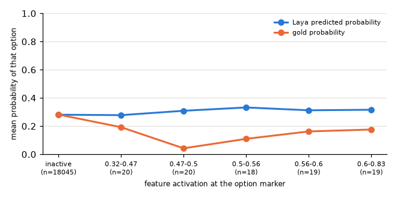

# Feature 6546

Critérios em que aparece: pred_error

**Interpretação (preencher):** 

---

## Maiores ativações

**tr_security_incidents_000269 / true_positive** (noul, security_incidents) | ativação 1.612 em `estado` | opções ['false', 'true'] | Laya: **true** [0.493, 0.507] | gabarito: **false**

```
[CLS]noul question: This alert reflects genuinely malicious or unauthorised activity.[SEP]
▸ [MASK] false: Benign activity, a misconfiguration, or a known false positive.
▸ [MASK] true: The underlying behaviour is malicious or unauthorised.

[SEP]

{"alert": {"description": "an unrecognised binary executed on a server", "evidence": "A binary not present in the approved inventory, located at /var/tmp/abcdef (SHA256 =⟦ ⟧d1e2f3a4…), executed on server 192.168.100.9 at 2026-09-15 22:18:03 UTC. The launch was performed by admin user \"bob\" using an MFA‑authenticated session, and the user’s credentials have not been rotated for 365 days (last rotation 2025-09-16).", "rule": "suspicious_process"}, "context": {"asset_criticality": "low", "change_window_active": false, "source_on_allowlist": true}, "history": {"credential_rotation_days_ago": 365, "distinct_countries_30d": 2, "logins_30d": 948, "prior_alerts_90d": 0}, "principal": {"mfa_enrolled": true, "name": "adm-infra-548", "privileges": ["repo:read"], "type": "admin"}}[SEP]
```

**tr_customer_service_000033 / action** (choice, customer_service) | ativação 1.485 em `estado` | opções ['answer_directly', 'close_no_action', 'escalate_to_human', 'execute_refund', 'request_information'] | Laya: **close_no_action** [0.167, 0.375, 0.208, 0.067, 0.183] | gabarito: **escalate_to_human**

```
[CLS]choice question: What should the assistant do next with this conversation?[SEP]
▸ [MASK] answer_directly: The assistant can resolve this itself with information it already has.
▸ [MASK] close_no_action: No further action is warranted; the matter is settled.
▸ [MASK] escalate_to_human: Hand off to a human agent with the appropriate authority.
▸ [MASK] execute_refund: Issue the refund or credit the customer is owed.
▸ [MASK] request_information: More detail is needed from the customer before anything can be done.

[SEP]

{"account": {"lifetime_value_usd": 972, "prior_tickets_90d": 3, "seats": 1, "tenure_months": 49, "tier": "free"}, "orders": [{"amount_usd": 999, "date": "2026-03-06", "id": "A-72271", "status": "settled"}, {"amount_usd": 999, "date": "2026-02-16", "id": "A-14198", "status": "settled"}, {"amount_usd": 999, "date": "2026-01-05", "id": "A-90678", "status": "settled"}], "thread": [{"role": "customer", "text": "I've been trying to downgrade to the free plan for three days now and the website just keeps looping me back to the dashboard. This is incredibly annoying given I've been a loyal user for over four years."}, {"role": "agent", "text": "I'm sorry for the frustration the downgrade process is causing. Could you tell me if you are seeing any specific error codes or pop-up messages when the page refreshes?"}, {"role": "customer", "text": "There are no codes, it just fails silently. I've spent almost a thousand dollars with you guys over 49 months, and after having three previous tickets only 'partially⟦'⟧ addressed, I really expected a simple plan change to actually work."}, {"role": "agent", "text": "I appreciate your long-term history with us. To help me investigate the account block, would you mind specifying which features from those three previous tickets are still causing you issues on your current plan?"}, {"role": "customer", "text": "The seat management and the data exports never worked right, which is why I'm trying to scale back. I'm just tired of paying for a service that feels broken every time I try to adjust my settings."}]}[SEP]
```

**tr_security_incidents_000267 / credential_compromise** (noul, security_incidents) | ativação 1.462 em `estado` | opções ['false', 'true'] | Laya: **true** [0.275, 0.725] | gabarito: **false**

```
[CLS]noul question: The evidence indicates a credential or account has been compromised.[SEP]
▸ [MASK] false: no, the statement does not hold
▸ [MASK] true: yes, the statement holds

[SEP]

{"alert": {"description": "an unrecognised binary executed on a server", "evidence": "At 2026-09-16 01:45:12 UTC, an executable located at /usr/local/bin/unknown_service (SHA256 =⟦ ⟧3f7a9c2e…) was launched on server 172.16.45.22. The process was started by the admin account \"admin1\" under an MFA‑authenticated session, and the account’s credentials were last rotated on 2026-09-13.", "rule": "suspicious_process"}, "context": {"asset_criticality": "medium", "change_window_active": false, "source_on_allowlist": true}, "history": {"credential_rotation_days_ago": 3, "distinct_countries_30d": 4, "logins_30d": 1334, "prior_alerts_90d": 1}, "principal": {"mfa_enrolled": true, "name": "adm-deploy-493", "privileges": ["deploy:production", "secrets:read"], "type": "admin"}}[SEP]
```

**tr_customer_service_000033 / churn_risk** (score, customer_service) | ativação 1.407 em `estado` | opções ['0', '1', '2', '3'] | Laya: **2** [0.064, 0.202, 0.558, 0.176] | gabarito: **3**

```
[CLS]score question: How likely is this customer to stop doing business with us because of this interaction?[SEP]
▸ [MASK] level 0: No sign of dissatisfaction.
▸ [MASK] level 1: Mild frustration, but the relationship is intact.
▸ [MASK] level 2: Clearly unhappy; repeat problems or explicit complaints.
▸ [MASK] level 3: Imminent: threatening to cancel, dispute or leave.

[SEP]

{"account": {"lifetime_value_usd": 972, "prior_tickets_90d": 3, "seats": 1, "tenure_months": 49, "tier": "free"}, "orders": [{"amount_usd": 999, "date": "2026-03-06", "id": "A-72271", "status": "settled"}, {"amount_usd": 999, "date": "2026-02-16", "id": "A-14198", "status": "settled"}, {"amount_usd": 999, "date": "2026-01-05", "id": "A-90678", "status": "settled"}], "thread": [{"role": "customer", "text": "I've been trying to downgrade to the free plan for three days now and the website just keeps looping me back to the dashboard. This is incredibly annoying given I've been a loyal user for over four years."}, {"role": "agent", "text": "I'm sorry for the frustration the downgrade process is causing. Could you tell me if you are seeing any specific error codes or pop-up messages when the page refreshes?"}, {"role": "customer", "text": "There are no codes, it just fails silently. I've spent almost a thousand dollars with you guys over 49 months, and after having three previous tickets only 'partially⟦'⟧ addressed, I really expected a simple plan change to actually work."}, {"role": "agent", "text": "I appreciate your long-term history with us. To help me investigate the account block, would you mind specifying which features from those three previous tickets are still causing you issues on your current plan?"}, {"role": "customer", "text": "The seat management and the data exports never worked right, which is why I'm trying to scale back. I'm just tired of paying for a service that feels broken every time I try to adjust my settings."}]}[SEP]
```

**tr_customer_service_000033 / needs_human** (noul, customer_service) | ativação 1.396 em `estado` | opções ['false', 'true'] | Laya: **true** [0.416, 0.584] | gabarito: **true**

```
[CLS]noul question: This conversation requires a human agent rather than automated handling.[SEP]
▸ [MASK] false: Automation can carry this to resolution.
▸ [MASK] true: A human must take over: judgement, authority or empathy is required.

[SEP]

{"account": {"lifetime_value_usd": 972, "prior_tickets_90d": 3, "seats": 1, "tenure_months": 49, "tier": "free"}, "orders": [{"amount_usd": 999, "date": "2026-03-06", "id": "A-72271", "status": "settled"}, {"amount_usd": 999, "date": "2026-02-16", "id": "A-14198", "status": "settled"}, {"amount_usd": 999, "date": "2026-01-05", "id": "A-90678", "status": "settled"}], "thread": [{"role": "customer", "text": "I've been trying to downgrade to the free plan for three days now and the website just keeps looping me back to the dashboard. This is incredibly annoying given I've been a loyal user for over four years."}, {"role": "agent", "text": "I'm sorry for the frustration the downgrade process is causing. Could you tell me if you are seeing any specific error codes or pop-up messages when the page refreshes?"}, {"role": "customer", "text": "There are no codes, it just fails silently. I've spent almost a thousand dollars with you guys over 49 months, and after having three previous tickets only 'partially⟦'⟧ addressed, I really expected a simple plan change to actually work."}, {"role": "agent", "text": "I appreciate your long-term history with us. To help me investigate the account block, would you mind specifying which features from those three previous tickets are still causing you issues on your current plan?"}, {"role": "customer", "text": "The seat management and the data exports never worked right, which is why I'm trying to scale back. I'm just tired of paying for a service that feels broken every time I try to adjust my settings."}]}[SEP]
```

## Ativações medianas (faixa 40-60%, mediana 0.519)

**tr_customer_service_000013 / churn_risk** (score, customer_service) | ativação 0.513 em `opção` | opções ['0', '1', '2', '3'] | Laya: **3** [0.215, 0.234, 0.152, 0.399] | gabarito: **3**

```
[CLS]score question: How likely is this customer to stop doing business with us because of this interaction?[SEP]
▸ [MASK] level 0: No sign of dissatisfaction.
▸ [MASK] level 1: Mild frustration, but the relationship is intact.
▸ [MASK] level 2: Clearly unhappy; repeat problems or explicit complaints.
▸ [MASK] level 3: Imminent⟦:⟧ threatening to cancel, dispute or leave.

[SEP]

{"account": {"lifetime_value_usd": 148, "prior_tickets_90d": 0, "seats": 40, "tenure_months": 3, "tier": "enterprise"}, "orders": [{"amount_usd": 198, "date": "2026-03-15", "id": "A-40361", "status": "failed"}, {"amount_usd": 198, "date": "2026-01-06", "id": "A-31584", "status": "settled"}, {"amount_usd": 198, "date": "2026-03-27", "id": "A-12899", "status": "pending"}], "thread": [{"role": "customer", "text": "Our latest invoice shows $198 for the enterprise plan, but my contract says $149. This discrepancy needs fixing, or I’ll have to look elsewhere; I need this resolved by the 15th."}, {"role": "agent", "text": "I understand the pricing concern. Can you confirm the billing period the invoice covers and attach the invoice file?"}, {"role": "customer", "text": "It covers March to May, and I’ve attached the PDF. I’m also considering canceling if we can’t sort it out quickly."}, {"role": "agent", "text": "Thanks for the details. Do you have a copy of the original agreement or any previous invoices for comparison?"}, {"role": "customer", "text": "Yes, the original agreement is in the email from January; I’ll forward it. I need a clear answer before the 15th deadline we discussed."}, {"role": "agent", "text": "Got it. I’ll review the documents. In the meantime, could you tell me if any discounts were applied that you’re aware of?"}, {"role": "customer", "text": "No discounts that I know of. I’m waiting for your clarification so I can decide whether to stay or move on."}]}[SEP]
```

**tr_customer_service_000136 / action** (choice, customer_service) | ativação 0.504 em `marcador` | opções ['answer_directly', 'close_no_action', 'escalate_to_human', 'execute_refund', 'request_information'] | Laya: **close_no_action** [0.161, 0.235, 0.223, 0.223, 0.158] | gabarito: **escalate_to_human**

```
[CLS]choice question: What should the assistant do next with this conversation?[SEP]
▸ [MASK] answer_directly: The assistant can resolve this itself with information it already has.
▸ [MASK] close_no_action: No further action is warranted; the matter is settled.
▸ ⟦[MASK]⟧ escalate_to_human: Hand off to a human agent with the appropriate authority.
▸ [MASK] execute_refund: Issue the refund or credit the customer is owed.
▸ [MASK] request_information: More detail is needed from the customer before anything can be done.

[SEP]

{"account": {"lifetime_value_usd": 151, "prior_tickets_90d": 0, "seats": 1, "tenure_months": 2, "tier": "free"}, "orders": [{"amount_usd": 2997, "date": "2026-02-27", "id": "A-95428", "status": "refunded"}], "thread": [{"role": "customer", "text": "I just got my latest invoice and it shows a charge of $2,997—something I never signed up for. I've only been on the free plan for two months and this is urgent, please explain why this amount is appearing."}, {"role": "agent", "text": "I’m sorry to hear about the surprise charge. Could you share the invoice number or the date it was issued so I can look into the details?"}, {"role": "customer", "text": "The invoice is #INV-8392, dated August 5th. I didn’t receive any notice about upgrading, and I’m still under the free tier."}, {"role": "agent", "text": "Thank you for that information. I’ll verify the account activity around that date. Did you perhaps receive any promotional email that might have triggered an automatic upgrade?"}, {"role": "customer", "text": "No, I haven’t seen any promotion, and I never clicked any upgrade link. I need to know what happened before this gets billed again."}, {"role": "agent", "text": "Understood. I’ll check the billing logs and see if there’s a misapplied charge. Meanwhile, could you confirm the primary email address on the account?"}, {"role": "customer", "text": "The email is jessica.rivera@example.com. Please let me know what you find as soon as possible."}]}[SEP]
```

**tr_invoice_processing_000066 / matches_order** (noul, invoice_processing) | ativação 0.538 em `estado` | opções ['false', 'true'] | Laya: **true** [0.467, 0.533] | gabarito: **true**

```
[CLS]noul question: The invoice reconciles with the purchase order and the recorded delivery.[SEP]
▸ [MASK] false: There is a discrepancy against the order or the delivery.
▸ [MASK] true: Line items, quantities and amounts reconcile.

[SEP]

{"delivery": {"condition": "accepted", "date": "2026-03-26", "received_qty": 250}, "invoice": {"currency": "USD", "id": "INV-2026-6387", "lines": [{"qty": 250, "sku": "SKU-563", "total_usd": 57015.0, "unit_usd⟦":⟧ 228.06}], "total_usd": 57015.0, "vendor": "Kestrel Supply"}, "payment": {"days_until_due": 11, "discount_expires_in_days": 5, "early_payment_discount_pct": 2.0, "status": "scheduled", "terms": "net 15"}, "purchase_order": {"freight_terms": "freight prepaid by vendor, not separately billable", "id": "PO-1938", "lines": [{"qty": 250, "unit_usd": 228.06}], "total_usd": 57015.0}, "vendor_history": {"disputes_12m": 5, "invoices_12m": 57, "prior_invoice_ids": ["INV-2026-2067", "INV-2026-4476", "INV-2026-9946", "INV-2026-4487"]}}[SEP]
```

**tr_customer_service_000264 / category** (choice, customer_service) | ativação 0.540 em `marcador` | opções ['account', 'billing', 'delivery', 'refund', 'technical'] | Laya: **billing** [0.107, 0.322, 0.042, 0.298, 0.231] | gabarito: **billing**

```
[CLS]choice question: What is this customer conversation primarily about?[SEP]
▸ [MASK] account: Login, plan changes, profile or access management.
▸ ⟦[MASK]⟧ billing: A charge, invoice, subscription or payment problem.
▸ [MASK] delivery: Shipping, fulfilment or delivery of a physical item.
▸ [MASK] refund: The customer is explicitly asking for money back.
▸ [MASK] technical: The product or service is not working as expected.

[SEP]

{"account": {"lifetime_value_usd": 166, "prior_tickets_90d": 2, "seats": 1, "tenure_months": 3, "tier": "standard"}, "thread": [{"role": "customer", "text": "I’m looking at my statement and see I’ve been hit with another duplicate charge for my standard plan. This is the third time now, and those last two tickets I opened resulted in absolutely nothing but empty promises from your team."}, {"role": "agent", "text": "I understand how frustrating it is to see recurring billing issues like this, and I apologize that your previous experience hasn't met expectations. Could you please provide the dates of those specific charges so I can pull up the transaction history?"}, {"role": "customer", "text": "It’s happened on the 15th of each of the last three months. I've already sent these dates in twice before, so I’m really not sure why you need them again."}, {"role": "agent", "text": "Thank you for clarifying that timeline. I am currently cross-referencing your billing records with the account activity; could you confirm if you have received any automated notification emails regarding these specific transaction dates?"}, {"role": "customer", "text": "I haven't seen a single email about these charges, which is exactly why this is so confusing. I’m just trying to get this sorted out once and for all."}]}[SEP]
```

**tr_security_incidents_000290 / severity** (score, security_incidents) | ativação 0.545 em `opção` | opções ['0', '1', '2', '3', '4'] | Laya: **2** [0.029, 0.256, 0.452, 0.207, 0.055] | gabarito: **3**

```
[CLS]score question: How severe is the potential impact if this alert is real?[SEP]
▸ [MASK] level 0: Negligible: no access to anything sensitive.
▸ [MASK] level 1: Low: limited access, easily reversed.
▸ [MASK] level 2: Moderate: access to internal systems or non-public data.
▸ [MASK] level 3: High⟦:⟧ access to production, secrets or customer data.
▸ [MASK] level 4: Critical: active compromise of crown-jewel systems.

[SEP]

{"alert": {"description": "a first-ever sign-in from an unfamiliar country", "evidence": "A privileged service account named svc_backup_01 logged in from IP 185.12.34.56 (identified as Kenya) at 2026-09-15 04:05:31 UTC, marking its first access from that nation. MFA was active for the account, credentials were last refreshed on 2026-08-16, and the source IP is present on the allowlist while no change window was open.", "rule": "new_country_login"}, "context": {"asset_criticality": "medium", "change_window_active": false, "source_on_allowlist": true}, "history": {"credential_rotation_days_ago": 30, "distinct_countries_30d": 3, "logins_30d": 724, "prior_alerts_90d": 0}, "principal": {"mfa_enrolled": true, "name": "ci-support-122", "privileges": ["deploy:production", "secrets:read"], "type": "service_account"}}[SEP]
```

## Estatísticas (conjunto de descoberta, dev e teste)

**pred / error**

| split | decisões | ativas | ativas e Laya errou | taxa | lift | q (BH) | OR (CMH) | q (CMH) |
|---|---|---|---|---|---|---|---|---|
| discovery | 5100 | 59 | 56 | 0.949 | 1.49 | 1.58e-07 | 2.42 | 0.674 |
| dev | 900 | 6 | 6 | 1.000 | 1.52 | nan | nan | nan |
| test | 2000 | 33 | 30 | 0.909 | 1.43 | 0.00214 | 0.00 | 0.837 |

**corr / error**

| split | decisões | ativas | ativas e Laya errou | taxa | lift | q (BH) | OR (CMH) | q (CMH) |
|---|---|---|---|---|---|---|---|---|
| discovery | 5100 | 13 | 10 | 0.769 | 1.21 | nan | nan | nan |
| dev | 900 | 0 | 0 | nan | nan | nan | nan | nan |
| test | 2000 | 13 | 10 | 0.769 | 1.21 | nan | nan | nan |

**state / error**

| split | decisões | ativas | ativas e Laya errou | taxa | lift | q (BH) | OR (CMH) | q (CMH) |
|---|---|---|---|---|---|---|---|---|
| discovery | 5100 | 188 | 122 | 0.649 | 1.02 | 0.941 | 1.03 | 0.928 |
| dev | 900 | 30 | 17 | 0.567 | 0.86 | 1 | 0.61 | 0.482 |
| test | 2000 | 94 | 61 | 0.649 | 1.02 | 1 | 0.96 | 0.941 |

Confusão mais sobre-representada (pred): `action|1>2` (n=36, lift 24.89, p=4.2e-45). Formato `pergunta|índice previsto>índice correto`.

Confusão mais sobre-representada (corr): `category|0>1` (n=3, lift 117.69, p=nan). Formato `pergunta|índice previsto>índice correto`.

Confusão mais sobre-representada (state): `duplicate|1>0` (n=26, lift 3.27, p=5.88e-08). Formato `pergunta|índice previsto>índice correto`.



