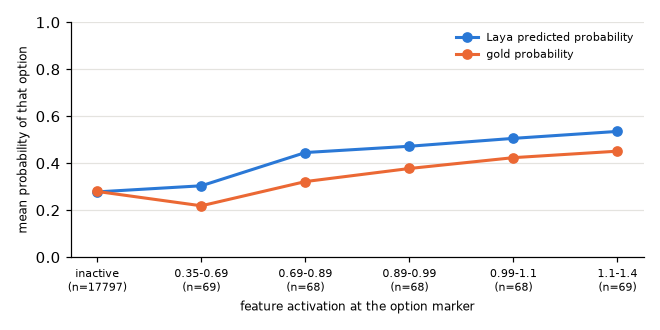

# Feature 6577

Critérios em que aparece: attribution_toward_wrong

**Interpretação (preencher):** 

---

## Maiores ativações

**tr_customer_service_000071 / action** (choice, customer_service) | ativação 2.391 em `estado` | opções ['answer_directly', 'close_no_action', 'escalate_to_human', 'execute_refund', 'request_information'] | Laya: **close_no_action** [0.213, 0.271, 0.126, 0.211, 0.179] | gabarito: **answer_directly**

```
[CLS]choice question: What should the assistant do next with this conversation?[SEP]
▸ [MASK] answer_directly: The assistant can resolve this itself with information it already has.
▸ [MASK] close_no_action: No further action is warranted; the matter is settled.
▸ [MASK] escalate_to_human: Hand off to a human agent with the appropriate authority.
▸ [MASK] execute_refund: Issue the refund or credit the customer is owed.
▸ [MASK] request_information: More detail is needed from the customer before anything can be done.

[SEP]

{"account": {"lifetime_value_usd": 34, "prior_tickets_90d": 0, "seats": 5, "tenure_months": 1, "tier": "premium"}, "orders": [{"amount_usd": 49, "date": "2026-03-16", "id": "A-22387", "status": "refunded"}], "thread": [{"role": "customer", "text": "I want to cancel the account. We're on the premium plan, about $49 a month, and we've only been using it for a month."}, {"role": "agent", "text": "I can help with that. Could you let me know whether you want to cancel at the end of the current billing period or immediately, if immediate cancellation is an option?"}, {"role": "customer", "text": "I'd prefer it to stop at the end of the current period. I don't want to continue into another month."}, {"role": "agent", "text": "Understood. Could you also confirm whether you want to keep any data until the current period ends, or have you already completed your migration?"}, {"role": "customer", "text": "We still need read-only access until the period ends. After that, the account can be closed."}, {"role": "agent", "text": "I understand. For the record, is this⟦ a⟧ standard account cancellation, or do you need a specific invoice or final access request included in the cancellation note?"}, {"role": "customer", "text": "Standard cancellation. If a final invoice is generated, please make sure it reflects the current period only."}]}[SEP]
```

**tr_customer_service_000071 / urgency** (score, customer_service) | ativação 2.281 em `estado` | opções ['0', '1', '2', '3'] | Laya: **1** [0.117, 0.63, 0.111, 0.142] | gabarito: **1**

```
[CLS]score question: How time-sensitive is this conversation?[SEP]
▸ [MASK] level 0: No time pressure; can wait indefinitely.
▸ [MASK] level 1: Routine; handle within the normal queue.
▸ [MASK] level 2: Elevated; should be handled within the same week.
▸ [MASK] level 3: Critical; requires action within the same day.

[SEP]

{"account": {"lifetime_value_usd": 34, "prior_tickets_90d": 0, "seats": 5, "tenure_months": 1, "tier": "premium"}, "orders": [{"amount_usd": 49, "date": "2026-03-16", "id": "A-22387", "status": "refunded"}], "thread": [{"role": "customer", "text": "I want to cancel the account. We're on the premium plan, about $49 a month, and we've only been using it for a month."}, {"role": "agent", "text": "I can help with that. Could you let me know whether you want to cancel at the end of the current billing period or immediately, if immediate cancellation is an option?"}, {"role": "customer", "text": "I'd prefer it to stop at the end of the current period. I don't want to continue into another month."}, {"role": "agent", "text": "Understood. Could you also confirm whether you want to keep any data until the current period ends, or have you already completed your migration?"}, {"role": "customer", "text": "We still need read-only access until the period ends. After that, the account can be closed."}, {"role": "agent", "text": "I understand. For the record, is this⟦ a⟧ standard account cancellation, or do you need a specific invoice or final access request included in the cancellation note?"}, {"role": "customer", "text": "Standard cancellation. If a final invoice is generated, please make sure it reflects the current period only."}]}[SEP]
```

**tr_customer_service_000065 / category** (choice, customer_service) | ativação 1.978 em `estado` | opções ['account', 'billing', 'delivery', 'refund', 'technical'] | Laya: **refund** [0.083, 0.089, 0.025, 0.696, 0.107] | gabarito: **technical**

```
[CLS]choice question: What is this customer conversation primarily about?[SEP]
▸ [MASK] account: Login, plan changes, profile or access management.
▸ [MASK] billing: A charge, invoice, subscription or payment problem.
▸ [MASK] delivery: Shipping, fulfilment or delivery of a physical item.
▸ [MASK] refund: The customer is explicitly asking for money back.
▸ [MASK] technical: The product or service is not working as expected.

[SEP]

{"account": {"lifetime_value_usd": 586, "prior_tickets_90d": 0, "seats": 1, "tenure_months": 19, "tier": "standard"}, "orders": [{"amount_usd": 99, "date": "2026-02-21", "id": "A-35676", "status": "settled"}, {"amount_usd": 99, "date": "2026-02-28", "id": "A-65097", "status": "failed"}, {"amount_usd": 99, "date": "2026-03-26", "id": "A-82387", "status": "refunded"}], "thread": [{"role": "customer", "text": "I'm trying to export my data and I can't find any option to do it. This is confusing, and if I can't get it sorted by Friday, I'm going to have to look elsewhere."}, {"role": "agent", "text": "Sorry for the trouble. Could you let me know which data set you're after and whether you need it⟦ in⟧ CSV or JSON format?"}, {"role": "customer", "text": "I need the full activity log for the past six months in CSV. It's critical for my reporting deadline this Friday."}]}[SEP]
```

**tr_customer_service_000071 / churn_risk** (score, customer_service) | ativação 1.959 em `estado` | opções ['0', '1', '2', '3'] | Laya: **1** [0.146, 0.313, 0.268, 0.273] | gabarito: **3**

```
[CLS]score question: How likely is this customer to stop doing business with us because of this interaction?[SEP]
▸ [MASK] level 0: No sign of dissatisfaction.
▸ [MASK] level 1: Mild frustration, but the relationship is intact.
▸ [MASK] level 2: Clearly unhappy; repeat problems or explicit complaints.
▸ [MASK] level 3: Imminent: threatening to cancel, dispute or leave.

[SEP]

{"account": {"lifetime_value_usd": 34, "prior_tickets_90d": 0, "seats": 5, "tenure_months": 1, "tier": "premium"}, "orders": [{"amount_usd": 49, "date": "2026-03-16", "id": "A-22387", "status": "refunded"}], "thread": [{"role": "customer", "text": "I want to cancel the account. We're on the premium plan, about $49 a month, and we've only been using it for a month."}, {"role": "agent", "text": "I can help with that. Could you let me know whether you want to cancel at the end of the current billing period or immediately, if immediate cancellation is an option?"}, {"role": "customer", "text": "I'd prefer it to stop at the end of the current period. I don't want to continue into another month."}, {"role": "agent", "text": "Understood. Could you also confirm whether you want to keep any data until the current period ends, or have you already completed your migration?"}, {"role": "customer", "text": "We still need read-only access until the period ends. After that, the account can be closed."}, {"role": "agent", "text": "I understand. For the record, is this⟦ a⟧ standard account cancellation, or do you need a specific invoice or final access request included in the cancellation note?"}, {"role": "customer", "text": "Standard cancellation. If a final invoice is generated, please make sure it reflects the current period only."}]}[SEP]
```

**tr_customer_service_000071 / category** (choice, customer_service) | ativação 1.953 em `estado` | opções ['account', 'billing', 'delivery', 'refund', 'technical'] | Laya: **refund** [0.192, 0.279, 0.021, 0.435, 0.074] | gabarito: **account**

```
[CLS]choice question: What is this customer conversation primarily about?[SEP]
▸ [MASK] account: Login, plan changes, profile or access management.
▸ [MASK] billing: A charge, invoice, subscription or payment problem.
▸ [MASK] delivery: Shipping, fulfilment or delivery of a physical item.
▸ [MASK] refund: The customer is explicitly asking for money back.
▸ [MASK] technical: The product or service is not working as expected.

[SEP]

{"account": {"lifetime_value_usd": 34, "prior_tickets_90d": 0, "seats": 5, "tenure_months": 1, "tier": "premium"}, "orders": [{"amount_usd": 49, "date": "2026-03-16", "id": "A-22387", "status": "refunded"}], "thread": [{"role": "customer", "text": "I want to cancel the account. We're on the premium plan, about $49 a month, and we've only been using it for a month."}, {"role": "agent", "text": "I can help with that. Could you let me know whether you want to cancel at the end of the current billing period or immediately, if immediate cancellation is an option?"}, {"role": "customer", "text": "I'd prefer it to stop at the end of the current period. I don't want to continue into another month."}, {"role": "agent", "text": "Understood. Could you also confirm whether you want to keep any data until the current period ends, or have you already completed your migration?"}, {"role": "customer", "text": "We still need read-only access until the period ends. After that, the account can be closed."}, {"role": "agent", "text": "I understand. For the record, is this⟦ a⟧ standard account cancellation, or do you need a specific invoice or final access request included in the cancellation note?"}, {"role": "customer", "text": "Standard cancellation. If a final invoice is generated, please make sure it reflects the current period only."}]}[SEP]
```

## Ativações medianas (faixa 40-60%, mediana 0.710)

**tr_invoice_processing_000123 / urgency** (score, invoice_processing) | ativação 0.701 em `pergunta` | opções ['0', '1', '2', '3'] | Laya: **1** [0.254, 0.535, 0.124, 0.086] | gabarito: **2**

```
[CLS]score question:⟦ How⟧ time-sensitive is processing this invoice?[SEP]
▸ [MASK] level 0: No time pressure; can wait indefinitely.
▸ [MASK] level 1: Routine; handle within the normal queue.
▸ [MASK] level 2: Elevated; should be handled within the same week.
▸ [MASK] level 3: Critical; requires action within the same day.

[SEP]

{"delivery": {"condition": "accepted with exceptions", "date": "2026-03-08", "received_qty": 50}, "invoice": {"currency": "USD", "id": "INV-2026-5267", "lines": [{"qty": 50, "sku": "SKU-916", "total_usd": 22219.0, "unit_usd": 444.38}, {"qty": 1, "sku": "FREIGHT", "total_usd": 1147.63, "unit_usd": 1147.63}], "total_usd": 23366.63, "vendor": "Acme Fabrication"}, "payment": {"days_until_due": 18, "discount_expires_in_days": 2, "early_payment_discount_pct": 2.0, "status": "scheduled", "terms": "net 30"}, "purchase_order": {"freight_terms": "freight prepaid by vendor, not separately billable", "id": "PO-2802", "lines": [{"qty": 50, "unit_usd": 444.38}], "total_usd": 22219.0}, "vendor_history": {"disputes_12m": 0, "invoices_12m": 22, "prior_invoice_ids": ["INV-2026-3885", "INV-2026-7284"]}}[SEP]
```

**tr_invoice_processing_000210 / urgency** (score, invoice_processing) | ativação 0.681 em `pergunta` | opções ['0', '1', '2', '3'] | Laya: **1** [0.25, 0.466, 0.174, 0.111] | gabarito: **2**

```
[CLS]score question:⟦ How⟧ time-sensitive is processing this invoice?[SEP]
▸ [MASK] level 0: No time pressure; can wait indefinitely.
▸ [MASK] level 1: Routine; handle within the normal queue.
▸ [MASK] level 2: Elevated; should be handled within the same week.
▸ [MASK] level 3: Critical; requires action within the same day.

[SEP]

{"delivery": {"condition": "accepted", "date": "2026-03-05", "received_qty": 80}, "invoice": {"currency": "USD", "id": "INV-2026-6684", "lines": [{"qty": 80, "sku": "SKU-630", "total_usd": 33030.4, "unit_usd": 412.88}], "total_usd": 33030.4, "vendor": "Kestrel Supply"}, "payment": {"days_until_due": -21, "discount_expires_in_days": null, "early_payment_discount_pct": null, "status": "overdue", "terms": "net 15"}, "purchase_order": {"freight_terms": "freight prepaid by vendor, not separately billable", "id": "PO-6644", "lines": [{"qty": 100, "unit_usd": 412.88}], "total_usd": 41288.0}, "vendor_history": {"disputes_12m": 0, "invoices_12m": 4, "prior_invoice_ids": ["INV-2026-1588"]}}[SEP]
```

**tr_security_incidents_000019 / credential_compromise** (noul, security_incidents) | ativação 0.680 em `pergunta` | opções ['false', 'true'] | Laya: **true** [0.13, 0.87] | gabarito: **false**

```
[CLS]noul question: The evidence indicates a credential or account⟦ has⟧ been compromised.[SEP]
▸ [MASK] false: no, the statement does not hold
▸ [MASK] true: yes, the statement holds

[SEP]

{"alert": {"description": "an unrecognised binary executed on a server", "evidence": "A privileged service account executed an unrecognized binary titled 'db_sync_tool' on the production server during an open change window. The execution was traced to an allowlisted source IP, and logs show the account credentials have not been rotated for 180 days. MFA authentication was successfully verified for this privileged session.", "rule": "suspicious_process"}, "context": {"asset_criticality": "crown_jewel", "change_window_active": true, "source_on_allowlist": true}, "history": {"credential_rotation_days_ago": 180, "distinct_countries_30d": 4, "logins_30d": 1491, "prior_alerts_90d": 3}, "principal": {"mfa_enrolled": true, "name": "usr-deploy-880", "privileges": ["deploy:production", "secrets:read"], "type": "service_account"}}[SEP]
```

**tr_invoice_processing_000122 / urgency** (score, invoice_processing) | ativação 0.696 em `pergunta` | opções ['0', '1', '2', '3'] | Laya: **1** [0.221, 0.516, 0.184, 0.08] | gabarito: **3**

```
[CLS]score question:⟦ How⟧ time-sensitive is processing this invoice?[SEP]
▸ [MASK] level 0: No time pressure; can wait indefinitely.
▸ [MASK] level 1: Routine; handle within the normal queue.
▸ [MASK] level 2: Elevated; should be handled within the same week.
▸ [MASK] level 3: Critical; requires action within the same day.

[SEP]

{"delivery": {"condition": "accepted", "date": "2026-03-06", "received_qty": 50}, "invoice": {"currency": "USD", "id": "INV-2026-6710", "lines": [{"qty": 50, "sku": "SKU-535", "total_usd": 12689.0, "unit_usd": 253.78}], "total_usd": 12689.0, "vendor": "Vantage Materials"}, "payment": {"days_until_due": 0, "discount_expires_in_days": null, "early_payment_discount_pct": null, "status": "scheduled", "terms": "net 30"}, "purchase_order": {"freight_terms": "freight prepaid by vendor, not separately billable", "id": "PO-6025", "lines": [{"qty": 50, "unit_usd": 253.78}], "total_usd": 12689.0}, "vendor_history": {"disputes_12m": 0, "invoices_12m": 35, "prior_invoice_ids": ["INV-2026-6710"]}}[SEP]
```

**tr_customer_service_000154 / urgency** (score, customer_service) | ativação 0.685 em `opção` | opções ['0', '1', '2', '3'] | Laya: **1** [0.15, 0.609, 0.094, 0.147] | gabarito: **1**

```
[CLS]score question: How time-sensitive is this conversation?[SEP]
▸ [MASK] level 0: No time pressure; can wait indefinitely.
▸ [MASK] level 1⟦:⟧ Routine; handle within the normal queue.
▸ [MASK] level 2: Elevated; should be handled within the same week.
▸ [MASK] level 3: Critical; requires action within the same day.

[SEP]

{"account": {"lifetime_value_usd": 1803, "prior_tickets_90d": 0, "seats": 1, "tenure_months": 19, "tier": "free"}, "orders": [{"amount_usd": 198, "date": "2026-02-24", "id": "A-56491", "status": "refunded"}, {"amount_usd": 198, "date": "2026-02-25", "id": "A-17184", "status": "settled"}], "thread": [{"role": "customer", "text": "My attempt to upload a PDF to the project folder keeps timing out after a few seconds."}, {"role": "agent", "text": "Understood. Are you seeing any error messages, or does the process simply stop?"}, {"role": "customer", "text": "It just stops; the spinner spins forever, no error text appears."}, {"role": "agent", "text": "Thanks for clarifying. Have you tried clearing your browser cache or using a different browser?"}, {"role": "customer", "text": "I tried Chrome incognito and it behaved the same way."}]}[SEP]
```

## Estatísticas (conjunto de descoberta, dev e teste)

**pred / error**

| split | decisões | ativas | ativas e Laya errou | taxa | lift | q (BH) | OR (CMH) | q (CMH) |
|---|---|---|---|---|---|---|---|---|
| discovery | 5100 | 291 | 172 | 0.591 | 0.93 | 0.168 | 0.14 | 1.61e-16 |
| dev | 900 | 66 | 38 | 0.576 | 0.88 | 0.46 | 0.15 | 0.00651 |
| test | 2000 | 109 | 60 | 0.550 | 0.86 | 0.115 | 0.04 | 8.85e-10 |

**corr / error**

| split | decisões | ativas | ativas e Laya errou | taxa | lift | q (BH) | OR (CMH) | q (CMH) |
|---|---|---|---|---|---|---|---|---|
| discovery | 5100 | 130 | 11 | 0.085 | 0.13 | 3.99e-39 | 0.11 | 1.38e-05 |
| dev | 900 | 29 | 1 | 0.034 | 0.05 | 2.83e-11 | 0.00 | 0.335 |
| test | 2000 | 55 | 6 | 0.109 | 0.17 | 3.55e-15 | 0.04 | 0.113 |

**state / error**

| split | decisões | ativas | ativas e Laya errou | taxa | lift | q (BH) | OR (CMH) | q (CMH) |
|---|---|---|---|---|---|---|---|---|
| discovery | 5100 | 922 | 609 | 0.661 | 1.04 | 0.334 | 1.25 | 0.0371 |
| dev | 900 | 162 | 116 | 0.716 | 1.09 | 0.838 | 1.34 | 0.439 |
| test | 2000 | 374 | 250 | 0.668 | 1.05 | 0.651 | 1.24 | 0.316 |

Confusão mais sobre-representada (pred): `disposition|0>2` (n=85, lift 6.23, p=0). Formato `pergunta|índice previsto>índice correto`.

Confusão mais sobre-representada (corr): `action|1>4` (n=6, lift 5.12, p=0.000991). Formato `pergunta|índice previsto>índice correto`.

Confusão mais sobre-representada (state): `duplicate|1>0` (n=98, lift 2.51, p=2.61e-21). Formato `pergunta|índice previsto>índice correto`.



