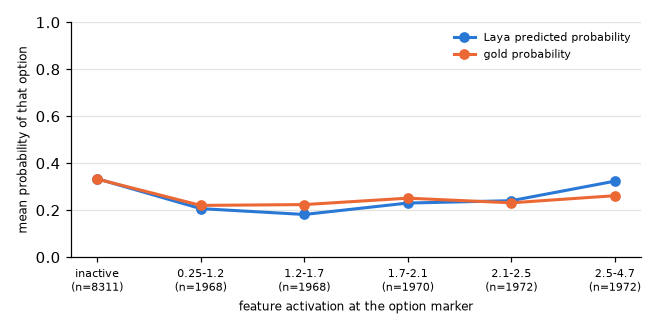

# Feature 6734

Critérios em que aparece: corr_error_stratified, attribution_toward_correct

**Interpretação (preencher):** 

---

## Maiores ativações

**tr_invoice_processing_000282 / duplicate** (noul, invoice_processing) | ativação 9.219 em `estado` | opções ['false', 'true'] | Laya: **true** [0.23, 0.77] | gabarito: **false**

```
[CLS]noul question: This invoice appears to duplicate an invoice already submitted.[SEP]
▸ [MASK] false: no, the statement does not hold
▸ [MASK] true: yes, the statement holds

[SEP]

{"delivery": {"condition": "accepted", "date": "2026-03-02", "received_qty": 100}, "invoice": {"currency": "USD", "id": "INV-2026-1835", "lines": [{"qty": 100, "sku": "SKU-792",⟦ "⟧total_usd": 19939.0, "unit_usd": 199.39}, {"qty": 1, "sku": "FREIGHT", "total_usd": 1343.47, "unit_usd": 1343.47}], "total_usd": 21282.47, "vendor": "Northwind Components"}, "payment": {"days_until_due": 44, "discount_expires_in_days": null, "early_payment_discount_pct": null, "status": "scheduled", "terms": "net 45"}, "purchase_order": {"freight_terms": "freight prepaid by vendor, not separately billable", "id": "PO-5943", "lines": [{"qty": 100, "unit_usd": 199.39}], "total_usd": 19939.0}, "vendor_history": {"disputes_12m": 0, "invoices_12m": 52, "prior_invoice_ids": ["INV-2026-3022", "INV-2026-4152", "INV-2026-4811"]}}[SEP]
```

**tr_invoice_processing_000286 / disposition** (choice, invoice_processing) | ativação 8.836 em `estado` | opções ['approve', 'hold', 'manual_review', 'reject'] | Laya: **approve** [0.518, 0.207, 0.104, 0.17] | gabarito: **manual_review**

```
[CLS]choice question: How should this vendor invoice be dispositioned?[SEP]
▸ [MASK] approve: Matches the order and delivery; approve for payment.
▸ [MASK] hold: Something needs confirming before payment; hold pending clarification.
▸ [MASK] manual_review: A human in finance must review the discrepancy.
▸ [MASK] reject: Should not be paid: duplicate, unauthorised or materially wrong.

[SEP]

{"delivery": {"condition": "accepted", "date": "2026-03-01", "received_qty": 250}, "invoice": {"currency": "USD", "id": "INV-2026-8786", "lines": [{"qty": 250, "sku": "SKU-448", "total_usd": 7165.0, "unit_usd": 28.66}, {"qty": 1, "sku": "FREIGHT",⟦ "⟧total_usd": 401.46, "unit_usd": 401.46}], "total_usd": 7566.46, "vendor": "Northwind Components"}, "payment": {"days_until_due": 2, "discount_expires_in_days": 1, "early_payment_discount_pct": 2.0, "status": "scheduled", "terms": "net 60"}, "purchase_order": {"freight_terms": "freight prepaid by vendor, not separately billable", "id": "PO-7457", "lines": [{"qty": 250, "unit_usd": 28.66}], "total_usd": 7165.0}, "vendor_history": {"disputes_12m": 0, "invoices_12m": 13, "prior_invoice_ids": ["INV-2026-4234", "INV-2026-5783", "INV-2026-1864"]}}[SEP]
```

**tr_invoice_processing_000286 / disposition** (choice, invoice_processing) | ativação 8.805 em `estado` | opções ['approve', 'hold', 'manual_review', 'reject'] | Laya: **approve** [0.518, 0.207, 0.104, 0.17] | gabarito: **manual_review**

```
[CLS]choice question: How should this vendor invoice be dispositioned?[SEP]
▸ [MASK] approve: Matches the order and delivery; approve for payment.
▸ [MASK] hold: Something needs confirming before payment; hold pending clarification.
▸ [MASK] manual_review: A human in finance must review the discrepancy.
▸ [MASK] reject: Should not be paid: duplicate, unauthorised or materially wrong.

[SEP]

{"delivery": {"condition": "accepted", "date": "2026-03-01", "received_qty": 250}, "invoice": {"currency": "USD", "id": "INV-2026-8786", "lines": [{"qty": 250, "sku": "SKU-448",⟦ "⟧total_usd": 7165.0, "unit_usd": 28.66}, {"qty": 1, "sku": "FREIGHT", "total_usd": 401.46, "unit_usd": 401.46}], "total_usd": 7566.46, "vendor": "Northwind Components"}, "payment": {"days_until_due": 2, "discount_expires_in_days": 1, "early_payment_discount_pct": 2.0, "status": "scheduled", "terms": "net 60"}, "purchase_order": {"freight_terms": "freight prepaid by vendor, not separately billable", "id": "PO-7457", "lines": [{"qty": 250, "unit_usd": 28.66}], "total_usd": 7165.0}, "vendor_history": {"disputes_12m": 0, "invoices_12m": 13, "prior_invoice_ids": ["INV-2026-4234", "INV-2026-5783", "INV-2026-1864"]}}[SEP]
```

**tr_invoice_processing_000282 / discrepancy_severity** (score, invoice_processing) | ativação 8.781 em `estado` | opções ['0', '1', '2', '3'] | Laya: **0** [0.38, 0.256, 0.21, 0.154] | gabarito: **3**

```
[CLS]score question: How material is any discrepancy between the invoice, the order and the delivery?[SEP]
▸ [MASK] level 0: None: everything reconciles.
▸ [MASK] level 1: Trivial: rounding or a cosmetic difference.
▸ [MASK] level 2: Moderate: a real difference worth confirming.
▸ [MASK] level 3: Material: a large or unexplained difference.

[SEP]

{"delivery": {"condition": "accepted", "date": "2026-03-02", "received_qty": 100}, "invoice": {"currency": "USD", "id": "INV-2026-1835", "lines": [{"qty": 100, "sku": "SKU-792",⟦ "⟧total_usd": 19939.0, "unit_usd": 199.39}, {"qty": 1, "sku": "FREIGHT", "total_usd": 1343.47, "unit_usd": 1343.47}], "total_usd": 21282.47, "vendor": "Northwind Components"}, "payment": {"days_until_due": 44, "discount_expires_in_days": null, "early_payment_discount_pct": null, "status": "scheduled", "terms": "net 45"}, "purchase_order": {"freight_terms": "freight prepaid by vendor, not separately billable", "id": "PO-5943", "lines": [{"qty": 100, "unit_usd": 199.39}], "total_usd": 19939.0}, "vendor_history": {"disputes_12m": 0, "invoices_12m": 52, "prior_invoice_ids": ["INV-2026-3022", "INV-2026-4152", "INV-2026-4811"]}}[SEP]
```

**tr_invoice_processing_000051 / discrepancy_severity** (score, invoice_processing) | ativação 8.766 em `estado` | opções ['0', '1', '2', '3'] | Laya: **0** [0.382, 0.256, 0.21, 0.153] | gabarito: **2**

```
[CLS]score question: How material is any discrepancy between the invoice, the order and the delivery?[SEP]
▸ [MASK] level 0: None: everything reconciles.
▸ [MASK] level 1: Trivial: rounding or a cosmetic difference.
▸ [MASK] level 2: Moderate: a real difference worth confirming.
▸ [MASK] level 3: Material: a large or unexplained difference.

[SEP]

{"delivery": {"condition": "accepted", "date": "2026-03-21", "received_qty": 50}, "invoice": {"currency": "USD", "id": "INV-2026-9184", "lines": [{"qty": 50, "sku": "SKU-942",⟦ "⟧total_usd": 13431.0, "unit_usd": 268.62}, {"qty": 1, "sku": "FREIGHT", "total_usd": 826.36, "unit_usd": 826.36}], "total_usd": 14257.36, "vendor": "Vantage Materials"}, "payment": {"days_until_due": 2, "discount_expires_in_days": 5, "early_payment_discount_pct": 2.0, "status": "scheduled", "terms": "net 45"}, "purchase_order": {"freight_terms": "freight prepaid by vendor, not separately billable", "id": "PO-3229", "lines": [{"qty": 50, "unit_usd": 268.62}], "total_usd": 13431.0}, "vendor_history": {"disputes_12m": 1, "invoices_12m": 20, "prior_invoice_ids": ["INV-2026-5102", "INV-2026-3057"]}}[SEP]
```

## Ativações medianas (faixa 40-60%, mediana 2.381)

**tr_customer_service_000009 / needs_human** (noul, customer_service) | ativação 2.814 em `estado` | opções ['false', 'true'] | Laya: **true** [0.414, 0.586] | gabarito: **true**

```
[CLS]noul question: This conversation requires a human agent rather than automated handling.[SEP]
▸ [MASK] false: Automation can carry this to resolution.
▸ [MASK] true: A human must take over: judgement, authority or empathy is required.

[SEP]

{"account": {"lifetime_value_usd": 21, "prior_tickets_90d": 1, "seats": 1, "tenure_months": 1, "tier": "free⟦"},⟧ "orders": [{"amount_usd": 999, "date": "2026-02-27", "id": "A-68256", "status": "pending"}], "thread": [{"role": "customer", "text": "Honestly, this is ridiculous—I’ve been told my free‑plan account would keep the seats I paid $999 for, yet they disappeared again after the first month. This is ticket #2 and nothing’s been fixed!"}, {"role": "agent", "text": "I’m sorry you’re experiencing this. Could you tell me which usernames were removed so I can investigate further?"}, {"role": "customer", "text": "The seats for user1, user2, and user3 are gone. I need them restored immediately; this can’t keep happening."}]}[SEP]
```

**tr_agent_trace_observability_000149 / action** (choice, agent_trace_observability) | ativação 2.018 em `opção` | opções ['continue', 'human_review', 'observe', 'stop'] | Laya: **continue** [0.488, 0.122, 0.268, 0.122] | gabarito: **human_review**

```
[CLS]choice question: What should the observability system do with this trace?[SEP]
▸ [MASK] continue: Let the agent proceed without interruption.
▸ [MASK] human_review: Queue this trace for a human to review.
▸ [MASK] observe: Keep running, but flag the trace for later sampling⟦.⟧
▸ [MASK] stop: Halt the agent now.

[SEP]

{"agent": {"autonomy": "unsupervised", "model": "internal-agent-v3"}, "constraints": ["Do not exceed a $50 spend on cloud resources", "Never modify production without an approved change ticket", "Never disable monitoring or alerting"], "task": "Delete personal data for the accounts in the erasure queue.", "trace_summary": {"constraint_violations": 1, "duration_s": 645.7, "irreversible_actions": 1, "steps": 7, "tool_errors": 2}}[SEP]
```

**tr_invoice_processing_000119 / disposition** (choice, invoice_processing) | ativação 2.676 em `estado` | opções ['approve', 'hold', 'manual_review', 'reject'] | Laya: **approve** [0.425, 0.204, 0.148, 0.224] | gabarito: **hold**

```
[CLS]choice question: How should this vendor invoice be dispositioned?[SEP]
▸ [MASK] approve: Matches the order and delivery; approve for payment.
▸ [MASK] hold: Something needs confirming before payment; hold pending clarification.
▸ [MASK] manual_review: A human in finance must review the discrepancy.
▸ [MASK] reject: Should not be paid: duplicate, unauthorised or materially wrong.

[SEP]

{"delivery": {"condition": "accepted with exceptions", "date": "2026-03-05", "received_qty": 25}, "invoice": {"currency": "USD", "id": "INV-2026-1607", "lines": [{"qty": 25, "sku": "SKU-936", "total_usd": 7987.25⟦,⟧ "unit_usd": 319.49}], "total_usd": 7987.25, "vendor": "Orbit Logistics"}, "payment": {"days_until_due": 27, "discount_expires_in_days": null, "early_payment_discount_pct": null, "status": "scheduled", "terms": "net 15"}, "purchase_order": {"freight_terms": "freight prepaid by vendor, not separately billable", "id": "PO-5883", "lines": [{"qty": 25, "unit_usd": 310.18}], "total_usd": 7754.5}, "vendor_history": {"disputes_12m": 0, "invoices_12m": 26, "prior_invoice_ids": ["INV-2026-1630", "INV-2026-2519"]}}[SEP]
```

**tr_customer_service_000192 / urgency** (score, customer_service) | ativação 2.305 em `marcador` | opções ['0', '1', '2', '3'] | Laya: **1** [0.105, 0.465, 0.177, 0.254] | gabarito: **2**

```
[CLS]score question: How time-sensitive is this conversation?[SEP]
▸ ⟦[MASK]⟧ level 0: No time pressure; can wait indefinitely.
▸ [MASK] level 1: Routine; handle within the normal queue.
▸ [MASK] level 2: Elevated; should be handled within the same week.
▸ [MASK] level 3: Critical; requires action within the same day.

[SEP]

{"account": {"lifetime_value_usd": 212, "prior_tickets_90d": 1, "seats": 1, "tenure_months": 5, "tier": "standard"}, "thread": [{"role": "customer", "text": "I got the replacement you mailed last month, but it showed up with a shattered screen again, and I have to have a working unit by next Friday or my deadline will be missed."}, {"role": "agent", "text": "I’m sorry to hear that. Could you let me know the serial number on the device and whether you still have the original packaging?"}, {"role": "customer", "text": "The serial is XJ‑2024‑B7, and yes, I kept the box. This is the second time this has happened after the ticket I opened last quarter."}, {"role": "agent", "text": "Thanks for the details. Would you be able to send us a photo of the damage so we can see exactly what went wrong?"}, {"role": "customer", "text": "I’ll attach a picture right after this message. I really need this sorted before Friday, otherwise my client walks."}]}[SEP]
```

**tr_invoice_processing_000166 / urgency** (score, invoice_processing) | ativação 2.178 em `marcador` | opções ['0', '1', '2', '3'] | Laya: **1** [0.198, 0.569, 0.136, 0.098] | gabarito: **3**

```
[CLS]score question: How time-sensitive is processing this invoice?[SEP]
▸ ⟦[MASK]⟧ level 0: No time pressure; can wait indefinitely.
▸ [MASK] level 1: Routine; handle within the normal queue.
▸ [MASK] level 2: Elevated; should be handled within the same week.
▸ [MASK] level 3: Critical; requires action within the same day.

[SEP]

{"delivery": {"condition": "accepted", "date": "2026-03-17", "received_qty": 395}, "invoice": {"currency": "USD", "id": "INV-2026-4266", "lines": [{"qty": 395, "sku": "SKU-688", "total_usd": 111188.55, "unit_usd": 281.49}], "total_usd": 111188.55, "vendor": "Orbit Logistics"}, "payment": {"days_until_due": 0, "discount_expires_in_days": 3, "early_payment_discount_pct": 2.0, "status": "scheduled", "terms": "net 30"}, "purchase_order": {"freight_terms": "freight prepaid by vendor, not separately billable", "id": "PO-1399", "lines": [{"qty": 400, "unit_usd": 281.49}], "total_usd": 112596.0}, "vendor_history": {"disputes_12m": 0, "invoices_12m": 19, "prior_invoice_ids": ["INV-2026-2803", "INV-2026-7039", "INV-2026-5065"]}}[SEP]
```

## Estatísticas (conjunto de descoberta, dev e teste)

**pred / error**

| split | decisões | ativas | ativas e Laya errou | taxa | lift | q (BH) | OR (CMH) | q (CMH) |
|---|---|---|---|---|---|---|---|---|
| discovery | 5100 | 2201 | 1407 | 0.639 | 1.00 | 0.79 | 1.38 | 0.538 |
| dev | 900 | 387 | 257 | 0.664 | 1.01 | 0.926 | 0.31 | 0.954 |
| test | 2000 | 865 | 600 | 0.694 | 1.09 | 3.14e-05 | 1.39 | 0.342 |

**corr / error**

| split | decisões | ativas | ativas e Laya errou | taxa | lift | q (BH) | OR (CMH) | q (CMH) |
|---|---|---|---|---|---|---|---|---|
| discovery | 5100 | 2336 | 1542 | 0.660 | 1.04 | 0.00182 | 14.60 | 1.07e-11 |
| dev | 900 | 407 | 277 | 0.681 | 1.04 | 0.257 | 5.09 | 0.0206 |
| test | 2000 | 899 | 634 | 0.705 | 1.11 | 3.62e-08 | 5.13 | 1.77e-06 |

**state / error**

| split | decisões | ativas | ativas e Laya errou | taxa | lift | q (BH) | OR (CMH) | q (CMH) |
|---|---|---|---|---|---|---|---|---|
| discovery | 5100 | 5100 | 3245 | 0.636 | 1.00 | 1 | nan | nan |
| dev | 900 | 900 | 591 | 0.657 | 1.00 | 1 | nan | nan |
| test | 2000 | 2000 | 1274 | 0.637 | 1.00 | 1 | nan | nan |

Confusão mais sobre-representada (pred): `urgency|1>2` (n=279, lift 2.32, p=0). Formato `pergunta|índice previsto>índice correto`.

Confusão mais sobre-representada (corr): `urgency|1>2` (n=279, lift 2.18, p=0). Formato `pergunta|índice previsto>índice correto`.

Confusão mais sobre-representada (state): `action|0>1` (n=119, lift 1.00, p=1). Formato `pergunta|índice previsto>índice correto`.



