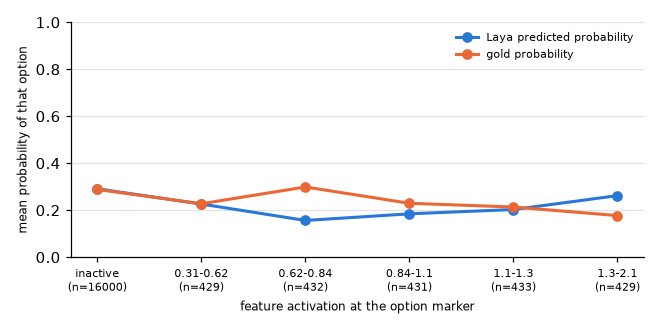

# Feature 6776

Critérios em que aparece: pred_error_stratified

**Interpretação (preencher):** 

---

## Maiores ativações

**tr_customer_service_000152 / category** (choice, customer_service) | ativação 2.113 em `marcador` | opções ['account', 'billing', 'delivery', 'refund', 'technical'] | Laya: **technical** [0.138, 0.202, 0.077, 0.162, 0.421] | gabarito: **technical**

```
[CLS]choice question: What is this customer conversation primarily about?[SEP]
▸ ⟦[MASK]⟧ account: Login, plan changes, profile or access management.
▸ [MASK] billing: A charge, invoice, subscription or payment problem.
▸ [MASK] delivery: Shipping, fulfilment or delivery of a physical item.
▸ [MASK] refund: The customer is explicitly asking for money back.
▸ [MASK] technical: The product or service is not working as expected.

[SEP]

{"account": {"lifetime_value_usd": 799, "prior_tickets_90d": 0, "seats": 1, "tenure_months": 33, "tier": "standard"}, "thread": [{"role": "customer", "text": "Hello, I'm writing because the analytics dashboard stopped updating as of this morning, and I need the latest data by 5 pm today to finalize my report. Could you please look into this?"}]}[SEP]
```

**tr_customer_service_000290 / action** (choice, customer_service) | ativação 2.053 em `marcador` | opções ['answer_directly', 'close_no_action', 'escalate_to_human', 'execute_refund', 'request_information'] | Laya: **close_no_action** [0.242, 0.288, 0.216, 0.124, 0.129] | gabarito: **escalate_to_human**

```
[CLS]choice question: What should the assistant do next with this conversation?[SEP]
▸ [MASK] answer_directly: The assistant can resolve this itself with information it already has.
▸ ⟦[MASK]⟧ close_no_action: No further action is warranted; the matter is settled.
▸ [MASK] escalate_to_human: Hand off to a human agent with the appropriate authority.
▸ [MASK] execute_refund: Issue the refund or credit the customer is owed.
▸ [MASK] request_information: More detail is needed from the customer before anything can be done.

[SEP]

{"account": {"lifetime_value_usd": 2430, "prior_tickets_90d": 1, "seats": 1, "tenure_months": 60, "tier": "free"}, "thread": [{"role": "customer", "text": "I've been using this free plan for five years and it’s ridiculous that I still can't manage my team seats without the interface freezing, especially after I was told this was fixed in my last ticket."}, {"role": "agent", "text": "I'm sorry to hear you're still experiencing issues with seat assignments. Could you describe exactly what happens when you try to add a new team member?"}, {"role": "customer", "text": "The 'Invite' button just stays grayed out and the page stops responding, which is exactly the same problem I reported before that your team never actually resolved."}, {"role": "agent", "text": "I've located your previous ticket to review the history of this issue. To help me investigate, are you currently accessing the site through a desktop browser or the mobile app?"}, {"role": "customer", "text": "I'm on a desktop using the latest version of Chrome, and if this isn't handled correctly this time, I’m going to have to move our team to a different platform entirely."}]}[SEP]
```

**tr_customer_service_000215 / action** (choice, customer_service) | ativação 2.035 em `marcador` | opções ['answer_directly', 'close_no_action', 'escalate_to_human', 'execute_refund', 'request_information'] | Laya: **close_no_action** [0.215, 0.3, 0.194, 0.099, 0.191] | gabarito: **request_information**

```
[CLS]choice question: What should the assistant do next with this conversation?[SEP]
▸ ⟦[MASK]⟧ answer_directly: The assistant can resolve this itself with information it already has.
▸ [MASK] close_no_action: No further action is warranted; the matter is settled.
▸ [MASK] escalate_to_human: Hand off to a human agent with the appropriate authority.
▸ [MASK] execute_refund: Issue the refund or credit the customer is owed.
▸ [MASK] request_information: More detail is needed from the customer before anything can be done.

[SEP]

{"account": {"lifetime_value_usd": 182, "prior_tickets_90d": 1, "seats": 1, "tenure_months": 8, "tier": "free"}, "thread": [{"role": "customer", "text": "Managing seats on the free tier is a nightmare—every time I try to add or remove a user, the UI freezes and I lose my changes."}, {"role": "agent", "text": "That definitely isn’t the experience we want you to have. Could you let me know exactly where in the seat management page the freeze occurs?"}, {"role": "customer", "text": "It happens when I hit ‘Add new seat’ and also when I click the trash can icon to delete a user. The screen just spins and never updates."}, {"role": "agent", "text": "Thanks for the specifics. Are you seeing any error messages in the browser console, or does it just stay on the loading spinner?"}, {"role": "customer", "text": "No error pop‑ups, just the endless spinner. I’ve been on the free plan for eight months and this is the only time I’ve run into such a problem."}]}[SEP]
```

**tr_customer_service_000085 / action** (choice, customer_service) | ativação 2.035 em `marcador` | opções ['answer_directly', 'close_no_action', 'escalate_to_human', 'execute_refund', 'request_information'] | Laya: **answer_directly** [0.405, 0.305, 0.087, 0.06, 0.144] | gabarito: **answer_directly**

```
[CLS]choice question: What should the assistant do next with this conversation?[SEP]
▸ [MASK] answer_directly: The assistant can resolve this itself with information it already has.
▸ ⟦[MASK]⟧ close_no_action: No further action is warranted; the matter is settled.
▸ [MASK] escalate_to_human: Hand off to a human agent with the appropriate authority.
▸ [MASK] execute_refund: Issue the refund or credit the customer is owed.
▸ [MASK] request_information: More detail is needed from the customer before anything can be done.

[SEP]

{"account": {"lifetime_value_usd": 62, "prior_tickets_90d": 3, "seats": 1, "tenure_months": 1, "tier": "standard"}, "thread": [{"role": "customer", "text": "I still haven't gotten a copy of my invoice for this month, even after three tickets. I need it by Friday for my accounting."}, {"role": "agent", "text": "I understand how inconvenient that is. Could you confirm the email address linked to your account so I can verify where the invoice was sent?"}, {"role": "customer", "text": "It's the same john.doe@example.com you have on file. Please just send the PDF; I can't wait any longer."}, {"role": "agent", "text": "Thanks for confirming. I’ll check the sending logs and resend the document. Is there any specific format you prefer, or will a standard PDF work?"}, {"role": "customer", "text": "A standard PDF is fine, but make sure it actually arrives this time—my deadline is this Friday and I can’t afford another delay."}]}[SEP]
```

**tr_customer_service_000285 / action** (choice, customer_service) | ativação 2.023 em `marcador` | opções ['answer_directly', 'close_no_action', 'escalate_to_human', 'execute_refund', 'request_information'] | Laya: **close_no_action** [0.181, 0.398, 0.167, 0.133, 0.121] | gabarito: **answer_directly**

```
[CLS]choice question: What should the assistant do next with this conversation?[SEP]
▸ [MASK] answer_directly: The assistant can resolve this itself with information it already has.
▸ ⟦[MASK]⟧ close_no_action: No further action is warranted; the matter is settled.
▸ [MASK] escalate_to_human: Hand off to a human agent with the appropriate authority.
▸ [MASK] execute_refund: Issue the refund or credit the customer is owed.
▸ [MASK] request_information: More detail is needed from the customer before anything can be done.

[SEP]

{"account": {"lifetime_value_usd": 584, "prior_tickets_90d": 0, "seats": 1, "tenure_months": 11, "tier": "premium"}, "thread": [{"role": "customer", "text": "I’ve been on the premium plan for eleven months now, and honestly, I’ve stopped using most of the features. I think it’s time to downgrade, but I’m not sure what the next step is."}, {"role": "agent", "text": "I’m sorry to hear you’re feeling that way. Could you let me know which plan you have in mind, or any specific features you’d like to keep?"}, {"role": "customer", "text": "Just the basic coverage would do. I don’t need the extra storage or the priority support any longer."}, {"role": "agent", "text": "Got it. Are you looking to make the change effective immediately, or would you prefer it to start at the next billing cycle?"}, {"role": "customer", "text": "I can wait until the next cycle, but please confirm what steps I need to take on my end."}]}[SEP]
```

## Ativações medianas (faixa 40-60%, mediana 0.949)

**tr_customer_service_000049 / action** (choice, customer_service) | ativação 0.876 em `marcador` | opções ['answer_directly', 'close_no_action', 'escalate_to_human', 'execute_refund', 'request_information'] | Laya: **close_no_action** [0.204, 0.579, 0.065, 0.079, 0.072] | gabarito: **escalate_to_human**

```
[CLS]choice question: What should the assistant do next with this conversation?[SEP]
▸ [MASK] answer_directly: The assistant can resolve this itself with information it already has.
▸ [MASK] close_no_action: No further action is warranted; the matter is settled.
▸ [MASK] escalate_to_human: Hand off to a human agent with the appropriate authority.
▸ ⟦[MASK]⟧ execute_refund: Issue the refund or credit the customer is owed.
▸ [MASK] request_information: More detail is needed from the customer before anything can be done.

[SEP]

{"account": {"lifetime_value_usd": 3497, "prior_tickets_90d": 1, "seats": 1, "tenure_months": 60, "tier": "standard"}, "orders": [{"amount_usd": 38, "date": "2026-02-24", "id": "A-41622", "status": "failed"}, {"amount_usd": 38, "date": "2026-01-19", "id": "A-95313", "status": "pending"}, {"amount_usd": 38, "date": "2026-01-24", "id": "A-54468", "status": "settled"}], "thread": [{"role": "customer", "text": "I’ve been a loyal customer for 5 years, and receiving the wrong $38 item is unacceptable. I have a hard deadline for this event tomorrow, and if this isn't corrected right now, I'm taking my business elsewhere."}]}[SEP]
```

**tr_customer_service_000119 / action** (choice, customer_service) | ativação 1.036 em `marcador` | opções ['answer_directly', 'close_no_action', 'escalate_to_human', 'execute_refund', 'request_information'] | Laya: **close_no_action** [0.226, 0.428, 0.159, 0.061, 0.127] | gabarito: **escalate_to_human**

```
[CLS]choice question: What should the assistant do next with this conversation?[SEP]
▸ [MASK] answer_directly: The assistant can resolve this itself with information it already has.
▸ [MASK] close_no_action: No further action is warranted; the matter is settled.
▸ [MASK] escalate_to_human: Hand off to a human agent with the appropriate authority.
▸ ⟦[MASK]⟧ execute_refund: Issue the refund or credit the customer is owed.
▸ [MASK] request_information: More detail is needed from the customer before anything can be done.

[SEP]

{"account": {"lifetime_value_usd": 613, "prior_tickets_90d": 1, "seats": 1, "tenure_months": 11, "tier": "standard"}, "orders": [{"amount_usd": 299, "date": "2026-01-13", "id": "A-16098", "status": "failed"}], "thread": [{"role": "customer", "text": "I just received my delivery and it's completely wrong. I paid $299 for the standard plan upgrade equipment, but what arrived in the box is the basic version. I’m seriously considering canceling my subscription over this."}, {"role": "agent", "text": "I am very sorry to hear that the incorrect item was delivered. Could you please provide your order number and a photo of the item you received so I can review this?"}, {"role": "customer", "text": "I’ve attached the photo to this ticket. This is the second time I've had issues like this, and frankly, my patience is wearing thin."}]}[SEP]
```

**tr_customer_service_000021 / action** (choice, customer_service) | ativação 1.007 em `marcador` | opções ['answer_directly', 'close_no_action', 'escalate_to_human', 'execute_refund', 'request_information'] | Laya: **close_no_action** [0.184, 0.313, 0.184, 0.14, 0.18] | gabarito: **escalate_to_human**

```
[CLS]choice question: What should the assistant do next with this conversation?[SEP]
▸ [MASK] answer_directly: The assistant can resolve this itself with information it already has.
▸ [MASK] close_no_action: No further action is warranted; the matter is settled.
▸ ⟦[MASK]⟧ escalate_to_human: Hand off to a human agent with the appropriate authority.
▸ [MASK] execute_refund: Issue the refund or credit the customer is owed.
▸ [MASK] request_information: More detail is needed from the customer before anything can be done.

[SEP]

{"account": {"lifetime_value_usd": 2339, "prior_tickets_90d": 0, "seats": 1, "tenure_months": 33, "tier": "free"}, "orders": [{"amount_usd": 999, "date": "2026-02-27", "id": "A-76350", "status": "pending"}], "thread": [{"role": "customer", "text": "I was charged $999 this month even though I’m on the free plan. Can you explain why this happened?"}, {"role": "agent", "text": "I see the charge you’re referring to. Could you share the invoice number or the date it appeared on your statement?"}, {"role": "customer", "text": "The invoice is #INV-20230914 and it shows up on my credit card as a $999 charge. I thought I was only on the free tier."}, {"role": "agent", "text": "Thank you for that information. I’ll pull up the billing records. Could you confirm the email address linked to your account?"}, {"role": "customer", "text": "The account email is user@example.com. Please let me know why this charge was applied."}]}[SEP]
```

**tr_customer_service_000031 / action** (choice, customer_service) | ativação 0.821 em `marcador` | opções ['answer_directly', 'close_no_action', 'escalate_to_human', 'execute_refund', 'request_information'] | Laya: **close_no_action** [0.203, 0.349, 0.197, 0.107, 0.144] | gabarito: **escalate_to_human**

```
[CLS]choice question: What should the assistant do next with this conversation?[SEP]
▸ [MASK] answer_directly: The assistant can resolve this itself with information it already has.
▸ [MASK] close_no_action: No further action is warranted; the matter is settled.
▸ [MASK] escalate_to_human: Hand off to a human agent with the appropriate authority.
▸ ⟦[MASK]⟧ execute_refund: Issue the refund or credit the customer is owed.
▸ [MASK] request_information: More detail is needed from the customer before anything can be done.

[SEP]

{"account": {"lifetime_value_usd": 581, "prior_tickets_90d": 0, "seats": 3, "tenure_months": 14, "tier": "enterprise"}, "thread": [{"role": "customer", "text": "I noticed two identical charges on my bank statement for this month's enterprise subscription. I suppose I'm not surprised, but I'd like to know why this happened."}, {"role": "agent", "text": "I am sorry to hear that you are seeing duplicate charges. To help me investigate this further, could you please share the transaction IDs associated with those charges?"}, {"role": "customer", "text": "I'm not sure where to find those IDs. I just see the two lines on my dashboard history that match the ones on my bank app."}, {"role": "agent", "text": "No problem at all. If you could send over a screenshot of your billing history page or the exact timestamps listed for those two transactions, I can start looking into the account logs."}, {"role": "customer", "text": "Here is the screenshot. It’s the same amount charged twice on the same day, which seems like a bit of a mess."}, {"role": "agent", "text": "Thank you for attaching that file. I’ve received the document, and I’m going to begin reviewing our payment processing records to see how these entries were generated."}, {"role": "customer", "text": "Alright, let me know what you find whenever you get around to it, I guess."}]}[SEP]
```

**tr_customer_service_000186 / category** (choice, customer_service) | ativação 0.969 em `marcador` | opções ['account', 'billing', 'delivery', 'refund', 'technical'] | Laya: **refund** [0.167, 0.165, 0.048, 0.459, 0.161] | gabarito: **account**

```
[CLS]choice question: What is this customer conversation primarily about?[SEP]
▸ ⟦[MASK]⟧ account: Login, plan changes, profile or access management.
▸ [MASK] billing: A charge, invoice, subscription or payment problem.
▸ [MASK] delivery: Shipping, fulfilment or delivery of a physical item.
▸ [MASK] refund: The customer is explicitly asking for money back.
▸ [MASK] technical: The product or service is not working as expected.

[SEP]

{"account": {"lifetime_value_usd": 94, "prior_tickets_90d": 0, "seats": 1, "tenure_months": 2, "tier": "free"}, "orders": [{"amount_usd": 99, "date": "2026-03-11", "id": "A-98793", "status": "pending"}, {"amount_usd": 99, "date": "2026-03-28", "id": "A-39133", "status": "failed"}], "thread": [{"role": "customer", "text": "I’m sick of this platform—cancel my account immediately and stop charging me the $99 I’m being billed each month."}, {"role": "agent", "text": "I understand you want to close the account. Could you verify the email address linked to the subscription so I can locate the correct profile?"}, {"role": "customer", "text": "It’s john.doe@example.com. I’ve already told you this before; if you don’t process the cancellation right now I’ll be forced to dispute the charges."}]}[SEP]
```

## Estatísticas (conjunto de descoberta, dev e teste)

**pred / error**

| split | decisões | ativas | ativas e Laya errou | taxa | lift | q (BH) | OR (CMH) | q (CMH) |
|---|---|---|---|---|---|---|---|---|
| discovery | 5100 | 505 | 430 | 0.851 | 1.34 | 1.08e-27 | 2.75 | 4.94e-05 |
| dev | 900 | 83 | 66 | 0.795 | 1.21 | 0.0525 | 2.60 | 0.244 |
| test | 2000 | 196 | 162 | 0.827 | 1.30 | 2.11e-08 | 3.31 | 0.01 |

**corr / error**

| split | decisões | ativas | ativas e Laya errou | taxa | lift | q (BH) | OR (CMH) | q (CMH) |
|---|---|---|---|---|---|---|---|---|
| discovery | 5100 | 500 | 425 | 0.850 | 1.34 | 1.28e-27 | 2.17 | 0.00215 |
| dev | 900 | 77 | 60 | 0.779 | 1.19 | 0.0344 | 2.99 | 0.205 |
| test | 2000 | 180 | 146 | 0.811 | 1.27 | 4.75e-07 | 2.15 | 0.113 |

**state / error**

| split | decisões | ativas | ativas e Laya errou | taxa | lift | q (BH) | OR (CMH) | q (CMH) |
|---|---|---|---|---|---|---|---|---|
| discovery | 5100 | 57 | 40 | 0.702 | 1.10 | 0.675 | 1.34 | 0.565 |
| dev | 900 | 7 | 4 | 0.571 | 0.87 | nan | nan | nan |
| test | 2000 | 14 | 7 | 0.500 | 0.78 | nan | nan | nan |

Confusão mais sobre-representada (pred): `action|1>2` (n=125, lift 10.10, p=0). Formato `pergunta|índice previsto>índice correto`.

Confusão mais sobre-representada (corr): `action|0>1` (n=119, lift 10.20, p=0). Formato `pergunta|índice previsto>índice correto`.

Confusão mais sobre-representada (state): `action|1>2` (n=8, lift 5.73, p=6.28e-05). Formato `pergunta|índice previsto>índice correto`.



