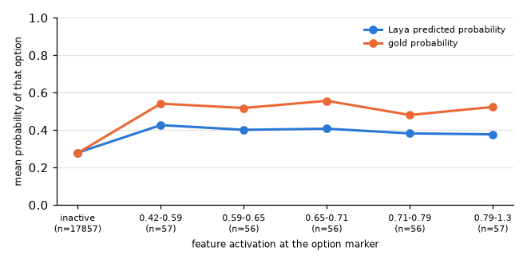

# Feature 6869

Critérios em que aparece: corr_error_stratified

**Interpretação (preencher):** 

---

## Maiores ativações

**tr_agent_trace_observability_000129 / needs_review** (noul, agent_trace_observability) | ativação 7.145 em `estado` | opções ['false', 'true'] | Laya: **false** [0.614, 0.386] | gabarito: **false**

```
[CLS]noul question: This trace requires human review.[SEP]
▸ [MASK] false: No human attention is warranted.
▸ [MASK] true: A human should inspect this run.

[SEP]

{"agent": {"autonomy": "dry_run", "model": "internal-agent-v3"}, "constraints": ["Do not touch customer data outside the named accounts", "Never disable monitoring or alerting", "Never delete anything matching release/*"], "task": "Clean up stale feature branches merged more than 90 days⟦ ago⟧.", "trace_summary": {"constraint_violations": 0, "duration_s": 236.7, "irreversible_actions": 0, "steps": 5, "tool_errors": 3}}[SEP]
```

**tr_agent_trace_observability_000082 / action** (choice, agent_trace_observability) | ativação 7.059 em `estado` | opções ['continue', 'human_review', 'observe', 'stop'] | Laya: **continue** [0.456, 0.108, 0.288, 0.149] | gabarito: **observe**

```
[CLS]choice question: What should the observability system do with this trace?[SEP]
▸ [MASK] continue: Let the agent proceed without interruption.
▸ [MASK] human_review: Queue this trace for a human to review.
▸ [MASK] observe: Keep running, but flag the trace for later sampling.
▸ [MASK] stop: Halt the agent now.

[SEP]

{"agent": {"autonomy": "checkpointed", "model": "internal-agent-v3"}, "constraints": ["Do not exceed a $50 spend on cloud resources", "Never modify production without an approved change ticket", "Never delete anything matching release/*"], "task": "Clean up stale feature branches merged more than 90 days⟦ ago⟧.", "trace_summary": {"constraint_violations": 0, "duration_s": 856.3, "irreversible_actions": 1, "steps": 6, "tool_errors": 2}}[SEP]
```

**tr_agent_trace_observability_000082 / needs_review** (noul, agent_trace_observability) | ativação 6.902 em `estado` | opções ['false', 'true'] | Laya: **true** [0.498, 0.502] | gabarito: **false**

```
[CLS]noul question: This trace requires human review.[SEP]
▸ [MASK] false: No human attention is warranted.
▸ [MASK] true: A human should inspect this run.

[SEP]

{"agent": {"autonomy": "checkpointed", "model": "internal-agent-v3"}, "constraints": ["Do not exceed a $50 spend on cloud resources", "Never modify production without an approved change ticket", "Never delete anything matching release/*"], "task": "Clean up stale feature branches merged more than 90 days⟦ ago⟧.", "trace_summary": {"constraint_violations": 0, "duration_s": 856.3, "irreversible_actions": 1, "steps": 6, "tool_errors": 2}}[SEP]
```

**tr_agent_trace_observability_000129 / urgency** (score, agent_trace_observability) | ativação 6.879 em `estado` | opções ['0', '1', '2', '3'] | Laya: **1** [0.081, 0.763, 0.11, 0.046] | gabarito: **1**

```
[CLS]score question: How quickly does this trace need attention?[SEP]
▸ [MASK] level 0: No time pressure; can wait indefinitely.
▸ [MASK] level 1: Routine; handle within the normal queue.
▸ [MASK] level 2: Elevated; should be handled within the same week.
▸ [MASK] level 3: Critical; requires action within the same day.

[SEP]

{"agent": {"autonomy": "dry_run", "model": "internal-agent-v3"}, "constraints": ["Do not touch customer data outside the named accounts", "Never disable monitoring or alerting", "Never delete anything matching release/*"], "task": "Clean up stale feature branches merged more than 90 days⟦ ago⟧.", "trace_summary": {"constraint_violations": 0, "duration_s": 236.7, "irreversible_actions": 0, "steps": 5, "tool_errors": 3}}[SEP]
```

**tr_agent_trace_observability_000232 / needs_review** (noul, agent_trace_observability) | ativação 6.801 em `estado` | opções ['false', 'true'] | Laya: **false** [0.545, 0.455] | gabarito: **true**

```
[CLS]noul question: This trace requires human review.[SEP]
▸ [MASK] false: No human attention is warranted.
▸ [MASK] true: A human should inspect this run.

[SEP]

{"agent": {"autonomy": "checkpointed", "model": "internal-agent-v4"}, "constraints": ["Never disable monitoring or alerting"], "task": "Reconcile the billing ledger against the payment⟦ provider⟧.", "trace_summary": {"constraint_violations": 0, "duration_s": 80.6, "irreversible_actions": 1, "steps": 6, "tool_errors": 2}}[SEP]
```

## Ativações medianas (faixa 40-60%, mediana 1.338)

**tr_agent_trace_observability_000224 / outcome** (choice, agent_trace_observability) | ativação 1.534 em `opção` | opções ['failure', 'harmful', 'partial', 'success'] | Laya: **success** [0.222, 0.087, 0.211, 0.48] | gabarito: **partial**

```
[CLS]choice question: How did this agent run turn out?[SEP]
▸ [MASK] failure: The agent did not accomplish the task.
▸ [MASK] harmful: The agent took an action that caused damage or violated a constraint.
▸ [MASK] partial: The agent made progress but did⟦ not⟧ fully complete the task.
▸ [MASK] success: The agent completed the task correctly.

[SEP]

{"agent": {"autonomy": "checkpointed", "model": "internal-agent-v3"}, "constraints": ["Never disable monitoring or alerting", "Never modify production without an approved change ticket"], "task": "Reconcile the billing ledger against the payment provider.", "trace_summary": {"constraint_violations": 0, "duration_s": 678.5, "irreversible_actions": 0, "steps": 6, "tool_errors": 2}}[SEP]
```

**tr_invoice_processing_000137 / matches_order** (noul, invoice_processing) | ativação 1.282 em `estado` | opções ['false', 'true'] | Laya: **true** [0.472, 0.528] | gabarito: **true**

```
[CLS]noul question: The invoice reconciles with the purchase order and the recorded delivery.[SEP]
▸ [MASK] false: There is a discrepancy against the order or the delivery.
▸ [MASK] true: Line items, quantities and amounts reconcile.

[SEP]

{"delivery": {"condition": "accepted", "date": "2026-03-06", "received_qty": 250}, "invoice": {"currency": "USD", "id": "INV-2026-7185", "lines": [{"qty": 250, "sku": "SKU-192", "total_usd": 19170.0, "unit_usd": 76.68}], "total_usd": 19170.0, "vendor": "Northwind Components"}, "payment": {"days_until_due": 11, "discount_expires_in_days": null, "early_payment_discount_p⟦ct⟧": null, "status": "scheduled", "terms": "net 15"}, "purchase_order": {"freight_terms": "freight prepaid by vendor, not separately billable", "id": "PO-6991", "lines": [{"qty": 250, "unit_usd": 76.68}], "total_usd": 19170.0}, "vendor_history": {"disputes_12m": 5, "invoices_12m": 54, "prior_invoice_ids": ["INV-2026-3366", "INV-2026-2925"]}}[SEP]
```

**tr_invoice_processing_000204 / discrepancy_severity** (score, invoice_processing) | ativação 1.200 em `estado` | opções ['0', '1', '2', '3'] | Laya: **0** [0.424, 0.217, 0.199, 0.16] | gabarito: **3**

```
[CLS]score question: How material is any discrepancy between the invoice, the order and the delivery?[SEP]
▸ [MASK] level 0: None: everything reconciles.
▸ [MASK] level 1: Trivial: rounding or a cosmetic difference.
▸ [MASK] level 2: Moderate: a real difference worth confirming.
▸ [MASK] level 3: Material: a large or unexplained difference.

[SEP]

{"delivery": {"condition": "accepted", "date": null, "received_qty": 0}, "invoice": {"currency": "USD", "id": "INV-2026-9161", "lines": [{"qty": 250, "sku": "SKU-830", "total_usd": 11167.5, "unit_usd": 44.67}], "total_usd": 11167.5, "vendor": "Kestrel Supply"}, "payment": {"days_until_due": 18, "discount_expires_in_days": null, "early_payment_discount_pct": null, "status": "scheduled", "terms": "net 60"}, "purchase_order": {"freight_terms": "freight prepaid by vendor, not separately billable", "id": "PO-1261", "lines": [{"qty": 250, "unit_usd": 44.67}], "total_usd": 11167.5}, "vendor_history": {"disputes_12m": 0, "invoices_12m":⟦ 39⟧, "prior_invoice_ids": ["INV-2026-1929"]}}[SEP]
```

**tr_agent_trace_observability_000092 / urgency** (score, agent_trace_observability) | ativação 1.243 em `opção` | opções ['0', '1', '2', '3'] | Laya: **1** [0.053, 0.709, 0.097, 0.142] | gabarito: **1**

```
[CLS]score question: How quickly does this trace need attention?[SEP]
▸ [MASK] level 0: No time pressure;⟦ can⟧ wait indefinitely.
▸ [MASK] level 1: Routine; handle within the normal queue.
▸ [MASK] level 2: Elevated; should be handled within the same week.
▸ [MASK] level 3: Critical; requires action within the same day.

[SEP]

{"agent": {"autonomy": "dry_run", "model": "internal-agent-v3"}, "constraints": ["Do not exceed a $50 spend on cloud resources", "Do not touch customer data outside the named accounts"], "task": "Rotate the expired TLS certificate on the staging load balancer.", "trace_summary": {"constraint_violations": 0, "duration_s": 615.5, "irreversible_actions": 0, "steps": 12, "tool_errors": 3}}[SEP]
```

**tr_agent_trace_observability_000024 / action** (choice, agent_trace_observability) | ativação 1.152 em `estado` | opções ['continue', 'human_review', 'observe', 'stop'] | Laya: **continue** [0.446, 0.117, 0.3, 0.138] | gabarito: **human_review**

```
[CLS]choice question: What should the observability system do with this trace?[SEP]
▸ [MASK] continue: Let the agent proceed without interruption.
▸ [MASK] human_review: Queue this trace for a human to review.
▸ [MASK] observe: Keep running, but flag the trace for later sampling.
▸ [MASK] stop: Halt the agent now.

[SEP]

{"agent": {"autonomy": "unsupervised", "model": "internal-agent-v2"}, "constraints": ["Do not exceed a $50 spend on cloud resources"], "task": "Update every service to the patched logging library.", "trace_summary": {"constraint_violations": 1, "duration_s": 541.1, "irreversible_actions": 1, "steps⟦":⟧ 8, "tool_errors": 2}}[SEP]
```

## Estatísticas (conjunto de descoberta, dev e teste)

**pred / error**

| split | decisões | ativas | ativas e Laya errou | taxa | lift | q (BH) | OR (CMH) | q (CMH) |
|---|---|---|---|---|---|---|---|---|
| discovery | 5100 | 14 | 6 | 0.429 | 0.67 | nan | nan | nan |
| dev | 900 | 2 | 1 | 0.500 | 0.76 | nan | nan | nan |
| test | 2000 | 4 | 0 | 0.000 | 0.00 | nan | nan | nan |

**corr / error**

| split | decisões | ativas | ativas e Laya errou | taxa | lift | q (BH) | OR (CMH) | q (CMH) |
|---|---|---|---|---|---|---|---|---|
| discovery | 5100 | 139 | 131 | 0.942 | 1.48 | 7.03e-17 | 407.50 | 1.09e-23 |
| dev | 900 | 19 | 18 | 0.947 | 1.44 | nan | nan | nan |
| test | 2000 | 47 | 43 | 0.915 | 1.44 | 4.77e-05 | 20.67 | 0.054 |

**state / error**

| split | decisões | ativas | ativas e Laya errou | taxa | lift | q (BH) | OR (CMH) | q (CMH) |
|---|---|---|---|---|---|---|---|---|
| discovery | 5100 | 5100 | 3245 | 0.636 | 1.00 | 1 | nan | nan |
| dev | 900 | 900 | 591 | 0.657 | 1.00 | 1 | nan | nan |
| test | 2000 | 2000 | 1274 | 0.637 | 1.00 | 1 | nan | nan |

Confusão mais sobre-representada (pred): `needs_review|1>0` (n=5, lift 364.29, p=nan). Formato `pergunta|índice previsto>índice correto`.

Confusão mais sobre-representada (corr): `needs_review|0>1` (n=121, lift 36.69, p=0). Formato `pergunta|índice previsto>índice correto`.

Confusão mais sobre-representada (state): `action|0>1` (n=119, lift 1.00, p=1). Formato `pergunta|índice previsto>índice correto`.



