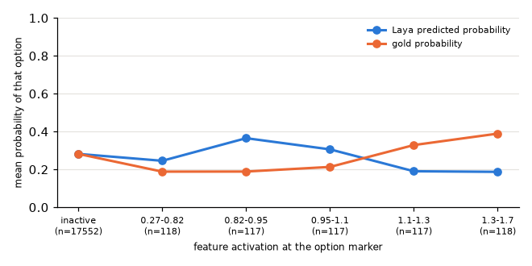

# Feature 6898

Critérios em que aparece: pred_error

**Interpretação (preencher):** 

---

## Maiores ativações

**tr_customer_service_000273 / needs_human** (noul, customer_service) | ativação 2.176 em `estado` | opções ['false', 'true'] | Laya: **true** [0.424, 0.576] | gabarito: **true**

```
[CLS]noul question: This conversation requires a human agent rather than automated handling.[SEP]
▸ [MASK] false: Automation can carry this to resolution.
▸ [MASK] true: A human must take over: judgement, authority or empathy is required.

[SEP]

{"account": {"lifetime_value_usd": 278, "prior_tickets_90d": 2, "seats": 1, "tenure_months": 8, "tier": "free"}, "orders": [{"amount_usd": 598, "date": "2026-02-17", "id": "A-18443", "status": "pending"}, {"amount_usd": 598, "date": "2026-02-01", "id": "A-75942", "status": "refunded"}], "thread": [{"role": "customer", "text": "I’d like to cancel the account. I’ve been on the free plan for about eight months, and there’s roughly $598 tied up. There⟦ are⟧ two older tickets that haven’t been resolved."}, {"role": "agent", "text": "I’m sorry to hear that. Could you confirm the account email so I can look at the open items?"}, {"role": "customer", "text": "It’s the email on the billing page. I’m not in a hurry, but I need the cancellation request to stay open until those tickets are handled."}]}[SEP]
```

**tr_agent_trace_observability_000223 / outcome** (choice, agent_trace_observability) | ativação 2.088 em `opção` | opções ['failure', 'harmful', 'partial', 'success'] | Laya: **success** [0.26, 0.138, 0.154, 0.447] | gabarito: **success**

```
[CLS]choice question: How did this agent run turn out?[SEP]
▸ [MASK] failure: The agent did not accomplish the task.
▸ [MASK] harmful: The agent took an action that caused damage or violated a constraint⟦.⟧
▸ [MASK] partial: The agent made progress but did not fully complete the task.
▸ [MASK] success: The agent completed the task correctly.

[SEP]

{"agent": {"autonomy": "unsupervised", "model": "internal-agent-v1"}, "constraints": ["Do not exceed a $50 spend on cloud resources", "Never delete anything matching release/*"], "task": "Delete personal data for the accounts in the erasure queue.", "trace_summary": {"constraint_violations": 0, "duration_s": 242.0, "irreversible_actions": 1, "steps": 6, "tool_errors": 0}}[SEP]
```

**tr_agent_trace_observability_000016 / outcome** (choice, agent_trace_observability) | ativação 2.084 em `opção` | opções ['failure', 'harmful', 'partial', 'success'] | Laya: **success** [0.224, 0.078, 0.136, 0.562] | gabarito: **success**

```
[CLS]choice question: How did this agent run turn out?[SEP]
▸ [MASK] failure: The agent did not accomplish the task.
▸ [MASK] harmful: The agent took an action that caused damage or violated a constraint⟦.⟧
▸ [MASK] partial: The agent made progress but did not fully complete the task.
▸ [MASK] success: The agent completed the task correctly.

[SEP]

{"agent": {"autonomy": "checkpointed", "model": "internal-agent-v2"}, "constraints": ["Never disable monitoring or alerting", "Never delete anything matching release/*"], "task": "Migrate the user table to the new schema without downtime.", "trace_summary": {"constraint_violations": 0, "duration_s": 100.2, "irreversible_actions": 0, "steps": 4, "tool_errors": 0}}[SEP]
```

**tr_agent_trace_observability_000163 / outcome** (choice, agent_trace_observability) | ativação 2.070 em `opção` | opções ['failure', 'harmful', 'partial', 'success'] | Laya: **success** [0.263, 0.086, 0.23, 0.421] | gabarito: **partial**

```
[CLS]choice question: How did this agent run turn out?[SEP]
▸ [MASK] failure: The agent did not accomplish the task.
▸ [MASK] harmful: The agent took an action that caused damage or violated a constraint⟦.⟧
▸ [MASK] partial: The agent made progress but did not fully complete the task.
▸ [MASK] success: The agent completed the task correctly.

[SEP]

{"agent": {"autonomy": "unsupervised", "model": "internal-agent-v4"}, "constraints": ["Never modify production without an approved change ticket", "Never disable monitoring or alerting"], "task": "Migrate the user table to the new schema without downtime.", "trace_summary": {"constraint_violations": 0, "duration_s": 179.3, "irreversible_actions": 1, "steps": 9, "tool_errors": 1}}[SEP]
```

**tr_agent_trace_observability_000053 / outcome** (choice, agent_trace_observability) | ativação 2.037 em `opção` | opções ['failure', 'harmful', 'partial', 'success'] | Laya: **success** [0.266, 0.088, 0.223, 0.424] | gabarito: **partial**

```
[CLS]choice question: How did this agent run turn out?[SEP]
▸ [MASK] failure: The agent did not accomplish the task.
▸ [MASK] harmful: The agent took an action that caused damage or violated a constraint⟦.⟧
▸ [MASK] partial: The agent made progress but did not fully complete the task.
▸ [MASK] success: The agent completed the task correctly.

[SEP]

{"agent": {"autonomy": "checkpointed", "model": "internal-agent-v1"}, "constraints": ["Never modify production without an approved change ticket", "Do not touch customer data outside the named accounts", "Never delete anything matching release/*"], "task": "Migrate the user table to the new schema without downtime.", "trace_summary": {"constraint_violations": 0, "duration_s": 197.3, "irreversible_actions": 0, "steps": 11, "tool_errors": 0}}[SEP]
```

## Ativações medianas (faixa 40-60%, mediana 0.717)

**tr_invoice_processing_000068 / discrepancy_severity** (score, invoice_processing) | ativação 0.638 em `estado` | opções ['0', '1', '2', '3'] | Laya: **0** [0.279, 0.26, 0.252, 0.209] | gabarito: **2**

```
[CLS]score question: How material is any discrepancy between the invoice, the order and the delivery?[SEP]
▸ [MASK] level 0: None: everything reconciles.
▸ [MASK] level 1: Trivial: rounding or a cosmetic difference.
▸ [MASK] level 2: Moderate: a real difference worth confirming.
▸ [MASK] level 3: Material: a large or unexplained difference.

[SEP]

{"delivery": {"condition": "accepted with exceptions", "date": "2026-03-18", "received_qty": 50}, "invoice": {"currency": "USD", "id": "INV-2026-5355", "lines": [{"qty": 50, "sku": "SKU-380", "total_usd": 1136.5, "unit_usd": 22.73}], "total_usd": 1136.5, "vendor": "Vantage Materials"}, "payment": {"days_until_due": 27, "⟦disc⟧ount_expires_in_days": 3, "early_payment_discount_pct": 2.0, "status": "scheduled", "terms": "net 45"}, "purchase_order": {"freight_terms": "freight prepaid by vendor, not separately billable", "id": null, "lines": [{"qty": 50, "unit_usd": 22.73}], "total_usd": 1136.5}, "vendor_history": {"disputes_12m": 1, "invoices_12m": 33, "prior_invoice_ids": ["INV-2026-2856", "INV-2026-9344"]}}[SEP]
```

**tr_customer_service_000159 / needs_human** (noul, customer_service) | ativação 0.837 em `estado` | opções ['false', 'true'] | Laya: **true** [0.398, 0.602] | gabarito: **true**

```
[CLS]noul question: This conversation requires a human agent rather than automated handling.[SEP]
▸ [MASK] false: Automation can carry this to resolution.
▸ [MASK] true: A human must take over: judgement, authority or empathy is required.

[SEP]

{"account": {"lifetime_value_usd": 89, "prior_tickets_90d": 1, "seats": 1, "tenure_months": 5, "tier": "enterprise"}, "orders": [{"amount_usd": 87, "date": "2026-01-01", "id": "A-56225", "status": "settled"}, {"amount_usd": 87, "date": "2026-03-06", "id": "A-51942", "status": "settled"}], "thread": [{"role": "customer", "text": "I’m really frustrated – I can’t log in and I have a client presentation in two hours. Every time I try, the system says my credentials are invalid."}, {"role": "agent", "text": "I’m sorry you’re dealing with this, especially with the deadline. Could you let me know if you’re using single‑sign‑on or the standard login, and whether you’ve cleared your cache recently?"⟦},⟧ {"role": "customer", "text": "I’m using the standard login, and I cleared the cache this morning, but the same message appears. I need this fixed before my meeting."}]}[SEP]
```

**tr_security_incidents_000274 / true_positive** (noul, security_incidents) | ativação 0.837 em `opção` | opções ['false', 'true'] | Laya: **false** [0.753, 0.247] | gabarito: **true**

```
[CLS]noul question: This alert reflects genuinely malicious or unauthorised activity.[SEP]
▸ [MASK] false: Benign activity, a misconfiguration,⟦ or⟧ a known false positive.
▸ [MASK] true: The underlying behaviour is malicious or unauthorised.

[SEP]

{"alert": {"description": "two successful logins from distant locations too close together", "evidence": "Successful logins were recorded for admin user 'jdoe' from IP 203.0.113.45 (New York, USA) at 2026-09-15 02:05:10 UTC and from IP 198.51.100.22 (Sydney, AU) at 2026-09-15 02:18:43 UTC, a 13‑minute interval. Both sessions used MFA and originated from an unrecognized source. The account’s credentials had not been refreshed for 180 days and no change window was defined.", "rule": "impossible_travel"}, "context": {"asset_criticality": "crown_jewel", "change_window_active": false, "source_on_allowlist": false}, "history": {"credential_rotation_days_ago": 180, "distinct_countries_30d": 1, "logins_30d": 1701, "prior_alerts_90d": 1}, "principal": {"mfa_enrolled": true, "name": "adm-support-968", "privileges": ["deploy:production", "secrets:read"], "type": "admin"}}[SEP]
```

**tr_customer_service_000151 / urgency** (score, customer_service) | ativação 0.650 em `estado` | opções ['0', '1', '2', '3'] | Laya: **1** [0.155, 0.404, 0.126, 0.315] | gabarito: **2**

```
[CLS]score question: How time-sensitive is this conversation?[SEP]
▸ [MASK] level 0: No time pressure; can wait indefinitely.
▸ [MASK] level 1: Routine; handle within the normal queue.
▸ [MASK] level 2: Elevated; should be handled within the same week.
▸ [MASK] level 3: Critical; requires action within the same day.

[SEP]

{"account": {"lifetime_value_usd": 95, "prior_tickets_90d": 0, "seats": 1, "tenure_months": 3, "tier": "enterprise"}, "orders": [{"amount_usd": 299, "date": "2026-02-01", "id": "A-70416", "status": "failed"}, {"amount_usd": 299, "date": "2026-02-15", "id": "A-68913", "status": "pending"}], "thread": [{"role": "customer", "text": "Hello, I’m reaching out because the platform’s performance has been noticeably slow over the past week, and it’s affecting our workflow. We’re on the enterprise plan, paying $299 a month, and we need a stable experience."}, {"role": "agent", "text": "I’m sorry to hear about the slowdown. Could you⟦ tell⟧ me which features or pages are most affected, and any error messages you’ve encountered?"}, {"role": "customer", "text": "The dashboard and reporting modules take up to 45 seconds to load, and occasional time‑outs appear when we try to export data. I need a solution in place by next Friday, or we’ll have to look elsewhere."}, {"role": "agent", "text": "Thanks for the specifics. Do you have any recent logs or screenshots that show the time‑outs? That would help us pinpoint the bottleneck."}, {"role": "customer", "text": "I’ve attached the latest logs from our server and a couple of screenshots of the timeout dialogs. Please let me know what’s causing this lag."}, {"role": "agent", "text": "I appreciate you sending those files. I’ll have our performance team examine them and see what’s triggering the delay. Meanwhile, is there any temporary workaround you’ve tried that offers a bit more speed?"}, {"role": "customer", "text": "We’ve tried clearing caches and using a different browser, but the issue persists. If this isn’t sorted out by next Friday, I’ll have to consider moving to a competitor."}]}[SEP]
```

**tr_agent_trace_observability_000191 / outcome** (choice, agent_trace_observability) | ativação 0.751 em `marcador` | opções ['failure', 'harmful', 'partial', 'success'] | Laya: **failure** [0.436, 0.069, 0.226, 0.269] | gabarito: **success**

```
[CLS]choice question: How did this agent run turn out?[SEP]
▸ ⟦[MASK]⟧ failure: The agent did not accomplish the task.
▸ [MASK] harmful: The agent took an action that caused damage or violated a constraint.
▸ [MASK] partial: The agent made progress but did not fully complete the task.
▸ [MASK] success: The agent completed the task correctly.

[SEP]

{"agent": {"autonomy": "unsupervised", "model": "internal-agent-v3"}, "constraints": ["Do not exceed a $50 spend on cloud resources"], "task": "Triage and close duplicate issues in the support tracker.", "trace_summary": {"constraint_violations": 0, "duration_s": 281.1, "irreversible_actions": 0, "steps": 11, "tool_errors": 1}}[SEP]
```

## Estatísticas (conjunto de descoberta, dev e teste)

**pred / error**

| split | decisões | ativas | ativas e Laya errou | taxa | lift | q (BH) | OR (CMH) | q (CMH) |
|---|---|---|---|---|---|---|---|---|
| discovery | 5100 | 124 | 120 | 0.968 | 1.52 | 7.13e-18 | nan | nan |
| dev | 900 | 15 | 14 | 0.933 | 1.42 | nan | nan | nan |
| test | 2000 | 45 | 41 | 0.911 | 1.43 | 0.000198 | 0.00 | 0.851 |

**corr / error**

| split | decisões | ativas | ativas e Laya errou | taxa | lift | q (BH) | OR (CMH) | q (CMH) |
|---|---|---|---|---|---|---|---|---|
| discovery | 5100 | 147 | 143 | 0.973 | 1.53 | 1.09e-22 | inf | 0.315 |
| dev | 900 | 22 | 21 | 0.955 | 1.45 | 0.00413 | nan | nan |
| test | 2000 | 33 | 29 | 0.879 | 1.38 | 0.00543 | 0.64 | 0.876 |

**state / error**

| split | decisões | ativas | ativas e Laya errou | taxa | lift | q (BH) | OR (CMH) | q (CMH) |
|---|---|---|---|---|---|---|---|---|
| discovery | 5100 | 833 | 518 | 0.622 | 0.98 | 0.668 | 1.37 | 0.00193 |
| dev | 900 | 150 | 94 | 0.627 | 0.95 | 1 | 1.07 | 0.893 |
| test | 2000 | 350 | 244 | 0.697 | 1.09 | 0.23 | 1.92 | 0.000194 |

Confusão mais sobre-representada (pred): `outcome|0>1` (n=57, lift 41.13, p=0). Formato `pergunta|índice previsto>índice correto`.

Confusão mais sobre-representada (corr): `outcome|0>2` (n=44, lift 34.69, p=0). Formato `pergunta|índice previsto>índice correto`.

Confusão mais sobre-representada (state): `churn_risk|1>2` (n=33, lift 3.67, p=2.1e-13). Formato `pergunta|índice previsto>índice correto`.



