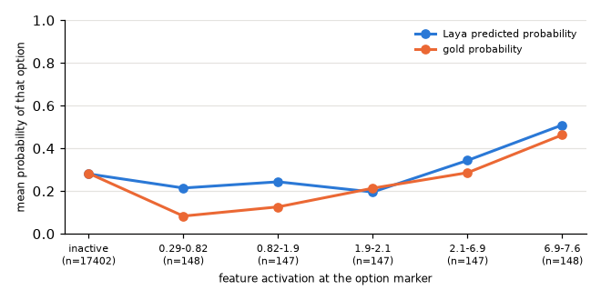

# Feature 6937

Critérios em que aparece: state_error

**Interpretação (preencher):** 

---

## Maiores ativações

**tr_invoice_processing_000190 / disposition** (choice, invoice_processing) | ativação 9.805 em `opção` | opções ['approve', 'hold', 'manual_review', 'reject'] | Laya: **approve** [0.526, 0.164, 0.124, 0.186] | gabarito: **approve**

```
[CLS]choice question: How should this vendor invoice be dispositioned?[SEP]
▸ [MASK] approve: Matches the order and delivery⟦;⟧ approve for payment.
▸ [MASK] hold: Something needs confirming before payment; hold pending clarification.
▸ [MASK] manual_review: A human in finance must review the discrepancy.
▸ [MASK] reject: Should not be paid: duplicate, unauthorised or materially wrong.

[SEP]

{"delivery": {"condition": "accepted", "date": "2026-03-25", "received_qty": 25}, "invoice": {"currency": "USD", "id": "INV-2026-2067", "lines": [{"qty": 25, "sku": "SKU-500", "total_usd": 9786.25, "unit_usd": 391.45}], "total_usd": 9786.25, "vendor": "Vantage Materials"}, "payment": {"days_until_due": 18, "discount_expires_in_days": null, "early_payment_discount_pct": null, "status": "scheduled", "terms": "net 45"}, "purchase_order": {"freight_terms": "freight prepaid by vendor, not separately billable", "id": "PO-5843", "lines": [{"qty": 25, "unit_usd": 391.45}], "total_usd": 9786.25}, "vendor_history": {"disputes_12m": 0, "invoices_12m": 17, "prior_invoice_ids": ["INV-2026-2032", "INV-2026-2947", "INV-2026-4760"]}}[SEP]
```

**tr_invoice_processing_000163 / disposition** (choice, invoice_processing) | ativação 9.789 em `opção` | opções ['approve', 'hold', 'manual_review', 'reject'] | Laya: **approve** [0.54, 0.156, 0.091, 0.213] | gabarito: **approve**

```
[CLS]choice question: How should this vendor invoice be dispositioned?[SEP]
▸ [MASK] approve: Matches the order and delivery⟦;⟧ approve for payment.
▸ [MASK] hold: Something needs confirming before payment; hold pending clarification.
▸ [MASK] manual_review: A human in finance must review the discrepancy.
▸ [MASK] reject: Should not be paid: duplicate, unauthorised or materially wrong.

[SEP]

{"delivery": {"condition": "accepted", "date": "2026-03-03", "received_qty": 1000}, "invoice": {"currency": "USD", "id": "INV-2026-4638", "lines": [{"qty": 1000, "sku": "SKU-842", "total_usd": 251570.0, "unit_usd": 251.57}], "total_usd": 251570.0, "vendor": "Kestrel Supply"}, "payment": {"days_until_due": 0, "discount_expires_in_days": null, "early_payment_discount_pct": null, "status": "scheduled", "terms": "net 30"}, "purchase_order": {"freight_terms": "freight prepaid by vendor, not separately billable", "id": null, "lines": [{"qty": 1000, "unit_usd": 251.57}], "total_usd": 251570.0}, "vendor_history": {"disputes_12m": 0, "invoices_12m": 55, "prior_invoice_ids": ["INV-2026-7565", "INV-2026-8662", "INV-2026-6843", "INV-2026-4110"]}}[SEP]
```

**tr_invoice_processing_000014 / disposition** (choice, invoice_processing) | ativação 9.750 em `opção` | opções ['approve', 'hold', 'manual_review', 'reject'] | Laya: **approve** [0.54, 0.168, 0.13, 0.162] | gabarito: **approve**

```
[CLS]choice question: How should this vendor invoice be dispositioned?[SEP]
▸ [MASK] approve: Matches the order and delivery⟦;⟧ approve for payment.
▸ [MASK] hold: Something needs confirming before payment; hold pending clarification.
▸ [MASK] manual_review: A human in finance must review the discrepancy.
▸ [MASK] reject: Should not be paid: duplicate, unauthorised or materially wrong.

[SEP]

{"delivery": {"condition": "accepted", "date": "2026-03-06", "received_qty": 25}, "invoice": {"currency": "USD", "id": "INV-2026-4795", "lines": [{"qty": 25, "sku": "SKU-803", "total_usd": 4397.25, "unit_usd": 175.89}], "total_usd": 4397.25, "vendor": "Orbit Logistics"}, "payment": {"days_until_due": 2, "discount_expires_in_days": null, "early_payment_discount_pct": null, "status": "scheduled", "terms": "net 30"}, "purchase_order": {"freight_terms": "freight prepaid by vendor, not separately billable", "id": "PO-8342", "lines": [{"qty": 25, "unit_usd": 175.89}], "total_usd": 4397.25}, "vendor_history": {"disputes_12m": 2, "invoices_12m": 55, "prior_invoice_ids": ["INV-2026-3988", "INV-2026-1362"]}}[SEP]
```

**tr_invoice_processing_000129 / disposition** (choice, invoice_processing) | ativação 9.727 em `opção` | opções ['approve', 'hold', 'manual_review', 'reject'] | Laya: **approve** [0.543, 0.162, 0.109, 0.186] | gabarito: **hold**

```
[CLS]choice question: How should this vendor invoice be dispositioned?[SEP]
▸ [MASK] approve: Matches the order and delivery⟦;⟧ approve for payment.
▸ [MASK] hold: Something needs confirming before payment; hold pending clarification.
▸ [MASK] manual_review: A human in finance must review the discrepancy.
▸ [MASK] reject: Should not be paid: duplicate, unauthorised or materially wrong.

[SEP]

{"delivery": {"condition": "accepted", "date": "2026-03-28", "received_qty": 10}, "invoice": {"currency": "EUR", "id": "INV-2026-8563", "lines": [{"qty": 10, "sku": "SKU-495", "total_usd": 988.4, "unit_usd": 98.84}], "total_usd": 988.4, "vendor": "Kestrel Supply"}, "payment": {"days_until_due": 0, "discount_expires_in_days": 1, "early_payment_discount_pct": 2.0, "status": "scheduled", "terms": "net 60"}, "purchase_order": {"freight_terms": "freight prepaid by vendor, not separately billable", "id": "PO-1536", "lines": [{"qty": 10, "unit_usd": 98.84}], "total_usd": 988.4}, "vendor_history": {"disputes_12m": 0, "invoices_12m": 9, "prior_invoice_ids": ["INV-2026-7035", "INV-2026-7348", "INV-2026-2760"]}}[SEP]
```

**tr_invoice_processing_000276 / disposition** (choice, invoice_processing) | ativação 9.711 em `opção` | opções ['approve', 'hold', 'manual_review', 'reject'] | Laya: **approve** [0.516, 0.171, 0.114, 0.2] | gabarito: **approve**

```
[CLS]choice question: How should this vendor invoice be dispositioned?[SEP]
▸ [MASK] approve: Matches the order and delivery⟦;⟧ approve for payment.
▸ [MASK] hold: Something needs confirming before payment; hold pending clarification.
▸ [MASK] manual_review: A human in finance must review the discrepancy.
▸ [MASK] reject: Should not be paid: duplicate, unauthorised or materially wrong.

[SEP]

{"delivery": {"condition": "accepted", "date": "2026-03-02", "received_qty": 25}, "invoice": {"currency": "USD", "id": "INV-2026-4114", "lines": [{"qty": 25, "sku": "SKU-776", "total_usd": 6578.75, "unit_usd": 263.15}], "total_usd": 6578.75, "vendor": "Acme Fabrication"}, "payment": {"days_until_due": 0, "discount_expires_in_days": null, "early_payment_discount_pct": null, "status": "scheduled", "terms": "net 15"}, "purchase_order": {"freight_terms": "freight prepaid by vendor, not separately billable", "id": null, "lines": [{"qty": 25, "unit_usd": 263.15}], "total_usd": 6578.75}, "vendor_history": {"disputes_12m": 0, "invoices_12m": 8, "prior_invoice_ids": ["INV-2026-5447", "INV-2026-7281", "INV-2026-3201"]}}[SEP]
```

## Ativações medianas (faixa 40-60%, mediana 1.999)

**tr_invoice_processing_000218 / disposition** (choice, invoice_processing) | ativação 1.937 em `opção` | opções ['approve', 'hold', 'manual_review', 'reject'] | Laya: **approve** [0.419, 0.197, 0.121, 0.263] | gabarito: **manual_review**

```
[CLS]choice question: How should this vendor invoice be dispositioned?[SEP]
▸ [MASK] approve: Matches the order and delivery; approve for payment.
▸ [MASK] hold: Something needs confirming before payment⟦;⟧ hold pending clarification.
▸ [MASK] manual_review: A human in finance must review the discrepancy.
▸ [MASK] reject: Should not be paid: duplicate, unauthorised or materially wrong.

[SEP]

{"delivery": {"condition": "accepted", "date": "2026-03-06", "received_qty": 400}, "invoice": {"currency": "USD", "id": "INV-2026-2470", "lines": [{"qty": 450, "sku": "SKU-801", "total_usd": 65844.0, "unit_usd": 146.32}], "total_usd": 65844.0, "vendor": "Vantage Materials"}, "payment": {"days_until_due": 5, "discount_expires_in_days": 2, "early_payment_discount_pct": 2.0, "status": "scheduled", "terms": "net 30"}, "purchase_order": {"freight_terms": "freight prepaid by vendor, not separately billable", "id": "PO-9318", "lines": [{"qty": 400, "unit_usd": 146.32}], "total_usd": 58528.0}, "vendor_history": {"disputes_12m": 0, "invoices_12m": 22, "prior_invoice_ids": ["INV-2026-9482"]}}[SEP]
```

**tr_invoice_processing_000196 / disposition** (choice, invoice_processing) | ativação 1.953 em `opção` | opções ['approve', 'hold', 'manual_review', 'reject'] | Laya: **approve** [0.463, 0.217, 0.147, 0.173] | gabarito: **approve**

```
[CLS]choice question: How should this vendor invoice be dispositioned?[SEP]
▸ [MASK] approve: Matches the order and delivery; approve for payment.
▸ [MASK] hold: Something needs confirming before payment⟦;⟧ hold pending clarification.
▸ [MASK] manual_review: A human in finance must review the discrepancy.
▸ [MASK] reject: Should not be paid: duplicate, unauthorised or materially wrong.

[SEP]

{"delivery": {"condition": "accepted", "date": "2026-03-12", "received_qty": 50}, "invoice": {"currency": "USD", "id": "INV-2026-9921", "lines": [{"qty": 50, "sku": "SKU-318", "total_usd": 4862.0, "unit_usd": 97.24}], "total_usd": 4862.0, "vendor": "Vantage Materials"}, "payment": {"days_until_due": 0, "discount_expires_in_days": null, "early_payment_discount_pct": null, "status": "scheduled", "terms": "net 30"}, "purchase_order": {"freight_terms": "freight prepaid by vendor, not separately billable", "id": "PO-1505", "lines": [{"qty": 50, "unit_usd": 97.24}], "total_usd": 4862.0}, "vendor_history": {"disputes_12m": 1, "invoices_12m": 25, "prior_invoice_ids": ["INV-2026-5325"]}}[SEP]
```

**tr_invoice_processing_000030 / disposition** (choice, invoice_processing) | ativação 1.905 em `marcador` | opções ['approve', 'hold', 'manual_review', 'reject'] | Laya: **approve** [0.562, 0.18, 0.107, 0.151] | gabarito: **manual_review**

```
[CLS]choice question: How should this vendor invoice be dispositioned?[SEP]
▸ [MASK] approve: Matches the order and delivery; approve for payment.
▸ ⟦[MASK]⟧ hold: Something needs confirming before payment; hold pending clarification.
▸ [MASK] manual_review: A human in finance must review the discrepancy.
▸ [MASK] reject: Should not be paid: duplicate, unauthorised or materially wrong.

[SEP]

{"delivery": {"condition": "accepted", "date": "2026-03-15", "received_qty": 395}, "invoice": {"currency": "USD", "id": "INV-2026-7485", "lines": [{"qty": 395, "sku": "SKU-439", "total_usd": 123820.65, "unit_usd": 313.47}], "total_usd": 123820.65, "vendor": "Orbit Logistics"}, "payment": {"days_until_due": 44, "discount_expires_in_days": null, "early_payment_discount_pct": null, "status": "scheduled", "terms": "net 60"}, "purchase_order": {"freight_terms": "freight prepaid by vendor, not separately billable", "id": "PO-8050", "lines": [{"qty": 400, "unit_usd": 313.47}], "total_usd": 125388.0}, "vendor_history": {"disputes_12m": 2, "invoices_12m": 31, "prior_invoice_ids": ["INV-2026-6077", "INV-2026-4627"]}}[SEP]
```

**tr_invoice_processing_000222 / disposition** (choice, invoice_processing) | ativação 1.891 em `opção` | opções ['approve', 'hold', 'manual_review', 'reject'] | Laya: **approve** [0.556, 0.166, 0.105, 0.173] | gabarito: **manual_review**

```
[CLS]choice question: How should this vendor invoice be dispositioned?[SEP]
▸ [MASK] approve: Matches the order and delivery; approve for payment.
▸ [MASK] hold: Something needs confirming before payment⟦;⟧ hold pending clarification.
▸ [MASK] manual_review: A human in finance must review the discrepancy.
▸ [MASK] reject: Should not be paid: duplicate, unauthorised or materially wrong.

[SEP]

{"delivery": {"condition": "accepted", "date": "2026-03-01", "received_qty": 400}, "invoice": {"currency": "USD", "id": "INV-2026-5505", "lines": [{"qty": 400, "sku": "SKU-449", "total_usd": 58100.0, "unit_usd": 145.25}], "total_usd": 58100.0, "vendor": "Orbit Logistics"}, "payment": {"days_until_due": 18, "discount_expires_in_days": null, "early_payment_discount_pct": null, "status": "scheduled", "terms": "net 30"}, "purchase_order": {"freight_terms": "freight prepaid by vendor, not separately billable", "id": "PO-8387", "lines": [{"qty": 400, "unit_usd": 103.75}], "total_usd": 41500.0}, "vendor_history": {"disputes_12m": 0, "invoices_12m": 31, "prior_invoice_ids": ["INV-2026-4436", "INV-2026-7279", "INV-2026-9184"]}}[SEP]
```

**tr_invoice_processing_000122 / disposition** (choice, invoice_processing) | ativação 2.039 em `marcador` | opções ['approve', 'hold', 'manual_review', 'reject'] | Laya: **approve** [0.498, 0.207, 0.118, 0.177] | gabarito: **approve**

```
[CLS]choice question: How should this vendor invoice be dispositioned?[SEP]
▸ [MASK] approve: Matches the order and delivery; approve for payment.
▸ ⟦[MASK]⟧ hold: Something needs confirming before payment; hold pending clarification.
▸ [MASK] manual_review: A human in finance must review the discrepancy.
▸ [MASK] reject: Should not be paid: duplicate, unauthorised or materially wrong.

[SEP]

{"delivery": {"condition": "accepted", "date": "2026-03-06", "received_qty": 50}, "invoice": {"currency": "USD", "id": "INV-2026-6710", "lines": [{"qty": 50, "sku": "SKU-535", "total_usd": 12689.0, "unit_usd": 253.78}], "total_usd": 12689.0, "vendor": "Vantage Materials"}, "payment": {"days_until_due": 0, "discount_expires_in_days": null, "early_payment_discount_pct": null, "status": "scheduled", "terms": "net 30"}, "purchase_order": {"freight_terms": "freight prepaid by vendor, not separately billable", "id": "PO-6025", "lines": [{"qty": 50, "unit_usd": 253.78}], "total_usd": 12689.0}, "vendor_history": {"disputes_12m": 0, "invoices_12m": 35, "prior_invoice_ids": ["INV-2026-6710"]}}[SEP]
```

## Estatísticas (conjunto de descoberta, dev e teste)

**pred / error**

| split | decisões | ativas | ativas e Laya errou | taxa | lift | q (BH) | OR (CMH) | q (CMH) |
|---|---|---|---|---|---|---|---|---|
| discovery | 5100 | 258 | 154 | 0.597 | 0.94 | 0.273 | 0.16 | 1.75e-13 |
| dev | 900 | 60 | 37 | 0.617 | 0.94 | 0.845 | 0.22 | 0.0625 |
| test | 2000 | 104 | 58 | 0.558 | 0.88 | 0.169 | 0.10 | 2.44e-08 |

**corr / error**

| split | decisões | ativas | ativas e Laya errou | taxa | lift | q (BH) | OR (CMH) | q (CMH) |
|---|---|---|---|---|---|---|---|---|
| discovery | 5100 | 166 | 62 | 0.373 | 0.59 | 1.48e-11 | 0.79 | 0.785 |
| dev | 900 | 32 | 9 | 0.281 | 0.43 | 6.51e-05 | nan | nan |
| test | 2000 | 64 | 18 | 0.281 | 0.44 | 2.88e-08 | inf | 0.488 |

**state / error**

| split | decisões | ativas | ativas e Laya errou | taxa | lift | q (BH) | OR (CMH) | q (CMH) |
|---|---|---|---|---|---|---|---|---|
| discovery | 5100 | 37 | 33 | 0.892 | 1.40 | 0.0183 | 6.09 | 0.0021 |
| dev | 900 | 1 | 1 | 1.000 | 1.52 | nan | nan | nan |
| test | 2000 | 3 | 3 | 1.000 | 1.57 | nan | nan | nan |

Confusão mais sobre-representada (pred): `disposition|0>2` (n=84, lift 6.95, p=0). Formato `pergunta|índice previsto>índice correto`.

Confusão mais sobre-representada (corr): `disposition|0>1` (n=45, lift 20.04, p=0). Formato `pergunta|índice previsto>índice correto`.

Confusão mais sobre-representada (state): `churn_risk|0>2` (n=1, lift 137.84, p=0.00725). Formato `pergunta|índice previsto>índice correto`.



