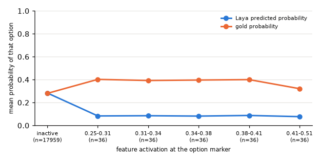

# Feature 6990

Critérios em que aparece: corr_error

**Interpretação (preencher):** 

---

## Maiores ativações

**tr_customer_service_000007 / needs_human** (noul, customer_service) | ativação 2.949 em `estado` | opções ['false', 'true'] | Laya: **false** [0.535, 0.465] | gabarito: **true**

```
[CLS]noul question: This conversation requires a human agent rather than automated handling.[SEP]
▸ [MASK] false: Automation can carry this to resolution.
▸ [MASK] true: A human must take over: judgement, authority or empathy is required.

[SEP]

{"account": {"lifetime_value_usd": 46, "prior_tickets_90d": 0, "seats": 1, "tenure_months": 1, "tier": "premium"}, "thread": [{"role": "customer", "text": "I'm trying to use the new collaboration feature I just paid for, but the invite link doesn't seem to do anything⟦ when⟧ my partner clicks it, am I missing a step?"}, {"role": "agent", "text": "I'd like to help you get that working. When your partner clicks the link, what exactly do they see on their screen?"}, {"role": "customer", "text": "They just see a blank white page, and I thought this was supposed to be a simple process for premium users."}, {"role": "agent", "text": "I see. Have you tried generating a new link to see if the same issue persists, or does it happen with every invite you send?"}, {"role": "customer", "text": "I tried creating three different links and they all lead to the same blank page, so I'm really confused about what the problem is."}]}[SEP]
```

**tr_customer_service_000007 / category** (choice, customer_service) | ativação 2.941 em `estado` | opções ['account', 'billing', 'delivery', 'refund', 'technical'] | Laya: **technical** [0.182, 0.131, 0.044, 0.098, 0.546] | gabarito: **technical**

```
[CLS]choice question: What is this customer conversation primarily about?[SEP]
▸ [MASK] account: Login, plan changes, profile or access management.
▸ [MASK] billing: A charge, invoice, subscription or payment problem.
▸ [MASK] delivery: Shipping, fulfilment or delivery of a physical item.
▸ [MASK] refund: The customer is explicitly asking for money back.
▸ [MASK] technical: The product or service is not working as expected.

[SEP]

{"account": {"lifetime_value_usd": 46, "prior_tickets_90d": 0, "seats": 1, "tenure_months": 1, "tier": "premium"}, "thread": [{"role": "customer", "text": "I'm trying to use the new collaboration feature I just paid for, but the invite link doesn't seem to do anything⟦ when⟧ my partner clicks it, am I missing a step?"}, {"role": "agent", "text": "I'd like to help you get that working. When your partner clicks the link, what exactly do they see on their screen?"}, {"role": "customer", "text": "They just see a blank white page, and I thought this was supposed to be a simple process for premium users."}, {"role": "agent", "text": "I see. Have you tried generating a new link to see if the same issue persists, or does it happen with every invite you send?"}, {"role": "customer", "text": "I tried creating three different links and they all lead to the same blank page, so I'm really confused about what the problem is."}]}[SEP]
```

**tr_customer_service_000297 / urgency** (score, customer_service) | ativação 2.934 em `estado` | opções ['0', '1', '2', '3'] | Laya: **1** [0.134, 0.615, 0.173, 0.078] | gabarito: **2**

```
[CLS]score question: How time-sensitive is this conversation?[SEP]
▸ [MASK] level 0: No time pressure; can wait indefinitely.
▸ [MASK] level 1: Routine; handle within the normal queue.
▸ [MASK] level 2: Elevated; should be handled within the same week.
▸ [MASK] level 3: Critical; requires action within the same day.

[SEP]

{"account": {"lifetime_value_usd": 581, "prior_tickets_90d": 2, "seats": 40, "tenure_months": 11, "tier": "enterprise"}, "orders": [{"amount_usd": 299, "date": "2026-03-03", "id": "A-90996", "status": "settled"}], "thread": [{"role": "customer", "text": "I just opened the box and the hardware is cracked, but I'm not sure if this happened during shipping or if it was like this already? I have a hard deadline this Friday and really need this working."}, {"role": "agent", "text": "I'm sorry to hear about the damage. To help me look into this, could you please provide your order number and upload a few photos of the packaging?"}, {"role": "customer", "text": "I think I sent photos in my last two tickets, but I can't remember⟦ if⟧ they actually saw them. Where do I upload them again?"}]}[SEP]
```

**tr_customer_service_000007 / urgency** (score, customer_service) | ativação 2.814 em `estado` | opções ['0', '1', '2', '3'] | Laya: **1** [0.071, 0.722, 0.152, 0.055] | gabarito: **2**

```
[CLS]score question: How time-sensitive is this conversation?[SEP]
▸ [MASK] level 0: No time pressure; can wait indefinitely.
▸ [MASK] level 1: Routine; handle within the normal queue.
▸ [MASK] level 2: Elevated; should be handled within the same week.
▸ [MASK] level 3: Critical; requires action within the same day.

[SEP]

{"account": {"lifetime_value_usd": 46, "prior_tickets_90d": 0, "seats": 1, "tenure_months": 1, "tier": "premium"}, "thread": [{"role": "customer", "text": "I'm trying to use the new collaboration feature I just paid for, but the invite link doesn't seem to do anything⟦ when⟧ my partner clicks it, am I missing a step?"}, {"role": "agent", "text": "I'd like to help you get that working. When your partner clicks the link, what exactly do they see on their screen?"}, {"role": "customer", "text": "They just see a blank white page, and I thought this was supposed to be a simple process for premium users."}, {"role": "agent", "text": "I see. Have you tried generating a new link to see if the same issue persists, or does it happen with every invite you send?"}, {"role": "customer", "text": "I tried creating three different links and they all lead to the same blank page, so I'm really confused about what the problem is."}]}[SEP]
```

**tr_customer_service_000007 / action** (choice, customer_service) | ativação 2.748 em `estado` | opções ['answer_directly', 'close_no_action', 'escalate_to_human', 'execute_refund', 'request_information'] | Laya: **close_no_action** [0.323, 0.331, 0.071, 0.055, 0.22] | gabarito: **request_information**

```
[CLS]choice question: What should the assistant do next with this conversation?[SEP]
▸ [MASK] answer_directly: The assistant can resolve this itself with information it already has.
▸ [MASK] close_no_action: No further action is warranted; the matter is settled.
▸ [MASK] escalate_to_human: Hand off to a human agent with the appropriate authority.
▸ [MASK] execute_refund: Issue the refund or credit the customer is owed.
▸ [MASK] request_information: More detail is needed from the customer before anything can be done.

[SEP]

{"account": {"lifetime_value_usd": 46, "prior_tickets_90d": 0, "seats": 1, "tenure_months": 1, "tier": "premium"}, "thread": [{"role": "customer", "text": "I'm trying to use the new collaboration feature I just paid for, but the invite link doesn't seem to do anything⟦ when⟧ my partner clicks it, am I missing a step?"}, {"role": "agent", "text": "I'd like to help you get that working. When your partner clicks the link, what exactly do they see on their screen?"}, {"role": "customer", "text": "They just see a blank white page, and I thought this was supposed to be a simple process for premium users."}, {"role": "agent", "text": "I see. Have you tried generating a new link to see if the same issue persists, or does it happen with every invite you send?"}, {"role": "customer", "text": "I tried creating three different links and they all lead to the same blank page, so I'm really confused about what the problem is."}]}[SEP]
```

## Ativações medianas (faixa 40-60%, mediana 0.613)

**tr_customer_service_000061 / needs_human** (noul, customer_service) | ativação 0.625 em `opção` | opções ['false', 'true'] | Laya: **true** [0.456, 0.544] | gabarito: **false**

```
[CLS]noul question: This conversation requires a human agent rather than automated handling.[SEP]
▸ [MASK] false⟦:⟧ Automation can carry this to resolution.
▸ [MASK] true: A human must take over: judgement, authority or empathy is required.

[SEP]

{"account": {"lifetime_value_usd": 1585, "prior_tickets_90d": 2, "seats": 1, "tenure_months": 41, "tier": "premium"}, "thread": [{"role": "customer", "text": "I'm trying to adjust my seat count again, but the dashboard is just giving me the same greyed-out error as last time."}, {"role": "agent", "text": "I apologize for the frustration; could you confirm if you are seeing this error on the billing page or the team management tab?"}, {"role": "customer", "text": "It's on the team management tab. Honestly, I'm used to this by now."}, {"role": "agent", "text": "Thank you for clarifying. Are you currently logged in as the primary account administrator when accessing that specific tab?"}, {"role": "customer", "text": "Yes, I am the admin. Nothing ever seems to change with these permissions."}, {"role": "agent", "text": "I appreciate your patience while we look into this. Could you please send me a screenshot of the specific error message you see?"}, {"role": "customer", "text": "I'll try to get that over later, but I don't really expect it to make a difference."}]}[SEP]
```

**tr_security_incidents_000110 / disposition** (choice, security_incidents) | ativação 0.618 em `opção` | opções ['close_benign', 'contain', 'investigate', 'monitor'] | Laya: **monitor** [0.307, 0.2, 0.145, 0.348] | gabarito: **investigate**

```
[CLS]choice question: How should this security alert be dispositioned?[SEP]
▸ [MASK] close_benign: Expected, explainable activity; close⟦ without⟧ analyst time.
▸ [MASK] contain: Contain the host or account immediately; do not wait for triage.
▸ [MASK] investigate: Warrants an analyst opening an investigation.
▸ [MASK] monitor: Not clearly malicious, but worth watching for recurrence.

[SEP]

{"alert": {"description": "many failed authentications followed by a success", "evidence": "Fifty‑seven failed RDP authentication attempts were logged against host WIN-DB01 (192.168.5.22) between 2026-09-15 14:10 and 14:18 UTC, followed by a successful login from the same source IP 172.16.8.44 at 14:19 UTC. The login used a shared_mailbox account with MFA enabled, unprivileged status, and a password that has not been rotated for 700 days; the source IP is present on the allowlist.", "rule": "brute_force"}, "context": {"asset_criticality": "high", "change_window_active": false, "source_on_allowlist": true}, "history": {"credential_rotation_days_ago": 700, "distinct_countries_30d": 1, "logins_30d": 1558, "prior_alerts_90d": 1}, "principal": {"mfa_enrolled": true, "name": "svc-billing-899", "privileges": ["repo:read"], "type": "shared_mailbox"}}[SEP]
```

**tr_security_incidents_000192 / disposition** (choice, security_incidents) | ativação 0.654 em `opção` | opções ['close_benign', 'contain', 'investigate', 'monitor'] | Laya: **close_benign** [0.515, 0.16, 0.109, 0.217] | gabarito: **contain**

```
[CLS]choice question: How should this security alert be dispositioned?[SEP]
▸ [MASK] close_benign: Expected, explainable activity; close without analyst time.
▸ [MASK] contain: Contain the host or account immediately; do not wait for triage.
▸ [MASK] investigate: Warrants⟦ an⟧ analyst opening an investigation.
▸ [MASK] monitor: Not clearly malicious, but worth watching for recurrence.

[SEP]

{"alert": {"description": "an unusual volume of files read in a short window", "evidence": "Between 02:15 and 02:20 UTC the privileged contractor account C12345 accessed 487 files on \\srv-data\\share via SMB, averaging about 95 files per minute. The source IP for these accesses was 203.0.113.45, which is not listed in the approved corporate address range. MFA was recorded as enabled for this account.", "rule": "mass_download"}, "context": {"asset_criticality": "high", "change_window_active": false, "source_on_allowlist": false}, "history": {"credential_rotation_days_ago": 365, "distinct_countries_30d": 3, "logins_30d": 1271, "prior_alerts_90d": 3}, "principal": {"mfa_enrolled": true, "name": "svc-billing-478", "privileges": ["deploy:production", "secrets:read"], "type": "contractor"}}[SEP]
```

**tr_customer_service_000166 / action** (choice, customer_service) | ativação 0.583 em `estado` | opções ['answer_directly', 'close_no_action', 'escalate_to_human', 'execute_refund', 'request_information'] | Laya: **close_no_action** [0.136, 0.444, 0.14, 0.12, 0.159] | gabarito: **escalate_to_human**

```
[CLS]choice question: What should the assistant do next with this conversation?[SEP]
▸ [MASK] answer_directly: The assistant can resolve this itself with information it already has.
▸ [MASK] close_no_action: No further action is warranted; the matter is settled.
▸ [MASK] escalate_to_human: Hand off to a human agent with the appropriate authority.
▸ [MASK] execute_refund: Issue the refund or credit the customer is owed.
▸ [MASK] request_information: More detail is needed from the customer before anything can be done.

[SEP]

{"account": {"lifetime_value_usd": 102, "prior_tickets_90d": 1, "seats": 1, "tenure_months": 2, "tier": "standard"}, "orders": [{"amount_usd": 9, "date": "2026-03-23", "id": "A-71466", "status": "settled"}, {"amount_usd": 9, "date": "2026-01-21", "id": "A-62774", "status": "settled"}], "thread": [⟦{"⟧role": "customer", "text": "I am furious. I downgraded my plan weeks ago to avoid that extra $9 fee, yet here it is on my bill again. I already dealt with this exact issue once before, and I am sick of wasting my time."}, {"role": "agent", "text": "I am very sorry to hear that the charge has appeared again despite your previous interaction. Could you please confirm the date on which you requested the downgrade?"}, {"role": "customer", "text": "I don't have the date right in front of me, but I have the transcript from the last time I complained about this. Are you going to tell me you can't see that in your system?"}]}[SEP]
```

**tr_customer_service_000289 / action** (choice, customer_service) | ativação 0.637 em `estado` | opções ['answer_directly', 'close_no_action', 'escalate_to_human', 'execute_refund', 'request_information'] | Laya: **close_no_action** [0.202, 0.333, 0.058, 0.083, 0.324] | gabarito: **request_information**

```
[CLS]choice question: What should the assistant do next with this conversation?[SEP]
▸ [MASK] answer_directly: The assistant can resolve this itself with information it already has.
▸ [MASK] close_no_action: No further action is warranted; the matter is settled.
▸ [MASK] escalate_to_human: Hand off to a human agent with the appropriate authority.
▸ [MASK] execute_refund: Issue the refund or credit the customer is owed.
▸ [MASK] request_information: More detail is needed from the customer before anything can be done.

[SEP]

{"account": {"lifetime_value_usd": 1589, "prior_tickets_90d": 0, "seats": 12, "tenure_months": 19, "tier": "premium"}, "thread": [{"role": "customer", "text": "The recurring payment for my premium subscription failed this morning. The card on file is active and has sufficient funds."}, {"role": "agent", "text": "I can certainly look into that for you. Could you please confirm the last four digits of the card you are currently using for this subscription?"}, {"role": "customer", "text": "The card ends in 1004. I have already verified with my bank that there are no blocks or restrictions on this account."}, {"role": "agent", "text": "Thank you for checking that. Are you seeing a specific error code in your billing dashboard, or did you only receive a generic failure notification via email⟦?"⟧}, {"role": "customer", "text": "The dashboard only indicates that the transaction was declined without providing a specific code. I need to know why the system is rejecting it."}]}[SEP]
```

## Estatísticas (conjunto de descoberta, dev e teste)

**pred / error**

| split | decisões | ativas | ativas e Laya errou | taxa | lift | q (BH) | OR (CMH) | q (CMH) |
|---|---|---|---|---|---|---|---|---|
| discovery | 5100 | 0 | 0 | nan | nan | nan | nan | nan |
| dev | 900 | 0 | 0 | nan | nan | nan | nan | nan |
| test | 2000 | 0 | 0 | nan | nan | nan | nan | nan |

**corr / error**

| split | decisões | ativas | ativas e Laya errou | taxa | lift | q (BH) | OR (CMH) | q (CMH) |
|---|---|---|---|---|---|---|---|---|
| discovery | 5100 | 77 | 77 | 1.000 | 1.57 | 4.02e-15 | nan | nan |
| dev | 900 | 10 | 10 | 1.000 | 1.52 | nan | nan | nan |
| test | 2000 | 22 | 22 | 1.000 | 1.57 | 0.000176 | nan | nan |

**state / error**

| split | decisões | ativas | ativas e Laya errou | taxa | lift | q (BH) | OR (CMH) | q (CMH) |
|---|---|---|---|---|---|---|---|---|
| discovery | 5100 | 771 | 454 | 0.589 | 0.93 | 0.0446 | 0.84 | 0.12 |
| dev | 900 | 133 | 84 | 0.632 | 0.96 | 1 | 0.88 | 0.785 |
| test | 2000 | 335 | 215 | 0.642 | 1.01 | 1 | 0.98 | 0.957 |

Confusão mais sobre-representada (corr): `action|0>1` (n=77, lift 42.86, p=0). Formato `pergunta|índice previsto>índice correto`.

Confusão mais sobre-representada (state): `risk|1>2` (n=22, lift 3.10, p=2.29e-07). Formato `pergunta|índice previsto>índice correto`.



