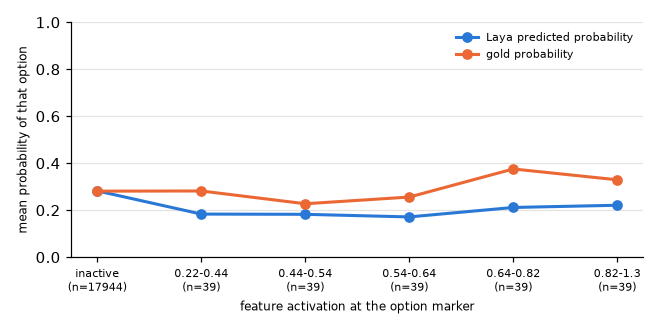

# Feature 7099

Critérios em que aparece: corr_error

**Interpretação (preencher):** 

---

## Maiores ativações

**tr_customer_service_000202 / churn_risk** (score, customer_service) | ativação 2.449 em `estado` | opções ['0', '1', '2', '3'] | Laya: **2** [0.043, 0.265, 0.599, 0.093] | gabarito: **2**

```
[CLS]score question: How likely is this customer to stop doing business with us because of this interaction?[SEP]
▸ [MASK] level 0: No sign of dissatisfaction.
▸ [MASK] level 1: Mild frustration, but the relationship is intact.
▸ [MASK] level 2: Clearly unhappy; repeat problems or explicit complaints.
▸ [MASK] level 3: Imminent: threatening to cancel, dispute or leave.

[SEP]

{"account": {"lifetime_value_usd": 271, "prior_tickets_90d": 1, "seats": 1, "tenure_months": 11, "tier": "free"}, "thread": [{"role": "customer", "text": "Your new analytics dashboard stopped updating two hours⟦ ago⟧, and I’ve been trying to get this fixed all day—this is unacceptable!"}, {"role": "agent", "text": "I understand your frustration. Can you tell me which browser and version you’re using, and whether you see any error messages?"}, {"role": "customer", "text": "I’m on Chrome 115, and the page just shows a blank screen with a 500 error. I need this working by tomorrow’s reporting deadline, so I expect a quick response."}]}[SEP]
```

**tr_customer_service_000202 / action** (choice, customer_service) | ativação 2.420 em `estado` | opções ['answer_directly', 'close_no_action', 'escalate_to_human', 'execute_refund', 'request_information'] | Laya: **close_no_action** [0.249, 0.458, 0.104, 0.055, 0.132] | gabarito: **escalate_to_human**

```
[CLS]choice question: What should the assistant do next with this conversation?[SEP]
▸ [MASK] answer_directly: The assistant can resolve this itself with information it already has.
▸ [MASK] close_no_action: No further action is warranted; the matter is settled.
▸ [MASK] escalate_to_human: Hand off to a human agent with the appropriate authority.
▸ [MASK] execute_refund: Issue the refund or credit the customer is owed.
▸ [MASK] request_information: More detail is needed from the customer before anything can be done.

[SEP]

{"account": {"lifetime_value_usd": 271, "prior_tickets_90d": 1, "seats": 1, "tenure_months": 11, "tier": "free"}, "thread": [{"role": "customer", "text": "Your new analytics dashboard stopped updating two hours⟦ ago⟧, and I’ve been trying to get this fixed all day—this is unacceptable!"}, {"role": "agent", "text": "I understand your frustration. Can you tell me which browser and version you’re using, and whether you see any error messages?"}, {"role": "customer", "text": "I’m on Chrome 115, and the page just shows a blank screen with a 500 error. I need this working by tomorrow’s reporting deadline, so I expect a quick response."}]}[SEP]
```

**tr_customer_service_000202 / urgency** (score, customer_service) | ativação 2.385 em `estado` | opções ['0', '1', '2', '3'] | Laya: **1** [0.044, 0.665, 0.13, 0.161] | gabarito: **3**

```
[CLS]score question: How time-sensitive is this conversation?[SEP]
▸ [MASK] level 0: No time pressure; can wait indefinitely.
▸ [MASK] level 1: Routine; handle within the normal queue.
▸ [MASK] level 2: Elevated; should be handled within the same week.
▸ [MASK] level 3: Critical; requires action within the same day.

[SEP]

{"account": {"lifetime_value_usd": 271, "prior_tickets_90d": 1, "seats": 1, "tenure_months": 11, "tier": "free"}, "thread": [{"role": "customer", "text": "Your new analytics dashboard stopped updating two hours⟦ ago⟧, and I’ve been trying to get this fixed all day—this is unacceptable!"}, {"role": "agent", "text": "I understand your frustration. Can you tell me which browser and version you’re using, and whether you see any error messages?"}, {"role": "customer", "text": "I’m on Chrome 115, and the page just shows a blank screen with a 500 error. I need this working by tomorrow’s reporting deadline, so I expect a quick response."}]}[SEP]
```

**tr_security_incidents_000280 / credential_compromise** (noul, security_incidents) | ativação 2.367 em `estado` | opções ['false', 'true'] | Laya: **true** [0.089, 0.911] | gabarito: **false**

```
[CLS]noul question: The evidence indicates a credential or account has been compromised.[SEP]
▸ [MASK] false: no, the statement does not hold
▸ [MASK] true: yes, the statement holds

[SEP]

{"alert": {"description": "a session token was presented from a second address", "evidence": "Session token \"f9d2a1c3\" associated with shared_mailbox@example.com was first used from IP 198.51.100.22 at 2026-09-16 02:11 UTC and then presented⟦ again⟧ from IP 198.51.100.55 at 2026-09-16 02:13 UTC. Both source IPs are on the allowlist; the token holder's credentials were last rotated 412 days ago and no change window was active.", "rule": "token_reuse"}, "context": {"asset_criticality": "low", "change_window_active": false, "source_on_allowlist": true}, "history": {"credential_rotation_days_ago": 412, "distinct_countries_30d": 4, "logins_30d": 1529, "prior_alerts_90d": 3}, "principal": {"mfa_enrolled": true, "name": "ci-analytics-679", "privileges": ["repo:read"], "type": "shared_mailbox"}}[SEP]
```

**tr_customer_service_000206 / action** (choice, customer_service) | ativação 2.350 em `estado` | opções ['answer_directly', 'close_no_action', 'escalate_to_human', 'execute_refund', 'request_information'] | Laya: **close_no_action** [0.213, 0.356, 0.132, 0.096, 0.202] | gabarito: **escalate_to_human**

```
[CLS]choice question: What should the assistant do next with this conversation?[SEP]
▸ [MASK] answer_directly: The assistant can resolve this itself with information it already has.
▸ [MASK] close_no_action: No further action is warranted; the matter is settled.
▸ [MASK] escalate_to_human: Hand off to a human agent with the appropriate authority.
▸ [MASK] execute_refund: Issue the refund or credit the customer is owed.
▸ [MASK] request_information: More detail is needed from the customer before anything can be done.

[SEP]

{"account": {"lifetime_value_usd": 152, "prior_tickets_90d": 3, "seats": 1, "tenure_months": 5, "tier": "standard"}, "orders": [{"amount_usd": 297, "date": "2026-03-11", "id": "A-35334", "status": "settled"}], "thread": [{"role": "customer", "text": "I just got an email saying my $297 payment failed, but I don't understand why because I haven't changed any of my bank settings."}, {"role": "agent", "text": "I can certainly look into that billing notification for you. Have you recently updated any of the security features on your credit card, such as a new expiration date or CVV?"}, {"role": "customer", "text": "No, everything is exactly the same as it was when it worked two months ago. This same thing happened back in June and then it just started working again for no reason."}, {"role": "agent", "text": "I see that we've had a few intermittent issues with this account in the past. Are you getting a specific error message⟦ when⟧ you try to manually process the payment through the 'Pay Now' button?"}, {"role": "customer", "text": "It just gives me a red box that says 'Transaction Denied' and tells me to contact my administrator, but I am the administrator."}, {"role": "agent", "text": "That is definitely confusing. Could you tell me if you are trying to process this through a VPN or a restricted corporate network, as that can sometimes trigger a decline?"}, {"role": "customer", "text": "I'm just using my home Wi-Fi like I always do, so I don't think it's a network problem on my end."}]}[SEP]
```

## Ativações medianas (faixa 40-60%, mediana 0.706)

**tr_invoice_processing_000245 / matches_order** (noul, invoice_processing) | ativação 0.722 em `opção` | opções ['false', 'true'] | Laya: **true** [0.481, 0.519] | gabarito: **true**

```
[CLS]noul question: The invoice reconciles with the purchase order and the recorded delivery.[SEP]
▸ [MASK] false: There⟦ is⟧ a discrepancy against the order or the delivery.
▸ [MASK] true: Line items, quantities and amounts reconcile.

[SEP]

{"delivery": {"condition": "accepted", "date": "2026-03-14", "received_qty": 1000}, "invoice": {"currency": "EUR", "id": "INV-2026-4696", "lines": [{"qty": 1000, "sku": "SKU-228", "total_usd": 175820.0, "unit_usd": 175.82}], "total_usd": 175820.0, "vendor": "Orbit Logistics"}, "payment": {"days_until_due": -3, "discount_expires_in_days": null, "early_payment_discount_pct": null, "status": "overdue", "terms": "net 15"}, "purchase_order": {"freight_terms": "freight prepaid by vendor, not separately billable", "id": "PO-4111", "lines": [{"qty": 1000, "unit_usd": 175.82}], "total_usd": 175820.0}, "vendor_history": {"disputes_12m": 0, "invoices_12m": 48, "prior_invoice_ids": ["INV-2026-6883", "INV-2026-3464"]}}[SEP]
```

**tr_security_incidents_000090 / disposition** (choice, security_incidents) | ativação 0.644 em `estado` | opções ['close_benign', 'contain', 'investigate', 'monitor'] | Laya: **close_benign** [0.462, 0.181, 0.108, 0.248] | gabarito: **investigate**

```
[CLS]choice question: How should this security alert be dispositioned?[SEP]
▸ [MASK] close_benign: Expected, explainable activity; close without analyst time.
▸ [MASK] contain: Contain the host or account immediately; do not wait for triage.
▸ [MASK] investigate: Warrants an analyst opening an investigation.
▸ [MASK] monitor: Not clearly malicious, but worth watching for recurrence.

[SEP]

{"alert": {"description": "two successful logins from distant locations too close together", "evidence": "At 2026-09-14 03:12:04 UTC a successful authentication for the CI_Runner service was logged from IP 203.0.113.45 (Paris, FR). A second successful login for the same principal occurred 6 minutes later from IP 198.51.100.22 (Tokyo, JP), and the system flagged the source as not present in the allowlist. The change‑window flag was active and the associated credentials were last rotated on 2026-08-15.", "rule": "impossible_travel"}, "context": {"asset_criticality": "high",⟦ "⟧change_window_active": true, "source_on_allowlist": false}, "history": {"credential_rotation_days_ago": 30, "distinct_countries_30d": 1, "logins_30d": 587, "prior_alerts_90d": 0}, "principal": {"mfa_enrolled": true, "name": "adm-billing-542", "privileges": ["deploy:production", "secrets:read"], "type": "ci_runner"}}[SEP]
```

**tr_invoice_processing_000068 / matches_order** (noul, invoice_processing) | ativação 0.659 em `estado` | opções ['false', 'true'] | Laya: **true** [0.478, 0.522] | gabarito: **true**

```
[CLS]noul question: The invoice reconciles with the purchase order and the recorded delivery.[SEP]
▸ [MASK] false: There is a discrepancy against the order or the delivery.
▸ [MASK] true: Line items, quantities and amounts reconcile.

[SEP]

{"delivery": {"condition": "accepted with exceptions", "date": "2026-03-18", "received_qty": 50}, "invoice": {"currency": "USD", "id": "INV-2026-5355", "lines": [{"qty": 50, "sku": "SKU-380", "total_usd": 1136.5, "unit_usd": 22.73}], "total_usd": 1136.5, "vendor": "Vantage Materials"}, "payment": {"days_until_due": 27, "discount_expires_in_days": 3, "early_payment_discount_pct": 2.0, "status": "scheduled", "terms": "net 45"}, "purchase_order": {"freight_terms": "freight prepaid by vendor, not separately billable", "id": null, "lines": [{"qty": 50, "unit_usd": 22.73}], "total_usd": 1136.5}, "vendor_history": {"disputes_12m": 1, "invoices_12m": 33, "prior_invoice_ids": ["INV-2026-2856⟦",⟧ "INV-2026-9344"]}}[SEP]
```

**tr_customer_service_000123 / churn_risk** (score, customer_service) | ativação 0.763 em `estado` | opções ['0', '1', '2', '3'] | Laya: **1** [0.114, 0.448, 0.316, 0.122] | gabarito: **2**

```
[CLS]score question: How likely is this customer to stop doing business with us because of this interaction?[SEP]
▸ [MASK] level 0: No sign of dissatisfaction.
▸ [MASK] level 1: Mild frustration, but the relationship is intact.
▸ [MASK] level 2: Clearly unhappy; repeat problems or explicit complaints.
▸ [MASK] level 3: Imminent: threatening to cancel, dispute or leave.

[SEP]

{"account": {"lifetime_value_usd": 154, "prior_tickets_90d": 1, "seats": 5, "tenure_months": 2, "tier": "premium"}, "thread": [{"role": "customer", "text": "Hello there. I'm having a bit of a problem logging into my Premium account this morning. It keeps telling me my credentials aren't recognized, even though I haven't changed them."}, {"role": "agent", "text": "I'd be happy to help you with that. Are you seeing a specific error code, or is it just the standard 'invalid password' notification?"},⟦ {"⟧role": "customer", "text": "It says 'User not found.' I had a ticket open last week about account syncing and the agent promised it would be fixed by now, but it seems I'm still locked out."}, {"role": "agent", "text": "I see. Since you mentioned the previous ticket, did you receive a confirmation email or a link to verify your identity after that interaction?"}, {"role": "customer", "text": "No, I never received any follow-up email at all, which is why I'm reaching out again. I've only been using the service for two months and I really like it, but I can't use what I can't access."}, {"role": "agent", "text": "I appreciate your patience while we work through this. Could you please confirm the primary email address associated with your account so I can check the status of your profile?"}, {"role": "customer", "text": "Of course, it's j.smith@example.com. I have a hard deadline for a project presentation at 1:00 PM today that requires the data in that account, so if you could check on that for me, I'd appreciate it."}]}[SEP]
```

**tr_customer_service_000280 / needs_human** (noul, customer_service) | ativação 0.768 em `opção` | opções ['false', 'true'] | Laya: **true** [0.359, 0.641] | gabarito: **false**

```
[CLS]noul question: This conversation requires a human agent rather than automated handling.[SEP]
▸ [MASK] false: Automation can carry this⟦ to⟧ resolution.
▸ [MASK] true: A human must take over: judgement, authority or empathy is required.

[SEP]

{"account": {"lifetime_value_usd": 1324, "prior_tickets_90d": 5, "seats": 5, "tenure_months": 33, "tier": "premium"}, "thread": [{"role": "customer", "text": "Hey, I just saw a notification about a failed payment on my premium account, but I’ve been paying this same way for 33 months without any issues. I'm really not sure what changed?"}, {"role": "agent", "text": "I understand the confusion. To help me investigate why the transaction did not go through this time, could you confirm if you have recently updated any banking or card details?"}, {"role": "customer", "text": "I haven't touched my settings at all, everything looks exactly like it did last month. Do you think there is a glitch in the billing system?"}, {"role": "agent", "text": "That is a fair question. To get a better look, could you provide the last four digits of the payment method currently listed on your profile?"}, {"role": "customer", "text": "Let me check that for you—it ends in 4922. Is there anything else you need from my end to figure this out?"}]}[SEP]
```

## Estatísticas (conjunto de descoberta, dev e teste)

**pred / error**

| split | decisões | ativas | ativas e Laya errou | taxa | lift | q (BH) | OR (CMH) | q (CMH) |
|---|---|---|---|---|---|---|---|---|
| discovery | 5100 | 9 | 9 | 1.000 | 1.57 | nan | nan | nan |
| dev | 900 | 0 | 0 | nan | nan | nan | nan | nan |
| test | 2000 | 2 | 2 | 1.000 | 1.57 | nan | nan | nan |

**corr / error**

| split | decisões | ativas | ativas e Laya errou | taxa | lift | q (BH) | OR (CMH) | q (CMH) |
|---|---|---|---|---|---|---|---|---|
| discovery | 5100 | 61 | 61 | 1.000 | 1.57 | 5.12e-12 | inf | 0.142 |
| dev | 900 | 9 | 9 | 1.000 | 1.52 | nan | nan | nan |
| test | 2000 | 20 | 20 | 1.000 | 1.57 | 0.000422 | inf | 0.458 |

**state / error**

| split | decisões | ativas | ativas e Laya errou | taxa | lift | q (BH) | OR (CMH) | q (CMH) |
|---|---|---|---|---|---|---|---|---|
| discovery | 5100 | 2562 | 1662 | 0.649 | 1.02 | 0.271 | 1.22 | 0.011 |
| dev | 900 | 442 | 284 | 0.643 | 0.98 | 1 | 0.99 | 0.986 |
| test | 2000 | 941 | 621 | 0.660 | 1.04 | 0.412 | 1.36 | 0.0214 |

Confusão mais sobre-representada (pred): `urgency|3>2` (n=3, lift 188.89, p=nan). Formato `pergunta|índice previsto>índice correto`.

Confusão mais sobre-representada (corr): `urgency|1>3` (n=32, lift 9.16, p=1.66e-24). Formato `pergunta|índice previsto>índice correto`.

Confusão mais sobre-representada (state): `action|1>2` (n=90, lift 1.43, p=4.46e-07). Formato `pergunta|índice previsto>índice correto`.



