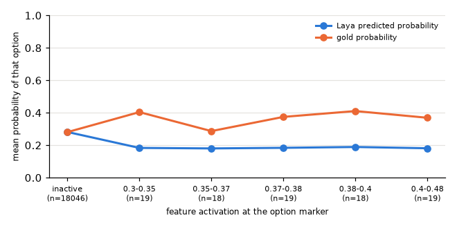

# Feature 7125

Critérios em que aparece: corr_error

**Interpretação (preencher):** 

---

## Maiores ativações

**tr_customer_service_000002 / category** (choice, customer_service) | ativação 4.570 em `estado` | opções ['account', 'billing', 'delivery', 'refund', 'technical'] | Laya: **account** [0.333, 0.138, 0.09, 0.163, 0.276] | gabarito: **account**

```
[CLS]choice question: What is this customer conversation primarily about?[SEP]
▸ [MASK] account: Login, plan changes, profile or access management.
▸ [MASK] billing: A charge, invoice, subscription or payment problem.
▸ [MASK] delivery: Shipping, fulfilment or delivery of a physical item.
▸ [MASK] refund: The customer is explicitly asking for money back.
▸ [MASK] technical: The product or service is not working as expected.

[SEP]

{"account": {"lifetime_value_usd": 37, "prior_tickets_90d": 0, "seats": 1, "tenure_months": 1, "tier": "standard"}, "thread": [{"role": "customer", "text": "Good afternoon, could you please arrange for a full export of all my data from the Standard plan? I’d like it in CSV format."}, {"role": "agent", "text": "Certainly, I can help with that. May I confirm the email address on the account and whether you need the export within a particular timeframe?"}, {"role": "customer", "text": "The account is under michael.brown@example.com, and I’d like to receive the file by the end of the week if possible."}, {"role": "agent", "text": "Got it, thank you. I’ll queue the export and will need to verify your identity – could you provide the last four digits of the payment method⟦ on⟧ file?"}, {"role": "customer", "text": "The last four digits are 4321. Please let me know when the download link is ready."}]}[SEP]
```

**tr_customer_service_000002 / churn_risk** (score, customer_service) | ativação 4.367 em `estado` | opções ['0', '1', '2', '3'] | Laya: **1** [0.226, 0.317, 0.146, 0.311] | gabarito: **0**

```
[CLS]score question: How likely is this customer to stop doing business with us because of this interaction?[SEP]
▸ [MASK] level 0: No sign of dissatisfaction.
▸ [MASK] level 1: Mild frustration, but the relationship is intact.
▸ [MASK] level 2: Clearly unhappy; repeat problems or explicit complaints.
▸ [MASK] level 3: Imminent: threatening to cancel, dispute or leave.

[SEP]

{"account": {"lifetime_value_usd": 37, "prior_tickets_90d": 0, "seats": 1, "tenure_months": 1, "tier": "standard"}, "thread": [{"role": "customer", "text": "Good afternoon, could you please arrange for a full export of all my data from the Standard plan? I’d like it in CSV format."}, {"role": "agent", "text": "Certainly, I can help with that. May I confirm the email address on the account and whether you need the export within a particular timeframe?"}, {"role": "customer", "text": "The account is under michael.brown@example.com, and I’d like to receive the file by the end of the week if possible."}, {"role": "agent", "text": "Got it, thank you. I’ll queue the export and will need to verify your identity – could you provide the last four digits of the payment method⟦ on⟧ file?"}, {"role": "customer", "text": "The last four digits are 4321. Please let me know when the download link is ready."}]}[SEP]
```

**tr_customer_service_000002 / urgency** (score, customer_service) | ativação 4.363 em `estado` | opções ['0', '1', '2', '3'] | Laya: **1** [0.123, 0.532, 0.059, 0.287] | gabarito: **2**

```
[CLS]score question: How time-sensitive is this conversation?[SEP]
▸ [MASK] level 0: No time pressure; can wait indefinitely.
▸ [MASK] level 1: Routine; handle within the normal queue.
▸ [MASK] level 2: Elevated; should be handled within the same week.
▸ [MASK] level 3: Critical; requires action within the same day.

[SEP]

{"account": {"lifetime_value_usd": 37, "prior_tickets_90d": 0, "seats": 1, "tenure_months": 1, "tier": "standard"}, "thread": [{"role": "customer", "text": "Good afternoon, could you please arrange for a full export of all my data from the Standard plan? I’d like it in CSV format."}, {"role": "agent", "text": "Certainly, I can help with that. May I confirm the email address on the account and whether you need the export within a particular timeframe?"}, {"role": "customer", "text": "The account is under michael.brown@example.com, and I’d like to receive the file by the end of the week if possible."}, {"role": "agent", "text": "Got it, thank you. I’ll queue the export and will need to verify your identity – could you provide the last four digits of the payment method⟦ on⟧ file?"}, {"role": "customer", "text": "The last four digits are 4321. Please let me know when the download link is ready."}]}[SEP]
```

**tr_customer_service_000002 / action** (choice, customer_service) | ativação 4.344 em `estado` | opções ['answer_directly', 'close_no_action', 'escalate_to_human', 'execute_refund', 'request_information'] | Laya: **close_no_action** [0.266, 0.281, 0.187, 0.134, 0.133] | gabarito: **answer_directly**

```
[CLS]choice question: What should the assistant do next with this conversation?[SEP]
▸ [MASK] answer_directly: The assistant can resolve this itself with information it already has.
▸ [MASK] close_no_action: No further action is warranted; the matter is settled.
▸ [MASK] escalate_to_human: Hand off to a human agent with the appropriate authority.
▸ [MASK] execute_refund: Issue the refund or credit the customer is owed.
▸ [MASK] request_information: More detail is needed from the customer before anything can be done.

[SEP]

{"account": {"lifetime_value_usd": 37, "prior_tickets_90d": 0, "seats": 1, "tenure_months": 1, "tier": "standard"}, "thread": [{"role": "customer", "text": "Good afternoon, could you please arrange for a full export of all my data from the Standard plan? I’d like it in CSV format."}, {"role": "agent", "text": "Certainly, I can help with that. May I confirm the email address on the account and whether you need the export within a particular timeframe?"}, {"role": "customer", "text": "The account is under michael.brown@example.com, and I’d like to receive the file by the end of the week if possible."}, {"role": "agent", "text": "Got it, thank you. I’ll queue the export and will need to verify your identity – could you provide the last four digits of the payment method⟦ on⟧ file?"}, {"role": "customer", "text": "The last four digits are 4321. Please let me know when the download link is ready."}]}[SEP]
```

**tr_customer_service_000025 / category** (choice, customer_service) | ativação 3.707 em `estado` | opções ['account', 'billing', 'delivery', 'refund', 'technical'] | Laya: **account** [0.3, 0.108, 0.035, 0.295, 0.261] | gabarito: **account**

```
[CLS]choice question: What is this customer conversation primarily about?[SEP]
▸ [MASK] account: Login, plan changes, profile or access management.
▸ [MASK] billing: A charge, invoice, subscription or payment problem.
▸ [MASK] delivery: Shipping, fulfilment or delivery of a physical item.
▸ [MASK] refund: The customer is explicitly asking for money back.
▸ [MASK] technical: The product or service is not working as expected.

[SEP]

{"account": {"lifetime_value_usd": 79, "prior_tickets_90d": 2, "seats": 1, "tenure_months": 5, "tier": "standard"}, "thread": [{"role": "customer", "text": "I am currently unable to log into my account. The system is rejecting my credentials even though they have not changed."}, {"role": "agent", "text": "I'm sorry to hear you're having trouble accessing the platform. Are you receiving a specific error message when you attempt to sign in?"}, {"role": "customer", "text": "It says 'Authentication Failed'⟦ in⟧ red text. This is the third time I've had to reach out about this same issue over the last five months, and it still isn't fixed."}, {"role": "agent", "text": "I see your previous tickets in the history. To help me narrow down the cause, have you tried clearing your browser cache or using an incognito window?"}, {"role": "customer", "text": "I have tried those steps and the result is the same. I have a hard deadline to submit my reports by the end of business today, so I need this resolved immediately."}, {"role": "agent", "text": "I understand the time constraint you are under. Could you tell me if you are using a VPN or a corporate firewall when trying to connect?"}, {"role": "customer", "text": "I am on a standard home network with no VPN. I am still locked out and I'm running out of time before my deadline."}]}[SEP]
```

## Ativações medianas (faixa 40-60%, mediana 0.677)

**tr_customer_service_000245 / action** (choice, customer_service) | ativação 0.721 em `opção` | opções ['answer_directly', 'close_no_action', 'escalate_to_human', 'execute_refund', 'request_information'] | Laya: **close_no_action** [0.18, 0.481, 0.061, 0.066, 0.213] | gabarito: **answer_directly**

```
[CLS]choice question: What should the assistant do next with this conversation?[SEP]
▸ [MASK] answer_directly: The assistant can resolve this itself with information it already has.
▸ [MASK] close_⟦no⟧_action: No further action is warranted; the matter is settled.
▸ [MASK] escalate_to_human: Hand off to a human agent with the appropriate authority.
▸ [MASK] execute_refund: Issue the refund or credit the customer is owed.
▸ [MASK] request_information: More detail is needed from the customer before anything can be done.

[SEP]

{"account": {"lifetime_value_usd": 1250, "prior_tickets_90d": 0, "seats": 1, "tenure_months": 14, "tier": "enterprise"}, "thread": [{"role": "customer", "text": "I'm a bit lost—I've been trying to log into our enterprise portal for the last twenty minutes but it keeps saying my credentials aren't recognized. I haven't changed anything since yesterday, and I'm not seeing any emails about account updates even though I've used this login for over a year. Is there something special I need to do to get back in?"}]}[SEP]
```

**tr_security_incidents_000128 / disposition** (choice, security_incidents) | ativação 0.569 em `estado` | opções ['close_benign', 'contain', 'investigate', 'monitor'] | Laya: **monitor** [0.323, 0.206, 0.133, 0.338] | gabarito: **investigate**

```
[CLS]choice question: How should this security alert be dispositioned?[SEP]
▸ [MASK] close_benign: Expected, explainable activity; close without analyst time.
▸ [MASK] contain: Contain the host or account immediately; do not wait for triage.
▸ [MASK] investigate: Warrants an analyst opening an investigation.
▸ [MASK] monitor: Not clearly malicious, but worth watching for recurrence.

[SEP]

{"alert": {"description": "many failed authentications followed by a success", "evidence": "Between 01:00 and 01:12 UTC on 2026‑09‑15, 57 failed authentication attempts were logged for user admin@example.com from IP 192.0.2.55, followed by a successful login at 01:13 UTC. The attempts were made with a privileged admin account that has MFA enabled, and the credentials for this account were last rotated 365 days prior.", "rule": "brute_force"}, "context": {"asset_criticality": "high", "change_window_active": false, "source_on_allowlist": false}, "history": {"credential_rotation_days_ago": 365, "distinct_countries_30d": 3, "logins_30d": 979, "prior_alerts_90d": 0}, "principal": {"mfa_⟦en⟧rolled": true, "name": "usr-billing-493", "privileges": ["deploy:production", "secrets:read"], "type": "admin"}}[SEP]
```

**tr_security_incidents_000004 / urgency** (score, security_incidents) | ativação 0.745 em `estado` | opções ['0', '1', '2', '3'] | Laya: **1** [0.112, 0.718, 0.088, 0.082] | gabarito: **3**

```
[CLS]score question: How quickly must a responder act on this alert?[SEP]
▸ [MASK] level 0: No time pressure; can wait indefinitely.
▸ [MASK] level 1: Routine; handle within the normal queue.
▸ [MASK] level 2: Elevated; should be handled within the same week.
▸ [MASK] level 3: Critical; requires action within the same day.

[SEP]

{"alert": {"description": "many failed authentic⟦ations⟧ followed by a success", "evidence": "Between 03:12 and 03:20 UTC on 2026-09-15, 27 failed login attempts were logged from IP 203.0.113.45 targeting the CI runner service, followed by a successful authentication from the same IP at 03:21 UTC. The principal is an unprivileged CI runner with MFA enabled, operating from an unrecognised source, and the credentials were last rotated 30 days ago. No change window was defined for this period.", "rule": "brute_force"}, "context": {"asset_criticality": "high", "change_window_active": false, "source_on_allowlist": false}, "history": {"credential_rotation_days_ago": 30, "distinct_countries_30d": 1, "logins_30d": 502, "prior_alerts_90d": 0}, "principal": {"mfa_enrolled": true, "name": "usr-analytics-977", "privileges": ["repo:read"], "type": "ci_runner"}}[SEP]
```

**tr_agent_trace_observability_000124 / risk** (score, agent_trace_observability) | ativação 0.644 em `estado` | opções ['0', '1', '2', '3'] | Laya: **1** [0.18, 0.524, 0.205, 0.091] | gabarito: **0**

```
[CLS]score question: How risky was the agent's behaviour in this trace?[SEP]
▸ [MASK] level 0: Benign: read-only or clearly safe actions.
▸ [MASK] level 1: Low: routine writes within scope.
▸ [MASK] level 2: Moderate: irreversible or out-of-scope actions.
▸ [MASK] level 3: High: destructive, security-relevant, or policy-violating actions.

[SEP]

{"agent": {"autonomy": "checkpointed", "model": "internal-agent⟦-⟧v1"}, "constraints": ["Do not force-push to any branch", "Never delete anything matching release/*", "Do not touch customer data outside the named accounts"], "task": "Reconcile the billing ledger against the payment provider.", "trace_summary": {"constraint_violations": 0, "duration_s": 528.4, "irreversible_actions": 0, "steps": 4, "tool_errors": 0}}[SEP]
```

**tr_security_incidents_000229 / severity** (score, security_incidents) | ativação 0.650 em `estado` | opções ['0', '1', '2', '3', '4'] | Laya: **3** [0.016, 0.121, 0.28, 0.298, 0.284] | gabarito: **4**

```
[CLS]score question: How severe is the potential impact if this alert is real?[SEP]
▸ [MASK] level 0: Negligible: no access to anything sensitive.
▸ [MASK] level 1: Low: limited access, easily reversed.
▸ [MASK] level 2: Moderate: access to internal systems or non-public data.
▸ [MASK] level 3: High: access to production, secrets or customer data.
▸ [MASK] level 4: Critical: active compromise of crown-jewel systems.

[SEP]

{"alert": {"description": "a large transfer to an external destination", "evidence": "A privileged CI runner transferred 12.8 GB of data to the external destination archive-ext.net (93.184.216.34) starting at 22:15 UTC. This outbound activity occurred outside of any change window using credentials that were last updated 365 days ago.", "rule": "data_egress"}, "context": {"asset_criticality": "crown_jewel", "change_window_active": false, "source_on_allowlist": false}, "history": {"credential_rotation_days_ago": 365, "distinct_countries_30d": 2, "logins_30d": 1351, "prior_alerts_90d": 3}, "principal": {"mfa_en⟦rolled⟧": true, "name": "svc-infra-840", "privileges": ["deploy:production", "secrets:read"], "type": "ci_runner"}}[SEP]
```

## Estatísticas (conjunto de descoberta, dev e teste)

**pred / error**

| split | decisões | ativas | ativas e Laya errou | taxa | lift | q (BH) | OR (CMH) | q (CMH) |
|---|---|---|---|---|---|---|---|---|
| discovery | 5100 | 0 | 0 | nan | nan | nan | nan | nan |
| dev | 900 | 0 | 0 | nan | nan | nan | nan | nan |
| test | 2000 | 0 | 0 | nan | nan | nan | nan | nan |

**corr / error**

| split | decisões | ativas | ativas e Laya errou | taxa | lift | q (BH) | OR (CMH) | q (CMH) |
|---|---|---|---|---|---|---|---|---|
| discovery | 5100 | 42 | 42 | 1.000 | 1.57 | 2.22e-08 | inf | 0.67 |
| dev | 900 | 10 | 10 | 1.000 | 1.52 | nan | nan | nan |
| test | 2000 | 11 | 11 | 1.000 | 1.57 | nan | nan | nan |

**state / error**

| split | decisões | ativas | ativas e Laya errou | taxa | lift | q (BH) | OR (CMH) | q (CMH) |
|---|---|---|---|---|---|---|---|---|
| discovery | 5100 | 1397 | 858 | 0.614 | 0.97 | 0.222 | 0.88 | 0.178 |
| dev | 900 | 219 | 142 | 0.648 | 0.99 | 1 | 0.90 | 0.785 |
| test | 2000 | 611 | 385 | 0.630 | 0.99 | 0.99 | 0.95 | 0.829 |

Confusão mais sobre-representada (corr): `outcome|3>2` (n=34, lift 54.32, p=0). Formato `pergunta|índice previsto>índice correto`.

Confusão mais sobre-representada (state): `action|1>2` (n=48, lift 1.40, p=0.00441). Formato `pergunta|índice previsto>índice correto`.



