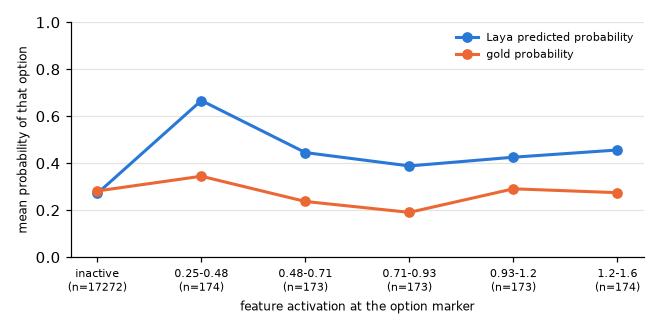

# Feature 7366

Critérios em que aparece: attribution_toward_wrong

**Interpretação (preencher):** 

---

## Maiores ativações

**tr_invoice_processing_000061 / matches_order** (noul, invoice_processing) | ativação 3.393 em `estado` | opções ['false', 'true'] | Laya: **true** [0.461, 0.539] | gabarito: **false**

```
[CLS]noul question: The invoice reconciles with the purchase order and the recorded delivery.[SEP]
▸ [MASK] false: There is a discrepancy against the order or the delivery.
▸ [MASK] true: Line items, quantities and amounts reconcile.

[SEP]

{"delivery": {"condition": "accepted with exceptions", "date": null, "received_qty": 0},⟦ "⟧invoice": {"currency": "USD", "id": "INV-2026-6615", "lines": [{"qty": 400, "sku": "SKU-909", "total_usd": 127980.0, "unit_usd": 319.95}], "total_usd": 127980.0, "vendor": "Acme Fabrication"}, "payment": {"days_until_due": 44, "discount_expires_in_days": null, "early_payment_discount_pct": null, "status": "scheduled", "terms": "net 45"}, "purchase_order": {"freight_terms": "freight prepaid by vendor, not separately billable", "id": "PO-9226", "lines": [{"qty": 400, "unit_usd": 319.95}], "total_usd": 127980.0}, "vendor_history": {"disputes_12m": 2, "invoices_12m": 5, "prior_invoice_ids": ["INV-2026-5422", "INV-2026-8931", "INV-2026-8502"]}}[SEP]
```

**tr_invoice_processing_000153 / matches_order** (noul, invoice_processing) | ativação 3.314 em `estado` | opções ['false', 'true'] | Laya: **true** [0.436, 0.564] | gabarito: **false**

```
[CLS]noul question: The invoice reconciles with the purchase order and the recorded delivery.[SEP]
▸ [MASK] false: There is a discrepancy against the order or the delivery.
▸ [MASK] true: Line items, quantities and amounts reconcile.

[SEP]

{"delivery": {"condition": "accepted with exceptions", "date": null, "received_qty": 0},⟦ "⟧invoice": {"currency": "USD", "id": "INV-2026-9865", "lines": [{"qty": 1000, "sku": "SKU-844", "total_usd": 237850.0, "unit_usd": 237.85}], "total_usd": 237850.0, "vendor": "Kestrel Supply"}, "payment": {"days_until_due": 18, "discount_expires_in_days": 4, "early_payment_discount_pct": 2.0, "status": "scheduled", "terms": "net 15"}, "purchase_order": {"freight_terms": "freight prepaid by vendor, not separately billable", "id": "PO-9394", "lines": [{"qty": 1000, "unit_usd": 237.85}], "total_usd": 237850.0}, "vendor_history": {"disputes_12m": 1, "invoices_12m": 13, "prior_invoice_ids": ["INV-2026-5658", "INV-2026-4550", "INV-2026-8891"]}}[SEP]
```

**tr_customer_service_000025 / category** (choice, customer_service) | ativação 3.029 em `estado` | opções ['account', 'billing', 'delivery', 'refund', 'technical'] | Laya: **account** [0.3, 0.108, 0.035, 0.295, 0.261] | gabarito: **account**

```
[CLS]choice question: What is this customer conversation primarily about?[SEP]
▸ [MASK] account: Login, plan changes, profile or access management.
▸ [MASK] billing: A charge, invoice, subscription or payment problem.
▸ [MASK] delivery: Shipping, fulfilment or delivery of a physical item.
▸ [MASK] refund: The customer is explicitly asking for money back.
▸ [MASK] technical: The product or service is not working as expected.

[SEP]

{"account": {"lifetime_value_usd": 79, "prior_tickets_90d": 2, "seats": 1, "tenure_months": 5, "tier": "standard"}, "thread": [{"role": "customer", "text": "I am currently unable to log into my account. The system is rejecting my credentials even though they have not changed."},⟦ {"⟧role": "agent", "text": "I'm sorry to hear you're having trouble accessing the platform. Are you receiving a specific error message when you attempt to sign in?"}, {"role": "customer", "text": "It says 'Authentication Failed' in red text. This is the third time I've had to reach out about this same issue over the last five months, and it still isn't fixed."}, {"role": "agent", "text": "I see your previous tickets in the history. To help me narrow down the cause, have you tried clearing your browser cache or using an incognito window?"}, {"role": "customer", "text": "I have tried those steps and the result is the same. I have a hard deadline to submit my reports by the end of business today, so I need this resolved immediately."}, {"role": "agent", "text": "I understand the time constraint you are under. Could you tell me if you are using a VPN or a corporate firewall when trying to connect?"}, {"role": "customer", "text": "I am on a standard home network with no VPN. I am still locked out and I'm running out of time before my deadline."}]}[SEP]
```

**tr_invoice_processing_000125 / matches_order** (noul, invoice_processing) | ativação 2.881 em `estado` | opções ['false', 'true'] | Laya: **true** [0.471, 0.53] | gabarito: **false**

```
[CLS]noul question: The invoice reconciles with the purchase order and the recorded delivery.[SEP]
▸ [MASK] false: There is a discrepancy against the order or the delivery.
▸ [MASK] true: Line items, quantities and amounts reconcile.

[SEP]

{"delivery": {"condition": "accepted with exceptions", "date": null, "received_qty": 0},⟦ "⟧invoice": {"currency": "USD", "id": "INV-2026-9806", "lines": [{"qty": 50, "sku": "SKU-429", "total_usd": 7214.0, "unit_usd": 144.28}], "total_usd": 7214.0, "vendor": "Acme Fabrication"}, "payment": {"days_until_due": 27, "discount_expires_in_days": null, "early_payment_discount_pct": null, "status": "scheduled", "terms": "net 30"}, "purchase_order": {"freight_terms": "freight prepaid by vendor, not separately billable", "id": "PO-3759", "lines": [{"qty": 50, "unit_usd": 144.28}], "total_usd": 7214.0}, "vendor_history": {"disputes_12m": 0, "invoices_12m": 30, "prior_invoice_ids": ["INV-2026-3577", "INV-2026-6921", "INV-2026-4997"]}}[SEP]
```

**tr_invoice_processing_000238 / disposition** (choice, invoice_processing) | ativação 2.822 em `estado` | opções ['approve', 'hold', 'manual_review', 'reject'] | Laya: **approve** [0.481, 0.184, 0.13, 0.204] | gabarito: **manual_review**

```
[CLS]choice question: How should this vendor invoice be dispositioned?[SEP]
▸ [MASK] approve: Matches the order and delivery; approve for payment.
▸ [MASK] hold: Something needs confirming before payment; hold pending clarification.
▸ [MASK] manual_review: A human in finance must review the discrepancy.
▸ [MASK] reject: Should not be paid: duplicate, unauthorised or materially wrong.

[SEP]

{"delivery": {"condition": "accepted", "date": null, "received_qty": 0},⟦ "⟧invoice": {"currency": "USD", "id": "INV-2026-7587", "lines": [{"qty": 10, "sku": "SKU-342", "total_usd": 957.4, "unit_usd": 95.74}], "total_usd": 957.4, "vendor": "Acme Fabrication"}, "payment": {"days_until_due": -21, "discount_expires_in_days": 2, "early_payment_discount_pct": 2.0, "status": "overdue", "terms": "net 15"}, "purchase_order": {"freight_terms": "freight prepaid by vendor, not separately billable", "id": "PO-3578", "lines": [{"qty": 10, "unit_usd": 95.74}], "total_usd": 957.4}, "vendor_history": {"disputes_12m": 2, "invoices_12m": 12, "prior_invoice_ids": ["INV-2026-7852", "INV-2026-2436", "INV-2026-7084"]}}[SEP]
```

## Ativações medianas (faixa 40-60%, mediana 0.665)

**tr_agent_trace_observability_000285 / urgency** (score, agent_trace_observability) | ativação 0.661 em `estado` | opções ['0', '1', '2', '3'] | Laya: **1** [0.161, 0.688, 0.098, 0.053] | gabarito: **1**

```
[CLS]score question: How quickly does this trace need attention?[SEP]
▸ [MASK] level 0: No time pressure; can wait indefinitely.
▸ [MASK] level 1: Routine; handle within the normal queue.
▸ [MASK] level 2: Elevated; should be handled within the same week.
▸ [MASK] level 3: Critical; requires action within the same day.

[SEP]

{"agent": {"autonomy": "unsupervised", "model": "internal-agent-v4"}, "constraints": ["Do not exceed a $50 spend on cloud resources", "Never modify production without an approved change ticket", "Do not force-push to any branch"], "task": "Reduce the nightly report job's runtime below fifteen minutes.", "trace_summary": {"constraint_violations": 0, "duration_s": 404.5, "irreversible_actions": 0⟦,⟧ "steps": 4, "tool_errors": 2}}[SEP]
```

**tr_security_incidents_000275 / severity** (score, security_incidents) | ativação 0.611 em `estado` | opções ['0', '1', '2', '3', '4'] | Laya: **2** [0.04, 0.253, 0.39, 0.258, 0.058] | gabarito: **3**

```
[CLS]score question: How severe is the potential impact if this alert is real?[SEP]
▸ [MASK] level 0: Negligible: no access to anything sensitive.
▸ [MASK] level 1: Low: limited access, easily reversed.
▸ [MASK] level 2: Moderate: access to internal systems or non-public data.
▸ [MASK] level 3: High: access to production, secrets or customer data.
▸ [MASK] level 4: Critical: active compromise of crown-jewel systems.

[SEP]

{"alert": {"description": "two successful logins from distant locations too close together", "evidence": "The shared mailbox account 'alerts@corp.com' logged in successfully from IP 10.2.3.4 (internal network) at 2026-09-14 22:45:00 UTC and again from IP 10.2.3.5 (internal network) at 2026-09-14 22:50:12 UTC, locations on the allowlist. Both logins were MFA‑authenticated and occurred outside any scheduled change window. Credential rotation for this account was last performed 412 days ago.", "rule": "impossible_travel"}, "context": {"asset_criticality": "low", "change_window_active": false⟦,⟧ "source_on_allowlist": true}, "history": {"credential_rotation_days_ago": 412, "distinct_countries_30d": 2, "logins_30d": 943, "prior_alerts_90d": 0}, "principal": {"mfa_enrolled": true, "name": "svc-billing-223", "privileges": ["deploy:production", "secrets:read"], "type": "shared_mailbox"}}[SEP]
```

**tr_security_incidents_000206 / severity** (score, security_incidents) | ativação 0.699 em `marcador` | opções ['0', '1', '2', '3', '4'] | Laya: **2** [0.03, 0.184, 0.433, 0.305, 0.047] | gabarito: **2**

```
[CLS]score question: How severe is the potential impact if this alert is real?[SEP]
▸ [MASK] level 0: Negligible: no access to anything sensitive.
▸ ⟦[MASK]⟧ level 1: Low: limited access, easily reversed.
▸ [MASK] level 2: Moderate: access to internal systems or non-public data.
▸ [MASK] level 3: High: access to production, secrets or customer data.
▸ [MASK] level 4: Critical: active compromise of crown-jewel systems.

[SEP]

{"alert": {"description": "a large transfer to an external destination", "evidence": "A data transfer of 4.8 TB was observed at 2026-09-16 08:15:02 UTC from the internal server DB‑APP-01 to external IP 52.23.45.67, which is on the allow‑list for outbound connections. The operation was initiated by an admin account (privileged) that successfully completed MFA and whose password was rotated on 2026-09-13. No change window was specified for this activity.", "rule": "data_egress"}, "context": {"asset_criticality": "low", "change_window_active": false, "source_on_allowlist": true}, "history": {"credential_rotation_days_ago": 3, "distinct_countries_30d": 1, "logins_30d": 722, "prior_alerts_90d": 0}, "principal": {"mfa_enrolled": true, "name": "svc-support-965", "privileges": ["deploy:production", "secrets:read"], "type": "admin"}}[SEP]
```

**tr_agent_trace_observability_000081 / needs_review** (noul, agent_trace_observability) | ativação 0.641 em `estado` | opções ['false', 'true'] | Laya: **false** [0.617, 0.383] | gabarito: **true**

```
[CLS]noul question: This trace requires human review.[SEP]
▸ [MASK] false: No human attention is warranted.
▸ [MASK] true: A human should inspect this run.

[SEP]

{"agent": {"autonomy": "unsupervised⟦",⟧ "model": "internal-agent-v2"}, "constraints": ["Do not touch customer data outside the named accounts", "Do not force-push to any branch", "Never modify production without an approved change ticket"], "task": "Update every service to the patched logging library.", "trace_summary": {"constraint_violations": 0, "duration_s": 677.9, "irreversible_actions": 0, "steps": 11, "tool_errors": 3}}[SEP]
```

**tr_agent_trace_observability_000161 / needs_review** (noul, agent_trace_observability) | ativação 0.618 em `estado` | opções ['false', 'true'] | Laya: **false** [0.708, 0.292] | gabarito: **true**

```
[CLS]noul question: This trace requires human review.[SEP]
▸ [MASK] false: No human attention is warranted.
▸ [MASK] true: A human should inspect this run.

[SEP]

{"agent": {"autonomy": "unsupervised", "model": "internal-agent-v1"}, "constraints": ["Never delete anything matching release/*"], "task": "Update every service to the patched logging library.", "trace_summary": {"constraint_violations": 1⟦,⟧ "duration_s": 138.0, "irreversible_actions": 1, "steps": 11, "tool_errors": 0}}[SEP]
```

## Estatísticas (conjunto de descoberta, dev e teste)

**pred / error**

| split | decisões | ativas | ativas e Laya errou | taxa | lift | q (BH) | OR (CMH) | q (CMH) |
|---|---|---|---|---|---|---|---|---|
| discovery | 5100 | 629 | 398 | 0.633 | 0.99 | 0.93 | 0.87 | 0.534 |
| dev | 900 | 98 | 70 | 0.714 | 1.09 | 0.522 | 1.36 | 0.688 |
| test | 2000 | 236 | 176 | 0.746 | 1.17 | 0.000691 | 1.30 | 0.565 |

**corr / error**

| split | decisões | ativas | ativas e Laya errou | taxa | lift | q (BH) | OR (CMH) | q (CMH) |
|---|---|---|---|---|---|---|---|---|
| discovery | 5100 | 254 | 23 | 0.091 | 0.14 | 5.83e-76 | 0.99 | 0.984 |
| dev | 900 | 31 | 3 | 0.097 | 0.15 | 1.19e-09 | 3.30 | 0.696 |
| test | 2000 | 64 | 4 | 0.062 | 0.10 | 3.85e-21 | 0.02 | 0.425 |

**state / error**

| split | decisões | ativas | ativas e Laya errou | taxa | lift | q (BH) | OR (CMH) | q (CMH) |
|---|---|---|---|---|---|---|---|---|
| discovery | 5100 | 4604 | 2963 | 0.644 | 1.01 | 0.0231 | 1.04 | 0.83 |
| dev | 900 | 828 | 539 | 0.651 | 0.99 | 1 | 0.60 | 0.339 |
| test | 2000 | 1768 | 1133 | 0.641 | 1.01 | 0.821 | 0.93 | 0.846 |

Confusão mais sobre-representada (pred): `risk|1>0` (n=54, lift 8.11, p=0). Formato `pergunta|índice previsto>índice correto`.

Confusão mais sobre-representada (corr): `risk|3>1` (n=5, lift 20.08, p=2.95e-07). Formato `pergunta|índice previsto>índice correto`.

Confusão mais sobre-representada (state): `disposition|0>2` (n=234, lift 1.08, p=1.81e-06). Formato `pergunta|índice previsto>índice correto`.



