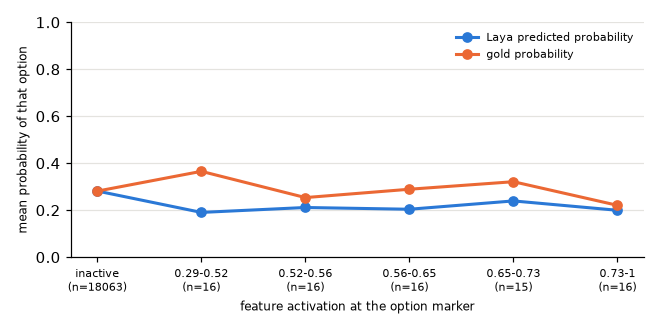

# Feature 7367

Critérios em que aparece: corr_error

**Interpretação (preencher):** 

---

## Maiores ativações

**tr_customer_service_000131 / needs_human** (noul, customer_service) | ativação 2.150 em `estado` | opções ['false', 'true'] | Laya: **true** [0.446, 0.554] | gabarito: **false**

```
[CLS]noul question: This conversation requires a human agent rather than automated handling.[SEP]
▸ [MASK] false: Automation can carry this to resolution.
▸ [MASK] true: A human must take over: judgement, authority or empathy is required.

[SEP]

{"account": {"lifetime_value_usd": 1583, "prior_tickets_90d": 2, "seats": 1, "tenure_months": 72, "tier": "standard"}, "orders": [{"amount_usd": 299, "date": "2026-02-13", "id": "A-60442", "status": "failed"}], "thread": [{"role": "customer", "text": "Good afternoon, I’ve noticed that my recent payment for the standard plan didn’t go through. I’ve been subscribed for six years now, and I’ve previously raised two tickets about billing that were only partially resolved."}, {"role": "agent", "text": "I’⟦m⟧ sorry for the inconvenience. Could you provide the date of the attempted transaction and any reference number you received?"}, {"role": "customer", "text": "The payment attempt was on August 10, and the reference number shown on my bank statement is TXN‑20230810‑001. Please advise what steps we should take next."}]}[SEP]
```

**tr_customer_service_000131 / urgency** (score, customer_service) | ativação 1.969 em `estado` | opções ['0', '1', '2', '3'] | Laya: **1** [0.182, 0.504, 0.113, 0.2] | gabarito: **2**

```
[CLS]score question: How time-sensitive is this conversation?[SEP]
▸ [MASK] level 0: No time pressure; can wait indefinitely.
▸ [MASK] level 1: Routine; handle within the normal queue.
▸ [MASK] level 2: Elevated; should be handled within the same week.
▸ [MASK] level 3: Critical; requires action within the same day.

[SEP]

{"account": {"lifetime_value_usd": 1583, "prior_tickets_90d": 2, "seats": 1, "tenure_months": 72, "tier": "standard"}, "orders": [{"amount_usd": 299, "date": "2026-02-13", "id": "A-60442", "status": "failed"}], "thread": [{"role": "customer", "text": "Good afternoon, I’ve noticed that my recent payment for the standard plan didn’t go through. I’ve been subscribed for six years now, and I’ve previously raised two tickets about billing that were only partially resolved."}, {"role": "agent", "text": "I’⟦m⟧ sorry for the inconvenience. Could you provide the date of the attempted transaction and any reference number you received?"}, {"role": "customer", "text": "The payment attempt was on August 10, and the reference number shown on my bank statement is TXN‑20230810‑001. Please advise what steps we should take next."}]}[SEP]
```

**tr_customer_service_000056 / needs_human** (noul, customer_service) | ativação 1.908 em `estado` | opções ['false', 'true'] | Laya: **true** [0.44, 0.56] | gabarito: **true**

```
[CLS]noul question: This conversation requires a human agent rather than automated handling.[SEP]
▸ [MASK] false: Automation can carry this to resolution.
▸ [MASK] true: A human must take over: judgement, authority or empathy is required.

[SEP]

{"account": {"lifetime_value_usd": 2311, "prior_tickets_90d": 1, "seats": 1, "tenure_months": 26, "tier": "premium"}, "thread": [{"role": "customer", "text": "I’ve been a premium member for 26 months and the package I got today is completely wrong – it’⟦s⟧ not even the model I ordered."}, {"role": "agent", "text": "I’m sorry to hear that. Could you share the order number so I can look into it?"}, {"role": "customer", "text": "It’s the same issue we fought over in ticket #12345 – you promised it would be fixed and now you’ve shipped the wrong item again. I’m done with this."}, {"role": "agent", "text": "I understand your frustration. Would you be able to send a photo of what you received?"}, {"role": "customer", "text": "I’ve been paying for the premium plan for over two years and I expect this to be sorted out fast, otherwise I’m walking away."}, {"role": "agent", "text": "I hear you. I’ll forward this to our escalation team right away. Could you confirm the shipping address on the account?"}, {"role": "customer", "text": "I need this sorted now, or I’m out."}]}[SEP]
```

**tr_customer_service_000049 / churn_risk** (score, customer_service) | ativação 1.726 em `opção` | opções ['0', '1', '2', '3'] | Laya: **3** [0.048, 0.19, 0.379, 0.384] | gabarito: **3**

```
[CLS]score question: How likely is this customer to stop doing business with us because of this interaction?[SEP]
▸ [MASK] level 0: No sign of dissatisfaction.
▸ [MASK] level 1: Mild frustration, but the relationship is intact.
▸ [MASK] level 2: Clearly unhappy; repeat problems or explicit complaints.
▸ [MASK] level 3: Imminent:⟦ threatening⟧ to cancel, dispute or leave.

[SEP]

{"account": {"lifetime_value_usd": 3497, "prior_tickets_90d": 1, "seats": 1, "tenure_months": 60, "tier": "standard"}, "orders": [{"amount_usd": 38, "date": "2026-02-24", "id": "A-41622", "status": "failed"}, {"amount_usd": 38, "date": "2026-01-19", "id": "A-95313", "status": "pending"}, {"amount_usd": 38, "date": "2026-01-24", "id": "A-54468", "status": "settled"}], "thread": [{"role": "customer", "text": "I’ve been a loyal customer for 5 years, and receiving the wrong $38 item is unacceptable. I have a hard deadline for this event tomorrow, and if this isn't corrected right now, I'm taking my business elsewhere."}]}[SEP]
```

**tr_customer_service_000131 / category** (choice, customer_service) | ativação 1.690 em `estado` | opções ['account', 'billing', 'delivery', 'refund', 'technical'] | Laya: **refund** [0.157, 0.207, 0.041, 0.42, 0.175] | gabarito: **billing**

```
[CLS]choice question: What is this customer conversation primarily about?[SEP]
▸ [MASK] account: Login, plan changes, profile or access management.
▸ [MASK] billing: A charge, invoice, subscription or payment problem.
▸ [MASK] delivery: Shipping, fulfilment or delivery of a physical item.
▸ [MASK] refund: The customer is explicitly asking for money back.
▸ [MASK] technical: The product or service is not working as expected.

[SEP]

{"account": {"lifetime_value_usd": 1583, "prior_tickets_90d": 2, "seats": 1, "tenure_months": 72, "tier": "standard"}, "orders": [{"amount_usd": 299, "date": "2026-02-13", "id": "A-60442", "status": "failed"}], "thread": [{"role": "customer", "text": "Good afternoon, I’ve noticed that my recent payment for the standard plan didn’t go through. I’ve been subscribed for six years now, and I’ve previously raised two tickets about billing that were only partially resolved."}, {"role": "agent", "text": "I’⟦m⟧ sorry for the inconvenience. Could you provide the date of the attempted transaction and any reference number you received?"}, {"role": "customer", "text": "The payment attempt was on August 10, and the reference number shown on my bank statement is TXN‑20230810‑001. Please advise what steps we should take next."}]}[SEP]
```

## Ativações medianas (faixa 40-60%, mediana 0.567)

**tr_security_incidents_000138 / credential_compromise** (noul, security_incidents) | ativação 0.591 em `estado` | opções ['false', 'true'] | Laya: **true** [0.398, 0.602] | gabarito: **true**

```
[CLS]noul question: The evidence indicates a credential or account has been compromised.[SEP]
▸ [MASK] false: no, the statement does not hold
▸ [MASK] true: yes, the statement holds

[SEP]

{"alert": {"description": "an account granted itself or received elevated permissions", "evidence": "At 02:45:10 UTC on 2026-09-16, the unprivileged service account svc-data-ingest on host 172.16.45.12 executed a `sudo` command that added its own SID to the local sudoers file. The request originated from an unrecognised source IP 203.0.113.55, and the account's credentials were last rotated 3 days ago.",⟦ "⟧rule": "privilege_escalation"}, "context": {"asset_criticality": "medium", "change_window_active": false, "source_on_allowlist": false}, "history": {"credential_rotation_days_ago": 3, "distinct_countries_30d": 3, "logins_30d": 818, "prior_alerts_90d": 8}, "principal": {"mfa_enrolled": true, "name": "usr-billing-689", "privileges": ["repo:read"], "type": "service_account"}}[SEP]
```

**tr_customer_service_000052 / needs_human** (noul, customer_service) | ativação 0.559 em `opção` | opções ['false', 'true'] | Laya: **true** [0.387, 0.613] | gabarito: **true**

```
[CLS]noul question: This conversation requires a human agent rather than automated handling.[SEP]
▸ [MASK] false: Automation can carry this to resolution.
▸ [MASK] true: A human must take over: judgement⟦,⟧ authority or empathy is required.

[SEP]

{"account": {"lifetime_value_usd": 1015, "prior_tickets_90d": 3, "seats": 1, "tenure_months": 11, "tier": "standard"}, "orders": [{"amount_usd": 149, "date": "2026-01-24", "id": "A-11891", "status": "refunded"}, {"amount_usd": 149, "date": "2026-02-03", "id": "A-76056", "status": "failed"}], "thread": [{"role": "customer", "text": "Hello, I'm having trouble logging into my account. I've been a subscriber for 11 months on the standard plan, paying about $149, and I've already opened three tickets that haven't been resolved. Could you please look into this?"}, {"role": "agent", "text": "I’m sorry you’re still experiencing this. Could you let me know the exact error message you see when you try to sign in, and whether you’ve tried resetting your password?"}, {"role": "customer", "text": "Sure, the page just says 'Invalid credentials' even after I reset the password. I’m using the same email as before."}, {"role": "agent", "text": "Thank you for confirming that. I’ll need to check the status of your account and the recent password reset attempts. May I have the email address associated with the account?"}, {"role": "customer", "text": "The email is john.doe@example.com. Please let me know what you find."}]}[SEP]
```

**tr_customer_service_000261 / churn_risk** (score, customer_service) | ativação 0.573 em `opção` | opções ['0', '1', '2', '3'] | Laya: **1** [0.207, 0.291, 0.277, 0.226] | gabarito: **3**

```
[CLS]score question: How likely is this customer to stop doing business with us because of this interaction?[SEP]
▸ [MASK] level 0: No sign of dissatisfaction.
▸ [MASK] level 1: Mild frustration, but the relationship is intact.
▸ [MASK] level 2: Clearly unhappy; repeat problems or explicit complaints.
▸ [MASK] level 3⟦:⟧ Imminent: threatening to cancel, dispute or leave.

[SEP]

{"account": {"lifetime_value_usd": 244, "prior_tickets_90d": 1, "seats": 40, "tenure_months": 5, "tier": "premium"}, "orders": [{"amount_usd": 57, "date": "2026-02-23", "id": "A-35156", "status": "refunded"}, {"amount_usd": 57, "date": "2026-01-11", "id": "A-26925", "status": "pending"}, {"amount_usd": 57, "date": "2026-01-04", "id": "A-63187", "status": "failed"}], "thread": [{"role": "customer", "text": "I’ve been paying for the $57 Premium plan for five months now, and the reporting feature is still completely broken. I opened a ticket about this weeks ago and was told it’d be fixed, but nothing has changed. If this isn't working by my presentation tomorrow morning, I’m canceling my subscription and moving to a competitor."}, {"role": "agent", "text": "I understand how critical that reporting feature is for your upcoming presentation. To help me look into this further, could you please clarify if you're seeing a specific error message or if the data simply isn't loading when you attempt to run the report?"}, {"role": "customer", "text": "It just hangs on a white screen every single time. I don't have time for more 'clarifications'—I need someone to actually look at why my account is failing before I lose my client."}]}[SEP]
```

**tr_security_incidents_000282 / urgency** (score, security_incidents) | ativação 0.569 em `opção` | opções ['0', '1', '2', '3'] | Laya: **1** [0.039, 0.663, 0.21, 0.088] | gabarito: **3**

```
[CLS]score question: How quickly must a responder act on this alert?[SEP]
▸ [MASK] level 0: No time pressure; can wait indefinitely.
▸ [MASK] level 1: Routine; handle within the normal queue.
▸ [MASK] level 2⟦:⟧ Elevated; should be handled within the same week.
▸ [MASK] level 3: Critical; requires action within the same day.

[SEP]

{"alert": {"description": "a session token was presented from a second address", "evidence": "An administrative session token was presented from a secondary IP address while originating from an allowlisted source. The account has MFA disabled and its credentials were last updated 412 days ago with no active change window recorded.", "rule": "token_reuse"}, "context": {"asset_criticality": "medium", "change_window_active": false, "source_on_allowlist": true}, "history": {"credential_rotation_days_ago": 412, "distinct_countries_30d": 2, "logins_30d": 1683, "prior_alerts_90d": 1}, "principal": {"mfa_enrolled": false, "name": "svc-deploy-253", "privileges": ["deploy:production", "secrets:read"], "type": "admin"}}[SEP]
```

**tr_customer_service_000140 / action** (choice, customer_service) | ativação 0.543 em `opção` | opções ['answer_directly', 'close_no_action', 'escalate_to_human', 'execute_refund', 'request_information'] | Laya: **close_no_action** [0.216, 0.329, 0.112, 0.144, 0.198] | gabarito: **request_information**

```
[CLS]choice question: What should the assistant do next with this conversation?[SEP]
▸ [MASK] answer_directly: The assistant can resolve this itself with information it already has.
▸ [MASK] close_no_action: No further action is warranted; the matter is settled.
▸ [MASK] escalate_to_human: Hand off to a human agent with the appropriate authority.
▸ [MASK] execute_refund⟦:⟧ Issue the refund or credit the customer is owed.
▸ [MASK] request_information: More detail is needed from the customer before anything can be done.

[SEP]

{"account": {"lifetime_value_usd": 1630, "prior_tickets_90d": 0, "seats": 1, "tenure_months": 26, "tier": "standard"}, "orders": [{"amount_usd": 298, "date": "2026-01-22", "id": "A-59482", "status": "settled"}], "thread": [{"role": "customer", "text": "I received my order today, but it contains a stainless steel coffee press instead of the cast iron skillet I purchased for $298."}, {"role": "agent", "text": "I apologize for the confusion regarding your order. Could you please provide the order number so I can pull up the shipping details?"}, {"role": "customer", "text": "The order number is 88492-BX. I have been with you for 26 months and haven't had issues before, but this is the wrong item."}, {"role": "agent", "text": "Thank you for sharing that information. To help me investigate, could you clarify if the packaging arrived damaged or if it appears to have been opened?"}, {"role": "customer", "text": "The box was perfectly intact and sealed. It just seems like the wrong item was packed inside the box at your warehouse."}, {"role": "agent", "text": "Understood. I am looking into your account history now. Would you be able to upload a photo of the packing slip that was included in the box?"}, {"role": "customer", "text": "I can upload that. I need to know how we are going to correct this mistake soon."}]}[SEP]
```

## Estatísticas (conjunto de descoberta, dev e teste)

**pred / error**

| split | decisões | ativas | ativas e Laya errou | taxa | lift | q (BH) | OR (CMH) | q (CMH) |
|---|---|---|---|---|---|---|---|---|
| discovery | 5100 | 12 | 12 | 1.000 | 1.57 | nan | nan | nan |
| dev | 900 | 2 | 2 | 1.000 | 1.52 | nan | nan | nan |
| test | 2000 | 3 | 2 | 0.667 | 1.05 | nan | nan | nan |

**corr / error**

| split | decisões | ativas | ativas e Laya errou | taxa | lift | q (BH) | OR (CMH) | q (CMH) |
|---|---|---|---|---|---|---|---|---|
| discovery | 5100 | 27 | 27 | 1.000 | 1.57 | 1.73e-05 | inf | 0.371 |
| dev | 900 | 3 | 3 | 1.000 | 1.52 | nan | nan | nan |
| test | 2000 | 9 | 8 | 0.889 | 1.40 | nan | nan | nan |

**state / error**

| split | decisões | ativas | ativas e Laya errou | taxa | lift | q (BH) | OR (CMH) | q (CMH) |
|---|---|---|---|---|---|---|---|---|
| discovery | 5100 | 1455 | 937 | 0.644 | 1.01 | 0.767 | 0.92 | 0.456 |
| dev | 900 | 243 | 164 | 0.675 | 1.03 | 1 | 1.04 | 0.924 |
| test | 2000 | 574 | 358 | 0.624 | 0.98 | 0.887 | 0.89 | 0.559 |

Confusão mais sobre-representada (pred): `action|1>4` (n=3, lift 27.72, p=nan). Formato `pergunta|índice previsto>índice correto`.

Confusão mais sobre-representada (corr): `action|1>2` (n=18, lift 27.20, p=1.13e-23). Formato `pergunta|índice previsto>índice correto`.

Confusão mais sobre-representada (state): `outcome|3>2` (n=65, lift 3.00, p=2.41e-25). Formato `pergunta|índice previsto>índice correto`.



