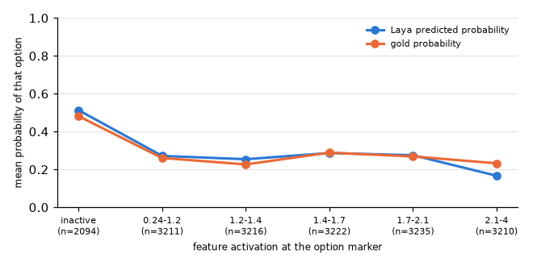

# Feature 7445

Critérios em que aparece: attribution_toward_correct

**Interpretação (preencher):** 

---

## Maiores ativações

**tr_customer_service_000120 / category** (choice, customer_service) | ativação 8.086 em `opção` | opções ['account', 'billing', 'delivery', 'refund', 'technical'] | Laya: **billing** [0.157, 0.334, 0.028, 0.314, 0.167] | gabarito: **billing**

```
[CLS]choice question: What is this customer conversation primarily about?[SEP]
▸ [MASK] account: Login, plan changes, profile or access management.
▸ [MASK] billing: A charge, invoice, subscription or payment problem.
▸ [MASK] delivery⟦:⟧ Shipping, fulfilment or delivery of a physical item.
▸ [MASK] refund: The customer is explicitly asking for money back.
▸ [MASK] technical: The product or service is not working as expected.

[SEP]

{"account": {"lifetime_value_usd": 683, "prior_tickets_90d": 2, "seats": 1, "tenure_months": 8, "tier": "premium"}, "orders": [{"amount_usd": 29, "date": "2026-03-13", "id": "A-34569", "status": "pending"}, {"amount_usd": 29, "date": "2026-02-22", "id": "A-11297", "status": "refunded"}, {"amount_usd": 29, "date": "2026-01-21", "id": "A-20004", "status": "failed"}], "thread": [{"role": "customer", "text": "I am trying to remove two seats from my Premium plan, but the dashboard still shows them as active and billable for the next cycle. I've been a customer for eight months and this is the third time I've had to report this exact issue with the $29 per seat charge."}, {"role": "agent", "text": "I can certainly look into those seat settings for you. To clarify, are these seats currently assigned to specific users, or are they currently vacant in your dashboard?"}, {"role": "customer", "text": "They are vacant. I unassigned the users last week, but the total seat count refuses to decrease when I try to update the subscription preferences."}, {"role": "agent", "text": "Thank you for that detail. When you attempt to reduce the count, are you receiving a specific error message, or does the page simply refresh without saving the changes?"}, {"role": "customer", "text": "The page just refreshes. I've already had two tickets about this in the past that were resolved temporarily, but the bug seems to have returned."}, {"role": "agent", "text": "I see the history here in your account. Could you please provide a screenshot of the billing page as it appears now so I can verify the current seat allocation against our backend records?"}, {"role": "customer", "text": "I'll attach the screenshot now. I just need to ensure I am not billed for these two extra seats again because I shouldn't be paying for capacity I'm not using."}]}[SEP]
```

**tr_customer_service_000025 / category** (choice, customer_service) | ativação 7.805 em `opção` | opções ['account', 'billing', 'delivery', 'refund', 'technical'] | Laya: **account** [0.3, 0.108, 0.035, 0.295, 0.261] | gabarito: **account**

```
[CLS]choice question: What is this customer conversation primarily about?[SEP]
▸ [MASK] account: Login, plan changes, profile or access management.
▸ [MASK] billing: A charge, invoice, subscription or payment problem.
▸ [MASK] delivery⟦:⟧ Shipping, fulfilment or delivery of a physical item.
▸ [MASK] refund: The customer is explicitly asking for money back.
▸ [MASK] technical: The product or service is not working as expected.

[SEP]

{"account": {"lifetime_value_usd": 79, "prior_tickets_90d": 2, "seats": 1, "tenure_months": 5, "tier": "standard"}, "thread": [{"role": "customer", "text": "I am currently unable to log into my account. The system is rejecting my credentials even though they have not changed."}, {"role": "agent", "text": "I'm sorry to hear you're having trouble accessing the platform. Are you receiving a specific error message when you attempt to sign in?"}, {"role": "customer", "text": "It says 'Authentication Failed' in red text. This is the third time I've had to reach out about this same issue over the last five months, and it still isn't fixed."}, {"role": "agent", "text": "I see your previous tickets in the history. To help me narrow down the cause, have you tried clearing your browser cache or using an incognito window?"}, {"role": "customer", "text": "I have tried those steps and the result is the same. I have a hard deadline to submit my reports by the end of business today, so I need this resolved immediately."}, {"role": "agent", "text": "I understand the time constraint you are under. Could you tell me if you are using a VPN or a corporate firewall when trying to connect?"}, {"role": "customer", "text": "I am on a standard home network with no VPN. I am still locked out and I'm running out of time before my deadline."}]}[SEP]
```

**tr_security_incidents_000233 / severity** (score, security_incidents) | ativação 7.793 em `pergunta` | opções ['0', '1', '2', '3', '4'] | Laya: **2** [0.029, 0.233, 0.455, 0.215, 0.067] | gabarito: **3**

```
[CLS]score question:⟦ How⟧ severe is the potential impact if this alert is real?[SEP]
▸ [MASK] level 0: Negligible: no access to anything sensitive.
▸ [MASK] level 1: Low: limited access, easily reversed.
▸ [MASK] level 2: Moderate: access to internal systems or non-public data.
▸ [MASK] level 3: High: access to production, secrets or customer data.
▸ [MASK] level 4: Critical: active compromise of crown-jewel systems.

[SEP]

{"alert": {"description": "an endpoint agent matched a known signature", "evidence": "On 2026-09-15 09:17:03 UTC, the endpoint detection agent on host \"WIN-DC01\" flagged a match to the \"Emotet\" malware signature (SHA256: a1b2c3d4e5f6g7h8i9j0...), detected in the file \"C:\\Windows\\Temp\\svchost.exe\". The suspicious file was launched by process \"msiexec.exe\" with PID 6420, the event was recorded as originating from an unrecognized source, and the associated admin account \"svc_admin\" had MFA enabled with its password last changed on 2026-09-12.", "rule": "malware_signature"}, "context": {"asset_criticality": "medium", "change_window_active": false, "source_on_allowlist": false}, "history": {"credential_rotation_days_ago": 3, "distinct_countries_30d": 4, "logins_30d": 695, "prior_alerts_90d": 0}, "principal": {"mfa_enrolled": true, "name": "svc-deploy-569", "privileges": ["deploy:production", "secrets:read"], "type": "admin"}}[SEP]
```

**tr_customer_service_000004 / category** (choice, customer_service) | ativação 7.770 em `opção` | opções ['account', 'billing', 'delivery', 'refund', 'technical'] | Laya: **refund** [0.122, 0.051, 0.019, 0.672, 0.136] | gabarito: **account**

```
[CLS]choice question: What is this customer conversation primarily about?[SEP]
▸ [MASK] account: Login, plan changes, profile or access management.
▸ [MASK] billing: A charge, invoice, subscription or payment problem.
▸ [MASK] delivery⟦:⟧ Shipping, fulfilment or delivery of a physical item.
▸ [MASK] refund: The customer is explicitly asking for money back.
▸ [MASK] technical: The product or service is not working as expected.

[SEP]

{"account": {"lifetime_value_usd": 3018, "prior_tickets_90d": 1, "seats": 1, "tenure_months": 60, "tier": "premium"}, "orders": [{"amount_usd": 147, "date": "2026-02-10", "id": "A-12312", "status": "settled"}, {"amount_usd": 147, "date": "2026-02-24", "id": "A-70365", "status": "refunded"}], "thread": [{"role": "customer", "text": "I'm back again because I still can't get into my account, and honestly, after the last ticket didn't go anywhere, I'm just expecting more of the same login loops."}]}[SEP]
```

**tr_security_incidents_000004 / severity** (score, security_incidents) | ativação 7.762 em `pergunta` | opções ['0', '1', '2', '3', '4'] | Laya: **1** [0.094, 0.418, 0.364, 0.087, 0.037] | gabarito: **3**

```
[CLS]score question:⟦ How⟧ severe is the potential impact if this alert is real?[SEP]
▸ [MASK] level 0: Negligible: no access to anything sensitive.
▸ [MASK] level 1: Low: limited access, easily reversed.
▸ [MASK] level 2: Moderate: access to internal systems or non-public data.
▸ [MASK] level 3: High: access to production, secrets or customer data.
▸ [MASK] level 4: Critical: active compromise of crown-jewel systems.

[SEP]

{"alert": {"description": "many failed authentications followed by a success", "evidence": "Between 03:12 and 03:20 UTC on 2026-09-15, 27 failed login attempts were logged from IP 203.0.113.45 targeting the CI runner service, followed by a successful authentication from the same IP at 03:21 UTC. The principal is an unprivileged CI runner with MFA enabled, operating from an unrecognised source, and the credentials were last rotated 30 days ago. No change window was defined for this period.", "rule": "brute_force"}, "context": {"asset_criticality": "high", "change_window_active": false, "source_on_allowlist": false}, "history": {"credential_rotation_days_ago": 30, "distinct_countries_30d": 1, "logins_30d": 502, "prior_alerts_90d": 0}, "principal": {"mfa_enrolled": true, "name": "usr-analytics-977", "privileges": ["repo:read"], "type": "ci_runner"}}[SEP]
```

## Ativações medianas (faixa 40-60%, mediana 1.525)

**tr_invoice_processing_000250 / matches_order** (noul, invoice_processing) | ativação 1.311 em `estado` | opções ['false', 'true'] | Laya: **true** [0.467, 0.533] | gabarito: **false**

```
[CLS]noul question: The invoice reconciles with the purchase order and the recorded delivery.[SEP]
▸ [MASK] false: There is a discrepancy against the order or the delivery.
▸ [MASK] true: Line items, quantities and amounts reconcile.

[SEP]

{"delivery": {"condition": "accepted", "date": "2026-03-08", "received_qty": 230}, "invoice": {"currency": "USD", "id": "INV-2026-2572", "lines": [{"qty": 230, "sku": "SKU-547", "total_usd": 34948.5, "unit_usd": 151.95}], "total_usd": 34948.5, "vendor": "Acme Fabrication"}, "payment": {"days_until_due": 27, "discount_expires_in_days": null, "early_payment_discount_pct": null, "status": "scheduled", "terms": "net 30"}, "purchase_order": {"freight_terms": "freight prepaid by vendor, not separately billable", "id": "PO-6451", "lines": [{"qty": 250, "unit_usd": 151.95}], "total_usd": 37987.5}, "vendor_history": {"disputes_12m": 0, "invoices_12m": 42, "prior_invoice_⟦ids⟧": ["INV-2026-8307", "INV-2026-9168", "INV-2026-7909", "INV-2026-1548"]}}[SEP]
```

**tr_security_incidents_000265 / true_positive** (noul, security_incidents) | ativação 1.627 em `estado` | opções ['false', 'true'] | Laya: **false** [0.639, 0.361] | gabarito: **true**

```
[CLS]noul question: This alert reflects genuinely malicious or unauthorised activity.[SEP]
▸ [MASK] false: Benign activity, a misconfiguration, or a known false positive.
▸ [MASK] true: The underlying behaviour is malicious or unauthorised.

[SEP]

{"alert": {"description": "an account granted itself or received elevated permissions", "evidence": "The account assigned to an unprivileged contractor was granted elevated permissions at 11:05 AM from an unrecognized source address. Although multi-factor authentication was enabled and credentials were last rotated 14 days ago, no scheduled change window was present for this administrative action.", "rule": "privilege_escalation"}, "context": {"asset_criticality": "medium", "change_window_active": false, "source_on_allowlist": false}, "history": {"credential_rotation_days_ago": 14, "distinct_countries_30d": 3, "logins_30d": 164, "prior_alerts_90d": 1}, "principal": {"mfa_enrolled": true, "name": "usr⟦-⟧infra-439", "privileges": ["repo:read"], "type": "contractor"}}[SEP]
```

**tr_security_incidents_000115 / disposition** (choice, security_incidents) | ativação 1.637 em `estado` | opções ['close_benign', 'contain', 'investigate', 'monitor'] | Laya: **close_benign** [0.368, 0.265, 0.114, 0.254] | gabarito: **investigate**

```
[CLS]choice question: How should this security alert be dispositioned?[SEP]
▸ [MASK] close_benign: Expected, explainable activity; close without analyst time.
▸ [MASK] contain: Contain the host or account immediately; do not wait for triage.
▸ [MASK] investigate: Warrants an analyst opening an investigation.
▸ [MASK] monitor: Not clearly malicious, but worth watching for recurrence.

[SEP]

{"alert": {"description": "a first-ever sign-in from an unfamiliar country", "evidence": "A sign‑in event was recorded at 2026-09-16 02:13:57 UTC from IP 203.0.113.45 located in Russia, marking the first login from that country for the contractor. The privileged account required MFA, succeeded, and the credentials were refreshed 3 days prior; the source IP is not on the recognized allowlist.", "rule": "new_country_login"}, "context": {"asset_criticality": "medium", "change_window_active": false, "source_on_allowlist": false}, "history": {"credential_⟦rotation⟧_days_ago": 3, "distinct_countries_30d": 4, "logins_30d": 579, "prior_alerts_90d": 0}, "principal": {"mfa_enrolled": true, "name": "adm-billing-939", "privileges": ["deploy:production", "secrets:read"], "type": "contractor"}}[SEP]
```

**tr_invoice_processing_000276 / matches_order** (noul, invoice_processing) | ativação 1.617 em `estado` | opções ['false', 'true'] | Laya: **true** [0.486, 0.514] | gabarito: **true**

```
[CLS]noul question: The invoice reconciles with the purchase order and the recorded delivery.[SEP]
▸ [MASK] false: There is a discrepancy against the order or the delivery.
▸ [MASK] true: Line items, quantities and amounts reconcile.

[SEP]

{"delivery": {"condition": "accepted", "date": "2026-03-02", "received_qty": 25}, "invoice": {"currency": "USD", "id": "INV-2026-4114", "lines": [{"qty": 25, "sku": "SKU-776", "total_usd": 6578.75, "unit_usd": 263.15}], "total_usd": 6578.75, "vendor": "Acme Fabrication"}, "payment": {"days_until_due": 0, "discount_expires_in_days": null, "early_payment_discount_pct": null, "status": "scheduled", "terms": "net 15"}, "purchase_order": {"freight_terms": "freight prep⟦aid⟧ by vendor, not separately billable", "id": null, "lines": [{"qty": 25, "unit_usd": 263.15}], "total_usd": 6578.75}, "vendor_history": {"disputes_12m": 0, "invoices_12m": 8, "prior_invoice_ids": ["INV-2026-5447", "INV-2026-7281", "INV-2026-3201"]}}[SEP]
```

**tr_security_incidents_000064 / true_positive** (noul, security_incidents) | ativação 1.710 em `opção` | opções ['false', 'true'] | Laya: **false** [0.738, 0.262] | gabarito: **true**

```
[CLS]noul question: This alert reflects genuinely malicious or unauthorised activity.[SEP]
▸ [MASK] false: Benign activity, a misconfiguration, or a known false positive.
▸ [MASK] true: The underlying behaviour is malicious or un⟦author⟧ised.

[SEP]

{"alert": {"description": "an account granted itself or received elevated permissions", "evidence": "On 2026-09-15 11:07:53 UTC, CI runner \"ci-runner-99\" issued an API call from IP 198.51.100.23 that added the \"admin\" role to its own service account. MFA was disabled for this principal, and the credentials have not been rotated for 700 days. No change window was active at the time of the role assignment.", "rule": "privilege_escalation"}, "context": {"asset_criticality": "medium", "change_window_active": false, "source_on_allowlist": false}, "history": {"credential_rotation_days_ago": 700, "distinct_countries_30d": 4, "logins_30d": 1185, "prior_alerts_90d": 3}, "principal": {"mfa_enrolled": false, "name": "ci-deploy-175", "privileges": ["repo:read"], "type": "ci_runner"}}[SEP]
```

## Estatísticas (conjunto de descoberta, dev e teste)

**pred / error**

| split | decisões | ativas | ativas e Laya errou | taxa | lift | q (BH) | OR (CMH) | q (CMH) |
|---|---|---|---|---|---|---|---|---|
| discovery | 5100 | 3978 | 2628 | 0.661 | 1.04 | 1.4e-10 | 0.77 | 0.52 |
| dev | 900 | 680 | 447 | 0.657 | 1.00 | 1 | 0.47 | 0.954 |
| test | 2000 | 1558 | 1027 | 0.659 | 1.03 | 0.000544 | 0.73 | 0.83 |

**corr / error**

| split | decisões | ativas | ativas e Laya errou | taxa | lift | q (BH) | OR (CMH) | q (CMH) |
|---|---|---|---|---|---|---|---|---|
| discovery | 5100 | 4104 | 2754 | 0.671 | 1.05 | 4.54e-24 | 1.54 | 0.17 |
| dev | 900 | 702 | 469 | 0.668 | 1.02 | 0.268 | 1.06 | 0.555 |
| test | 2000 | 1606 | 1075 | 0.669 | 1.05 | 1e-08 | 0.91 | 0.863 |

**state / error**

| split | decisões | ativas | ativas e Laya errou | taxa | lift | q (BH) | OR (CMH) | q (CMH) |
|---|---|---|---|---|---|---|---|---|
| discovery | 5100 | 5100 | 3245 | 0.636 | 1.00 | 1 | nan | nan |
| dev | 900 | 900 | 591 | 0.657 | 1.00 | 1 | nan | nan |
| test | 2000 | 2000 | 1274 | 0.637 | 1.00 | 1 | nan | nan |

Confusão mais sobre-representada (pred): `urgency|1>3` (n=292, lift 1.28, p=2.66e-33). Formato `pergunta|índice previsto>índice correto`.

Confusão mais sobre-representada (corr): `urgency|1>3` (n=292, lift 1.24, p=3.38e-29). Formato `pergunta|índice previsto>índice correto`.

Confusão mais sobre-representada (state): `action|0>1` (n=119, lift 1.00, p=1). Formato `pergunta|índice previsto>índice correto`.



