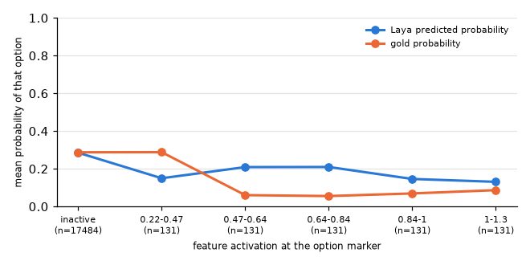

# Feature 7448

Critérios em que aparece: pred_error

**Interpretação (preencher):** 

---

## Maiores ativações

**tr_customer_service_000100 / churn_risk** (score, customer_service) | ativação 4.949 em `estado` | opções ['0', '1', '2', '3'] | Laya: **1** [0.168, 0.47, 0.177, 0.184] | gabarito: **1**

```
[CLS]score question: How likely is this customer to stop doing business with us because of this interaction?[SEP]
▸ [MASK] level 0: No sign of dissatisfaction.
▸ [MASK] level 1: Mild frustration, but the relationship is intact.
▸ [MASK] level 2: Clearly unhappy; repeat problems or explicit complaints.
▸ [MASK] level 3: Imminent: threatening to cancel, dispute or leave.

[SEP]

{"account": {"lifetime_value_usd": 3569, "prior_tickets_90d": 0, "seats": 1, "tenure_months": 60, "tier": "free"}, "thread": [{"role": "customer", "text": "Hi there, I hope you’re doing well. I’ve been on the free plan for the past five years (about 60 months now) and I just received my latest order, but it looks like the wrong item was shipped. Could you help me figure this out?"}, {"role": "agent", "text": "Hello! I’m sorry to hear about the mix‑up. Could you share the order number and tell me which product you received versus what you expected?"}, {"role": "customer", "text": "Sure, the order number is #A987654. I was supposed to get the ergonomic mouse, but I got a standard wired mouse instead."}, {"role": "agent", "text": "Thanks for the details. To verify, may I ask for a quick photo of the item you received? You can attach it here⟦ or⟧ let me know the best way to receive it."}, {"role": "customer", "text": "I’ve attached a picture to this message. Let me know what the next steps are for getting the correct mouse sent."}]}[SEP]
```

**tr_customer_service_000290 / needs_human** (noul, customer_service) | ativação 4.914 em `estado` | opções ['false', 'true'] | Laya: **true** [0.267, 0.733] | gabarito: **true**

```
[CLS]noul question: This conversation requires a human agent rather than automated handling.[SEP]
▸ [MASK] false: Automation can carry this to resolution.
▸ [MASK] true: A human must take over: judgement, authority or empathy is required.

[SEP]

{"account": {"lifetime_value_usd": 2430, "prior_tickets_90d": 1, "seats": 1, "tenure_months": 60, "tier": "free"}, "thread": [{"role": "customer", "text": "I've been using this free plan for five years and it’s ridiculous that I still can't manage my team seats without the interface freezing, especially after I was told this was fixed in my last ticket."}, {"role": "agent", "text": "I'm sorry to hear you're still experiencing issues with seat assignments. Could you describe exactly what happens when you try to add a new team member?"}, {"role": "customer", "text": "The 'Invite' button just stays grayed out and the page stops responding, which is exactly the same problem I reported before that your team never actually resolved."}, {"role": "agent", "text": "I've located your previous ticket to review the history of this issue. To help me investigate, are you currently accessing the site through a desktop browser⟦ or⟧ the mobile app?"}, {"role": "customer", "text": "I'm on a desktop using the latest version of Chrome, and if this isn't handled correctly this time, I’m going to have to move our team to a different platform entirely."}]}[SEP]
```

**tr_customer_service_000100 / category** (choice, customer_service) | ativação 4.910 em `estado` | opções ['account', 'billing', 'delivery', 'refund', 'technical'] | Laya: **refund** [0.161, 0.082, 0.127, 0.352, 0.279] | gabarito: **delivery**

```
[CLS]choice question: What is this customer conversation primarily about?[SEP]
▸ [MASK] account: Login, plan changes, profile or access management.
▸ [MASK] billing: A charge, invoice, subscription or payment problem.
▸ [MASK] delivery: Shipping, fulfilment or delivery of a physical item.
▸ [MASK] refund: The customer is explicitly asking for money back.
▸ [MASK] technical: The product or service is not working as expected.

[SEP]

{"account": {"lifetime_value_usd": 3569, "prior_tickets_90d": 0, "seats": 1, "tenure_months": 60, "tier": "free"}, "thread": [{"role": "customer", "text": "Hi there, I hope you’re doing well. I’ve been on the free plan for the past five years (about 60 months now) and I just received my latest order, but it looks like the wrong item was shipped. Could you help me figure this out?"}, {"role": "agent", "text": "Hello! I’m sorry to hear about the mix‑up. Could you share the order number and tell me which product you received versus what you expected?"}, {"role": "customer", "text": "Sure, the order number is #A987654. I was supposed to get the ergonomic mouse, but I got a standard wired mouse instead."}, {"role": "agent", "text": "Thanks for the details. To verify, may I ask for a quick photo of the item you received? You can attach it here⟦ or⟧ let me know the best way to receive it."}, {"role": "customer", "text": "I’ve attached a picture to this message. Let me know what the next steps are for getting the correct mouse sent."}]}[SEP]
```

**tr_customer_service_000290 / urgency** (score, customer_service) | ativação 4.777 em `estado` | opções ['0', '1', '2', '3'] | Laya: **3** [0.206, 0.31, 0.152, 0.332] | gabarito: **2**

```
[CLS]score question: How time-sensitive is this conversation?[SEP]
▸ [MASK] level 0: No time pressure; can wait indefinitely.
▸ [MASK] level 1: Routine; handle within the normal queue.
▸ [MASK] level 2: Elevated; should be handled within the same week.
▸ [MASK] level 3: Critical; requires action within the same day.

[SEP]

{"account": {"lifetime_value_usd": 2430, "prior_tickets_90d": 1, "seats": 1, "tenure_months": 60, "tier": "free"}, "thread": [{"role": "customer", "text": "I've been using this free plan for five years and it’s ridiculous that I still can't manage my team seats without the interface freezing, especially after I was told this was fixed in my last ticket."}, {"role": "agent", "text": "I'm sorry to hear you're still experiencing issues with seat assignments. Could you describe exactly what happens when you try to add a new team member?"}, {"role": "customer", "text": "The 'Invite' button just stays grayed out and the page stops responding, which is exactly the same problem I reported before that your team never actually resolved."}, {"role": "agent", "text": "I've located your previous ticket to review the history of this issue. To help me investigate, are you currently accessing the site through a desktop browser⟦ or⟧ the mobile app?"}, {"role": "customer", "text": "I'm on a desktop using the latest version of Chrome, and if this isn't handled correctly this time, I’m going to have to move our team to a different platform entirely."}]}[SEP]
```

**tr_customer_service_000100 / action** (choice, customer_service) | ativação 4.738 em `estado` | opções ['answer_directly', 'close_no_action', 'escalate_to_human', 'execute_refund', 'request_information'] | Laya: **close_no_action** [0.191, 0.293, 0.177, 0.149, 0.19] | gabarito: **escalate_to_human**

```
[CLS]choice question: What should the assistant do next with this conversation?[SEP]
▸ [MASK] answer_directly: The assistant can resolve this itself with information it already has.
▸ [MASK] close_no_action: No further action is warranted; the matter is settled.
▸ [MASK] escalate_to_human: Hand off to a human agent with the appropriate authority.
▸ [MASK] execute_refund: Issue the refund or credit the customer is owed.
▸ [MASK] request_information: More detail is needed from the customer before anything can be done.

[SEP]

{"account": {"lifetime_value_usd": 3569, "prior_tickets_90d": 0, "seats": 1, "tenure_months": 60, "tier": "free"}, "thread": [{"role": "customer", "text": "Hi there, I hope you’re doing well. I’ve been on the free plan for the past five years (about 60 months now) and I just received my latest order, but it looks like the wrong item was shipped. Could you help me figure this out?"}, {"role": "agent", "text": "Hello! I’m sorry to hear about the mix‑up. Could you share the order number and tell me which product you received versus what you expected?"}, {"role": "customer", "text": "Sure, the order number is #A987654. I was supposed to get the ergonomic mouse, but I got a standard wired mouse instead."}, {"role": "agent", "text": "Thanks for the details. To verify, may I ask for a quick photo of the item you received? You can attach it here⟦ or⟧ let me know the best way to receive it."}, {"role": "customer", "text": "I’ve attached a picture to this message. Let me know what the next steps are for getting the correct mouse sent."}]}[SEP]
```

## Ativações medianas (faixa 40-60%, mediana 0.911)

**tr_security_incidents_000260 / true_positive** (noul, security_incidents) | ativação 0.864 em `pergunta` | opções ['false', 'true'] | Laya: **true** [0.485, 0.515] | gabarito: **false**

```
[CLS]noul question: This alert reflects genuinely malicious⟦ or⟧ unauthorised activity.[SEP]
▸ [MASK] false: Benign activity, a misconfiguration, or a known false positive.
▸ [MASK] true: The underlying behaviour is malicious or unauthorised.

[SEP]

{"alert": {"description": "a long-unused account became active", "evidence": "A privileged admin account admin_backup logged in from IP 203.0.113.45 to server 10.0.0.12 at 2026-09-15T08:45:12Z, marking its first activity since the last successful login on 2024-01-01. The account has MFA enabled, its credentials were last rotated 412 days ago, and the authentication request originated from an allowlisted source.", "rule": "dormant_account_use"}, "context": {"asset_criticality": "low", "change_window_active": false, "source_on_allowlist": true}, "history": {"credential_rotation_days_ago": 412, "distinct_countries_30d": 2, "logins_30d": 1352, "prior_alerts_90d": 0}, "principal": {"mfa_enrolled": true, "name": "svc-support-134", "privileges": ["deploy:production", "secrets:read"], "type": "admin"}}[SEP]
```

**tr_agent_trace_observability_000262 / action** (choice, agent_trace_observability) | ativação 0.885 em `marcador` | opções ['continue', 'human_review', 'observe', 'stop'] | Laya: **continue** [0.546, 0.081, 0.23, 0.143] | gabarito: **human_review**

```
[CLS]choice question: What should the observability system do with this trace?[SEP]
▸ [MASK] continue: Let the agent proceed without interruption.
▸ [MASK] human_review: Queue this trace for a human to review.
▸ [MASK] observe: Keep running, but flag the trace for later sampling.
▸ ⟦[MASK]⟧ stop: Halt the agent now.

[SEP]

{"agent": {"autonomy": "unsupervised", "model": "internal-agent-v1"}, "constraints": ["Do not force-push to any branch", "Never delete anything matching release/*", "Do not exceed a $50 spend on cloud resources"], "task": "Rotate the expired TLS certificate on the staging load balancer.", "trace_summary": {"constraint_violations": 0, "duration_s": 470.9, "irreversible_actions": 1, "steps": 8, "tool_errors": 1}}[SEP]
```

**tr_customer_service_000086 / category** (choice, customer_service) | ativação 0.856 em `marcador` | opções ['account', 'billing', 'delivery', 'refund', 'technical'] | Laya: **billing** [0.022, 0.884, 0.01, 0.057, 0.028] | gabarito: **billing**

```
[CLS]choice question: What is this customer conversation primarily about?[SEP]
▸ [MASK] account: Login, plan changes, profile or access management.
▸ [MASK] billing: A charge, invoice, subscription or payment problem.
▸ [MASK] delivery: Shipping, fulfilment or delivery of a physical item.
▸ ⟦[MASK]⟧ refund: The customer is explicitly asking for money back.
▸ [MASK] technical: The product or service is not working as expected.

[SEP]

{"account": {"lifetime_value_usd": 1071, "prior_tickets_90d": 2, "seats": 1, "tenure_months": 19, "tier": "standard"}, "thread": [{"role": "customer", "text": "I just got a bill that’s higher than what I expected, and I don’t understand why the charge jumped. Can someone explain what’s going on? I need this cleared up by tomorrow."}, {"role": "agent", "text": "I’m sorry for the surprise. Could you tell me the date and amount shown on the statement so I can compare it to your plan details?"}, {"role": "customer", "text": "It’s the charge dated 9/14 and I need to know if this is a mistake or a new fee before the end of the day."}]}[SEP]
```

**tr_customer_service_000210 / churn_risk** (score, customer_service) | ativação 0.966 em `opção` | opções ['0', '1', '2', '3'] | Laya: **1** [0.22, 0.351, 0.178, 0.251] | gabarito: **2**

```
[CLS]score question: How likely is this customer to stop doing business with us because of this interaction?[SEP]
▸ [MASK] level 0: No sign of dissatisfaction.
▸ [MASK] level 1: Mild frustration, but the relationship is intact.
▸ [MASK] level 2: Clearly unhappy; repeat problems or explicit complaints.
▸ [MASK] level 3: Imminent: threatening to cancel, dispute⟦ or⟧ leave.

[SEP]

{"account": {"lifetime_value_usd": 459, "prior_tickets_90d": 5, "seats": 1, "tenure_months": 14, "tier": "free"}, "orders": [{"amount_usd": 299, "date": "2026-03-18", "id": "A-97738", "status": "failed"}, {"amount_usd": 299, "date": "2026-02-26", "id": "A-91369", "status": "refunded"}, {"amount_usd": 299, "date": "2026-03-24", "id": "A-52614", "status": "settled"}], "thread": [{"role": "customer", "text": "Hello, I’d like to downgrade my account to the Free plan. I’ve been with you for over a year and have $299 worth of credits, but I need this change by the end of the month."}, {"role": "agent", "text": "Thank you for reaching out. Just to confirm, you’re currently on a paid tier and want to move to the Free plan. May I ask which features you rely on most so we can ensure the downgrade won’t impact your workflow?"}, {"role": "customer", "text": "I mainly use the analytics dashboard and the API access; I’m okay losing the advanced reporting, but I can’t lose API keys."}, {"role": "agent", "text": "Got it. Could you also let me know if there are any pending invoices or credit adjustments that need to be addressed before we proceed?"}, {"role": "customer", "text": "No pending invoices—just the $299 credit I’ve accumulated, which I’d like applied before the downgrade takes effect."}]}[SEP]
```

**tr_customer_service_000296 / category** (choice, customer_service) | ativação 1.035 em `opção` | opções ['account', 'billing', 'delivery', 'refund', 'technical'] | Laya: **technical** [0.266, 0.086, 0.068, 0.243, 0.337] | gabarito: **account**

```
[CLS]choice question: What is this customer conversation primarily about?[SEP]
▸ [MASK] account: Login, plan changes, profile or access management.
▸ [MASK] billing: A charge⟦,⟧ invoice, subscription or payment problem.
▸ [MASK] delivery: Shipping, fulfilment or delivery of a physical item.
▸ [MASK] refund: The customer is explicitly asking for money back.
▸ [MASK] technical: The product or service is not working as expected.

[SEP]

{"account": {"lifetime_value_usd": 154, "prior_tickets_90d": 0, "seats": 1, "tenure_months": 2, "tier": "free"}, "thread": [{"role": "customer", "text": "We have a launch in two hours and need to reassign seats on our free plan—add three new users and remove two that left. This has to happen now."}, {"role": "agent", "text": "I understand the timing is tight. Could you give me the email addresses of the users you’d like to add and the ones you want removed?"}, {"role": "customer", "text": "Add: alice@example.com, bob@example.com, carol@example.com. Remove: dave@example.com and eve@example.com. I need the changes reflected instantly."}, {"role": "agent", "text": "Thanks for the list. I’ll process those seat changes right away. Would you like a confirmation email once the updates are applied?"}, {"role": "customer", "text": "Yes, send the confirmation now and make sure the seats are active before our launch; we can’t afford any delay."}]}[SEP]
```

## Estatísticas (conjunto de descoberta, dev e teste)

**pred / error**

| split | decisões | ativas | ativas e Laya errou | taxa | lift | q (BH) | OR (CMH) | q (CMH) |
|---|---|---|---|---|---|---|---|---|
| discovery | 5100 | 100 | 96 | 0.960 | 1.51 | 1.45e-13 | 3.29 | 0.24 |
| dev | 900 | 8 | 8 | 1.000 | 1.52 | nan | nan | nan |
| test | 2000 | 39 | 39 | 1.000 | 1.57 | 3e-07 | inf | 0.664 |

**corr / error**

| split | decisões | ativas | ativas e Laya errou | taxa | lift | q (BH) | OR (CMH) | q (CMH) |
|---|---|---|---|---|---|---|---|---|
| discovery | 5100 | 54 | 50 | 0.926 | 1.46 | 3.32e-06 | 0.97 | 0.975 |
| dev | 900 | 6 | 6 | 1.000 | 1.52 | nan | nan | nan |
| test | 2000 | 15 | 15 | 1.000 | 1.57 | nan | nan | nan |

**state / error**

| split | decisões | ativas | ativas e Laya errou | taxa | lift | q (BH) | OR (CMH) | q (CMH) |
|---|---|---|---|---|---|---|---|---|
| discovery | 5100 | 358 | 248 | 0.693 | 1.09 | 0.143 | 1.75 | 0.000383 |
| dev | 900 | 67 | 52 | 0.776 | 1.18 | 0.7 | 2.24 | 0.106 |
| test | 2000 | 120 | 76 | 0.633 | 0.99 | 1 | 1.23 | 0.607 |

Confusão mais sobre-representada (pred): `action|1>2` (n=50, lift 20.40, p=0). Formato `pergunta|índice previsto>índice correto`.

Confusão mais sobre-representada (corr): `action|0>1` (n=37, lift 29.37, p=0). Formato `pergunta|índice previsto>índice correto`.

Confusão mais sobre-representada (state): `needs_human|1>0` (n=19, lift 4.23, p=3.5e-08). Formato `pergunta|índice previsto>índice correto`.



