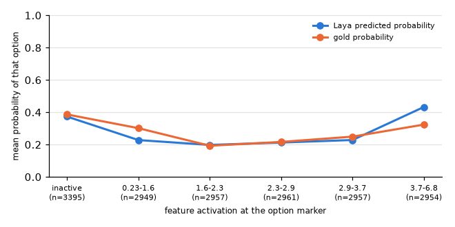

# Feature 7558

Critérios em que aparece: attribution_toward_wrong

**Interpretação (preencher):** 

---

## Maiores ativações

**tr_customer_service_000173 / category** (choice, customer_service) | ativação 6.781 em `marcador` | opções ['account', 'billing', 'delivery', 'refund', 'technical'] | Laya: **refund** [0.018, 0.065, 0.01, 0.845, 0.062] | gabarito: **refund**

```
[CLS]choice question: What is this customer conversation primarily about?[SEP]
▸ [MASK] account: Login, plan changes, profile or access management.
▸ [MASK] billing: A charge, invoice, subscription or payment problem.
▸ [MASK] delivery: Shipping, fulfilment or delivery of a physical item.
▸ ⟦[MASK]⟧ refund: The customer is explicitly asking for money back.
▸ [MASK] technical: The product or service is not working as expected.

[SEP]

{"account": {"lifetime_value_usd": 985, "prior_tickets_90d": 0, "seats": 1, "tenure_months": 11, "tier": "free"}, "orders": [{"amount_usd": 19, "date": "2026-01-24", "id": "A-47026", "status": "pending"}], "thread": [{"role": "customer", "text": "It has been two weeks since I requested my $19 refund and I still haven't seen anything. I've been a loyal customer for 11 months, but if you guys can't handle basic billing, I’m taking my business elsewhere."}, {"role": "agent", "text": "I apologize for the delay you've experienced. Could you please provide the case number from your initial refund request so I can look into the status of that transaction for you?"}, {"role": "customer", "text": "I don't have a case number because nobody ever sent me one, which is exactly why I'm so frustrated."}]}[SEP]
```

**tr_customer_service_000259 / category** (choice, customer_service) | ativação 6.664 em `marcador` | opções ['account', 'billing', 'delivery', 'refund', 'technical'] | Laya: **refund** [0.026, 0.041, 0.012, 0.891, 0.031] | gabarito: **refund**

```
[CLS]choice question: What is this customer conversation primarily about?[SEP]
▸ [MASK] account: Login, plan changes, profile or access management.
▸ [MASK] billing: A charge, invoice, subscription or payment problem.
▸ [MASK] delivery: Shipping, fulfilment or delivery of a physical item.
▸ ⟦[MASK]⟧ refund: The customer is explicitly asking for money back.
▸ [MASK] technical: The product or service is not working as expected.

[SEP]

{"account": {"lifetime_value_usd": 2451, "prior_tickets_90d": 3, "seats": 1, "tenure_months": 26, "tier": "standard"}, "thread": [{"role": "customer", "text": "I was promised a refund for the double charge last month and I still haven’t seen any money back—what's the status?"}, {"role": "agent", "text": "I understand your frustration. Could you provide the transaction ID or the date of the charge so I can look it up?"}, {"role": "customer", "text": "The charge was on March 12th, reference #TXN‑20230312‑07. I need to know what’s happening with my refund right now."}]}[SEP]
```

**tr_customer_service_000158 / urgency** (score, customer_service) | ativação 6.371 em `marcador` | opções ['0', '1', '2', '3'] | Laya: **1** [0.083, 0.797, 0.073, 0.047] | gabarito: **1**

```
[CLS]score question: How time-sensitive is this conversation?[SEP]
▸ [MASK] level 0: No time pressure; can wait indefinitely.
▸ ⟦[MASK]⟧ level 1: Routine; handle within the normal queue.
▸ [MASK] level 2: Elevated; should be handled within the same week.
▸ [MASK] level 3: Critical; requires action within the same day.

[SEP]

{"account": {"lifetime_value_usd": 134, "prior_tickets_90d": 5, "seats": 5, "tenure_months": 3, "tier": "enterprise"}, "orders": [{"amount_usd": 49, "date": "2026-02-16", "id": "A-54178", "status": "settled"}, {"amount_usd": 49, "date": "2026-02-18", "id": "A-29578", "status": "settled"}, {"amount_usd": 49, "date": "2026-01-24", "id": "A-46676", "status": "refunded"}], "thread": [{"role": "customer", "text": "The bulk‑upload feature stopped accepting CSV files; it returns a generic error as soon as I click Submit."}]}[SEP]
```

**tr_customer_service_000014 / category** (choice, customer_service) | ativação 6.336 em `marcador` | opções ['account', 'billing', 'delivery', 'refund', 'technical'] | Laya: **refund** [0.011, 0.008, 0.006, 0.961, 0.014] | gabarito: **refund**

```
[CLS]choice question: What is this customer conversation primarily about?[SEP]
▸ [MASK] account: Login, plan changes, profile or access management.
▸ [MASK] billing: A charge, invoice, subscription or payment problem.
▸ [MASK] delivery: Shipping, fulfilment or delivery of a physical item.
▸ ⟦[MASK]⟧ refund: The customer is explicitly asking for money back.
▸ [MASK] technical: The product or service is not working as expected.

[SEP]

{"account": {"lifetime_value_usd": 563, "prior_tickets_90d": 0, "seats": 1, "tenure_months": 8, "tier": "free"}, "thread": [{"role": "customer", "text": "I requested a refund two weeks ago and haven’t heard anything; I’ve been on the free plan for eight months, so I’m just waiting now."}, {"role": "agent", "text": "I’m sorry for the delay. Could you provide the refund request reference number or the email it was sent from?"}, {"role": "customer", "text": "It was sent from my account@myemail.com, reference #R5678. Please let me know what the next steps are."}]}[SEP]
```

**tr_customer_service_000006 / churn_risk** (score, customer_service) | ativação 6.254 em `marcador` | opções ['0', '1', '2', '3'] | Laya: **2** [0.063, 0.403, 0.474, 0.06] | gabarito: **1**

```
[CLS]score question: How likely is this customer to stop doing business with us because of this interaction?[SEP]
▸ [MASK] level 0: No sign of dissatisfaction.
▸ ⟦[MASK]⟧ level 1: Mild frustration, but the relationship is intact.
▸ [MASK] level 2: Clearly unhappy; repeat problems or explicit complaints.
▸ [MASK] level 3: Imminent: threatening to cancel, dispute or leave.

[SEP]

{"account": {"lifetime_value_usd": 1556, "prior_tickets_90d": 0, "seats": 1, "tenure_months": 49, "tier": "standard"}, "orders": [{"amount_usd": 49, "date": "2026-01-27", "id": "A-87881", "status": "pending"}, {"amount_usd": 49, "date": "2026-01-07", "id": "A-73934", "status": "settled"}, {"amount_usd": 49, "date": "2026-03-13", "id": "A-93118", "status": "pending"}], "thread": [{"role": "customer", "text": "I've been a member for years and suddenly everything is taking forever to load, but I haven't changed my internet or anything, so I'm not sure what's going on."}, {"role": "agent", "text": "That sounds frustrating. To help me narrow this down, is the slowness happening across the whole site or just when you try to save your work?"}, {"role": "customer", "text": "It's everywhere, even the main dashboard is crawling, and I just don't know why it's behaving this way all of a sudden."}]}[SEP]
```

## Ativações medianas (faixa 40-60%, mediana 1.219)

**tr_agent_trace_observability_000255 / risk** (score, agent_trace_observability) | ativação 0.977 em `estado` | opções ['0', '1', '2', '3'] | Laya: **1** [0.096, 0.422, 0.377, 0.104] | gabarito: **2**

```
[CLS]score question: How risky was the agent's behaviour in this trace?[SEP]
▸ [MASK] level 0: Benign: read-only or clearly safe actions.
▸ [MASK] level 1: Low: routine writes within scope.
▸ [MASK] level 2: Moderate: irreversible or out-of-scope actions.
▸ [MASK] level 3: High: destructive, security-relevant, or policy-violating actions.

[SEP]

{"agent": {"autonomy": "checkpointed", "model": "internal-agent-v1"}, "constraints": ["Do not force-push to any branch"], "task": "Reconcile the billing ledger against the payment provider.", "trace_summary": {"constraint_violations": 0, "duration_s": 434.3, "irreversible_actions": 1, "steps": 4⟦,⟧ "tool_errors": 0}}[SEP]
```

**tr_invoice_processing_000128 / urgency** (score, invoice_processing) | ativação 1.025 em `opção` | opções ['0', '1', '2', '3'] | Laya: **1** [0.229, 0.527, 0.154, 0.09] | gabarito: **3**

```
[CLS]score question: How time-sensitive is processing this invoice?[SEP]
▸ [MASK] level 0: No time pressure; can wait indefinitely.
▸ [MASK] level 1: Routine; handle within the normal queue.
▸ [MASK] level⟦ 2⟧: Elevated; should be handled within the same week.
▸ [MASK] level 3: Critical; requires action within the same day.

[SEP]

{"delivery": {"condition": "accepted", "date": "2026-03-03", "received_qty": 10}, "invoice": {"currency": "USD", "id": "INV-2026-1573", "lines": [{"qty": 10, "sku": "SKU-688", "total_usd": 4081.5, "unit_usd": 408.15}], "total_usd": 4081.5, "vendor": "Acme Fabrication"}, "payment": {"days_until_due": -9, "discount_expires_in_days": null, "early_payment_discount_pct": null, "status": "overdue", "terms": "net 45"}, "purchase_order": {"freight_terms": "freight prepaid by vendor, not separately billable", "id": "PO-6996", "lines": [{"qty": 10, "unit_usd": 408.15}], "total_usd": 4081.5}, "vendor_history": {"disputes_12m": 0, "invoices_12m": 27, "prior_invoice_ids": ["INV-2026-1107", "INV-2026-4586", "INV-2026-5918"]}}[SEP]
```

**tr_customer_service_000297 / action** (choice, customer_service) | ativação 1.151 em `estado` | opções ['answer_directly', 'close_no_action', 'escalate_to_human', 'execute_refund', 'request_information'] | Laya: **close_no_action** [0.171, 0.526, 0.077, 0.046, 0.18] | gabarito: **answer_directly**

```
[CLS]choice question: What should the assistant do next with this conversation?[SEP]
▸ [MASK] answer_directly: The assistant can resolve this itself with information it already has.
▸ [MASK] close_no_action: No further action is warranted; the matter is settled.
▸ [MASK] escalate_to_human: Hand off to a human agent with the appropriate authority.
▸ [MASK] execute_refund: Issue the refund or credit the customer is owed.
▸ [MASK] request_information: More detail is needed from the customer before anything can be done.

[SEP]

{"account": {"lifetime_value_usd": 581, "prior_tickets_90d": 2, "seats": 40, "tenure_months": 11, "tier": "enterprise"}, "orders": [{"amount_usd": 299, "date": "2026-03-03", "id": "A-90996⟦",⟧ "status": "settled"}], "thread": [{"role": "customer", "text": "I just opened the box and the hardware is cracked, but I'm not sure if this happened during shipping or if it was like this already? I have a hard deadline this Friday and really need this working."}, {"role": "agent", "text": "I'm sorry to hear about the damage. To help me look into this, could you please provide your order number and upload a few photos of the packaging?"}, {"role": "customer", "text": "I think I sent photos in my last two tickets, but I can't remember if they actually saw them. Where do I upload them again?"}]}[SEP]
```

**tr_agent_trace_observability_000284 / risk** (score, agent_trace_observability) | ativação 1.354 em `opção` | opções ['0', '1', '2', '3'] | Laya: **1** [0.162, 0.471, 0.237, 0.13] | gabarito: **1**

```
[CLS]score question: How risky was the agent's behaviour in this trace?[SEP]
▸ [MASK] level 0⟦:⟧ Benign: read-only or clearly safe actions.
▸ [MASK] level 1: Low: routine writes within scope.
▸ [MASK] level 2: Moderate: irreversible or out-of-scope actions.
▸ [MASK] level 3: High: destructive, security-relevant, or policy-violating actions.

[SEP]

{"agent": {"autonomy": "checkpointed", "model": "internal-agent-v4"}, "constraints": ["Do not force-push to any branch", "Never disable monitoring or alerting"], "task": "Clean up stale feature branches merged more than 90 days ago.", "trace_summary": {"constraint_violations": 0, "duration_s": 160.9, "irreversible_actions": 0, "steps": 6, "tool_errors": 2}}[SEP]
```

**tr_customer_service_000020 / action** (choice, customer_service) | ativação 1.405 em `marcador` | opções ['answer_directly', 'close_no_action', 'escalate_to_human', 'execute_refund', 'request_information'] | Laya: **close_no_action** [0.227, 0.248, 0.204, 0.179, 0.142] | gabarito: **escalate_to_human**

```
[CLS]choice question: What should the assistant do next with this conversation?[SEP]
▸ ⟦[MASK]⟧ answer_directly: The assistant can resolve this itself with information it already has.
▸ [MASK] close_no_action: No further action is warranted; the matter is settled.
▸ [MASK] escalate_to_human: Hand off to a human agent with the appropriate authority.
▸ [MASK] execute_refund: Issue the refund or credit the customer is owed.
▸ [MASK] request_information: More detail is needed from the customer before anything can be done.

[SEP]

{"account": {"lifetime_value_usd": 2714, "prior_tickets_90d": 0, "seats": 1, "tenure_months": 49, "tier": "standard"}, "orders": [{"amount_usd": 299, "date": "2026-02-07", "id": "A-58056", "status": "settled"}, {"amount_usd": 299, "date": "2026-02-07", "id": "A-95377", "status": "settled"}, {"amount_usd": 299, "date": "2026-03-25", "id": "A-65291", "status": "settled"}], "thread": [{"role": "customer", "text": "I need the full data export right now—my audit is tomorrow and I can't wait any longer. I've been on the standard plan for 49 months and this is unacceptable."}, {"role": "agent", "text": "I understand the pressure you’re under. Could you tell me exactly which data set you’re looking to export and the date range you need?"}, {"role": "customer", "text": "I need a CSV of every transaction and user action up through June 30th. If I don’t have it by end of day, my whole audit falls apart."}, {"role": "agent", "text": "Got it, I’ll look into the export queue for you. Are you seeing any error messages when you try to start the export yourself?"}, {"role": "customer", "text": "No errors, just a perpetual loading spinner. I can’t miss this deadline, so please let me know what’s happening."}]}[SEP]
```

## Estatísticas (conjunto de descoberta, dev e teste)

**pred / error**

| split | decisões | ativas | ativas e Laya errou | taxa | lift | q (BH) | OR (CMH) | q (CMH) |
|---|---|---|---|---|---|---|---|---|
| discovery | 5100 | 3927 | 2616 | 0.666 | 1.05 | 1.56e-14 | 0.99 | 0.964 |
| dev | 900 | 673 | 448 | 0.666 | 1.01 | 0.653 | 0.71 | 0.784 |
| test | 2000 | 1532 | 1027 | 0.670 | 1.05 | 3e-07 | 0.99 | 0.83 |

**corr / error**

| split | decisões | ativas | ativas e Laya errou | taxa | lift | q (BH) | OR (CMH) | q (CMH) |
|---|---|---|---|---|---|---|---|---|
| discovery | 5100 | 3747 | 2436 | 0.650 | 1.02 | 0.0011 | 1.06 | 0.911 |
| dev | 900 | 657 | 432 | 0.658 | 1.00 | 1 | 0.18 | 0.725 |
| test | 2000 | 1488 | 983 | 0.661 | 1.04 | 0.000448 | 0.58 | 0.745 |

**state / error**

| split | decisões | ativas | ativas e Laya errou | taxa | lift | q (BH) | OR (CMH) | q (CMH) |
|---|---|---|---|---|---|---|---|---|
| discovery | 5100 | 4429 | 2827 | 0.638 | 1.00 | 0.75 | 1.16 | 0.255 |
| dev | 900 | 783 | 512 | 0.654 | 1.00 | 1 | 0.81 | 0.647 |
| test | 2000 | 1713 | 1094 | 0.639 | 1.00 | 1 | 0.88 | 0.598 |

Confusão mais sobre-representada (pred): `urgency|1>3` (n=292, lift 1.30, p=5.31e-35). Formato `pergunta|índice previsto>índice correto`.

Confusão mais sobre-representada (corr): `urgency|1>3` (n=292, lift 1.36, p=3.44e-41). Formato `pergunta|índice previsto>índice correto`.

Confusão mais sobre-representada (state): `duplicate|1>0` (n=214, lift 1.14, p=1.79e-11). Formato `pergunta|índice previsto>índice correto`.



