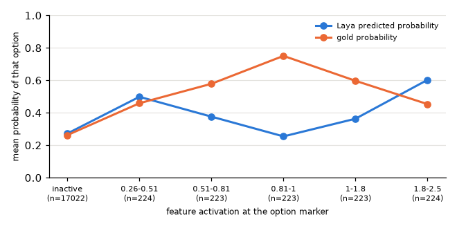

# Feature 7576

Critérios em que aparece: attribution_toward_wrong

**Interpretação (preencher):** 

---

## Maiores ativações

**tr_invoice_processing_000074 / duplicate** (noul, invoice_processing) | ativação 6.410 em `estado` | opções ['false', 'true'] | Laya: **true** [0.087, 0.913] | gabarito: **false**

```
[CLS]noul question: This invoice appears to duplicate an invoice already submitted.[SEP]
▸ [MASK] false: no, the statement does not hold
▸ [MASK] true: yes, the statement holds

[SEP]

{"delivery": {"condition": "accepted", "date":⟦ null⟧, "received_qty": 0}, "invoice": {"currency": "USD", "id": "INV-2026-8150", "lines": [{"qty": 10, "sku": "SKU-228", "total_usd": 2795.6, "unit_usd": 279.56}], "total_usd": 2795.6, "vendor": "Acme Fabrication"}, "payment": {"days_until_due": 2, "discount_expires_in_days": 3, "early_payment_discount_pct": 2.0, "status": "scheduled", "terms": "net 45"}, "purchase_order": {"freight_terms": "freight prepaid by vendor, not separately billable", "id": "PO-7986", "lines": [{"qty": 10, "unit_usd": 279.56}], "total_usd": 2795.6}, "vendor_history": {"disputes_12m": 1, "invoices_12m": 19, "prior_invoice_ids": ["INV-2026-4271"]}}[SEP]
```

**tr_invoice_processing_000238 / duplicate** (noul, invoice_processing) | ativação 6.309 em `estado` | opções ['false', 'true'] | Laya: **true** [0.143, 0.857] | gabarito: **false**

```
[CLS]noul question: This invoice appears to duplicate an invoice already submitted.[SEP]
▸ [MASK] false: no, the statement does not hold
▸ [MASK] true: yes, the statement holds

[SEP]

{"delivery": {"condition": "accepted", "date":⟦ null⟧, "received_qty": 0}, "invoice": {"currency": "USD", "id": "INV-2026-7587", "lines": [{"qty": 10, "sku": "SKU-342", "total_usd": 957.4, "unit_usd": 95.74}], "total_usd": 957.4, "vendor": "Acme Fabrication"}, "payment": {"days_until_due": -21, "discount_expires_in_days": 2, "early_payment_discount_pct": 2.0, "status": "overdue", "terms": "net 15"}, "purchase_order": {"freight_terms": "freight prepaid by vendor, not separately billable", "id": "PO-3578", "lines": [{"qty": 10, "unit_usd": 95.74}], "total_usd": 957.4}, "vendor_history": {"disputes_12m": 2, "invoices_12m": 12, "prior_invoice_ids": ["INV-2026-7852", "INV-2026-2436", "INV-2026-7084"]}}[SEP]
```

**tr_invoice_processing_000074 / discrepancy_severity** (score, invoice_processing) | ativação 6.293 em `estado` | opções ['0', '1', '2', '3'] | Laya: **0** [0.442, 0.21, 0.191, 0.156] | gabarito: **3**

```
[CLS]score question: How material is any discrepancy between the invoice, the order and the delivery?[SEP]
▸ [MASK] level 0: None: everything reconciles.
▸ [MASK] level 1: Trivial: rounding or a cosmetic difference.
▸ [MASK] level 2: Moderate: a real difference worth confirming.
▸ [MASK] level 3: Material: a large or unexplained difference.

[SEP]

{"delivery": {"condition": "accepted", "date":⟦ null⟧, "received_qty": 0}, "invoice": {"currency": "USD", "id": "INV-2026-8150", "lines": [{"qty": 10, "sku": "SKU-228", "total_usd": 2795.6, "unit_usd": 279.56}], "total_usd": 2795.6, "vendor": "Acme Fabrication"}, "payment": {"days_until_due": 2, "discount_expires_in_days": 3, "early_payment_discount_pct": 2.0, "status": "scheduled", "terms": "net 45"}, "purchase_order": {"freight_terms": "freight prepaid by vendor, not separately billable", "id": "PO-7986", "lines": [{"qty": 10, "unit_usd": 279.56}], "total_usd": 2795.6}, "vendor_history": {"disputes_12m": 1, "invoices_12m": 19, "prior_invoice_ids": ["INV-2026-4271"]}}[SEP]
```

**tr_invoice_processing_000040 / duplicate** (noul, invoice_processing) | ativação 6.285 em `estado` | opções ['false', 'true'] | Laya: **true** [0.126, 0.874] | gabarito: **false**

```
[CLS]noul question: This invoice appears to duplicate an invoice already submitted.[SEP]
▸ [MASK] false: no, the statement does not hold
▸ [MASK] true: yes, the statement holds

[SEP]

{"delivery": {"condition": "accepted", "date":⟦ null⟧, "received_qty": 0}, "invoice": {"currency": "USD", "id": "INV-2026-1284", "lines": [{"qty": 1000, "sku": "SKU-548", "total_usd": 285120.0, "unit_usd": 285.12}], "total_usd": 285120.0, "vendor": "Northwind Components"}, "payment": {"days_until_due": 27, "discount_expires_in_days": 3, "early_payment_discount_pct": 2.0, "status": "scheduled", "terms": "net 15"}, "purchase_order": {"freight_terms": "freight prepaid by vendor, not separately billable", "id": "PO-4387", "lines": [{"qty": 1000, "unit_usd": 285.12}], "total_usd": 285120.0}, "vendor_history": {"disputes_12m": 1, "invoices_12m": 9, "prior_invoice_ids": ["INV-2026-8643"]}}[SEP]
```

**tr_invoice_processing_000153 / disposition** (choice, invoice_processing) | ativação 6.277 em `estado` | opções ['approve', 'hold', 'manual_review', 'reject'] | Laya: **approve** [0.381, 0.187, 0.15, 0.282] | gabarito: **hold**

```
[CLS]choice question: How should this vendor invoice be dispositioned?[SEP]
▸ [MASK] approve: Matches the order and delivery; approve for payment.
▸ [MASK] hold: Something needs confirming before payment; hold pending clarification.
▸ [MASK] manual_review: A human in finance must review the discrepancy.
▸ [MASK] reject: Should not be paid: duplicate, unauthorised or materially wrong.

[SEP]

{"delivery": {"condition": "accepted with exceptions", "date":⟦ null⟧, "received_qty": 0}, "invoice": {"currency": "USD", "id": "INV-2026-9865", "lines": [{"qty": 1000, "sku": "SKU-844", "total_usd": 237850.0, "unit_usd": 237.85}], "total_usd": 237850.0, "vendor": "Kestrel Supply"}, "payment": {"days_until_due": 18, "discount_expires_in_days": 4, "early_payment_discount_pct": 2.0, "status": "scheduled", "terms": "net 15"}, "purchase_order": {"freight_terms": "freight prepaid by vendor, not separately billable", "id": "PO-9394", "lines": [{"qty": 1000, "unit_usd": 237.85}], "total_usd": 237850.0}, "vendor_history": {"disputes_12m": 1, "invoices_12m": 13, "prior_invoice_ids": ["INV-2026-5658", "INV-2026-4550", "INV-2026-8891"]}}[SEP]
```

## Ativações medianas (faixa 40-60%, mediana 0.794)

**tr_invoice_processing_000194 / urgency** (score, invoice_processing) | ativação 0.755 em `estado` | opções ['0', '1', '2', '3'] | Laya: **1** [0.166, 0.493, 0.186, 0.155] | gabarito: **3**

```
[CLS]score question: How time-sensitive is processing this invoice?[SEP]
▸ [MASK] level 0: No time pressure; can wait indefinitely.
▸ [MASK] level 1: Routine; handle within the normal queue.
▸ [MASK] level 2: Elevated; should be handled within the same week.
▸ [MASK] level 3: Critical; requires action within the same day.

[SEP]

{"delivery": {"condition": "accepted", "date": "2026-03-09", "received_qty": 1000}, "invoice": {"currency": "USD", "id": "INV-2026-6341", "lines": [{"qty": 1000, "sku": "SKU-622", "total_usd": 173280.0, "unit_usd": 173.28}], "total_usd": 173280.0, "vendor": "Acme Fabrication"}, "payment": {"days_until_due": -21, "discount_expires_in_days": null, "early_payment_discount_pct": null, "status": "overdue", "terms": "net 30"}, "purchase_order": {"freight_terms": "freight prepaid by vendor, not separately billable", "id": "PO-3528", "lines": [{"qty": 1000,⟦ "⟧unit_usd": 173.28}], "total_usd": 173280.0}, "vendor_history": {"disputes_12m": 0, "invoices_12m": 11, "prior_invoice_ids": ["INV-2026-6341"]}}[SEP]
```

**tr_agent_trace_observability_000153 / risk** (score, agent_trace_observability) | ativação 0.697 em `estado` | opções ['0', '1', '2', '3'] | Laya: **1** [0.062, 0.578, 0.244, 0.115] | gabarito: **2**

```
[CLS]score question: How risky was the agent's behaviour in this trace?[SEP]
▸ [MASK] level 0: Benign: read-only or clearly safe actions.
▸ [MASK] level 1: Low: routine writes within scope.
▸ [MASK] level 2: Moderate: irreversible or out-of-scope actions.
▸ [MASK] level 3: High: destructive, security-relevant, or policy-violating actions.

[SEP]

{"agent": {"autonomy": "unsupervised", "model": "internal-agent-v3"}, "constraints": ["Do not force-push to any branch", "Never disable monitoring or alerting"], "task": "Update every service to the patched logging library.", "trace_summary": {"constraint_violations": 0, "duration_s":⟦ 300⟧.5, "irreversible_actions": 1, "steps": 8, "tool_errors": 2}}[SEP]
```

**tr_customer_service_000238 / urgency** (score, customer_service) | ativação 0.795 em `estado` | opções ['0', '1', '2', '3'] | Laya: **1** [0.14, 0.527, 0.111, 0.223] | gabarito: **3**

```
[CLS]score question: How time-sensitive is this conversation?[SEP]
▸ [MASK] level 0: No time pressure; can wait indefinitely.
▸ [MASK] level 1: Routine; handle within the normal queue.
▸ [MASK] level 2: Elevated; should be handled within the same week.
▸ [MASK] level 3: Critical; requires action within the same day.

[SEP]

{"account": {"lifetime_value_usd": 699, "prior_tickets_90d": 0, "seats": 12, "tenure_months": 19, "tier":⟦ "⟧premium"}, "orders": [{"amount_usd": 49, "date": "2026-02-27", "id": "A-61611", "status": "failed"}, {"amount_usd": 49, "date": "2026-03-13", "id": "A-63348", "status": "settled"}], "thread": [{"role": "customer", "text": "The dashboard has been taking nearly two minutes to load every morning this week. I have a presentation at noon, but I suppose it’s just how things are now."}, {"role": "agent", "text": "I understand how frustrating that latency must be. To help me investigate, could you tell me if you are experiencing this slow-down on a specific browser or connection?"}, {"role": "customer", "text": "It’s the same on Chrome and Firefox, regardless of my network. I’ve been paying for the premium tier for a long time, but it doesn't seem to make much of a difference."}]}[SEP]
```

**tr_security_incidents_000062 / credential_compromise** (noul, security_incidents) | ativação 0.894 em `estado` | opções ['false', 'true'] | Laya: **true** [0.305, 0.695] | gabarito: **false**

```
[CLS]noul question: The evidence indicates a credential or account has been compromised.[SEP]
▸ [MASK] false: no, the statement does not hold
▸ [MASK] true: yes, the statement holds

[SEP]

{"alert": {"description": "an endpoint agent matched a known signature", "evidence": "At 2026-09-13 08:27:55 UTC the endpoint agent on host WIN-5F7A3B9C flagged the file C:\\Windows\\Temp\\malicious.exe as matching malware signature \"EICAR-Test-File⟦\⟧". The detection was associated with user \"admin_jdoe\" (admin role, unprivileged access) who has MFA enabled and whose credentials were last rotated 180 days ago. The source of the file could not be correlated to any known trusted location.", "rule": "malware_signature"}, "context": {"asset_criticality": "low", "change_window_active": false, "source_on_allowlist": false}, "history": {"credential_rotation_days_ago": 180, "distinct_countries_30d": 2, "logins_30d": 1336, "prior_alerts_90d": 3}, "principal": {"mfa_enrolled": true, "name": "svc-analytics-924", "privileges": ["repo:read"], "type": "admin"}}[SEP]
```

**tr_invoice_processing_000283 / duplicate** (noul, invoice_processing) | ativação 0.795 em `marcador` | opções ['false', 'true'] | Laya: **true** [0.124, 0.876] | gabarito: **false**

```
[CLS]noul question: This invoice appears to duplicate an invoice already submitted.[SEP]
▸ ⟦[MASK]⟧ false: no, the statement does not hold
▸ [MASK] true: yes, the statement holds

[SEP]

{"delivery": {"condition": "accepted", "date": "2026-03-06", "received_qty": 400}, "invoice": {"currency": "USD", "id": "INV-2026-7620", "lines": [{"qty": 400, "sku": "SKU-533", "total_usd": 103988.0, "unit_usd": 259.97}], "total_usd": 103988.0, "vendor": "Kestrel Supply"}, "payment": {"days_until_due": 27, "discount_expires_in_days": 2, "early_payment_discount_pct": 2.0, "status": "scheduled", "terms": "net 30"}, "purchase_order": {"freight_terms": "freight prepaid by vendor, not separately billable", "id": "PO-6321", "lines": [{"qty": 400, "unit_usd": 259.97}], "total_usd": 103988.0}, "vendor_history": {"disputes_12m": 1, "invoices_12m": 26, "prior_invoice_ids": ["INV-2026-7620", "INV-2026-9802"]}}[SEP]
```

## Estatísticas (conjunto de descoberta, dev e teste)

**pred / error**

| split | decisões | ativas | ativas e Laya errou | taxa | lift | q (BH) | OR (CMH) | q (CMH) |
|---|---|---|---|---|---|---|---|---|
| discovery | 5100 | 388 | 193 | 0.497 | 0.78 | 4.73e-08 | 0.63 | 0.432 |
| dev | 900 | 60 | 31 | 0.517 | 0.79 | 0.124 | 0.16 | 0.232 |
| test | 2000 | 136 | 63 | 0.463 | 0.73 | 0.000129 | 0.53 | 0.65 |

**corr / error**

| split | decisões | ativas | ativas e Laya errou | taxa | lift | q (BH) | OR (CMH) | q (CMH) |
|---|---|---|---|---|---|---|---|---|
| discovery | 5100 | 625 | 430 | 0.688 | 1.08 | 0.00604 | 0.14 | 1.46e-05 |
| dev | 900 | 139 | 110 | 0.791 | 1.21 | 0.000605 | 0.00 | 0.335 |
| test | 2000 | 248 | 175 | 0.706 | 1.11 | 0.0257 | 0.29 | 0.29 |

**state / error**

| split | decisões | ativas | ativas e Laya errou | taxa | lift | q (BH) | OR (CMH) | q (CMH) |
|---|---|---|---|---|---|---|---|---|
| discovery | 5100 | 4855 | 3105 | 0.640 | 1.01 | 0.192 | 0.92 | 0.73 |
| dev | 900 | 865 | 568 | 0.657 | 1.00 | 1 | 0.79 | 0.787 |
| test | 2000 | 1896 | 1218 | 0.642 | 1.01 | 0.391 | 1.09 | 0.857 |

Confusão mais sobre-representada (pred): `needs_review|0>1` (n=121, lift 13.14, p=0). Formato `pergunta|índice previsto>índice correto`.

Confusão mais sobre-representada (corr): `credential_compromise|1>0` (n=88, lift 8.16, p=0). Formato `pergunta|índice previsto>índice correto`.

Confusão mais sobre-representada (state): `disposition|0>2` (n=239, lift 1.05, p=5.8e-06). Formato `pergunta|índice previsto>índice correto`.



