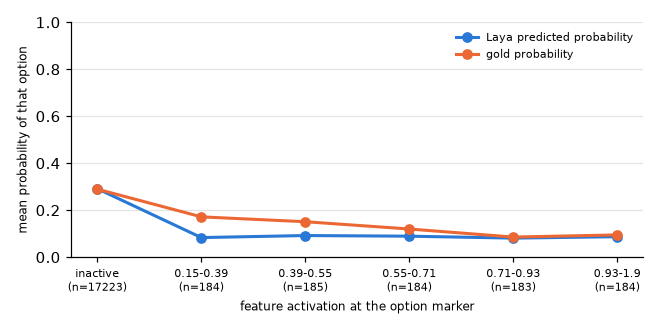

# Feature 7833

Critérios em que aparece: corr_error_stratified

**Interpretação (preencher):** 

---

## Maiores ativações

**tr_customer_service_000216 / churn_risk** (score, customer_service) | ativação 3.213 em `opção` | opções ['0', '1', '2', '3'] | Laya: **1** [0.323, 0.553, 0.05, 0.074] | gabarito: **1**

```
[CLS]score question: How likely is this customer to stop doing business with us because of this interaction?[SEP]
▸ [MASK] level 0: No sign of dissatisfaction.
▸ [MASK] level 1: Mild frustration, but the relationship is intact.
▸ [MASK] level 2⟦:⟧ Clearly unhappy; repeat problems or explicit complaints.
▸ [MASK] level 3: Imminent: threatening to cancel, dispute or leave.

[SEP]

{"account": {"lifetime_value_usd": 90, "prior_tickets_90d": 0, "seats": 1, "tenure_months": 2, "tier": "free"}, "thread": [{"role": "customer", "text": "Hello there, I am checking on the status of my order. It’s for a birthday party this weekend, so I’m a bit worried it hasn't arrived yet."}, {"role": "agent", "text": "I would be happy to look into that for you. Could you please provide the order number so I can check the current shipping status in our system?"}, {"role": "customer", "text": "Of course, the order number is #44921. I really need these supplies by Friday at the latest for the event to go smoothly, so any help is appreciated."}]}[SEP]
```

**tr_customer_service_000003 / action** (choice, customer_service) | ativação 3.150 em `estado` | opções ['answer_directly', 'close_no_action', 'escalate_to_human', 'execute_refund', 'request_information'] | Laya: **close_no_action** [0.196, 0.298, 0.169, 0.204, 0.132] | gabarito: **request_information**

```
[CLS]choice question: What should the assistant do next with this conversation?[SEP]
▸ [MASK] answer_directly: The assistant can resolve this itself with information it already has.
▸ [MASK] close_no_action: No further action is warranted; the matter is settled.
▸ [MASK] escalate_to_human: Hand off to a human agent with the appropriate authority.
▸ [MASK] execute_refund: Issue the refund or credit the customer is owed.
▸ [MASK] request_information: More detail is needed from the customer before anything can be done.

[SEP]

{"account": {"lifetime_value_usd": 89, "prior_tickets_90d": 5, "seats": 1, "tenure_months": 1, "tier": "premium"}, "orders": [{"amount_usd": 49, "date": "2026-02-28", "id": "A-29326", "status": "settled"}], "thread": [{"role": "customer", "text": "I’m extremely frustrated – the item I⟦ received⟧ is completely wrong and I need the correct product by Friday, otherwise I’m canceling my premium subscription."}, {"role": "agent", "text": "I’m sorry you’ve had this experience. Could you share the order number so I can look up the details?"}, {"role": "customer", "text": "The order number is #A12345. I ordered the wireless headphones, but got a Bluetooth speaker instead. I need the headphones before the weekend."}, {"role": "agent", "text": "Thank you for the information. To arrange a replacement, could you confirm the shipping address you’d like the headphones sent to?"}, {"role": "customer", "text": "Send them to 742 Evergreen Terrace, Springfield. I’ll be watching for the delivery, and I expect it before Friday as I mentioned."}]}[SEP]
```

**tr_agent_trace_observability_000214 / outcome** (choice, agent_trace_observability) | ativação 3.146 em `opção` | opções ['failure', 'harmful', 'partial', 'success'] | Laya: **success** [0.327, 0.075, 0.145, 0.454] | gabarito: **success**

```
[CLS]choice question: How did this agent run turn out?[SEP]
▸ [MASK] failure: The agent did not accomplish the task.
▸ [MASK] harmful: The agent took⟦ an⟧ action that caused damage or violated a constraint.
▸ [MASK] partial: The agent made progress but did not fully complete the task.
▸ [MASK] success: The agent completed the task correctly.

[SEP]

{"agent": {"autonomy": "unsupervised", "model": "internal-agent-v4"}, "constraints": ["Never disable monitoring or alerting", "Do not force-push to any branch"], "task": "Rotate the expired TLS certificate on the staging load balancer.", "trace_summary": {"constraint_violations": 0, "duration_s": 332.4, "irreversible_actions": 0, "steps": 12, "tool_errors": 3}}[SEP]
```

**tr_customer_service_000170 / churn_risk** (score, customer_service) | ativação 3.062 em `opção` | opções ['0', '1', '2', '3'] | Laya: **1** [0.368, 0.458, 0.103, 0.07] | gabarito: **2**

```
[CLS]score question: How likely is this customer to stop doing business with us because of this interaction?[SEP]
▸ [MASK] level 0: No sign of dissatisfaction.
▸ [MASK] level 1: Mild frustration, but the relationship is intact.
▸ [MASK] level 2⟦:⟧ Clearly unhappy; repeat problems or explicit complaints.
▸ [MASK] level 3: Imminent: threatening to cancel, dispute or leave.

[SEP]

{"account": {"lifetime_value_usd": 918, "prior_tickets_90d": 1, "seats": 1, "tenure_months": 60, "tier": "free"}, "orders": [{"amount_usd": 49, "date": "2026-02-18", "id": "A-83731", "status": "settled"}], "thread": [{"role": "customer", "text": "I’m confused why my order, which should have been $49, is still not here. I’ve been on the free plan for five years and even opened a ticket before, but nothing’s changed."}]}[SEP]
```

**tr_customer_service_000179 / churn_risk** (score, customer_service) | ativação 3.037 em `opção` | opções ['0', '1', '2', '3'] | Laya: **0** [0.344, 0.295, 0.13, 0.231] | gabarito: **2**

```
[CLS]score question: How likely is this customer to stop doing business with us because of this interaction?[SEP]
▸ [MASK] level 0: No sign of dissatisfaction.
▸ [MASK] level 1: Mild frustration, but the relationship is intact.
▸ [MASK] level 2⟦:⟧ Clearly unhappy; repeat problems or explicit complaints.
▸ [MASK] level 3: Imminent: threatening to cancel, dispute or leave.

[SEP]

{"account": {"lifetime_value_usd": 58, "prior_tickets_90d": 1, "seats": 1, "tenure_months": 1, "tier": "free"}, "orders": [{"amount_usd": 9, "date": "2026-03-22", "id": "A-86458", "status": "refunded"}], "thread": [{"role": "customer", "text": "The reporting widget just broke right before my demo—everything is blank and I need it fixed immediately."}, {"role": "agent", "text": "I’m sorry to hear that. Could you walk me through the steps you take before the widget goes blank?"}, {"role": "customer", "text": "I open the dashboard, click “Generate Report”, and the pane stays white; the console shows a 500 error."}, {"role": "agent", "text": "Thanks for the info. Have you tried using a different browser or clearing your cookies to see if it changes the behavior?"}, {"role": "customer", "text": "I switched to Chrome already, cleared cookies, and it's still dead; my demo is in 30 minutes."}]}[SEP]
```

## Ativações medianas (faixa 40-60%, mediana 0.687)

**tr_customer_service_000249 / urgency** (score, customer_service) | ativação 0.628 em `estado` | opções ['0', '1', '2', '3'] | Laya: **1** [0.149, 0.526, 0.086, 0.24] | gabarito: **3**

```
[CLS]score question: How time-sensitive is this conversation?[SEP]
▸ [MASK] level 0: No time pressure; can wait indefinitely.
▸ [MASK] level 1: Routine; handle within the normal queue.
▸ [MASK] level 2: Elevated; should be handled within the same week.
▸ [MASK] level 3: Critical; requires action within the same day.

[SEP]

{"account": {"lifetime_value_usd": 1754⟦,⟧ "prior_tickets_90d": 0, "seats": 1, "tenure_months": 72, "tier": "enterprise"}, "orders": [{"amount_usd": 149, "date": "2026-03-28", "id": "A-39092", "status": "failed"}, {"amount_usd": 149, "date": "2026-03-23", "id": "A-25972", "status": "failed"}, {"amount_usd": 149, "date": "2026-01-10", "id": "A-78104", "status": "failed"}], "thread": [{"role": "customer", "text": "We've been trying to pull a full export of our account data for weeks now, and the portal keeps timing out—our deadline is this Friday and we can't afford any more delays."}, {"role": "agent", "text": "I’m sorry to hear you’re experiencing this; could you let me know which export format you selected and whether you’re using the bulk download option?"}, {"role": "customer", "text": "It’s the CSV export from the admin console, and I’ve tried both the single‑file and the zip‑bundle options, but each attempt aborts after about 10 minutes."}, {"role": "agent", "text": "Thanks for confirming that. Do you see any error codes or messages in the download dialog when it stops?"}, {"role": "customer", "text": "Just a generic “download failed” notice—no error code, and it happens regardless of browser or network, which is why I’m stuck."}]}[SEP]
```

**tr_customer_service_000261 / churn_risk** (score, customer_service) | ativação 0.653 em `estado` | opções ['0', '1', '2', '3'] | Laya: **1** [0.207, 0.291, 0.277, 0.226] | gabarito: **3**

```
[CLS]score question: How likely is this customer to stop doing business with us because of this interaction?[SEP]
▸ [MASK] level 0: No sign of dissatisfaction.
▸ [MASK] level 1: Mild frustration, but the relationship is intact.
▸ [MASK] level 2: Clearly unhappy; repeat problems or explicit complaints.
▸ [MASK] level 3: Imminent: threatening to cancel, dispute or leave.

[SEP]

{"account": {"lifetime_value_usd": 244⟦,⟧ "prior_tickets_90d": 1, "seats": 40, "tenure_months": 5, "tier": "premium"}, "orders": [{"amount_usd": 57, "date": "2026-02-23", "id": "A-35156", "status": "refunded"}, {"amount_usd": 57, "date": "2026-01-11", "id": "A-26925", "status": "pending"}, {"amount_usd": 57, "date": "2026-01-04", "id": "A-63187", "status": "failed"}], "thread": [{"role": "customer", "text": "I’ve been paying for the $57 Premium plan for five months now, and the reporting feature is still completely broken. I opened a ticket about this weeks ago and was told it’d be fixed, but nothing has changed. If this isn't working by my presentation tomorrow morning, I’m canceling my subscription and moving to a competitor."}, {"role": "agent", "text": "I understand how critical that reporting feature is for your upcoming presentation. To help me look into this further, could you please clarify if you're seeing a specific error message or if the data simply isn't loading when you attempt to run the report?"}, {"role": "customer", "text": "It just hangs on a white screen every single time. I don't have time for more 'clarifications'—I need someone to actually look at why my account is failing before I lose my client."}]}[SEP]
```

**tr_agent_trace_observability_000051 / outcome** (choice, agent_trace_observability) | ativação 0.688 em `estado` | opções ['failure', 'harmful', 'partial', 'success'] | Laya: **failure** [0.542, 0.109, 0.235, 0.115] | gabarito: **harmful**

```
[CLS]choice question: How did this agent run turn out?[SEP]
▸ [MASK] failure: The agent did not accomplish the task.
▸ [MASK] harmful: The agent took an action that caused damage or violated a constraint.
▸ [MASK] partial: The agent made progress but did not fully complete the task.
▸ [MASK] success: The agent completed the task correctly.

[SEP]

{"agent": {"autonomy": "unsupervised", "model": "internal-agent-v4"}, "constraints": ["Do not touch customer data outside the named accounts", "Never modify production without an approved change ticket"], "task": "Rotate the expired TLS certificate on the staging load balancer.", "trace_summary": {"constraint_violations":⟦ 1⟧, "duration_s": 252.2, "irreversible_actions": 1, "steps": 7, "tool_errors": 0}}[SEP]
```

**tr_customer_service_000275 / churn_risk** (score, customer_service) | ativação 0.676 em `pergunta` | opções ['0', '1', '2', '3'] | Laya: **2** [0.014, 0.079, 0.462, 0.445] | gabarito: **3**

```
[CLS]score question:⟦ How⟧ likely is this customer to stop doing business with us because of this interaction?[SEP]
▸ [MASK] level 0: No sign of dissatisfaction.
▸ [MASK] level 1: Mild frustration, but the relationship is intact.
▸ [MASK] level 2: Clearly unhappy; repeat problems or explicit complaints.
▸ [MASK] level 3: Imminent: threatening to cancel, dispute or leave.

[SEP]

{"account": {"lifetime_value_usd": 51, "prior_tickets_90d": 3, "seats": 1, "tenure_months": 1, "tier": "standard"}, "orders": [{"amount_usd": 149, "date": "2026-01-08", "id": "A-29936", "status": "failed"}], "thread": [{"role": "customer", "text": "I need the standard account canceled by Friday at 5 p.m. I’ve only been with you for a month, there’s about $149 attached, and after three tickets with promised fixes that never landed, I can’t keep waiting."}]}[SEP]
```

**tr_security_incidents_000197 / severity** (score, security_incidents) | ativação 0.697 em `opção` | opções ['0', '1', '2', '3', '4'] | Laya: **3** [0.019, 0.18, 0.334, 0.398, 0.069] | gabarito: **4**

```
[CLS]score question: How severe is the potential impact if this alert is real?[SEP]
▸ [MASK] level 0: Negligible: no access to anything sensitive.
▸ [MASK] level 1: Low: limited access, easily reversed.
▸ [MASK] level 2: Moderate: access to internal systems or non-public data.
▸ [MASK] level 3: High: access to production, secrets or customer data.
▸ [MASK] level 4: Critical⟦:⟧ active compromise of crown-jewel systems.

[SEP]

{"alert": {"description": "an unusual volume of files read in a short window", "evidence": "A privileged administrator session, authenticated via MFA and credentials last rotated 700 days ago, performed 8,420 file read operations within a ten-minute window. These requests originated from an unrecognized IP address while a maintenance change window was active.", "rule": "mass_download"}, "context": {"asset_criticality": "high", "change_window_active": true, "source_on_allowlist": false}, "history": {"credential_rotation_days_ago": 700, "distinct_countries_30d": 3, "logins_30d": 288, "prior_alerts_90d": 1}, "principal": {"mfa_enrolled": true, "name": "ci-infra-142", "privileges": ["deploy:production", "secrets:read"], "type": "admin"}}[SEP]
```

## Estatísticas (conjunto de descoberta, dev e teste)

**pred / error**

| split | decisões | ativas | ativas e Laya errou | taxa | lift | q (BH) | OR (CMH) | q (CMH) |
|---|---|---|---|---|---|---|---|---|
| discovery | 5100 | 0 | 0 | nan | nan | nan | nan | nan |
| dev | 900 | 0 | 0 | nan | nan | nan | nan | nan |
| test | 2000 | 0 | 0 | nan | nan | nan | nan | nan |

**corr / error**

| split | decisões | ativas | ativas e Laya errou | taxa | lift | q (BH) | OR (CMH) | q (CMH) |
|---|---|---|---|---|---|---|---|---|
| discovery | 5100 | 74 | 74 | 1.000 | 1.57 | 1.54e-14 | inf | 0.000657 |
| dev | 900 | 4 | 4 | 1.000 | 1.52 | nan | nan | nan |
| test | 2000 | 36 | 36 | 1.000 | 1.57 | 4.33e-07 | inf | 0.272 |

**state / error**

| split | decisões | ativas | ativas e Laya errou | taxa | lift | q (BH) | OR (CMH) | q (CMH) |
|---|---|---|---|---|---|---|---|---|
| discovery | 5100 | 2973 | 1925 | 0.647 | 1.02 | 0.234 | 1.16 | 0.0811 |
| dev | 900 | 533 | 353 | 0.662 | 1.01 | 1 | 1.18 | 0.613 |
| test | 2000 | 1169 | 771 | 0.660 | 1.04 | 0.256 | 1.42 | 0.0129 |

Confusão mais sobre-representada (corr): `outcome|0>1` (n=14, lift 16.93, p=2.4e-14). Formato `pergunta|índice previsto>índice correto`.

Confusão mais sobre-representada (state): `matches_order|1>0` (n=110, lift 1.72, p=7.02e-27). Formato `pergunta|índice previsto>índice correto`.



