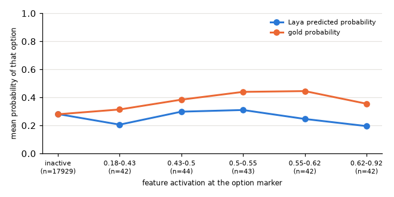

# Feature 7939

Critérios em que aparece: corr_error_stratified

**Interpretação (preencher):** 

---

## Maiores ativações

**tr_customer_service_000120 / needs_human** (noul, customer_service) | ativação 2.389 em `estado` | opções ['false', 'true'] | Laya: **true** [0.439, 0.561] | gabarito: **true**

```
[CLS]noul question: This conversation requires a human agent rather than automated handling.[SEP]
▸ [MASK] false: Automation can carry this to resolution.
▸ [MASK] true: A human must take over: judgement, authority or empathy is required.

[SEP]

{"account": {"lifetime_value_usd": 683, "prior_tickets_90d": 2, "seats": 1, "tenure_months": 8, "tier": "premium"}, "orders": [{"amount_usd": 29, "date": "2026-03-13", "id": "A-34569", "status": "pending"}, {"amount_usd": 29, "date": "2026-02-22", "id": "A-11297", "status": "refunded"}, {"amount_usd": 29, "date": "2026-01-21", "id": "A-20004", "status": "failed"}], "thread": [{"role": "customer", "text": "I am trying to remove two seats from my Premium plan, but the dashboard still shows them as active and billable for the next cycle. I've been a customer for eight months and this is the third time I've had to report this exact issue with the $29 per seat charge."}, {"role": "agent", "text": "I can certainly look into those seat settings for you. To clarify, are these seats currently assigned to specific users, or are they currently vacant in your dashboard?"}, {"role": "customer", "text": "They are vacant. I unassigned the users last week, but the total seat count refuses to decrease when I try to update the subscription preferences."}, {"role": "agent", "text": "Thank you for that detail. When you attempt to reduce the count, are you receiving a specific error message, or does the page simply refresh without saving the changes?"}, {"role": "customer", "text": "The page just refreshes. I've already had two tickets about this in the past that were resolved temporarily, but the bug seems to have returned."}, {"role": "agent", "text": "I see the history here in your account. Could you please provide a screenshot of the billing page as it appears now so I can verify the current seat allocation against our backend records?"}, {"role": "customer", "text": "I'll attach the⟦ screenshot⟧ now. I just need to ensure I am not billed for these two extra seats again because I shouldn't be paying for capacity I'm not using."}]}[SEP]
```

**tr_customer_service_000120 / urgency** (score, customer_service) | ativação 2.105 em `estado` | opções ['0', '1', '2', '3'] | Laya: **1** [0.092, 0.471, 0.161, 0.276] | gabarito: **2**

```
[CLS]score question: How time-sensitive is this conversation?[SEP]
▸ [MASK] level 0: No time pressure; can wait indefinitely.
▸ [MASK] level 1: Routine; handle within the normal queue.
▸ [MASK] level 2: Elevated; should be handled within the same week.
▸ [MASK] level 3: Critical; requires action within the same day.

[SEP]

{"account": {"lifetime_value_usd": 683, "prior_tickets_90d": 2, "seats": 1, "tenure_months": 8, "tier": "premium"}, "orders": [{"amount_usd": 29, "date": "2026-03-13", "id": "A-34569", "status": "pending"}, {"amount_usd": 29, "date": "2026-02-22", "id": "A-11297", "status": "refunded"}, {"amount_usd": 29, "date": "2026-01-21", "id": "A-20004", "status": "failed"}], "thread": [{"role": "customer", "text": "I am trying to remove two seats from my Premium plan, but the dashboard still shows them as active and billable for the next cycle. I've been a customer for eight months and this is the third time I've had to report this exact issue with the $29 per seat charge."}, {"role": "agent", "text": "I can certainly look into those seat settings for you. To clarify, are these seats currently assigned to specific users, or are they currently vacant in your dashboard?"}, {"role": "customer", "text": "They are vacant. I unassigned the users last week, but the total seat count refuses to decrease when I try to update the subscription preferences."}, {"role": "agent", "text": "Thank you for that detail. When you attempt to reduce the count, are you receiving a specific error message, or does the page simply refresh without saving the changes?"}, {"role": "customer", "text": "The page just refreshes. I've already had two tickets about this in the past that were resolved temporarily, but the bug seems to have returned."}, {"role": "agent", "text": "I see the history here in your account. Could you please provide a screenshot of the billing page as it appears now so I can verify the current seat allocation against our backend records?"}, {"role": "customer", "text": "I'll attach the⟦ screenshot⟧ now. I just need to ensure I am not billed for these two extra seats again because I shouldn't be paying for capacity I'm not using."}]}[SEP]
```

**tr_customer_service_000077 / category** (choice, customer_service) | ativação 2.016 em `estado` | opções ['account', 'billing', 'delivery', 'refund', 'technical'] | Laya: **billing** [0.022, 0.841, 0.01, 0.078, 0.049] | gabarito: **billing**

```
[CLS]choice question: What is this customer conversation primarily about?[SEP]
▸ [MASK] account: Login, plan changes, profile or access management.
▸ [MASK] billing: A charge, invoice, subscription or payment problem.
▸ [MASK] delivery: Shipping, fulfilment or delivery of a physical item.
▸ [MASK] refund: The customer is explicitly asking for money back.
▸ [MASK] technical: The product or service is not working as expected.

[SEP]

{"account": {"lifetime_value_usd": 579, "prior_tickets_90d": 2, "seats": 1, "tenure_months": 11, "tier": "free"}, "thread": [{"role": "customer", "text": "I noticed an unexpected charge on my account today. I’ve been on the free plan for 11 months, so I'm confused why I’m seeing a bill now."}, {"role": "agent", "text": "Thank you for bringing this to our attention. I would like to investigate this charge for you; could⟦ you⟧ confirm the date the transaction appeared on your statement?"}, {"role": "customer", "text": "It appeared on my dashboard yesterday morning. I’ve had issues with incorrect billing promises before, so I’d appreciate it if you could clarify what this is for."}]}[SEP]
```

**tr_customer_service_000167 / category** (choice, customer_service) | ativação 1.992 em `estado` | opções ['account', 'billing', 'delivery', 'refund', 'technical'] | Laya: **refund** [0.077, 0.091, 0.237, 0.394, 0.201] | gabarito: **delivery**

```
[CLS]choice question: What is this customer conversation primarily about?[SEP]
▸ [MASK] account: Login, plan changes, profile or access management.
▸ [MASK] billing: A charge, invoice, subscription or payment problem.
▸ [MASK] delivery: Shipping, fulfilment or delivery of a physical item.
▸ [MASK] refund: The customer is explicitly asking for money back.
▸ [MASK] technical: The product or service is not working as expected.

[SEP]

{"account": {"lifetime_value_usd": 48, "prior_tickets_90d": 0, "seats": 1, "tenure_months": 1,⟦ "⟧tier": "standard"}, "thread": [{"role": "customer", "text": "The package arrived today, but it’s not what I ordered. I received a different color and size than what I picked out. I guess I’m not surprised, really."}, {"role": "agent", "text": "I am sorry to hear that you received the incorrect items. Could you please provide your order number so I can investigate the fulfillment records?"}, {"role": "customer", "text": "It is order #44921. It’s my first month trying this service, so I suppose I should have expected some kind of error."}, {"role": "agent", "text": "Thank you for providing that. I am pulling up your account details now. Could you please tell me exactly which item you received versus what you were expecting?"}, {"role": "customer", "text": "I got the blue medium shirt, but I ordered the black large. It’s all listed right there on the packing slip."}]}[SEP]
```

**tr_customer_service_000073 / needs_human** (noul, customer_service) | ativação 1.973 em `estado` | opções ['false', 'true'] | Laya: **true** [0.294, 0.706] | gabarito: **true**

```
[CLS]noul question: This conversation requires a human agent rather than automated handling.[SEP]
▸ [MASK] false: Automation can carry this to resolution.
▸ [MASK] true: A human must take over: judgement, authority or empathy is required.

[SEP]

{"account": {"lifetime_value_usd": 54, "prior_tickets_90d": 1, "seats": 1, "tenure_months": 1, "tier": "premium"}, "orders": [{"amount_usd": 29, "date": "2026-01-23", "id": "A-91950", "status": "failed"}], "thread": [{"role": "customer", "text": "I am absolutely livid that my payment failed again after I was told this was fixed last week, this is ridiculous!"}, {"role": "agent", "text": "I'm very sorry for the ongoing trouble with your premium subscription payment; I see your previous ticket regarding this same issue."}, {"role": "customer", "text": "Seeing it doesn't help me! I've only been a member for a month and you've already messed up the $29 charge twice now."}, {"role": "agent", "text": "I understand how frustrating that is. To help me investigate, are you receiving a specific error message from your bank or within our portal?"}, {"role": "customer", "text": "It just says 'transaction failed' with no explanation, which is exactly what happened⟦ the⟧ first time I complained."}, {"role": "agent", "text": "Thank you for that detail. I'm going to pull up the logs from our payment processor to see if there's a more descriptive rejection code on the backend."}, {"role": "customer", "text": "You do that, but if this isn't sorted out once and for all, I'm canceling this plan and moving to a competitor who actually wants my money."}]}[SEP]
```

## Ativações medianas (faixa 40-60%, mediana 0.586)

**tr_security_incidents_000172 / disposition** (choice, security_incidents) | ativação 0.610 em `estado` | opções ['close_benign', 'contain', 'investigate', 'monitor'] | Laya: **close_benign** [0.423, 0.241, 0.118, 0.218] | gabarito: **investigate**

```
[CLS]choice question: How should this security alert be dispositioned?[SEP]
▸ [MASK] close_benign: Expected, explainable activity; close without analyst time.
▸ [MASK] contain: Contain the host or account immediately; do not wait for triage.
▸ [MASK] investigate: Warrants an analyst opening an investigation.
▸ [MASK] monitor: Not clearly malicious, but worth watching for recurrence.

[SEP]

{"alert": {"description": "an unusual volume of files read in a short window", "evidence": "The privileged service_account performed 12,400 file read operations from a known allowlisted IP within a five-minute interval. This activity occurred without a corresponding change window using credentials that have not been rotated in 412 days.", "rule": "mass_download"}, "context": {"asset_criticality": "medium", "change_window_active": false, "source_on_allowlist": true}, "history": {"credential_rotation_days_ago": 412, "distinct_countries_30d": 1, "logins_30d": 18, "prior_alerts_90d": 1}, "principal": {"mfa_enrolled": false, "name": "ci-support-249", "privileges": ["deploy:production", "secrets:read"], "type⟦":⟧ "service_account"}}[SEP]
```

**tr_security_incidents_000182 / severity** (score, security_incidents) | ativação 0.641 em `estado` | opções ['0', '1', '2', '3', '4'] | Laya: **2** [0.033, 0.324, 0.406, 0.196, 0.041] | gabarito: **2**

```
[CLS]score question: How severe is the potential impact if this alert is real?[SEP]
▸ [MASK] level 0: Negligible: no access to anything sensitive.
▸ [MASK] level 1: Low: limited access, easily reversed.
▸ [MASK] level 2: Moderate: access to internal systems or non-public data.
▸ [MASK] level 3: High: access to production, secrets or customer data.
▸ [MASK] level 4: Critical: active compromise of crown-jewel systems.

[SEP]

{"alert": {"description": "an unusual volume of files read in a short window", "evidence": "Between 2026-09-15 14:00 and 14:05 UTC, the admin account \"admin_klee\" on server 10.10.20.5 accessed 4,832 files in the \\share\\archives directory via the process cmd.exe. The activity originated from IP 198.51.100.77, which is not recognized as an approved source, and the account's password was last rotated on 2026-⟦09⟧-12.", "rule": "mass_download"}, "context": {"asset_criticality": "low", "change_window_active": false, "source_on_allowlist": false}, "history": {"credential_rotation_days_ago": 3, "distinct_countries_30d": 4, "logins_30d": 1031, "prior_alerts_90d": 0}, "principal": {"mfa_enrolled": false, "name": "svc-infra-869", "privileges": ["repo:read"], "type": "admin"}}[SEP]
```

**tr_customer_service_000020 / churn_risk** (score, customer_service) | ativação 0.570 em `marcador` | opções ['0', '1', '2', '3'] | Laya: **1** [0.186, 0.39, 0.233, 0.191] | gabarito: **2**

```
[CLS]score question: How likely is this customer to stop doing business with us because of this interaction?[SEP]
▸ [MASK] level 0: No sign of dissatisfaction.
▸ [MASK] level 1: Mild frustration, but the relationship is intact.
▸ ⟦[MASK]⟧ level 2: Clearly unhappy; repeat problems or explicit complaints.
▸ [MASK] level 3: Imminent: threatening to cancel, dispute or leave.

[SEP]

{"account": {"lifetime_value_usd": 2714, "prior_tickets_90d": 0, "seats": 1, "tenure_months": 49, "tier": "standard"}, "orders": [{"amount_usd": 299, "date": "2026-02-07", "id": "A-58056", "status": "settled"}, {"amount_usd": 299, "date": "2026-02-07", "id": "A-95377", "status": "settled"}, {"amount_usd": 299, "date": "2026-03-25", "id": "A-65291", "status": "settled"}], "thread": [{"role": "customer", "text": "I need the full data export right now—my audit is tomorrow and I can't wait any longer. I've been on the standard plan for 49 months and this is unacceptable."}, {"role": "agent", "text": "I understand the pressure you’re under. Could you tell me exactly which data set you’re looking to export and the date range you need?"}, {"role": "customer", "text": "I need a CSV of every transaction and user action up through June 30th. If I don’t have it by end of day, my whole audit falls apart."}, {"role": "agent", "text": "Got it, I’ll look into the export queue for you. Are you seeing any error messages when you try to start the export yourself?"}, {"role": "customer", "text": "No errors, just a perpetual loading spinner. I can’t miss this deadline, so please let me know what’s happening."}]}[SEP]
```

**tr_security_incidents_000219 / severity** (score, security_incidents) | ativação 0.633 em `estado` | opções ['0', '1', '2', '3', '4'] | Laya: **2** [0.041, 0.25, 0.322, 0.239, 0.149] | gabarito: **3**

```
[CLS]score question: How severe is the potential impact if this alert is real?[SEP]
▸ [MASK] level 0: Negligible: no access to anything sensitive.
▸ [MASK] level 1: Low: limited access, easily reversed.
▸ [MASK] level 2: Moderate: access to internal systems or non-public data.
▸ [MASK] level 3: High: access to production, secrets or customer data.
▸ [MASK] level 4: Critical: active compromise of crown-jewel systems.

[SEP]

{"alert": {"description": "a long-unused account became active", "evidence": "The privileged administrator account `admin_svc_04` authenticated from the unrecognized IP address 198.51.100.42 during an active system change window. This session marks the first activity for the account in over six months, utilizing MFA-protected credentials that were last rotated 180 days ago.", "rule": "dormant_account_use"}, "context": {"asset_criticality": "medium", "change_window⟦_⟧active": true, "source_on_allowlist": false}, "history": {"credential_rotation_days_ago": 180, "distinct_countries_30d": 3, "logins_30d": 832, "prior_alerts_90d": 1}, "principal": {"mfa_enrolled": true, "name": "adm-analytics-257", "privileges": ["deploy:production", "secrets:read"], "type": "admin"}}[SEP]
```

**tr_invoice_processing_000278 / discrepancy_severity** (score, invoice_processing) | ativação 0.615 em `estado` | opções ['0', '1', '2', '3'] | Laya: **2** [0.261, 0.259, 0.268, 0.212] | gabarito: **0**

```
[CLS]score question: How material is any discrepancy between the invoice, the order and the delivery?[SEP]
▸ [MASK] level 0: None: everything reconciles.
▸ [MASK] level 1: Trivial: rounding or a cosmetic difference.
▸ [MASK] level 2: Moderate: a real difference worth confirming.
▸ [MASK] level 3: Material: a large or unexplained difference.

[SEP]

{"delivery": {"condition": "accepted", "date": "2026-03-20", "received_qty": 25}, "invoice": {"currency": "USD", "id": "INV-2026-7761", "lines": [{"qty": 25, "sku": "SKU-466", "total_usd": 8533.0, "unit_⟦us⟧d": 341.32}], "total_usd": 8533.0, "vendor": "Vantage Materials"}, "payment": {"days_until_due": 5, "discount_expires_in_days": null, "early_payment_discount_pct": null, "status": "scheduled", "terms": "net 45"}, "purchase_order": {"freight_terms": "freight prepaid by vendor, not separately billable", "id": "PO-3755", "lines": [{"qty": 25, "unit_usd": 341.32}], "total_usd": 8533.0}, "vendor_history": {"disputes_12m": 5, "invoices_12m": 51, "prior_invoice_ids": ["INV-2026-2143", "INV-2026-9910"]}}[SEP]
```

## Estatísticas (conjunto de descoberta, dev e teste)

**pred / error**

| split | decisões | ativas | ativas e Laya errou | taxa | lift | q (BH) | OR (CMH) | q (CMH) |
|---|---|---|---|---|---|---|---|---|
| discovery | 5100 | 17 | 11 | 0.647 | 1.02 | nan | nan | nan |
| dev | 900 | 2 | 1 | 0.500 | 0.76 | nan | nan | nan |
| test | 2000 | 6 | 0 | 0.000 | 0.00 | nan | nan | nan |

**corr / error**

| split | decisões | ativas | ativas e Laya errou | taxa | lift | q (BH) | OR (CMH) | q (CMH) |
|---|---|---|---|---|---|---|---|---|
| discovery | 5100 | 89 | 83 | 0.933 | 1.47 | 3.05e-10 | 14.10 | 8.21e-11 |
| dev | 900 | 20 | 19 | 0.950 | 1.45 | 0.00819 | 18.35 | 0.0377 |
| test | 2000 | 37 | 31 | 0.838 | 1.32 | 0.0176 | 4.74 | 0.0123 |

**state / error**

| split | decisões | ativas | ativas e Laya errou | taxa | lift | q (BH) | OR (CMH) | q (CMH) |
|---|---|---|---|---|---|---|---|---|
| discovery | 5100 | 3577 | 2297 | 0.642 | 1.01 | 0.484 | 1.51 | 6.64e-06 |
| dev | 900 | 670 | 445 | 0.664 | 1.01 | 1 | 1.38 | 0.403 |
| test | 2000 | 1466 | 964 | 0.658 | 1.03 | 0.112 | 1.65 | 0.00216 |

Confusão mais sobre-representada (pred): `true_positive|1>0` (n=9, lift 142.11, p=nan). Formato `pergunta|índice previsto>índice correto`.

Confusão mais sobre-representada (corr): `true_positive|0>1` (n=42, lift 21.30, p=0). Formato `pergunta|índice previsto>índice correto`.

Confusão mais sobre-representada (state): `duplicate|1>0` (n=215, lift 1.42, p=7.05e-33). Formato `pergunta|índice previsto>índice correto`.



