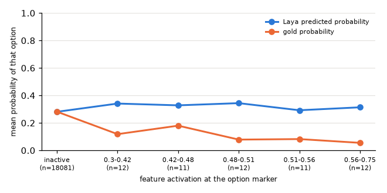

# Feature 8219

Critérios em que aparece: pred_error

**Interpretação (preencher):** 

---

## Maiores ativações

**tr_security_incidents_000114 / true_positive** (noul, security_incidents) | ativação 12.484 em `estado` | opções ['false', 'true'] | Laya: **false** [0.619, 0.381] | gabarito: **false**

```
[CLS]noul question: This alert reflects genuinely malicious or unauthorised activity.[SEP]
▸ [MASK] false: Benign activity, a misconfiguration, or a known false positive.
▸ [MASK] true: The underlying behaviour is malicious or unauthorised.

[SEP]

{"alert": {"description": "a session token was presented from a second address", "evidence": "At 2026-09-15 08:42:10 UTC a session token (ID 5F4A9C) was presented from IP 10.12.5.23, which had previously been used from the allow‑listed address 172.31.4.9 at 2026-09-15 08:37:02 UTC. The employee account is unprivileged, has MFA enabled, and the associated credentials were last rotated 412 days ago.", "rule": "token_reuse"}, "context": {"asset_criticality": "high", "change_window_active": false, "source_on_allowlist": true}, "history": {"credential_rotation_days_ago": 412, "distinct_countries_30d": 4, "logins_30d": 912, "prior_alerts⟦_⟧90d": 0}, "principal": {"mfa_enrolled": true, "name": "svc-support-904", "privileges": ["repo:read"], "type": "employee"}}[SEP]
```

**tr_security_incidents_000029 / true_positive** (noul, security_incidents) | ativação 12.281 em `estado` | opções ['false', 'true'] | Laya: **false** [0.643, 0.357] | gabarito: **true**

```
[CLS]noul question: This alert reflects genuinely malicious or unauthorised activity.[SEP]
▸ [MASK] false: Benign activity, a misconfiguration, or a known false positive.
▸ [MASK] true: The underlying behaviour is malicious or unauthorised.

[SEP]

{"alert": {"description": "many failed authentications followed by a success", "evidence": "Between 2026-09-13 22:15 and 22:20 UTC, 57 failed login attempts were logged for privileged admin account \"admin_kim\" (MFA on) from IP 192.0.2.77, followed by a successful authentication at 22:21 UTC. The activity took place within an open change window, the source is unrecognized, and the credentials for the account were last rotated 365 days ago.", "rule": "brute_force"}, "context": {"asset_criticality": "medium", "change_window_active": true, "source_on_allowlist": false}, "history": {"credential_rotation_days_ago": 365, "distinct_countries_30d": 2, "logins_30d": 1826, "prior_alerts⟦_⟧90d": 0}, "principal": {"mfa_enrolled": true, "name": "svc-analytics-152", "privileges": ["deploy:production", "secrets:read"], "type": "admin"}}[SEP]
```

**tr_security_incidents_000270 / true_positive** (noul, security_incidents) | ativação 12.281 em `estado` | opções ['false', 'true'] | Laya: **true** [0.241, 0.759] | gabarito: **true**

```
[CLS]noul question: This alert reflects genuinely malicious or unauthorised activity.[SEP]
▸ [MASK] false: Benign activity, a misconfiguration, or a known false positive.
▸ [MASK] true: The underlying behaviour is malicious or unauthorised.

[SEP]

{"alert": {"description": "an endpoint agent matched a known signature", "evidence": "On 2026-09-15 at 14:32:07 UTC, the endpoint sensor on host WIN-34A9F reported the execution of C:\\Temp\\malicious.exe, whose hash (SHA‑256: a1b2c3d4…) matched a known malware signature. The event was generated by a contractor account with MFA enabled, and the credential for that account was last rotated 180 days prior.", "rule": "malware_signature"}, "context": {"asset_criticality": "crown_jewel", "change_window_active": false, "source_on_allowlist": false}, "history": {"credential_rotation_days_ago": 180, "distinct_countries_30d": 3, "logins_30d": 924, "prior_alerts⟦_⟧90d": 0}, "principal": {"mfa_enrolled": true, "name": "usr-infra-611", "privileges": ["repo:read"], "type": "contractor"}}[SEP]
```

**tr_security_incidents_000062 / true_positive** (noul, security_incidents) | ativação 12.273 em `estado` | opções ['false', 'true'] | Laya: **true** [0.4, 0.6] | gabarito: **false**

```
[CLS]noul question: This alert reflects genuinely malicious or unauthorised activity.[SEP]
▸ [MASK] false: Benign activity, a misconfiguration, or a known false positive.
▸ [MASK] true: The underlying behaviour is malicious or unauthorised.

[SEP]

{"alert": {"description": "an endpoint agent matched a known signature", "evidence": "At 2026-09-13 08:27:55 UTC the endpoint agent on host WIN-5F7A3B9C flagged the file C:\\Windows\\Temp\\malicious.exe as matching malware signature \"EICAR-Test-File\". The detection was associated with user \"admin_jdoe\" (admin role, unprivileged access) who has MFA enabled and whose credentials were last rotated 180 days ago. The source of the file could not be correlated to any known trusted location.", "rule": "malware_signature"}, "context": {"asset_criticality": "low", "change_window_active": false, "source_on_allowlist": false}, "history": {"credential_rotation_days_ago": 180, "distinct_countries_30d": 2, "logins_30d": 1336, "prior_alerts⟦_⟧90d": 3}, "principal": {"mfa_enrolled": true, "name": "svc-analytics-924", "privileges": ["repo:read"], "type": "admin"}}[SEP]
```

**tr_security_incidents_000044 / true_positive** (noul, security_incidents) | ativação 12.250 em `estado` | opções ['false', 'true'] | Laya: **true** [0.453, 0.547] | gabarito: **true**

```
[CLS]noul question: This alert reflects genuinely malicious or unauthorised activity.[SEP]
▸ [MASK] false: Benign activity, a misconfiguration, or a known false positive.
▸ [MASK] true: The underlying behaviour is malicious or unauthorised.

[SEP]

{"alert": {"description": "an unrecognised binary executed on a server", "evidence": "On 2026‑09‑16 at 08:22:33 UTC, the binary file \"/opt/app/tmp/unknown_processor.bin\" (SHA‑256: a1b2c3d4e5f6…) was executed on host srv‑mail‑02 under the shared_mailbox account \"svc_alerts\" (process ID 4567). The binary is not present in the approved software inventory, the account has MFA disabled, its credentials were last changed on 2025‑03‑20 (180 days ago), and a change window was open during the execution.", "rule": "suspicious_process"}, "context": {"asset_criticality": "high", "change_window_active": true, "source_on_allowlist": true}, "history": {"credential_rotation_days_ago": 180, "distinct_countries_30d": 2, "logins_30d": 1101, "prior_alerts⟦_⟧90d": 0}, "principal": {"mfa_enrolled": false, "name": "ci-billing-491", "privileges": ["repo:read"], "type": "shared_mailbox"}}[SEP]
```

## Ativações medianas (faixa 40-60%, mediana 7.059)

**tr_invoice_processing_000117 / discrepancy_severity** (score, invoice_processing) | ativação 7.320 em `estado` | opções ['0', '1', '2', '3'] | Laya: **0** [0.412, 0.239, 0.207, 0.142] | gabarito: **1**

```
[CLS]score question: How material is any discrepancy between the invoice, the order and the delivery?[SEP]
▸ [MASK] level 0: None: everything reconciles.
▸ [MASK] level 1: Trivial: rounding or a cosmetic difference.
▸ [MASK] level 2: Moderate: a real difference worth confirming.
▸ [MASK] level 3: Material: a large or unexplained difference.

[SEP]

{"delivery": {"condition": "accepted with exceptions", "date": "2026-03-17", "received_qty": 50}, "invoice": {"currency": "USD", "id": "INV-2026-4861", "lines": [{"qty": 50, "sku": "SKU-282", "total_usd": 15800.5, "unit_usd": 316.01}], "total_usd": 15800.5, "vendor": "Orbit Logistics"}, "payment": {"days_until_due": -3, "discount_expires_in_days": null, "early_payment_discount_pct": null, "status": "overdue", "terms": "net 45"}, "purchase_order": {"freight_terms": "freight prepaid by vendor, not separately billable", "id": "PO-1105", "lines": [{"qty": 50, "unit_usd": 316.01}], "total_usd": 15800.5}, "vendor_history": {"disputes_12m": 0, "invoices_12m": 12, "prior_invoice⟦_⟧ids": ["INV-2026-9359", "INV-2026-7417", "INV-2026-1162"]}}[SEP]
```

**tr_agent_trace_observability_000067 / action** (choice, agent_trace_observability) | ativação 6.883 em `estado` | opções ['continue', 'human_review', 'observe', 'stop'] | Laya: **continue** [0.613, 0.066, 0.237, 0.084] | gabarito: **human_review**

```
[CLS]choice question: What should the observability system do with this trace?[SEP]
▸ [MASK] continue: Let the agent proceed without interruption.
▸ [MASK] human_review: Queue this trace for a human to review.
▸ [MASK] observe: Keep running, but flag the trace for later sampling.
▸ [MASK] stop: Halt the agent now.

[SEP]

{"agent": {"autonomy": "unsupervised", "model": "internal-agent⟦-⟧v4"}, "constraints": ["Never disable monitoring or alerting"], "task": "Migrate the user table to the new schema without downtime.", "trace_summary": {"constraint_violations": 0, "duration_s": 281.5, "irreversible_actions": 1, "steps": 5, "tool_errors": 3}}[SEP]
```

**tr_agent_trace_observability_000226 / urgency** (score, agent_trace_observability) | ativação 7.113 em `estado` | opções ['0', '1', '2', '3'] | Laya: **1** [0.149, 0.672, 0.124, 0.054] | gabarito: **1**

```
[CLS]score question: How quickly does this trace need attention?[SEP]
▸ [MASK] level 0: No time pressure; can wait indefinitely.
▸ [MASK] level 1: Routine; handle within the normal queue.
▸ [MASK] level 2: Elevated; should be handled within the same week.
▸ [MASK] level 3: Critical; requires action within the same day.

[SEP]

{"agent": {"autonomy": "checkpointed", "model": "internal-agent⟦-⟧v1"}, "constraints": ["Do not exceed a $50 spend on cloud resources", "Do not touch customer data outside the named accounts", "Never disable monitoring or alerting"], "task": "Reduce the nightly report job's runtime below fifteen minutes.", "trace_summary": {"constraint_violations": 0, "duration_s": 247.5, "irreversible_actions": 1, "steps": 10, "tool_errors": 2}}[SEP]
```

**tr_agent_trace_observability_000084 / action** (choice, agent_trace_observability) | ativação 6.734 em `estado` | opções ['continue', 'human_review', 'observe', 'stop'] | Laya: **continue** [0.689, 0.055, 0.163, 0.094] | gabarito: **continue**

```
[CLS]choice question: What should the observability system do with this trace?[SEP]
▸ [MASK] continue: Let the agent proceed without interruption.
▸ [MASK] human_review: Queue this trace for a human to review.
▸ [MASK] observe: Keep running, but flag the trace for later sampling.
▸ [MASK] stop: Halt the agent now.

[SEP]

{"agent": {"autonomy": "dry_run", "model": "internal⟦-⟧agent-v3"}, "constraints": ["Never disable monitoring or alerting", "Do not force-push to any branch", "Do not touch customer data outside the named accounts"], "task": "Delete personal data for the accounts in the erasure queue.", "trace_summary": {"constraint_violations": 0, "duration_s": 216.7, "irreversible_actions": 0, "steps": 9, "tool_errors": 0}}[SEP]
```

**tr_invoice_processing_000041 / duplicate** (noul, invoice_processing) | ativação 6.875 em `estado` | opções ['false', 'true'] | Laya: **true** [0.148, 0.852] | gabarito: **false**

```
[CLS]noul question: This invoice appears to duplicate an invoice already submitted.[SEP]
▸ [MASK] false: no, the statement does not hold
▸ [MASK] true: yes, the statement holds

[SEP]

{"delivery": {"condition": "accepted", "date": "2026-03-23", "received_qty": 100}, "invoice": {"currency": "USD", "id": "INV-2026-1927", "lines": [{"qty": 100, "sku": "SKU-406", "total_usd": 4761.0, "unit_usd": 47.61}], "total_usd": 4761.0, "vendor": "Pallas Industrial"}, "payment": {"days_until_due": 27, "discount_expires_in_days": null, "early_payment_discount_pct": null, "status": "scheduled", "terms": "net 30"}, "purchase_order": {"freight_terms": "freight prepaid by vendor, not separately billable", "id": "PO-2398", "lines": [{"qty": 100, "unit⟦_⟧usd": 47.61}], "total_usd": 4761.0}, "vendor_history": {"disputes_12m": 0, "invoices_12m": 9, "prior_invoice_ids": ["INV-2026-2496", "INV-2026-8779", "INV-2026-2316", "INV-2026-6894"]}}[SEP]
```

## Estatísticas (conjunto de descoberta, dev e teste)

**pred / error**

| split | decisões | ativas | ativas e Laya errou | taxa | lift | q (BH) | OR (CMH) | q (CMH) |
|---|---|---|---|---|---|---|---|---|
| discovery | 5100 | 43 | 40 | 0.930 | 1.46 | 5.79e-05 | 2.81 | 0.24 |
| dev | 900 | 5 | 4 | 0.800 | 1.22 | nan | nan | nan |
| test | 2000 | 22 | 21 | 0.955 | 1.50 | 0.00337 | 6.00 | 0.207 |

**corr / error**

| split | decisões | ativas | ativas e Laya errou | taxa | lift | q (BH) | OR (CMH) | q (CMH) |
|---|---|---|---|---|---|---|---|---|
| discovery | 5100 | 7 | 4 | 0.571 | 0.90 | nan | nan | nan |
| dev | 900 | 1 | 0 | 0.000 | 0.00 | nan | nan | nan |
| test | 2000 | 2 | 1 | 0.500 | 0.78 | nan | nan | nan |

**state / error**

| split | decisões | ativas | ativas e Laya errou | taxa | lift | q (BH) | OR (CMH) | q (CMH) |
|---|---|---|---|---|---|---|---|---|
| discovery | 5100 | 5100 | 3245 | 0.636 | 1.00 | 1 | nan | nan |
| dev | 900 | 900 | 591 | 0.657 | 1.00 | 1 | nan | nan |
| test | 2000 | 2000 | 1274 | 0.637 | 1.00 | 1 | nan | nan |

Confusão mais sobre-representada (pred): `disposition|0>2` (n=21, lift 10.42, p=2.16e-17). Formato `pergunta|índice previsto>índice correto`.

Confusão mais sobre-representada (corr): `disposition|3>0` (n=2, lift 291.43, p=nan). Formato `pergunta|índice previsto>índice correto`.

Confusão mais sobre-representada (state): `action|0>1` (n=119, lift 1.00, p=1). Formato `pergunta|índice previsto>índice correto`.



