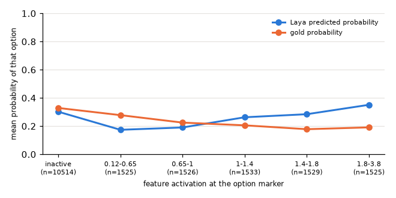

# Feature 8309

Critérios em que aparece: pred_error_stratified, corr_error_stratified, attribution_toward_wrong

**Interpretação (preencher):** 

---

## Maiores ativações

**tr_security_incidents_000250 / severity** (score, security_incidents) | ativação 6.117 em `estado` | opções ['0', '1', '2', '3', '4'] | Laya: **2** [0.066, 0.332, 0.354, 0.194, 0.053] | gabarito: **3**

```
[CLS]score question: How severe is the potential impact if this alert is real?[SEP]
▸ [MASK] level 0: Negligible: no access to anything sensitive.
▸ [MASK] level 1: Low: limited access, easily reversed.
▸ [MASK] level 2: Moderate: access to internal systems or non-public data.
▸ [MASK] level 3: High: access to production, secrets or customer data.
▸ [MASK] level 4: Critical: active compromise of crown-jewel systems.

[SEP]

{"alert": {"description": "two successful logins from distant locations too close together", "evidence": "A contractor account logged in from New York at 08:00 UTC and subsequently from London at 08:45 UTC. The user credentials associated with⟦ this⟧ unprivileged account were last rotated one year ago, though both access events originated from allowlisted IP addresses.", "rule": "impossible_travel"}, "context": {"asset_criticality": "crown_jewel", "change_window_active": false, "source_on_allowlist": true}, "history": {"credential_rotation_days_ago": 365, "distinct_countries_30d": 3, "logins_30d": 698, "prior_alerts_90d": 0}, "principal": {"mfa_enrolled": true, "name": "svc-analytics-492", "privileges": ["repo:read"], "type": "contractor"}}[SEP]
```

**tr_security_incidents_000250 / urgency** (score, security_incidents) | ativação 5.477 em `estado` | opções ['0', '1', '2', '3'] | Laya: **1** [0.134, 0.728, 0.098, 0.04] | gabarito: **2**

```
[CLS]score question: How quickly must a responder act on this alert?[SEP]
▸ [MASK] level 0: No time pressure; can wait indefinitely.
▸ [MASK] level 1: Routine; handle within the normal queue.
▸ [MASK] level 2: Elevated; should be handled within the same week.
▸ [MASK] level 3: Critical; requires action within the same day.

[SEP]

{"alert": {"description": "two successful logins from distant locations too close together", "evidence": "A contractor account logged in from New York at 08:00 UTC and subsequently from London at 08:45 UTC. The user credentials associated with⟦ this⟧ unprivileged account were last rotated one year ago, though both access events originated from allowlisted IP addresses.", "rule": "impossible_travel"}, "context": {"asset_criticality": "crown_jewel", "change_window_active": false, "source_on_allowlist": true}, "history": {"credential_rotation_days_ago": 365, "distinct_countries_30d": 3, "logins_30d": 698, "prior_alerts_90d": 0}, "principal": {"mfa_enrolled": true, "name": "svc-analytics-492", "privileges": ["repo:read"], "type": "contractor"}}[SEP]
```

**tr_customer_service_000215 / urgency** (score, customer_service) | ativação 5.285 em `opção` | opções ['0', '1', '2', '3'] | Laya: **1** [0.106, 0.361, 0.256, 0.278] | gabarito: **1**

```
[CLS]score question: How time-sensitive is this conversation?[SEP]
▸ [MASK] level 0: No time pressure; can wait indefinitely.
▸ [MASK] level⟦ 1⟧: Routine; handle within the normal queue.
▸ [MASK] level 2: Elevated; should be handled within the same week.
▸ [MASK] level 3: Critical; requires action within the same day.

[SEP]

{"account": {"lifetime_value_usd": 182, "prior_tickets_90d": 1, "seats": 1, "tenure_months": 8, "tier": "free"}, "thread": [{"role": "customer", "text": "Managing seats on the free tier is a nightmare—every time I try to add or remove a user, the UI freezes and I lose my changes."}, {"role": "agent", "text": "That definitely isn’t the experience we want you to have. Could you let me know exactly where in the seat management page the freeze occurs?"}, {"role": "customer", "text": "It happens when I hit ‘Add new seat’ and also when I click the trash can icon to delete a user. The screen just spins and never updates."}, {"role": "agent", "text": "Thanks for the specifics. Are you seeing any error messages in the browser console, or does it just stay on the loading spinner?"}, {"role": "customer", "text": "No error pop‑ups, just the endless spinner. I’ve been on the free plan for eight months and this is the only time I’ve run into such a problem."}]}[SEP]
```

**tr_security_incidents_000011 / credential_compromise** (noul, security_incidents) | ativação 5.223 em `estado` | opções ['false', 'true'] | Laya: **true** [0.447, 0.553] | gabarito: **false**

```
[CLS]noul question: The evidence indicates a credential or account has been compromised.[SEP]
▸ [MASK] false: no, the statement does not hold
▸ [MASK] true: yes, the statement holds

[SEP]

{"alert": {"description": "audit logging was turned off on a host", "evidence": "Audit logging was disabled on a host by⟦ an⟧ unprivileged employee account authenticated via MFA. The action originated from an allowlisted IP address and was performed without a corresponding entry in the scheduled change window.", "rule": "disabled_logging"}, "context": {"asset_criticality": "medium", "change_window_active": false, "source_on_allowlist": true}, "history": {"credential_rotation_days_ago": 14, "distinct_countries_30d": 4, "logins_30d": 1338, "prior_alerts_90d": 1}, "principal": {"mfa_enrolled": true, "name": "svc-billing-846", "privileges": ["repo:read"], "type": "employee"}}[SEP]
```

**tr_customer_service_000017 / category** (choice, customer_service) | ativação 5.160 em `estado` | opções ['account', 'billing', 'delivery', 'refund', 'technical'] | Laya: **billing** [0.053, 0.649, 0.021, 0.197, 0.08] | gabarito: **billing**

```
[CLS]choice question: What is this customer conversation primarily about?[SEP]
▸ [MASK] account: Login, plan changes, profile or access management.
▸ [MASK] billing: A charge, invoice, subscription or payment problem.
▸ [MASK] delivery: Shipping, fulfilment or delivery of a physical item.
▸ [MASK] refund: The customer is explicitly asking for money back.
▸ [MASK] technical: The product or service is not working as expected.

[SEP]

{"account": {"lifetime_value_usd": 228, "prior_tickets_90d": 3, "seats": 1, "tenure_months": 11, "tier": "premium"}, "orders": [{"amount_usd": 29, "date": "2026-03-25", "id": "A-17351", "status": "settled"}, {"amount_usd": 29, "date": "2026-02-18", "id": "A-55118", "status": "settled"}], "thread": [{"role": "customer", "text": "My payment for the $29 subscription failed this morning. I have a presentation tomorrow morning at 9:00 AM that requires this access, so I need this cleared up immediately."}, {"role": "agent", "text": "I see the status of your account. Before we look into the billing error⟦,⟧ could you confirm if the payment method on file has expired or if you have recently updated your banking information?"}, {"role": "customer", "text": "The card is current and active. I have had three previous tickets regarding billing glitches that were supposedly addressed, yet here I am again with the same issue."}, {"role": "agent", "text": "I acknowledge your frustration regarding the previous tickets. To investigate this specific failure, could you provide the transaction reference ID shown in your payment history?"}, {"role": "customer", "text": "I am looking at my bank portal now, but I don't see a reference ID generated for this attempt. How are we going to fix this before my deadline tomorrow?"}]}[SEP]
```

## Ativações medianas (faixa 40-60%, mediana 0.880)

**tr_customer_service_000233 / churn_risk** (score, customer_service) | ativação 0.833 em `estado` | opções ['0', '1', '2', '3'] | Laya: **2** [0.203, 0.248, 0.401, 0.147] | gabarito: **2**

```
[CLS]score question: How likely is this customer to stop doing business with us because of this interaction?[SEP]
▸ [MASK] level 0: No sign of dissatisfaction.
▸ [MASK] level 1: Mild frustration, but the relationship is intact.
▸ [MASK] level 2: Clearly unhappy; repeat problems or explicit complaints.
▸ [MASK] level 3: Imminent: threatening to cancel, dispute or leave.

[SEP]

{"account": {"lifetime_value_usd": 273, "prior_tickets_90d": 2, "seats": 1, "tenure_months": 14, "tier": "free"}, "orders": [{"amount_usd": 29, "date": "2026-02-02", "id":⟦ "⟧A-72334", "status": "settled"}, {"amount_usd": 29, "date": "2026-01-16", "id": "A-43421", "status": "settled"}], "thread": [{"role": "customer", "text": "I just opened my delivery and you sent me the wrong replacement part, I ordered the $29 filter kit but I received a pack of gaskets instead. I have an inspection scheduled for tomorrow morning and I absolutely must have the right parts installed by then."}, {"role": "agent", "text": "I'm sorry to hear that the incorrect items were delivered. Could you please provide the order number located on your packing slip so I can check the shipment details?"}, {"role": "customer", "text": "The order number is 44921-A. This is the third time I've had to reach out about shipping errors in the last year and I'm really in a bind here. Is there any way to get the correct filter kit to me today?"}, {"role": "agent", "text": "I've pulled up the order and see the filter kit listed. For our records, could you please describe any labels or SKU numbers visible on the packaging of the gaskets you received by mistake?"}, {"role": "customer", "text": "The sticker says G-992-X, but I really don't have time for a back-and-forth investigation. I need to know immediately how we can fix this because the inspector will be here at 9 AM and the system won't pass without those specific filters."}]}[SEP]
```

**tr_customer_service_000281 / needs_human** (noul, customer_service) | ativação 0.887 em `estado` | opções ['false', 'true'] | Laya: **true** [0.385, 0.615] | gabarito: **false**

```
[CLS]noul question: This conversation requires a human agent rather than automated handling.[SEP]
▸ [MASK] false: Automation can carry this to resolution.
▸ [MASK] true: A human must take over: judgement, authority or empathy is required.

[SEP]

{"account": {"lifetime_value_usd": 2899, "prior_tickets_90d": 1, "seats": 1, "tenure_months": 49, "tier": "free"}, "orders": [{"amount_usd": 29, "date": "2026-03-17", "id": "A-98902", "status": "settled"}, {"⟦amount⟧_usd": 29, "date": "2026-03-17", "id": "A-31035", "status": "settled"}, {"amount_usd": 29, "date": "2026-01-23", "id": "A-52749", "status": "refunded"}], "thread": [{"role": "customer", "text": "Hello, I am checking in on the $29 refund I requested. I have been a loyal user for 49 months and was hoping to have this settled before my bank statement closes this Friday."}, {"role": "agent", "text": "Thank you for your patience. I see we have a previous ticket open regarding this. Could you please verify the email address associated with the transaction you are referring to?"}, {"role": "customer", "text": "It is associated with the email I’m writing from right now. I just really need an update on where things stand because of that Friday deadline."}]}[SEP]
```

**tr_customer_service_000127 / category** (choice, customer_service) | ativação 0.903 em `estado` | opções ['account', 'billing', 'delivery', 'refund', 'technical'] | Laya: **account** [0.274, 0.11, 0.098, 0.257, 0.262] | gabarito: **technical**

```
[CLS]choice question: What is this customer conversation primarily about?[SEP]
▸ [MASK] account: Login, plan changes, profile or access management.
▸ [MASK] billing: A charge, invoice, subscription or payment problem.
▸ [MASK] delivery: Shipping, fulfilment or delivery of a physical item.
▸ [MASK] refund: The customer is explicitly asking for money back.
▸ [MASK] technical: The product or service is not working as expected.

[SEP]

{"account": {"lifetime_value_usd": 283, "prior_tickets_90d": 1, "seats": 1, "tenure_months": 3, "tier": "premium"}, "orders": [{"amount_usd": 38, "date": "2026-03-03", "id": "A-56312", "status": "failed"}, {"amount_usd": 38, "date": "2026-01-05", "⟦id⟧": "A-75782", "status": "failed"}], "thread": [{"role": "customer", "text": "I’m still seeing the same sluggishness in the dashboard, even after the last ticket where you promised a fix. It’s really holding us up."}, {"role": "agent", "text": "I’m sorry you’re experiencing that. Could you tell me which parts of the dashboard are loading slowly?"}, {"role": "customer", "text": "The main analytics view takes ages to render, and with our deadline coming up I can’t afford the delay."}]}[SEP]
```

**tr_customer_service_000017 / needs_human** (noul, customer_service) | ativação 0.855 em `pergunta` | opções ['false', 'true'] | Laya: **true** [0.413, 0.587] | gabarito: **true**

```
[CLS]noul question: This conversation requires a human agent rather⟦ than⟧ automated handling.[SEP]
▸ [MASK] false: Automation can carry this to resolution.
▸ [MASK] true: A human must take over: judgement, authority or empathy is required.

[SEP]

{"account": {"lifetime_value_usd": 228, "prior_tickets_90d": 3, "seats": 1, "tenure_months": 11, "tier": "premium"}, "orders": [{"amount_usd": 29, "date": "2026-03-25", "id": "A-17351", "status": "settled"}, {"amount_usd": 29, "date": "2026-02-18", "id": "A-55118", "status": "settled"}], "thread": [{"role": "customer", "text": "My payment for the $29 subscription failed this morning. I have a presentation tomorrow morning at 9:00 AM that requires this access, so I need this cleared up immediately."}, {"role": "agent", "text": "I see the status of your account. Before we look into the billing error, could you confirm if the payment method on file has expired or if you have recently updated your banking information?"}, {"role": "customer", "text": "The card is current and active. I have had three previous tickets regarding billing glitches that were supposedly addressed, yet here I am again with the same issue."}, {"role": "agent", "text": "I acknowledge your frustration regarding the previous tickets. To investigate this specific failure, could you provide the transaction reference ID shown in your payment history?"}, {"role": "customer", "text": "I am looking at my bank portal now, but I don't see a reference ID generated for this attempt. How are we going to fix this before my deadline tomorrow?"}]}[SEP]
```

**tr_invoice_processing_000196 / urgency** (score, invoice_processing) | ativação 0.992 em `opção` | opções ['0', '1', '2', '3'] | Laya: **1** [0.222, 0.512, 0.19, 0.076] | gabarito: **3**

```
[CLS]score question: How time-sensitive is processing this invoice?[SEP]
▸ [MASK] level⟦ 0⟧: No time pressure; can wait indefinitely.
▸ [MASK] level 1: Routine; handle within the normal queue.
▸ [MASK] level 2: Elevated; should be handled within the same week.
▸ [MASK] level 3: Critical; requires action within the same day.

[SEP]

{"delivery": {"condition": "accepted", "date": "2026-03-12", "received_qty": 50}, "invoice": {"currency": "USD", "id": "INV-2026-9921", "lines": [{"qty": 50, "sku": "SKU-318", "total_usd": 4862.0, "unit_usd": 97.24}], "total_usd": 4862.0, "vendor": "Vantage Materials"}, "payment": {"days_until_due": 0, "discount_expires_in_days": null, "early_payment_discount_pct": null, "status": "scheduled", "terms": "net 30"}, "purchase_order": {"freight_terms": "freight prepaid by vendor, not separately billable", "id": "PO-1505", "lines": [{"qty": 50, "unit_usd": 97.24}], "total_usd": 4862.0}, "vendor_history": {"disputes_12m": 1, "invoices_12m": 25, "prior_invoice_ids": ["INV-2026-5325"]}}[SEP]
```

## Estatísticas (conjunto de descoberta, dev e teste)

**pred / error**

| split | decisões | ativas | ativas e Laya errou | taxa | lift | q (BH) | OR (CMH) | q (CMH) |
|---|---|---|---|---|---|---|---|---|
| discovery | 5100 | 2206 | 1520 | 0.689 | 1.08 | 6.58e-11 | 1.98 | 0.00191 |
| dev | 900 | 404 | 277 | 0.686 | 1.04 | 0.328 | 0.86 | 0.882 |
| test | 2000 | 888 | 650 | 0.732 | 1.15 | 6.36e-14 | 1.38 | 0.417 |

**corr / error**

| split | decisões | ativas | ativas e Laya errou | taxa | lift | q (BH) | OR (CMH) | q (CMH) |
|---|---|---|---|---|---|---|---|---|
| discovery | 5100 | 1593 | 907 | 0.569 | 0.89 | 9.56e-11 | 3.80 | 4.89e-09 |
| dev | 900 | 286 | 159 | 0.556 | 0.85 | 6.51e-05 | 4.07 | 0.0151 |
| test | 2000 | 632 | 394 | 0.623 | 0.98 | 0.474 | 4.55 | 4.53e-07 |

**state / error**

| split | decisões | ativas | ativas e Laya errou | taxa | lift | q (BH) | OR (CMH) | q (CMH) |
|---|---|---|---|---|---|---|---|---|
| discovery | 5100 | 4869 | 3086 | 0.634 | 1.00 | 0.348 | 0.88 | 0.596 |
| dev | 900 | 865 | 566 | 0.654 | 1.00 | 1 | 0.74 | 0.734 |
| test | 2000 | 1900 | 1197 | 0.630 | 0.99 | 0.158 | 0.56 | 0.0898 |

Confusão mais sobre-representada (pred): `disposition|0>2` (n=239, lift 2.31, p=0). Formato `pergunta|índice previsto>índice correto`.

Confusão mais sobre-representada (corr): `action|0>1` (n=119, lift 3.20, p=0). Formato `pergunta|índice previsto>índice correto`.

Confusão mais sobre-representada (state): `duplicate|1>0` (n=214, lift 1.04, p=0.00247). Formato `pergunta|índice previsto>índice correto`.



