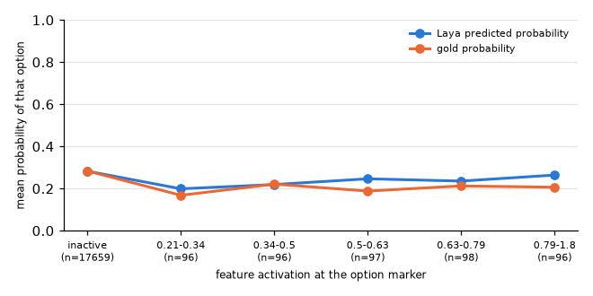

# Feature 8499

Critérios em que aparece: pred_error

**Interpretação (preencher):** 

---

## Maiores ativações

**tr_customer_service_000057 / action** (choice, customer_service) | ativação 1.784 em `marcador` | opções ['answer_directly', 'close_no_action', 'escalate_to_human', 'execute_refund', 'request_information'] | Laya: **close_no_action** [0.206, 0.353, 0.19, 0.09, 0.161] | gabarito: **escalate_to_human**

```
[CLS]choice question: What should the assistant do next with this conversation?[SEP]
▸ [MASK] answer_directly: The assistant can resolve this itself with information it already has.
▸ ⟦[MASK]⟧ close_no_action: No further action is warranted; the matter is settled.
▸ [MASK] escalate_to_human: Hand off to a human agent with the appropriate authority.
▸ [MASK] execute_refund: Issue the refund or credit the customer is owed.
▸ [MASK] request_information: More detail is needed from the customer before anything can be done.

[SEP]

{"account": {"lifetime_value_usd": 1386, "prior_tickets_90d": 1, "seats": 1, "tenure_months": 72, "tier": "free"}, "thread": [{"role": "customer", "text": "Your service is crawling at a snail’s pace and I’ve been on the free plan for six years – this is unacceptable."}, {"role": "agent", "text": "I’m sorry you’re experiencing slowness. Could you let me know which device and browser you’re using?"}, {"role": "customer", "text": "Ticket #6789 was supposed to fix this weeks ago, but nothing changed. It’s the same lag every time I log in."}, {"role": "agent", "text": "Got it. When did the slowdown start, and are you seeing any error messages on the screen?"}, {"role": "customer", "text": "It started yesterday, no error messages, just endless loading. My work is getting held up and I need an update."}]}[SEP]
```

**tr_customer_service_000240 / action** (choice, customer_service) | ativação 1.727 em `marcador` | opções ['answer_directly', 'close_no_action', 'escalate_to_human', 'execute_refund', 'request_information'] | Laya: **close_no_action** [0.156, 0.458, 0.143, 0.096, 0.147] | gabarito: **answer_directly**

```
[CLS]choice question: What should the assistant do next with this conversation?[SEP]
▸ [MASK] answer_directly: The assistant can resolve this itself with information it already has.
▸ ⟦[MASK]⟧ close_no_action: No further action is warranted; the matter is settled.
▸ [MASK] escalate_to_human: Hand off to a human agent with the appropriate authority.
▸ [MASK] execute_refund: Issue the refund or credit the customer is owed.
▸ [MASK] request_information: More detail is needed from the customer before anything can be done.

[SEP]

{"account": {"lifetime_value_usd": 363, "prior_tickets_90d": 0, "seats": 1, "tenure_months": 5, "tier": "standard"}, "thread": [{"role": "customer", "text": "I’d like to move my account from the Premium tier to the Standard tier, effective as of the 15th of next month."}, {"role": "agent", "text": "I understand you want to downgrade to Standard on that date. Could you confirm the email associated with the account so we can pull up the details?"}, {"role": "customer", "text": "The email is jane.doe@example.com, and I’ve been on the Premium plan for the past five months."}, {"role": "agent", "text": "Got it, Jane. Just to be clear, are there any additional services or add‑ons you’d like to keep after the downgrade?"}, {"role": "customer", "text": "No, I only need the core features that come with Standard. I also need to make sure my billing reflects the change by the deadline."}, {"role": "agent", "text": "Understood. To proceed, could you let me know if there are any outstanding invoices or credit balances we should account for before the switch?"}, {"role": "customer", "text": "There are no pending invoices; the last payment was processed last week. Please confirm the downgrade will be in place by the 15th."}]}[SEP]
```

**tr_customer_service_000015 / action** (choice, customer_service) | ativação 1.520 em `marcador` | opções ['answer_directly', 'close_no_action', 'escalate_to_human', 'execute_refund', 'request_information'] | Laya: **close_no_action** [0.192, 0.282, 0.143, 0.148, 0.235] | gabarito: **execute_refund**

```
[CLS]choice question: What should the assistant do next with this conversation?[SEP]
▸ [MASK] answer_directly: The assistant can resolve this itself with information it already has.
▸ ⟦[MASK]⟧ close_no_action: No further action is warranted; the matter is settled.
▸ [MASK] escalate_to_human: Hand off to a human agent with the appropriate authority.
▸ [MASK] execute_refund: Issue the refund or credit the customer is owed.
▸ [MASK] request_information: More detail is needed from the customer before anything can be done.

[SEP]

{"account": {"lifetime_value_usd": 261, "prior_tickets_90d": 0, "seats": 1, "tenure_months": 3, "tier": "free"}, "thread": [{"role": "customer", "text": "My statement shows two identical $45 charges from yesterday for the free plan, and I need this cleared by Friday."}, {"role": "agent", "text": "I see. Can you confirm the last four digits of the card used and forward a screenshot of the statement?"}, {"role": "customer", "text": "The card ends in 1234, and I’ve attached the screenshot. I’m not sure why this happened, but I need it fixed before Friday."}, {"role": "agent", "text": "Thanks for that. Have you noticed any other duplicate transactions in the past month?"}, {"role": "customer", "text": "No, this is the first time it’s occurred, and the deadline is firm—if it isn’t resolved by Friday, I’ll have to dispute the charge."}, {"role": "agent", "text": "Understood. While I investigate, could you let me know if the merchant name appears the same on both entries?"}, {"role": "customer", "text": "Both entries list the same merchant, ‘CloudServe’, and I’m still waiting for you to tell me what will happen before Friday."}]}[SEP]
```

**tr_customer_service_000261 / action** (choice, customer_service) | ativação 1.472 em `marcador` | opções ['answer_directly', 'close_no_action', 'escalate_to_human', 'execute_refund', 'request_information'] | Laya: **close_no_action** [0.224, 0.249, 0.196, 0.182, 0.15] | gabarito: **escalate_to_human**

```
[CLS]choice question: What should the assistant do next with this conversation?[SEP]
▸ [MASK] answer_directly: The assistant can resolve this itself with information it already has.
▸ ⟦[MASK]⟧ close_no_action: No further action is warranted; the matter is settled.
▸ [MASK] escalate_to_human: Hand off to a human agent with the appropriate authority.
▸ [MASK] execute_refund: Issue the refund or credit the customer is owed.
▸ [MASK] request_information: More detail is needed from the customer before anything can be done.

[SEP]

{"account": {"lifetime_value_usd": 244, "prior_tickets_90d": 1, "seats": 40, "tenure_months": 5, "tier": "premium"}, "orders": [{"amount_usd": 57, "date": "2026-02-23", "id": "A-35156", "status": "refunded"}, {"amount_usd": 57, "date": "2026-01-11", "id": "A-26925", "status": "pending"}, {"amount_usd": 57, "date": "2026-01-04", "id": "A-63187", "status": "failed"}], "thread": [{"role": "customer", "text": "I’ve been paying for the $57 Premium plan for five months now, and the reporting feature is still completely broken. I opened a ticket about this weeks ago and was told it’d be fixed, but nothing has changed. If this isn't working by my presentation tomorrow morning, I’m canceling my subscription and moving to a competitor."}, {"role": "agent", "text": "I understand how critical that reporting feature is for your upcoming presentation. To help me look into this further, could you please clarify if you're seeing a specific error message or if the data simply isn't loading when you attempt to run the report?"}, {"role": "customer", "text": "It just hangs on a white screen every single time. I don't have time for more 'clarifications'—I need someone to actually look at why my account is failing before I lose my client."}]}[SEP]
```

**tr_customer_service_000134 / action** (choice, customer_service) | ativação 1.440 em `marcador` | opções ['answer_directly', 'close_no_action', 'escalate_to_human', 'execute_refund', 'request_information'] | Laya: **close_no_action** [0.206, 0.25, 0.246, 0.187, 0.111] | gabarito: **escalate_to_human**

```
[CLS]choice question: What should the assistant do next with this conversation?[SEP]
▸ [MASK] answer_directly: The assistant can resolve this itself with information it already has.
▸ ⟦[MASK]⟧ close_no_action: No further action is warranted; the matter is settled.
▸ [MASK] escalate_to_human: Hand off to a human agent with the appropriate authority.
▸ [MASK] execute_refund: Issue the refund or credit the customer is owed.
▸ [MASK] request_information: More detail is needed from the customer before anything can be done.

[SEP]

{"account": {"lifetime_value_usd": 1659, "prior_tickets_90d": 0, "seats": 3, "tenure_months": 19, "tier": "enterprise"}, "thread": [{"role": "customer", "text": "I’m requesting a full export of all my company’s data by the end of the week; otherwise I’ll have to consider moving to a different platform."}, {"role": "agent", "text": "I understand the urgency. Could you specify which date range you need and whether you prefer CSV or JSON format?"}, {"role": "customer", "text": "We need everything from January 1 2023 through today, and CSV would be best. The deadline is Friday at 5 PM GMT."}, {"role": "agent", "text": "Got it. To ensure we’re exporting the correct records, could you confirm the primary account email you’d like the files sent to?"}, {"role": "customer", "text": "Please send the export to dataadmin@ourcompany.com. I’ll also be ready to verify my identity if you need any additional confirmation."}, {"role": "agent", "text": "Thank you for confirming. I’ll begin preparing the export and will follow up with any further questions."}, {"role": "customer", "text": "Great, just let me know the exact time you expect to have the files ready; we really can’t miss that Friday deadline."}]}[SEP]
```

## Ativações medianas (faixa 40-60%, mediana 0.462)

**tr_customer_service_000183 / action** (choice, customer_service) | ativação 0.458 em `marcador` | opções ['answer_directly', 'close_no_action', 'escalate_to_human', 'execute_refund', 'request_information'] | Laya: **close_no_action** [0.221, 0.25, 0.174, 0.185, 0.169] | gabarito: **answer_directly**

```
[CLS]choice question: What should the assistant do next with this conversation?[SEP]
▸ [MASK] answer_directly: The assistant can resolve this itself with information it already has.
▸ [MASK] close_no_action: No further action is warranted; the matter is settled.
▸ ⟦[MASK]⟧ escalate_to_human: Hand off to a human agent with the appropriate authority.
▸ [MASK] execute_refund: Issue the refund or credit the customer is owed.
▸ [MASK] request_information: More detail is needed from the customer before anything can be done.

[SEP]

{"account": {"lifetime_value_usd": 455, "prior_tickets_90d": 0, "seats": 1, "tenure_months": 5, "tier": "free"}, "orders": [{"amount_usd": 98, "date": "2026-03-24", "id": "A-16754", "status": "settled"}], "thread": [{"role": "customer", "text": "My payment just failed again and I have a hard deadline tomorrow to keep my account active – this is getting ridiculous."}, {"role": "agent", "text": "I’m really sorry you’re experiencing this. Could you tell me which payment method you’re trying to use?"}, {"role": "customer", "text": "I’m using the Visa ending in 4321. Every time I hit submit I get an error code 502 and the charge never goes through."}, {"role": "agent", "text": "Got it, thank you. Do you see any additional message on the screen besides the error code, like a declined notice or a timeout?"}, {"role": "customer", "text": "Just the generic “payment could not be processed” line. I need a solution right now, otherwise my free‑plan account will be suspended."}, {"role": "agent", "text": "I understand the urgency. Do you have an alternative payment option available, such as a different card or PayPal?"}, {"role": "customer", "text": "Yes, I have a PayPal account I can use. How do I switch to that quickly?"}]}[SEP]
```

**tr_customer_service_000116 / action** (choice, customer_service) | ativação 0.506 em `marcador` | opções ['answer_directly', 'close_no_action', 'escalate_to_human', 'execute_refund', 'request_information'] | Laya: **close_no_action** [0.204, 0.269, 0.211, 0.128, 0.188] | gabarito: **escalate_to_human**

```
[CLS]choice question: What should the assistant do next with this conversation?[SEP]
▸ [MASK] answer_directly: The assistant can resolve this itself with information it already has.
▸ [MASK] close_no_action: No further action is warranted; the matter is settled.
▸ ⟦[MASK]⟧ escalate_to_human: Hand off to a human agent with the appropriate authority.
▸ [MASK] execute_refund: Issue the refund or credit the customer is owed.
▸ [MASK] request_information: More detail is needed from the customer before anything can be done.

[SEP]

{"account": {"lifetime_value_usd": 720, "prior_tickets_90d": 2, "seats": 1, "tenure_months": 11, "tier": "standard"}, "orders": [{"amount_usd": 149, "date": "2026-03-09", "id": "A-35212", "status": "failed"}, {"amount_usd": 149, "date": "2026-01-13", "id": "A-58845", "status": "settled"}], "thread": [{"role": "customer", "text": "I just checked my statement and saw a charge for $149, which is completely unexpected! I've been on the standard plan for 11 months and it's never been this high before. Can you explain why this happened?"}, {"role": "agent", "text": "I see the charge you're referring to. Could you please provide the billing date listed on that transaction so I can pull up the specific invoice details for you?"}, {"role": "customer", "text": "It’s dated for the 14th. This is the third time I’ve had to reach out about billing discrepancies, and I really need to get to the bottom of why these charges keep fluctuating."}]}[SEP]
```

**tr_customer_service_000270 / category** (choice, customer_service) | ativação 0.518 em `estado` | opções ['account', 'billing', 'delivery', 'refund', 'technical'] | Laya: **account** [0.26, 0.216, 0.079, 0.202, 0.243] | gabarito: **technical**

```
[CLS]choice question: What is this customer conversation primarily about?[SEP]
▸ [MASK] account: Login, plan changes, profile or access management.
▸ [MASK] billing: A charge, invoice, subscription or payment problem.
▸ [MASK] delivery: Shipping, fulfilment or delivery of a physical item.
▸ [MASK] refund: The customer is explicitly asking for money back.
▸ [MASK] technical: The product or service is not working as expected.

[SEP]

{"account": {"lifetime_value_usd": 1765, "prior_tickets_90d": 2, "seats": 1, "tenure_months": 19, "tier": "standard"}, "orders": [{"amount_usd": 149, "date": "2026-02-28", "id": "A-88466", "status": "settled"}, {"amount_usd": 149, "date": "2026-02-27", "id": "A-17979", "status": "settled"}], "thread": [{"role": "customer", "text": "Hello, I’m writing about the seat‑management issue we’ve been seeing on our account. We’re on the standard plan, have been a customer for 19 months, and the monthly charge is about $149. This is the third time I’m reaching out—two earlier tickets were only partially addressed, and I have a hard deadline next Friday to reassign a few seats for an upcoming project."}, {"role": "agent", "text": "Thank you for the details. I’m sorry the prior tickets didn’t fully resolve the problem. Could you let me know exactly how many seats are affected and what the current error looks like?"}, {"role": "customer", "text": "Sure. We have five seats that are stuck in “pending” status, and when I try to move them to a different team they bounce back with a generic “operation failed” message. It’s preventing us from finalizing the team roster before the Friday deadline."}, {"role": "agent", "text": "Got it, five pending seats with a generic failure notice. Are there any particular teams or roles involved that might help us narrow down the cause?"}, {"role": "customer", "text": "The seats belong to our Marketing and Sales groups. Both groups use custom role configurations we set up last quarter, and the issue started after we added a new role hierarchy."}, {"role": "agent", "text": "Understood. I’ll note the custom role configurations and the recent hierarchy change. Just to confirm, have you noticed any impact on your billing or subscription status while this is happening?"}, {"role": "customer", "text": "No billing issues so far, but I really need those seats moved before Friday. Please let me know what you need from me to keep this moving forward."⟦}]⟧}[SEP]
```

**tr_customer_service_000165 / action** (choice, customer_service) | ativação 0.512 em `marcador` | opções ['answer_directly', 'close_no_action', 'escalate_to_human', 'execute_refund', 'request_information'] | Laya: **close_no_action** [0.192, 0.283, 0.154, 0.182, 0.189] | gabarito: **escalate_to_human**

```
[CLS]choice question: What should the assistant do next with this conversation?[SEP]
▸ [MASK] answer_directly: The assistant can resolve this itself with information it already has.
▸ [MASK] close_no_action: No further action is warranted; the matter is settled.
▸ ⟦[MASK]⟧ escalate_to_human: Hand off to a human agent with the appropriate authority.
▸ [MASK] execute_refund: Issue the refund or credit the customer is owed.
▸ [MASK] request_information: More detail is needed from the customer before anything can be done.

[SEP]

{"account": {"lifetime_value_usd": 4890, "prior_tickets_90d": 3, "seats": 1, "tenure_months": 60, "tier": "premium"}, "orders": [{"amount_usd": 19, "date": "2026-01-24", "id": "A-27992", "status": "settled"}, {"amount_usd": 19, "date": "2026-02-04", "id": "A-63170", "status": "settled"}, {"amount_usd": 19, "date": "2026-02-15", "id": "A-75660", "status": "settled"}], "thread": [{"role": "customer", "text": "Hi, I was checking my bank statement and noticed two charges from you guys for the same $19 amount. I'm really confused—am I getting billed twice for the same premium subscription?"}, {"role": "agent", "text": "Hello, thank you for reaching out to us. I would be happy to look into these charges for you. Could you please confirm the dates of the transactions you are seeing?"}, {"role": "customer", "text": "They both hit on the 12th. I've been with you for five years now and I've had three previous tickets where things were promised but never actually followed through on, so I'm hoping this one is different."}, {"role": "agent", "text": "I appreciate your long-term membership and I sincerely apologize for any previous lapses in service. I am checking your billing ledger now; could you verify the email address associated with the account?"}, {"role": "customer", "text": "It’s under j.doe@email.com. I really just want to understand why my account would show two charges when I’ve only ever had one plan."}, {"role": "agent", "text": "Thank you for that information. I am currently reviewing your billing cycle. To ensure I'm looking at the right data, could you clarify if you recently made any changes to your payment method?"}, {"role": "customer", "text": "No, I haven't touched my settings in years. I’m just trying to make sense of why my balance is off."}]}[SEP]
```

**tr_customer_service_000296 / category** (choice, customer_service) | ativação 0.457 em `estado` | opções ['account', 'billing', 'delivery', 'refund', 'technical'] | Laya: **technical** [0.266, 0.086, 0.068, 0.243, 0.337] | gabarito: **account**

```
[CLS]choice question: What is this customer conversation primarily about?[SEP]
▸ [MASK] account: Login, plan changes, profile or access management.
▸ [MASK] billing: A charge, invoice, subscription or payment problem.
▸ [MASK] delivery: Shipping, fulfilment or delivery of a physical item.
▸ [MASK] refund: The customer is explicitly asking for money back.
▸ [MASK] technical: The product or service is not working as expected.

[SEP]

{"account": {"lifetime_value_usd": 154, "prior_tickets_90d": 0, "seats": 1, "tenure_months": 2, "tier": "free"}, "thread": [{"role": "customer", "text": "We have a launch in two hours and need to reassign seats on our free plan—add three new users and remove two that left. This has to happen now."}, {"role": "agent", "text": "I understand the timing is tight. Could you give me the email addresses of the users you’d like to add and the ones you want removed?"}, {"role": "customer", "text": "Add: alice@example.com, bob@example.com, carol@example.com. Remove: dave@example.com and eve@example.com. I need the changes reflected instantly."}, {"role": "agent", "text": "Thanks for the list. I’ll process those seat changes right away. Would you like a confirmation email once the updates are applied?"}, {"role": "customer", "text": "Yes, send the confirmation now and make sure the seats are active before our launch; we can’t afford any delay."⟦}]⟧}[SEP]
```

## Estatísticas (conjunto de descoberta, dev e teste)

**pred / error**

| split | decisões | ativas | ativas e Laya errou | taxa | lift | q (BH) | OR (CMH) | q (CMH) |
|---|---|---|---|---|---|---|---|---|
| discovery | 5100 | 150 | 144 | 0.960 | 1.51 | 3.03e-20 | 2.55 | 0.124 |
| dev | 900 | 21 | 20 | 0.952 | 1.45 | 0.0334 | 3.45 | 0.519 |
| test | 2000 | 64 | 60 | 0.938 | 1.47 | 2.44e-07 | 1.87 | 0.691 |

**corr / error**

| split | decisões | ativas | ativas e Laya errou | taxa | lift | q (BH) | OR (CMH) | q (CMH) |
|---|---|---|---|---|---|---|---|---|
| discovery | 5100 | 100 | 94 | 0.940 | 1.48 | 4.42e-12 | 6.32 | 0.0414 |
| dev | 900 | 18 | 17 | 0.944 | 1.44 | nan | nan | nan |
| test | 2000 | 40 | 36 | 0.900 | 1.41 | 0.000549 | 0.76 | 0.872 |

**state / error**

| split | decisões | ativas | ativas e Laya errou | taxa | lift | q (BH) | OR (CMH) | q (CMH) |
|---|---|---|---|---|---|---|---|---|
| discovery | 5100 | 503 | 332 | 0.660 | 1.04 | 0.569 | 1.26 | 0.137 |
| dev | 900 | 109 | 75 | 0.688 | 1.05 | 1 | 1.26 | 0.679 |
| test | 2000 | 189 | 134 | 0.709 | 1.11 | 0.36 | 1.56 | 0.0865 |

Confusão mais sobre-representada (pred): `action|1>2` (n=67, lift 18.22, p=0). Formato `pergunta|índice previsto>índice correto`.

Confusão mais sobre-representada (corr): `action|1>2` (n=62, lift 25.30, p=0). Formato `pergunta|índice previsto>índice correto`.

Confusão mais sobre-representada (state): `matches_order|1>0` (n=65, lift 5.99, p=2.29e-38). Formato `pergunta|índice previsto>índice correto`.



