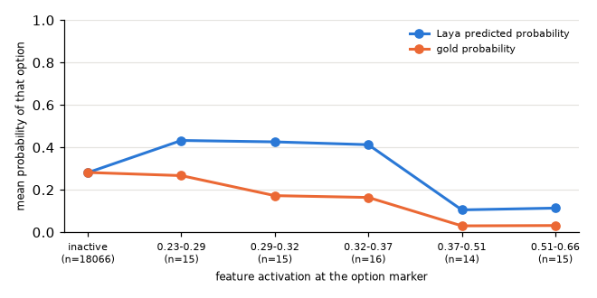

# Feature 8544

Critérios em que aparece: pred_error

**Interpretação (preencher):** 

---

## Maiores ativações

**tr_customer_service_000246 / action** (choice, customer_service) | ativação 4.035 em `estado` | opções ['answer_directly', 'close_no_action', 'escalate_to_human', 'execute_refund', 'request_information'] | Laya: **close_no_action** [0.212, 0.351, 0.144, 0.105, 0.188] | gabarito: **escalate_to_human**

```
[CLS]choice question: What should the assistant do next with this conversation?[SEP]
▸ [MASK] answer_directly: The assistant can resolve this itself with information it already has.
▸ [MASK] close_no_action: No further action is warranted; the matter is settled.
▸ [MASK] escalate_to_human: Hand off to a human agent with the appropriate authority.
▸ [MASK] execute_refund: Issue the refund or credit the customer is owed.
▸ [MASK] request_information: More detail is needed from the customer before anything can be done.

[SEP]

{"account": {"lifetime_value_usd": 2575, "prior_tickets_90d": 0, "seats": 1, "tenure_months": 60, "tier": "free"}, "orders": [{"amount_usd": 9, "date": "2026-01-21", "id": "A-12450", "status": "settled"}], "thread": [{"role": "customer", "text": "I need someone to help me right now, I'm completely locked out of my account and I have a major presentation starting in less than twenty minutes!"}, {"role": "agent", "text": "I understand the urgency of getting back into your account before your presentation. Could you tell me the exact error message you receive when you try to log in?"}, {"role": "customer", "text": "It just says 'Authentication Failed' over and over again, and I've already tried the password reset button three times but no email is showing up!"}, {"role": "agent", "text": "Thank you for that information. To help me narrow this down, are you attempting to log in through our desktop application or via a web browser?"}, {"role": "customer", "text": "I've tried Chrome, Safari, and the desktop app, and nothing is working; I'm starting to panic because all my files are in there and I can't get to them!"}, {"role": "agent", "text": "I see. Have you had a chance to check your junk or spam folders for that reset link, or are you using a corporate network that⟦ might⟧ have a strict firewall?"}, {"role": "customer", "text": "I've checked every folder and there is nothing, and I'm just on my home Wi-Fi, so please tell me what else I can try because I'm running out of time!"}]}[SEP]
```

**tr_customer_service_000183 / action** (choice, customer_service) | ativação 3.715 em `estado` | opções ['answer_directly', 'close_no_action', 'escalate_to_human', 'execute_refund', 'request_information'] | Laya: **close_no_action** [0.221, 0.25, 0.174, 0.185, 0.169] | gabarito: **answer_directly**

```
[CLS]choice question: What should the assistant do next with this conversation?[SEP]
▸ [MASK] answer_directly: The assistant can resolve this itself with information it already has.
▸ [MASK] close_no_action: No further action is warranted; the matter is settled.
▸ [MASK] escalate_to_human: Hand off to a human agent with the appropriate authority.
▸ [MASK] execute_refund: Issue the refund or credit the customer is owed.
▸ [MASK] request_information: More detail is needed from the customer before anything can be done.

[SEP]

{"account": {"lifetime_value_usd": 455, "prior_tickets_90d": 0, "seats": 1, "tenure_months": 5, "tier": "free"}, "orders": [{"amount_usd": 98, "date": "2026-03-24", "id": "A-16754", "status": "settled"}], "thread": [{"role": "customer", "text": "My payment just failed again and I have a hard deadline tomorrow to keep my account active – this is getting ridiculous."}, {"role": "agent", "text": "I’m really sorry you’re experiencing this. Could you tell me which payment method you’re trying to use?"}, {"role": "customer", "text": "I’m using the Visa ending in 4321. Every time I hit submit I get an error code 502 and the charge never goes through."}, {"role": "agent", "text": "Got it, thank you. Do you see any additional message on the screen besides the error code, like a declined notice or a timeout?"}, {"role": "customer", "text": "Just the generic “payment could not be processed” line. I need a solution right now, otherwise my free‑plan account will be suspended."}, {"role": "agent", "text": "I understand the urgency. Do you have an alternative payment option available, such as a different card⟦ or⟧ PayPal?"}, {"role": "customer", "text": "Yes, I have a PayPal account I can use. How do I switch to that quickly?"}]}[SEP]
```

**tr_customer_service_000007 / urgency** (score, customer_service) | ativação 3.646 em `estado` | opções ['0', '1', '2', '3'] | Laya: **1** [0.071, 0.722, 0.152, 0.055] | gabarito: **2**

```
[CLS]score question: How time-sensitive is this conversation?[SEP]
▸ [MASK] level 0: No time pressure; can wait indefinitely.
▸ [MASK] level 1: Routine; handle within the normal queue.
▸ [MASK] level 2: Elevated; should be handled within the same week.
▸ [MASK] level 3: Critical; requires action within the same day.

[SEP]

{"account": {"lifetime_value_usd": 46, "prior_tickets_90d": 0, "seats": 1, "tenure_months": 1, "tier": "premium"}, "thread": [{"role": "customer", "text": "I'm trying to use the new collaboration feature I just paid for, but the invite link doesn't seem to do anything when my partner clicks it,⟦ am⟧ I missing a step?"}, {"role": "agent", "text": "I'd like to help you get that working. When your partner clicks the link, what exactly do they see on their screen?"}, {"role": "customer", "text": "They just see a blank white page, and I thought this was supposed to be a simple process for premium users."}, {"role": "agent", "text": "I see. Have you tried generating a new link to see if the same issue persists, or does it happen with every invite you send?"}, {"role": "customer", "text": "I tried creating three different links and they all lead to the same blank page, so I'm really confused about what the problem is."}]}[SEP]
```

**tr_customer_service_000007 / churn_risk** (score, customer_service) | ativação 3.604 em `estado` | opções ['0', '1', '2', '3'] | Laya: **1** [0.198, 0.49, 0.278, 0.035] | gabarito: **1**

```
[CLS]score question: How likely is this customer to stop doing business with us because of this interaction?[SEP]
▸ [MASK] level 0: No sign of dissatisfaction.
▸ [MASK] level 1: Mild frustration, but the relationship is intact.
▸ [MASK] level 2: Clearly unhappy; repeat problems or explicit complaints.
▸ [MASK] level 3: Imminent: threatening to cancel, dispute or leave.

[SEP]

{"account": {"lifetime_value_usd": 46, "prior_tickets_90d": 0, "seats": 1, "tenure_months": 1, "tier": "premium"}, "thread": [{"role": "customer", "text": "I'm trying to use the new collaboration feature I just paid for, but the invite link doesn't seem to do anything when my partner clicks it,⟦ am⟧ I missing a step?"}, {"role": "agent", "text": "I'd like to help you get that working. When your partner clicks the link, what exactly do they see on their screen?"}, {"role": "customer", "text": "They just see a blank white page, and I thought this was supposed to be a simple process for premium users."}, {"role": "agent", "text": "I see. Have you tried generating a new link to see if the same issue persists, or does it happen with every invite you send?"}, {"role": "customer", "text": "I tried creating three different links and they all lead to the same blank page, so I'm really confused about what the problem is."}]}[SEP]
```

**tr_customer_service_000246 / churn_risk** (score, customer_service) | ativação 3.518 em `estado` | opções ['0', '1', '2', '3'] | Laya: **2** [0.064, 0.199, 0.585, 0.153] | gabarito: **2**

```
[CLS]score question: How likely is this customer to stop doing business with us because of this interaction?[SEP]
▸ [MASK] level 0: No sign of dissatisfaction.
▸ [MASK] level 1: Mild frustration, but the relationship is intact.
▸ [MASK] level 2: Clearly unhappy; repeat problems or explicit complaints.
▸ [MASK] level 3: Imminent: threatening to cancel, dispute or leave.

[SEP]

{"account": {"lifetime_value_usd": 2575, "prior_tickets_90d": 0, "seats": 1, "tenure_months": 60, "tier": "free"}, "orders": [{"amount_usd": 9, "date": "2026-01-21", "id": "A-12450", "status": "settled"}], "thread": [{"role": "customer", "text": "I need someone to help me right now, I'm completely locked out of my account and I have a major presentation starting in less than twenty minutes!"}, {"role": "agent", "text": "I understand the urgency of getting back into your account before your presentation. Could you tell me the exact error message you receive when you try to log in?"}, {"role": "customer", "text": "It just says 'Authentication Failed' over and over again, and I've already tried the password reset button three times but no email is showing up!"}, {"role": "agent", "text": "Thank you for that information. To help me narrow this down, are you attempting to log in through our desktop application or via a web browser?"}, {"role": "customer", "text": "I've tried Chrome, Safari, and the desktop app, and nothing is working; I'm starting to panic because all my files are in there and I can't get to them!"}, {"role": "agent", "text": "I see. Have you had a chance to check your junk or spam folders for that reset link, or are you using a corporate network that⟦ might⟧ have a strict firewall?"}, {"role": "customer", "text": "I've checked every folder and there is nothing, and I'm just on my home Wi-Fi, so please tell me what else I can try because I'm running out of time!"}]}[SEP]
```

## Ativações medianas (faixa 40-60%, mediana 0.875)

**tr_customer_service_000206 / churn_risk** (score, customer_service) | ativação 0.937 em `estado` | opções ['0', '1', '2', '3'] | Laya: **1** [0.194, 0.373, 0.355, 0.078] | gabarito: **2**

```
[CLS]score question: How likely is this customer to stop doing business with us because of this interaction?[SEP]
▸ [MASK] level 0: No sign of dissatisfaction.
▸ [MASK] level 1: Mild frustration, but the relationship is intact.
▸ [MASK] level 2: Clearly unhappy; repeat problems or explicit complaints.
▸ [MASK] level 3: Imminent: threatening to cancel, dispute or leave.

[SEP]

{"account": {"lifetime_value_usd": 152, "prior_tickets_90d": 3, "seats": 1, "tenure_months": 5, "tier": "standard"}, "orders": [{"amount_usd": 297, "date": "2026-03-11", "id": "A-35334", "status": "settled"}], "thread": [{"role": "customer", "text": "I just got an email saying my $297 payment failed, but I don't understand why because I haven't changed any of my bank settings."}, {"role": "agent", "text": "I can certainly look into that billing notification for you. Have you recently updated any of the security features on your credit card, such as a new expiration date⟦ or⟧ CVV?"}, {"role": "customer", "text": "No, everything is exactly the same as it was when it worked two months ago. This same thing happened back in June and then it just started working again for no reason."}, {"role": "agent", "text": "I see that we've had a few intermittent issues with this account in the past. Are you getting a specific error message when you try to manually process the payment through the 'Pay Now' button?"}, {"role": "customer", "text": "It just gives me a red box that says 'Transaction Denied' and tells me to contact my administrator, but I am the administrator."}, {"role": "agent", "text": "That is definitely confusing. Could you tell me if you are trying to process this through a VPN or a restricted corporate network, as that can sometimes trigger a decline?"}, {"role": "customer", "text": "I'm just using my home Wi-Fi like I always do, so I don't think it's a network problem on my end."}]}[SEP]
```

**tr_invoice_processing_000179 / urgency** (score, invoice_processing) | ativação 0.999 em `opção` | opções ['0', '1', '2', '3'] | Laya: **1** [0.23, 0.523, 0.163, 0.084] | gabarito: **2**

```
[CLS]score question: How time-sensitive is processing this invoice?[SEP]
▸ [MASK] level⟦ 0⟧: No time pressure; can wait indefinitely.
▸ [MASK] level 1: Routine; handle within the normal queue.
▸ [MASK] level 2: Elevated; should be handled within the same week.
▸ [MASK] level 3: Critical; requires action within the same day.

[SEP]

{"delivery": {"condition": "accepted", "date": null, "received_qty": 0}, "invoice": {"currency": "USD", "id": "INV-2026-6915", "lines": [{"qty": 400, "sku": "SKU-486", "total_usd": 39496.0, "unit_usd": 98.74}], "total_usd": 39496.0, "vendor": "Orbit Logistics"}, "payment": {"days_until_due": -3, "discount_expires_in_days": null, "early_payment_discount_pct": null, "status": "overdue", "terms": "net 15"}, "purchase_order": {"freight_terms": "freight prepaid by vendor, not separately billable", "id": "PO-3653", "lines": [{"qty": 400, "unit_usd": 98.74}], "total_usd": 39496.0}, "vendor_history": {"disputes_12m": 0, "invoices_12m": 13, "prior_invoice_ids": ["INV-2026-1411"]}}[SEP]
```

**tr_customer_service_000044 / category** (choice, customer_service) | ativação 0.867 em `opção` | opções ['account', 'billing', 'delivery', 'refund', 'technical'] | Laya: **refund** [0.177, 0.27, 0.026, 0.351, 0.176] | gabarito: **account**

```
[CLS]choice question: What is this customer conversation primarily about?[SEP]
▸ [MASK] account: Login, plan changes, profile or access management.
▸ [MASK] billing: A charge, invoice, subscription⟦ or⟧ payment problem.
▸ [MASK] delivery: Shipping, fulfilment or delivery of a physical item.
▸ [MASK] refund: The customer is explicitly asking for money back.
▸ [MASK] technical: The product or service is not working as expected.

[SEP]

{"account": {"lifetime_value_usd": 754, "prior_tickets_90d": 0, "seats": 1, "tenure_months": 8, "tier": "free"}, "orders": [{"amount_usd": 897, "date": "2026-03-17", "id": "A-13529", "status": "pending"}], "thread": [{"role": "customer", "text": "I've been trying to downgrade my account to the free tier for over an hour now and the dashboard just keeps looping me back to the billing page without saving the changes. I've already spent nearly $900 with you guys over the last eight months, and I shouldn't have to jump through hoops just to stop being charged."}, {"role": "agent", "text": "I'm sorry for the frustration you're experiencing with the downgrade process. To help me investigate why the system isn't processing your request, could you please specify if you're receiving a particular error code or if the page simply refreshes without an update?"}, {"role": "customer", "text": "There's no error code, it just flashes a message saying 'Action could not be completed at this time' and stays on the paid plan. It's ridiculous because I can see the $897 total in my billing history, so the system clearly knows who I am, but it won't let me move to the free plan."}, {"role": "agent", "text": "Thank you for clarifying that for me. I'll need to look into the back-end logs for your account to see what's triggering that message. Could you tell me which browser and version you are currently using, and if you have attempted the change from a different device?"}, {"role": "customer", "text": "I'm on the latest version of Chrome and I've already tried it on my phone too with the exact same result. I just want someone to actually look at my account and explain why the downgrade isn't sticking when I've been a customer here for months."}]}[SEP]
```

**tr_security_incidents_000217 / true_positive** (noul, security_incidents) | ativação 0.880 em `pergunta` | opções ['false', 'true'] | Laya: **false** [0.645, 0.355] | gabarito: **true**

```
[CLS]noul question: This alert reflects genuinely malicious⟦ or⟧ unauthorised activity.[SEP]
▸ [MASK] false: Benign activity, a misconfiguration, or a known false positive.
▸ [MASK] true: The underlying behaviour is malicious or unauthorised.

[SEP]

{"alert": {"description": "a session token was presented from a second address", "evidence": "At 11:30 UTC, a session token belonging to the privileged account `svc_storage_admin` was presented from IP `10.50.2.14` and subsequently from `10.50.2.89`. The activity originated from an allowlisted source, though the account's authentication credentials have not been updated in 412 days.", "rule": "token_reuse"}, "context": {"asset_criticality": "crown_jewel", "change_window_active": false, "source_on_allowlist": true}, "history": {"credential_rotation_days_ago": 412, "distinct_countries_30d": 3, "logins_30d": 50, "prior_alerts_90d": 0}, "principal": {"mfa_enrolled": false, "name": "usr-deploy-906", "privileges": ["deploy:production", "secrets:read"], "type": "service_account"}}[SEP]
```

**tr_invoice_processing_000111 / urgency** (score, invoice_processing) | ativação 0.949 em `estado` | opções ['0', '1', '2', '3'] | Laya: **1** [0.244, 0.545, 0.143, 0.068] | gabarito: **1**

```
[CLS]score question: How time-sensitive is processing this invoice?[SEP]
▸ [MASK] level 0: No time pressure; can wait indefinitely.
▸ [MASK] level 1: Routine; handle within the normal queue.
▸ [MASK] level 2: Elevated; should be handled within the same week.
▸ [MASK] level 3: Critical; requires action within the same day.

[SEP]

{"delivery": {"condition": "accepted with exceptions", "date": "2026-03-07", "received_qty": 1000}, "invoice": {"currency": "USD", "id": "INV-2026-5057", "lines": [{"qty": 1000, "sku": "SKU-452", "total_usd": 137⟦220⟧.0, "unit_usd": 137.22}], "total_usd": 137220.0, "vendor": "Northwind Components"}, "payment": {"days_until_due": 27, "discount_expires_in_days": null, "early_payment_discount_pct": null, "status": "scheduled", "terms": "net 30"}, "purchase_order": {"freight_terms": "freight prepaid by vendor, not separately billable", "id": "PO-8637", "lines": [{"qty": 1000, "unit_usd": 137.22}], "total_usd": 137220.0}, "vendor_history": {"disputes_12m": 0, "invoices_12m": 11, "prior_invoice_ids": ["INV-2026-5057"]}}[SEP]
```

## Estatísticas (conjunto de descoberta, dev e teste)

**pred / error**

| split | decisões | ativas | ativas e Laya errou | taxa | lift | q (BH) | OR (CMH) | q (CMH) |
|---|---|---|---|---|---|---|---|---|
| discovery | 5100 | 28 | 28 | 1.000 | 1.57 | 2.11e-05 | inf | 0.574 |
| dev | 900 | 3 | 3 | 1.000 | 1.52 | nan | nan | nan |
| test | 2000 | 8 | 8 | 1.000 | 1.57 | nan | nan | nan |

**corr / error**

| split | decisões | ativas | ativas e Laya errou | taxa | lift | q (BH) | OR (CMH) | q (CMH) |
|---|---|---|---|---|---|---|---|---|
| discovery | 5100 | 4 | 4 | 1.000 | 1.57 | nan | nan | nan |
| dev | 900 | 1 | 1 | 1.000 | 1.52 | nan | nan | nan |
| test | 2000 | 0 | 0 | nan | nan | nan | nan | nan |

**state / error**

| split | decisões | ativas | ativas e Laya errou | taxa | lift | q (BH) | OR (CMH) | q (CMH) |
|---|---|---|---|---|---|---|---|---|
| discovery | 5100 | 305 | 190 | 0.623 | 0.98 | 0.881 | 1.20 | 0.334 |
| dev | 900 | 43 | 28 | 0.651 | 0.99 | 1 | 1.11 | 0.914 |
| test | 2000 | 102 | 68 | 0.667 | 1.05 | 0.955 | 1.31 | 0.505 |

Confusão mais sobre-representada (pred): `outcome|0>1` (n=15, lift 47.93, p=2.43e-23). Formato `pergunta|índice previsto>índice correto`.

Confusão mais sobre-representada (corr): `outcome|3>0` (n=2, lift 231.82, p=nan). Formato `pergunta|índice previsto>índice correto`.

Confusão mais sobre-representada (state): `needs_human|1>0` (n=17, lift 4.44, p=1.09e-07). Formato `pergunta|índice previsto>índice correto`.



