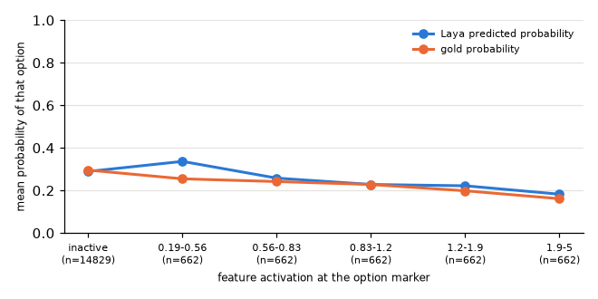

# Feature 8737

Critérios em que aparece: pred_error_stratified, attribution_toward_correct

**Interpretação (preencher):** 

---

## Maiores ativações

**tr_customer_service_000263 / category** (choice, customer_service) | ativação 6.086 em `opção` | opções ['account', 'billing', 'delivery', 'refund', 'technical'] | Laya: **technical** [0.149, 0.127, 0.108, 0.245, 0.372] | gabarito: **delivery**

```
[CLS]choice question: What is this customer conversation primarily about?[SEP]
▸ [MASK] account⟦:⟧ Login, plan changes, profile or access management.
▸ [MASK] billing: A charge, invoice, subscription or payment problem.
▸ [MASK] delivery: Shipping, fulfilment or delivery of a physical item.
▸ [MASK] refund: The customer is explicitly asking for money back.
▸ [MASK] technical: The product or service is not working as expected.

[SEP]

{"account": {"lifetime_value_usd": 270, "prior_tickets_90d": 5, "seats": 1, "tenure_months": 3, "tier": "enterprise"}, "orders": [{"amount_usd": 9, "date": "2026-02-14", "id": "A-24658", "status": "settled"}, {"amount_usd": 9, "date": "2026-01-01", "id": "A-74253", "status": "settled"}], "thread": [{"role": "customer", "text": "This is the sixth time in three months I’ve received the wrong shipment, despite being on an Enterprise agreement. I’ve had five tickets about this already that were supposedly resolved, but the error keeps recurring and I absolutely need the correct hardware for our site launch on Friday."}]}[SEP]
```

**tr_customer_service_000095 / category** (choice, customer_service) | ativação 5.871 em `opção` | opções ['account', 'billing', 'delivery', 'refund', 'technical'] | Laya: **delivery** [0.039, 0.042, 0.419, 0.387, 0.112] | gabarito: **delivery**

```
[CLS]choice question: What is this customer conversation primarily about?[SEP]
▸ [MASK] account⟦:⟧ Login, plan changes, profile or access management.
▸ [MASK] billing: A charge, invoice, subscription or payment problem.
▸ [MASK] delivery: Shipping, fulfilment or delivery of a physical item.
▸ [MASK] refund: The customer is explicitly asking for money back.
▸ [MASK] technical: The product or service is not working as expected.

[SEP]

{"account": {"lifetime_value_usd": 2044, "prior_tickets_90d": 1, "seats": 12, "tenure_months": 60, "tier": "premium"}, "thread": [{"role": "customer", "text": "I am beyond frustrated. I’ve been a loyal premium customer for five years, and the item I just received is already damaged. This is unacceptable, especially since my previous ticket about the shipping quality is still just sitting there ignored."}, {"role": "agent", "text": "I truly apologize for the frustration caused by the state of your delivery. To better assist you, could you please provide a few photos of the damage so I can document the issue?"}, {"role": "customer", "text": "I shouldn't have to jump through hoops to prove this arrived broken when your company has a history of these failures. My time is being wasted."}]}[SEP]
```

**tr_customer_service_000263 / category** (choice, customer_service) | ativação 5.852 em `opção` | opções ['account', 'billing', 'delivery', 'refund', 'technical'] | Laya: **technical** [0.149, 0.127, 0.108, 0.245, 0.372] | gabarito: **delivery**

```
[CLS]choice question: What is this customer conversation primarily about?[SEP]
▸ [MASK] account: Login⟦,⟧ plan changes, profile or access management.
▸ [MASK] billing: A charge, invoice, subscription or payment problem.
▸ [MASK] delivery: Shipping, fulfilment or delivery of a physical item.
▸ [MASK] refund: The customer is explicitly asking for money back.
▸ [MASK] technical: The product or service is not working as expected.

[SEP]

{"account": {"lifetime_value_usd": 270, "prior_tickets_90d": 5, "seats": 1, "tenure_months": 3, "tier": "enterprise"}, "orders": [{"amount_usd": 9, "date": "2026-02-14", "id": "A-24658", "status": "settled"}, {"amount_usd": 9, "date": "2026-01-01", "id": "A-74253", "status": "settled"}], "thread": [{"role": "customer", "text": "This is the sixth time in three months I’ve received the wrong shipment, despite being on an Enterprise agreement. I’ve had five tickets about this already that were supposedly resolved, but the error keeps recurring and I absolutely need the correct hardware for our site launch on Friday."}]}[SEP]
```

**tr_customer_service_000093 / category** (choice, customer_service) | ativação 5.762 em `opção` | opções ['account', 'billing', 'delivery', 'refund', 'technical'] | Laya: **technical** [0.28, 0.128, 0.074, 0.212, 0.307] | gabarito: **technical**

```
[CLS]choice question: What is this customer conversation primarily about?[SEP]
▸ [MASK] account⟦:⟧ Login, plan changes, profile or access management.
▸ [MASK] billing: A charge, invoice, subscription or payment problem.
▸ [MASK] delivery: Shipping, fulfilment or delivery of a physical item.
▸ [MASK] refund: The customer is explicitly asking for money back.
▸ [MASK] technical: The product or service is not working as expected.

[SEP]

{"account": {"lifetime_value_usd": 2245, "prior_tickets_90d": 1, "seats": 1, "tenure_months": 26, "tier": "premium"}, "thread": [{"role": "customer", "text": "After 26 months of being a premium member, I’m sick of these quality issues. I dropped my device once and the casing shattered instantly. This is the same recurring garbage I complained about last time, and if this isn't handled properly, I'm taking my business elsewhere for good."}]}[SEP]
```

**tr_customer_service_000094 / category** (choice, customer_service) | ativação 5.707 em `pergunta` | opções ['account', 'billing', 'delivery', 'refund', 'technical'] | Laya: **billing** [0.077, 0.459, 0.035, 0.204, 0.224] | gabarito: **billing**

```
[CLS]choice question: What is this customer conversation primarily about⟦?⟧[SEP]
▸ [MASK] account: Login, plan changes, profile or access management.
▸ [MASK] billing: A charge, invoice, subscription or payment problem.
▸ [MASK] delivery: Shipping, fulfilment or delivery of a physical item.
▸ [MASK] refund: The customer is explicitly asking for money back.
▸ [MASK] technical: The product or service is not working as expected.

[SEP]

{"account": {"lifetime_value_usd": 979, "prior_tickets_90d": 1, "seats": 1, "tenure_months": 11, "tier": "premium"}, "thread": [{"role": "customer", "text": "I’m looking at my billing statement and I don't understand why the premium plan charges are still hitting my card when I thought I processed a downgrade last week. Can you explain what’s going on?"}, {"role": "agent", "text": "I understand your concern regarding the recent charges. To help me investigate this for you, could you provide the reference number or date from the request you submitted?"}, {"role": "customer", "text": "I don't have a reference number, but it was just a few days ago. Why is this so difficult to track down when I've been with you for 11 months?"}, {"role": "agent", "text": "Thank you for that information. I see you have an open ticket regarding your account status; could you clarify if you received a confirmation email after attempting the downgrade?"}, {"role": "customer", "text": "I might have deleted it, but the site said it was done. It feels like I'm running in circles here with no real answers."}]}[SEP]
```

## Ativações medianas (faixa 40-60%, mediana 0.996)

**tr_customer_service_000090 / category** (choice, customer_service) | ativação 1.018 em `opção` | opções ['account', 'billing', 'delivery', 'refund', 'technical'] | Laya: **refund** [0.1, 0.108, 0.123, 0.405, 0.263] | gabarito: **delivery**

```
[CLS]choice question: What is this customer conversation primarily about?[SEP]
▸ [MASK] account: Login, plan changes, profile or access management.
▸ [MASK] billing: A⟦ charge⟧, invoice, subscription or payment problem.
▸ [MASK] delivery: Shipping, fulfilment or delivery of a physical item.
▸ [MASK] refund: The customer is explicitly asking for money back.
▸ [MASK] technical: The product or service is not working as expected.

[SEP]

{"account": {"lifetime_value_usd": 2058, "prior_tickets_90d": 5, "seats": 1, "tenure_months": 33, "tier": "standard"}, "thread": [{"role": "customer", "text": "The unit I received arrived with a cracked screen, which is unacceptable given I’ve been a subscriber for almost three years. I need a replacement before the 5 PM deadline tomorrow for my upcoming presentation."}, {"role": "agent", "text": "I’m sorry about the damage. Could you attach a photo of the crack so we can verify the condition?"}, {"role": "customer", "text": "I’ll upload the pictures right after this message. Please let me know if we can expedite a replacement to meet my deadline."}]}[SEP]
```

**tr_customer_service_000077 / urgency** (score, customer_service) | ativação 1.042 em `pergunta` | opções ['0', '1', '2', '3'] | Laya: **1** [0.056, 0.848, 0.045, 0.051] | gabarito: **1**

```
[CLS]score question: How time-⟦sensitive⟧ is this conversation?[SEP]
▸ [MASK] level 0: No time pressure; can wait indefinitely.
▸ [MASK] level 1: Routine; handle within the normal queue.
▸ [MASK] level 2: Elevated; should be handled within the same week.
▸ [MASK] level 3: Critical; requires action within the same day.

[SEP]

{"account": {"lifetime_value_usd": 579, "prior_tickets_90d": 2, "seats": 1, "tenure_months": 11, "tier": "free"}, "thread": [{"role": "customer", "text": "I noticed an unexpected charge on my account today. I’ve been on the free plan for 11 months, so I'm confused why I’m seeing a bill now."}, {"role": "agent", "text": "Thank you for bringing this to our attention. I would like to investigate this charge for you; could you confirm the date the transaction appeared on your statement?"}, {"role": "customer", "text": "It appeared on my dashboard yesterday morning. I’ve had issues with incorrect billing promises before, so I’d appreciate it if you could clarify what this is for."}]}[SEP]
```

**tr_customer_service_000226 / action** (choice, customer_service) | ativação 0.872 em `opção` | opções ['answer_directly', 'close_no_action', 'escalate_to_human', 'execute_refund', 'request_information'] | Laya: **close_no_action** [0.082, 0.763, 0.054, 0.047, 0.054] | gabarito: **escalate_to_human**

```
[CLS]choice question: What should the assistant do next with this conversation?[SEP]
▸ [MASK] answer_directly: The assistant can resolve this itself with information it already has.
▸ [MASK] close_no_action: No further action is warranted; the matter is settled.
▸ [MASK] escalate_to_human: Hand off to a human⟦ agent⟧ with the appropriate authority.
▸ [MASK] execute_refund: Issue the refund or credit the customer is owed.
▸ [MASK] request_information: More detail is needed from the customer before anything can be done.

[SEP]

{"account": {"lifetime_value_usd": 2324, "prior_tickets_90d": 1, "seats": 1, "tenure_months": 26, "tier": "free"}, "orders": [{"amount_usd": 99, "date": "2026-01-19", "id": "A-44962", "status": "pending"}], "thread": [{"role": "customer", "text": "I have been using this free service for over two years, but the current lag makes it impossible to work, and I have a hard deadline in two hours that I am going to miss because of this $99 billable project!"}]}[SEP]
```

**tr_customer_service_000062 / category** (choice, customer_service) | ativação 1.027 em `marcador` | opções ['account', 'billing', 'delivery', 'refund', 'technical'] | Laya: **refund** [0.091, 0.06, 0.017, 0.644, 0.188] | gabarito: **technical**

```
[CLS]choice question: What is this customer conversation primarily about?[SEP]
▸ [MASK] account: Login, plan changes, profile or access management.
▸ [MASK] billing: A charge, invoice, subscription or payment problem.
▸ [MASK] delivery: Shipping, fulfilment or delivery of a physical item.
▸ ⟦[MASK]⟧ refund: The customer is explicitly asking for money back.
▸ [MASK] technical: The product or service is not working as expected.

[SEP]

{"account": {"lifetime_value_usd": 379, "prior_tickets_90d": 0, "seats": 1, "tenure_months": 11, "tier": "standard"}, "thread": [{"role": "customer", "text": "This service is a total joke and I want to cancel immediately before you charge me another dime."}, {"role": "agent", "text": "I am sorry to hear you're unhappy; could you tell me a bit more about what's prompted this decision today?"}, {"role": "customer", "text": "Everything is broken and the support is non-existent. I'm done."}, {"role": "agent", "text": "I understand your frustration. To better assist you, would you mind specifying which features have not been meeting your expectations?"}, {"role": "customer", "text": "All of them. Fix it or I'm taking my business elsewhere."}, {"role": "agent", "text": "I hear your concerns clearly. Could you please provide your account email address so I can pull up the details of your recent usage?"}, {"role": "customer", "text": "It's the same email I'm messaging from. Just process the cancellation."}]}[SEP]
```

**tr_customer_service_000138 / category** (choice, customer_service) | ativação 0.898 em `opção` | opções ['account', 'billing', 'delivery', 'refund', 'technical'] | Laya: **refund** [0.139, 0.223, 0.136, 0.259, 0.243] | gabarito: **technical**

```
[CLS]choice question: What is this customer conversation primarily about?[SEP]
▸ [MASK] account: Login, plan changes, profile or access management.
▸ [MASK] billing: A charge, invoice, subscription or payment problem.
▸ [MASK] delivery: Shipping⟦,⟧ fulfilment or delivery of a physical item.
▸ [MASK] refund: The customer is explicitly asking for money back.
▸ [MASK] technical: The product or service is not working as expected.

[SEP]

{"account": {"lifetime_value_usd": 247, "prior_tickets_90d": 1, "seats": 1, "tenure_months": 3, "tier": "standard"}, "thread": [{"role": "customer", "text": "Good afternoon, I need the data export we discussed last month. This is my third month on the standard plan, and the previous ticket promised the export but never arrived."}, {"role": "agent", "text": "I’m sorry you haven’t received the export yet. Could you remind me of the ticket number so I can locate the original request?"}, {"role": "customer", "text": "The ticket was #7890, opened on July 20th. I was told it would be ready within 48 hours, but I still have nothing."}, {"role": "agent", "text": "Thank you for the details. I’ll pull up the logs for that ticket. In the meantime, could you confirm the email address you’d like the export sent to?"}, {"role": "customer", "text": "Please send it to me at alex.tan@example.com. I need the data before the end of the month, so any update would be great."}]}[SEP]
```

## Estatísticas (conjunto de descoberta, dev e teste)

**pred / error**

| split | decisões | ativas | ativas e Laya errou | taxa | lift | q (BH) | OR (CMH) | q (CMH) |
|---|---|---|---|---|---|---|---|---|
| discovery | 5100 | 921 | 674 | 0.732 | 1.15 | 1.17e-10 | 1.77 | 1.75e-06 |
| dev | 900 | 138 | 92 | 0.667 | 1.02 | 0.996 | 1.24 | 0.698 |
| test | 2000 | 368 | 267 | 0.726 | 1.14 | 0.000353 | 1.44 | 0.179 |

**corr / error**

| split | decisões | ativas | ativas e Laya errou | taxa | lift | q (BH) | OR (CMH) | q (CMH) |
|---|---|---|---|---|---|---|---|---|
| discovery | 5100 | 697 | 450 | 0.646 | 1.01 | 0.645 | 1.03 | 0.891 |
| dev | 900 | 97 | 51 | 0.526 | 0.80 | 0.0114 | 0.73 | 0.686 |
| test | 2000 | 266 | 165 | 0.620 | 0.97 | 0.633 | 0.91 | 0.829 |

**state / error**

| split | decisões | ativas | ativas e Laya errou | taxa | lift | q (BH) | OR (CMH) | q (CMH) |
|---|---|---|---|---|---|---|---|---|
| discovery | 5100 | 1566 | 944 | 0.603 | 0.95 | 0.0209 | 0.96 | 0.746 |
| dev | 900 | 240 | 156 | 0.650 | 0.99 | 1 | 1.04 | 0.939 |
| test | 2000 | 612 | 375 | 0.613 | 0.96 | 0.604 | 0.90 | 0.636 |

Confusão mais sobre-representada (pred): `action|1>2` (n=78, lift 3.46, p=8.23e-29). Formato `pergunta|índice previsto>índice correto`.

Confusão mais sobre-representada (corr): `action|1>2` (n=69, lift 4.04, p=1.07e-28). Formato `pergunta|índice previsto>índice correto`.

Confusão mais sobre-representada (state): `action|1>2` (n=86, lift 2.24, p=7.96e-19). Formato `pergunta|índice previsto>índice correto`.



