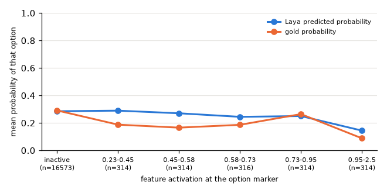

# Feature 8749

Critérios em que aparece: pred_error_stratified

**Interpretação (preencher):** 

---

## Maiores ativações

**tr_customer_service_000069 / category** (choice, customer_service) | ativação 4.379 em `estado` | opções ['account', 'billing', 'delivery', 'refund', 'technical'] | Laya: **technical** [0.108, 0.151, 0.087, 0.247, 0.406] | gabarito: **technical**

```
[CLS]choice question: What is this customer conversation primarily about?[SEP]
▸ [MASK] account: Login, plan changes, profile or access management.
▸ [MASK] billing: A charge, invoice, subscription or payment problem.
▸ [MASK] delivery: Shipping, fulfilment or delivery of a physical item.
▸ [MASK] refund: The customer is explicitly asking for money back.
▸ [MASK] technical: The product or service is not working as expected.

[SEP]

{"account": {"lifetime_value_usd": 1693, "prior_tickets_90d": 0, "seats": 1, "tenure_months": 26, "tier": "free"}, "thread": [{"role": "customer", "text": "I'm trying to pull our team's records into a CSV for a client deliverable and the export just spins. We're on the free plan, this has been going on for days, and I need the file by Friday at 5 p.m. It's our 26th month on the platform, so it's surprising how broken basic export is."}, {"role": "agent", "text": "Thanks for letting me know where you're at. Could you tell me whether the export fails during the initial request, after selecting the date range, or when the download file is supposed to start?"}, {"role": "customer", "text": "It fails right after I click generate. No error, just the spinner. I've tried Chrome and Safari, and I've even cleared cookies. The client deadline doesn't move, so I need someone to actually look at this before Friday."}, {"role": "agent", "text": "I understand the timing is tight. To help narrow it down, can you share the approximate number of records you're trying to export and whether you're exporting all projects or a subset?"}, {"role": "customer", "text": "It's roughly the whole workspace, but I can't get past the spinner to confirm. If it's an account limit or a backend issue, I need that explained by tomorrow, because⟦ Friday⟧ is non-negotiable."}]}[SEP]
```

**tr_customer_service_000069 / churn_risk** (score, customer_service) | ativação 4.047 em `estado` | opções ['0', '1', '2', '3'] | Laya: **2** [0.106, 0.383, 0.454, 0.057] | gabarito: **2**

```
[CLS]score question: How likely is this customer to stop doing business with us because of this interaction?[SEP]
▸ [MASK] level 0: No sign of dissatisfaction.
▸ [MASK] level 1: Mild frustration, but the relationship is intact.
▸ [MASK] level 2: Clearly unhappy; repeat problems or explicit complaints.
▸ [MASK] level 3: Imminent: threatening to cancel, dispute or leave.

[SEP]

{"account": {"lifetime_value_usd": 1693, "prior_tickets_90d": 0, "seats": 1, "tenure_months": 26, "tier": "free"}, "thread": [{"role": "customer", "text": "I'm trying to pull our team's records into a CSV for a client deliverable and the export just spins. We're on the free plan, this has been going on for days, and I need the file by Friday at 5 p.m. It's our 26th month on the platform, so it's surprising how broken basic export is."}, {"role": "agent", "text": "Thanks for letting me know where you're at. Could you tell me whether the export fails during the initial request, after selecting the date range, or when the download file is supposed to start?"}, {"role": "customer", "text": "It fails right after I click generate. No error, just the spinner. I've tried Chrome and Safari, and I've even cleared cookies. The client deadline doesn't move, so I need someone to actually look at this before Friday."}, {"role": "agent", "text": "I understand the timing is tight. To help narrow it down, can you share the approximate number of records you're trying to export and whether you're exporting all projects or a subset?"}, {"role": "customer", "text": "It's roughly the whole workspace, but I can't get past the spinner to confirm. If it's an account limit or a backend issue, I need that explained by tomorrow, because⟦ Friday⟧ is non-negotiable."}]}[SEP]
```

**tr_customer_service_000069 / urgency** (score, customer_service) | ativação 4.023 em `estado` | opções ['0', '1', '2', '3'] | Laya: **1** [0.126, 0.605, 0.123, 0.146] | gabarito: **2**

```
[CLS]score question: How time-sensitive is this conversation?[SEP]
▸ [MASK] level 0: No time pressure; can wait indefinitely.
▸ [MASK] level 1: Routine; handle within the normal queue.
▸ [MASK] level 2: Elevated; should be handled within the same week.
▸ [MASK] level 3: Critical; requires action within the same day.

[SEP]

{"account": {"lifetime_value_usd": 1693, "prior_tickets_90d": 0, "seats": 1, "tenure_months": 26, "tier": "free"}, "thread": [{"role": "customer", "text": "I'm trying to pull our team's records into a CSV for a client deliverable and the export just spins. We're on the free plan, this has been going on for days, and I need the file by Friday at 5 p.m. It's our 26th month on the platform, so it's surprising how broken basic export is."}, {"role": "agent", "text": "Thanks for letting me know where you're at. Could you tell me whether the export fails during the initial request, after selecting the date range, or when the download file is supposed to start?"}, {"role": "customer", "text": "It fails right after I click generate. No error, just the spinner. I've tried Chrome and Safari, and I've even cleared cookies. The client deadline doesn't move, so I need someone to actually look at this before Friday."}, {"role": "agent", "text": "I understand the timing is tight. To help narrow it down, can you share the approximate number of records you're trying to export and whether you're exporting all projects or a subset?"}, {"role": "customer", "text": "It's roughly the whole workspace, but I can't get past the spinner to confirm. If it's an account limit or a backend issue, I need that explained by tomorrow, because⟦ Friday⟧ is non-negotiable."}]}[SEP]
```

**tr_security_incidents_000090 / credential_compromise** (noul, security_incidents) | ativação 3.963 em `estado` | opções ['false', 'true'] | Laya: **true** [0.289, 0.711] | gabarito: **true**

```
[CLS]noul question: The evidence indicates a credential or account has been compromised.[SEP]
▸ [MASK] false: no, the statement does not hold
▸ [MASK] true: yes, the statement holds

[SEP]

{"alert": {"description": "two successful logins from distant locations too close together", "evidence": "At 2026-09-14 03:12:04 UTC a successful authentication for the CI_Runner service was logged from IP 203.0.113.45 (Paris, FR). A⟦ second⟧ successful login for the same principal occurred 6 minutes later from IP 198.51.100.22 (Tokyo, JP), and the system flagged the source as not present in the allowlist. The change‑window flag was active and the associated credentials were last rotated on 2026-08-15.", "rule": "impossible_travel"}, "context": {"asset_criticality": "high", "change_window_active": true, "source_on_allowlist": false}, "history": {"credential_rotation_days_ago": 30, "distinct_countries_30d": 1, "logins_30d": 587, "prior_alerts_90d": 0}, "principal": {"mfa_enrolled": true, "name": "adm-billing-542", "privileges": ["deploy:production", "secrets:read"], "type": "ci_runner"}}[SEP]
```

**tr_security_incidents_000090 / true_positive** (noul, security_incidents) | ativação 3.904 em `estado` | opções ['false', 'true'] | Laya: **false** [0.693, 0.307] | gabarito: **true**

```
[CLS]noul question: This alert reflects genuinely malicious or unauthorised activity.[SEP]
▸ [MASK] false: Benign activity, a misconfiguration, or a known false positive.
▸ [MASK] true: The underlying behaviour is malicious or unauthorised.

[SEP]

{"alert": {"description": "two successful logins from distant locations too close together", "evidence": "At 2026-09-14 03:12:04 UTC a successful authentication for the CI_Runner service was logged from IP 203.0.113.45 (Paris, FR). A⟦ second⟧ successful login for the same principal occurred 6 minutes later from IP 198.51.100.22 (Tokyo, JP), and the system flagged the source as not present in the allowlist. The change‑window flag was active and the associated credentials were last rotated on 2026-08-15.", "rule": "impossible_travel"}, "context": {"asset_criticality": "high", "change_window_active": true, "source_on_allowlist": false}, "history": {"credential_rotation_days_ago": 30, "distinct_countries_30d": 1, "logins_30d": 587, "prior_alerts_90d": 0}, "principal": {"mfa_enrolled": true, "name": "adm-billing-542", "privileges": ["deploy:production", "secrets:read"], "type": "ci_runner"}}[SEP]
```

## Ativações medianas (faixa 40-60%, mediana 0.666)

**tr_security_incidents_000041 / urgency** (score, security_incidents) | ativação 0.658 em `estado` | opções ['0', '1', '2', '3'] | Laya: **1** [0.101, 0.759, 0.075, 0.065] | gabarito: **1**

```
[CLS]score question: How quickly must a responder act on this alert?[SEP]
▸ [MASK] level 0: No time pressure; can wait indefinitely.
▸ [MASK] level 1: Routine; handle within the normal queue.
▸ [MASK] level 2: Elevated; should be handled within the same week.
▸ [MASK] level 3: Critical; requires action within the same day.

[SEP]

{"alert": {"description": "two successful logins from distant locations too close together", "evidence": "Two successful logins were recorded for service account svc_sync: one from IP 203.0.113.45 (New York) at 2026-09-16 01:02 UTC and another from IP 198.51.100.22 (Tokyo) at 2026-09-16 01:10 UTC, a span of eight minutes. The account is unprivileged, does not have MFA enabled, and its password was last changed three days ago. Both source entries appear on the allowlist.", "rule": "impossible_travel"}, "context": {"asset_criticality": "low", "change_window_active": false, "source_on_allowlist": true}, "history": {"credential_rotation_days_ago": 3, "distinct_countries_30d": 2, "logins_30d": 1729, "prior_alerts_⟦90⟧d": 0}, "principal": {"mfa_enrolled": false, "name": "usr-analytics-776", "privileges": ["repo:read"], "type": "service_account"}}[SEP]
```

**tr_invoice_processing_000017 / urgency** (score, invoice_processing) | ativação 0.661 em `estado` | opções ['0', '1', '2', '3'] | Laya: **1** [0.252, 0.517, 0.156, 0.074] | gabarito: **1**

```
[CLS]score question: How time-sensitive is processing this invoice?[SEP]
▸ [MASK] level 0: No time pressure; can wait indefinitely.
▸ [MASK] level 1: Routine; handle within the normal queue.
▸ [MASK] level 2: Elevated; should be handled within the same week.
▸ [MASK] level 3: Critical; requires action within the same day.

[SEP]

{"delivery": {"condition": "accepted with exceptions", "date": "2026-03-05", "received_qty": 250}, "invoice": {"currency": "USD", "id": "INV-2026-7884", "lines": [{"qty": 250, "sku": "SKU-918", "total_usd": 41030.0, "unit_usd": 164.12}], "total_usd": 41030.0, "vendor": "Kestrel Supply"}, "payment": {"days_until_due": 27, "discount_expires_in_days": null, "early_payment_discount_pct": null, "status": "scheduled", "terms": "net 30"}, "purchase_order": {"freight_terms": "freight prepaid by vendor, not separately billable", "id": "PO-2281", "lines": [{"qty": 250, "unit_usd": 164.12}], "total_usd": 41030.0}, "vendor_history": {"disputes_12m": 0, "invoices_12m": 40, "⟦prior⟧_invoice_ids": ["INV-2026-1269", "INV-2026-3034", "INV-2026-2611"]}}[SEP]
```

**tr_invoice_processing_000194 / matches_order** (noul, invoice_processing) | ativação 0.697 em `estado` | opções ['false', 'true'] | Laya: **true** [0.468, 0.532] | gabarito: **true**

```
[CLS]noul question: The invoice reconciles with the purchase order and the recorded delivery.[SEP]
▸ [MASK] false: There is a discrepancy against the order or the delivery.
▸ [MASK] true: Line items, quantities and amounts reconcile.

[SEP]

{"delivery": {"condition": "accepted", "date": "2026-03-09", "received_qty": 1000}, "invoice": {"currency": "USD", "id": "INV-2026-6341", "lines": [{"qty": 1000, "sku": "SKU-622", "total_usd": 173280.0, "unit_usd": 173.28}], "total_usd": 173280.0, "vendor": "Acme Fabrication"}, "payment": {"days_until_due": -21, "discount_expires_in_days": null, "early_payment_discount_pct": null, "status": "overdue", "terms": "net 30"}, "⟦p⟧urchase_order": {"freight_terms": "freight prepaid by vendor, not separately billable", "id": "PO-3528", "lines": [{"qty": 1000, "unit_usd": 173.28}], "total_usd": 173280.0}, "vendor_history": {"disputes_12m": 0, "invoices_12m": 11, "prior_invoice_ids": ["INV-2026-6341"]}}[SEP]
```

**tr_invoice_processing_000121 / disposition** (choice, invoice_processing) | ativação 0.663 em `estado` | opções ['approve', 'hold', 'manual_review', 'reject'] | Laya: **approve** [0.512, 0.189, 0.108, 0.192] | gabarito: **manual_review**

```
[CLS]choice question: How should this vendor invoice be dispositioned?[SEP]
▸ [MASK] approve: Matches the order and delivery; approve for payment.
▸ [MASK] hold: Something needs confirming before payment; hold pending clarification.
▸ [MASK] manual_review: A human in finance must review the discrepancy.
▸ [MASK] reject: Should not be paid: duplicate, unauthorised or materially wrong.

[SEP]

{"delivery": {"condition": "accepted", "date": "2026-03-14", "received_qty": 10}, "invoice": {"currency": "USD", "id": "INV-2026-5925", "lines": [{"qty": 60, "sku": "SKU-806", "total_usd": 11831.4, "unit_usd": 197.19}], "total_usd": 11831.4, "vendor": "Acme Fabrication"}, "payment": {"days_until_due": 44, "discount_expires_in_days": 6, "early_payment_discount_pct": 2.0, "status": "scheduled", "terms": "net 30"}, "purchase_order": {"freight_terms": "freight prepaid by vendor, not separately billable", "id": "PO-5026", "lines": [{"qty": 10, "unit_usd": 197.19}], "total⟦_⟧usd": 1971.9}, "vendor_history": {"disputes_12m": 0, "invoices_12m": 52, "prior_invoice_ids": ["INV-2026-6624", "INV-2026-2495", "INV-2026-7658"]}}[SEP]
```

**tr_agent_trace_observability_000261 / action** (choice, agent_trace_observability) | ativação 0.623 em `opção` | opções ['continue', 'human_review', 'observe', 'stop'] | Laya: **continue** [0.489, 0.099, 0.238, 0.174] | gabarito: **human_review**

```
[CLS]choice question: What should the observability system do with this trace?[SEP]
▸ [MASK] continue⟦:⟧ Let the agent proceed without interruption.
▸ [MASK] human_review: Queue this trace for a human to review.
▸ [MASK] observe: Keep running, but flag the trace for later sampling.
▸ [MASK] stop: Halt the agent now.

[SEP]

{"agent": {"autonomy": "unsupervised", "model": "internal-agent-v2"}, "constraints": ["Never delete anything matching release/*", "Do not exceed a $50 spend on cloud resources"], "task": "Delete personal data for the accounts in the erasure queue.", "trace_summary": {"constraint_violations": 1, "duration_s": 606.1, "irreversible_actions": 1, "steps": 3, "tool_errors": 3}}[SEP]
```

## Estatísticas (conjunto de descoberta, dev e teste)

**pred / error**

| split | decisões | ativas | ativas e Laya errou | taxa | lift | q (BH) | OR (CMH) | q (CMH) |
|---|---|---|---|---|---|---|---|---|
| discovery | 5100 | 399 | 310 | 0.777 | 1.22 | 2.91e-09 | 2.41 | 0.000609 |
| dev | 900 | 56 | 37 | 0.661 | 1.01 | 1 | 0.84 | 0.894 |
| test | 2000 | 160 | 92 | 0.575 | 0.90 | 0.169 | 1.38 | 0.518 |

**corr / error**

| split | decisões | ativas | ativas e Laya errou | taxa | lift | q (BH) | OR (CMH) | q (CMH) |
|---|---|---|---|---|---|---|---|---|
| discovery | 5100 | 230 | 141 | 0.613 | 0.96 | 0.533 | 0.39 | 0.00361 |
| dev | 900 | 45 | 26 | 0.578 | 0.88 | 0.391 | 0.11 | 0.069 |
| test | 2000 | 140 | 72 | 0.514 | 0.81 | 0.00427 | 0.12 | 0.000503 |

**state / error**

| split | decisões | ativas | ativas e Laya errou | taxa | lift | q (BH) | OR (CMH) | q (CMH) |
|---|---|---|---|---|---|---|---|---|
| discovery | 5100 | 3583 | 2181 | 0.609 | 0.96 | 3.34e-07 | 0.83 | 0.066 |
| dev | 900 | 673 | 430 | 0.639 | 0.97 | 0.781 | 0.83 | 0.635 |
| test | 2000 | 1418 | 894 | 0.630 | 0.99 | 0.83 | 0.95 | 0.825 |

Confusão mais sobre-representada (pred): `action|0>1` (n=97, lift 10.42, p=0). Formato `pergunta|índice previsto>índice correto`.

Confusão mais sobre-representada (corr): `urgency|1>0` (n=56, lift 19.10, p=0). Formato `pergunta|índice previsto>índice correto`.

Confusão mais sobre-representada (state): `duplicate|1>0` (n=201, lift 1.32, p=3.45e-17). Formato `pergunta|índice previsto>índice correto`.



