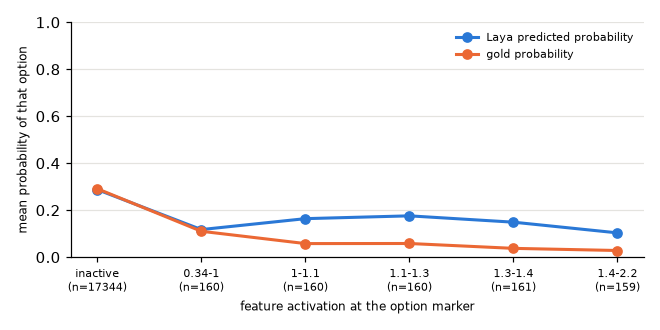

# Feature 8813

Critérios em que aparece: corr_error

**Interpretação (preencher):** 

---

## Maiores ativações

**tr_customer_service_000086 / urgency** (score, customer_service) | ativação 8.680 em `opção` | opções ['0', '1', '2', '3'] | Laya: **1** [0.058, 0.53, 0.196, 0.216] | gabarito: **3**

```
[CLS]score question: How time-sensitive is this conversation?[SEP]
▸ [MASK] level⟦ 0⟧: No time pressure; can wait indefinitely.
▸ [MASK] level 1: Routine; handle within the normal queue.
▸ [MASK] level 2: Elevated; should be handled within the same week.
▸ [MASK] level 3: Critical; requires action within the same day.

[SEP]

{"account": {"lifetime_value_usd": 1071, "prior_tickets_90d": 2, "seats": 1, "tenure_months": 19, "tier": "standard"}, "thread": [{"role": "customer", "text": "I just got a bill that’s higher than what I expected, and I don’t understand why the charge jumped. Can someone explain what’s going on? I need this cleared up by tomorrow."}, {"role": "agent", "text": "I’m sorry for the surprise. Could you tell me the date and amount shown on the statement so I can compare it to your plan details?"}, {"role": "customer", "text": "It’s the charge dated 9/14 and I need to know if this is a mistake or a new fee before the end of the day."}]}[SEP]
```

**tr_customer_service_000132 / urgency** (score, customer_service) | ativação 8.617 em `opção` | opções ['0', '1', '2', '3'] | Laya: **1** [0.053, 0.653, 0.162, 0.132] | gabarito: **1**

```
[CLS]score question: How time-sensitive is this conversation?[SEP]
▸ [MASK] level⟦ 0⟧: No time pressure; can wait indefinitely.
▸ [MASK] level 1: Routine; handle within the normal queue.
▸ [MASK] level 2: Elevated; should be handled within the same week.
▸ [MASK] level 3: Critical; requires action within the same day.

[SEP]

{"account": {"lifetime_value_usd": 222, "prior_tickets_90d": 0, "seats": 1, "tenure_months": 3, "tier": "free"}, "thread": [{"role": "customer", "text": "Hi there, I just opened the package from my recent order and, unfortunately, the item arrived with a noticeable crack on the side. Could you let me know what the next steps are?"}, {"role": "agent", "text": "I’m sorry to hear that the product was damaged. Could you please share a photo of the crack and confirm the order number so I can look into this for you?"}, {"role": "customer", "text": "Sure, I’ve attached a picture and the order number is #4521. I’d appreciate any guidance on how we can move forward."}]}[SEP]
```

**tr_customer_service_000214 / urgency** (score, customer_service) | ativação 8.516 em `opção` | opções ['0', '1', '2', '3'] | Laya: **1** [0.032, 0.647, 0.153, 0.168] | gabarito: **3**

```
[CLS]score question: How time-sensitive is this conversation?[SEP]
▸ [MASK] level⟦ 0⟧: No time pressure; can wait indefinitely.
▸ [MASK] level 1: Routine; handle within the normal queue.
▸ [MASK] level 2: Elevated; should be handled within the same week.
▸ [MASK] level 3: Critical; requires action within the same day.

[SEP]

{"account": {"lifetime_value_usd": 820, "prior_tickets_90d": 2, "seats": 1, "tenure_months": 19, "tier": "standard"}, "thread": [{"role": "customer", "text": "The platform has been crawling at a snail's pace all day—queries that used to return in seconds now take minutes, and I need this fixed before my deadline tomorrow."}, {"role": "agent", "text": "I understand how critical that is. Can you tell me which specific actions are lagging and if this slowdown is happening across all browsers?"}, {"role": "customer", "text": "Both the search bar and the analytics tab are sluggish, and it’s the same on Chrome and Firefox. I’ve been on the standard plan for 19 months and this is the first time I’ve seen anything this bad."}]}[SEP]
```

**tr_customer_service_000216 / urgency** (score, customer_service) | ativação 8.477 em `opção` | opções ['0', '1', '2', '3'] | Laya: **1** [0.062, 0.694, 0.068, 0.175] | gabarito: **2**

```
[CLS]score question: How time-sensitive is this conversation?[SEP]
▸ [MASK] level⟦ 0⟧: No time pressure; can wait indefinitely.
▸ [MASK] level 1: Routine; handle within the normal queue.
▸ [MASK] level 2: Elevated; should be handled within the same week.
▸ [MASK] level 3: Critical; requires action within the same day.

[SEP]

{"account": {"lifetime_value_usd": 90, "prior_tickets_90d": 0, "seats": 1, "tenure_months": 2, "tier": "free"}, "thread": [{"role": "customer", "text": "Hello there, I am checking on the status of my order. It’s for a birthday party this weekend, so I’m a bit worried it hasn't arrived yet."}, {"role": "agent", "text": "I would be happy to look into that for you. Could you please provide the order number so I can check the current shipping status in our system?"}, {"role": "customer", "text": "Of course, the order number is #44921. I really need these supplies by Friday at the latest for the event to go smoothly, so any help is appreciated."}]}[SEP]
```

**tr_customer_service_000095 / urgency** (score, customer_service) | ativação 8.438 em `opção` | opções ['0', '1', '2', '3'] | Laya: **1** [0.046, 0.443, 0.166, 0.345] | gabarito: **2**

```
[CLS]score question: How time-sensitive is this conversation?[SEP]
▸ [MASK] level⟦ 0⟧: No time pressure; can wait indefinitely.
▸ [MASK] level 1: Routine; handle within the normal queue.
▸ [MASK] level 2: Elevated; should be handled within the same week.
▸ [MASK] level 3: Critical; requires action within the same day.

[SEP]

{"account": {"lifetime_value_usd": 2044, "prior_tickets_90d": 1, "seats": 12, "tenure_months": 60, "tier": "premium"}, "thread": [{"role": "customer", "text": "I am beyond frustrated. I’ve been a loyal premium customer for five years, and the item I just received is already damaged. This is unacceptable, especially since my previous ticket about the shipping quality is still just sitting there ignored."}, {"role": "agent", "text": "I truly apologize for the frustration caused by the state of your delivery. To better assist you, could you please provide a few photos of the damage so I can document the issue?"}, {"role": "customer", "text": "I shouldn't have to jump through hoops to prove this arrived broken when your company has a history of these failures. My time is being wasted."}]}[SEP]
```

## Ativações medianas (faixa 40-60%, mediana 2.439)

**tr_customer_service_000120 / urgency** (score, customer_service) | ativação 2.145 em `marcador` | opções ['0', '1', '2', '3'] | Laya: **1** [0.092, 0.471, 0.161, 0.276] | gabarito: **2**

```
[CLS]score question: How time-sensitive is this conversation?[SEP]
▸ ⟦[MASK]⟧ level 0: No time pressure; can wait indefinitely.
▸ [MASK] level 1: Routine; handle within the normal queue.
▸ [MASK] level 2: Elevated; should be handled within the same week.
▸ [MASK] level 3: Critical; requires action within the same day.

[SEP]

{"account": {"lifetime_value_usd": 683, "prior_tickets_90d": 2, "seats": 1, "tenure_months": 8, "tier": "premium"}, "orders": [{"amount_usd": 29, "date": "2026-03-13", "id": "A-34569", "status": "pending"}, {"amount_usd": 29, "date": "2026-02-22", "id": "A-11297", "status": "refunded"}, {"amount_usd": 29, "date": "2026-01-21", "id": "A-20004", "status": "failed"}], "thread": [{"role": "customer", "text": "I am trying to remove two seats from my Premium plan, but the dashboard still shows them as active and billable for the next cycle. I've been a customer for eight months and this is the third time I've had to report this exact issue with the $29 per seat charge."}, {"role": "agent", "text": "I can certainly look into those seat settings for you. To clarify, are these seats currently assigned to specific users, or are they currently vacant in your dashboard?"}, {"role": "customer", "text": "They are vacant. I unassigned the users last week, but the total seat count refuses to decrease when I try to update the subscription preferences."}, {"role": "agent", "text": "Thank you for that detail. When you attempt to reduce the count, are you receiving a specific error message, or does the page simply refresh without saving the changes?"}, {"role": "customer", "text": "The page just refreshes. I've already had two tickets about this in the past that were resolved temporarily, but the bug seems to have returned."}, {"role": "agent", "text": "I see the history here in your account. Could you please provide a screenshot of the billing page as it appears now so I can verify the current seat allocation against our backend records?"}, {"role": "customer", "text": "I'll attach the screenshot now. I just need to ensure I am not billed for these two extra seats again because I shouldn't be paying for capacity I'm not using."}]}[SEP]
```

**tr_customer_service_000014 / churn_risk** (score, customer_service) | ativação 2.189 em `opção` | opções ['0', '1', '2', '3'] | Laya: **1** [0.133, 0.349, 0.318, 0.2] | gabarito: **1**

```
[CLS]score question: How likely is this customer to stop doing business with us because of this interaction?[SEP]
▸ [MASK] level⟦ 0⟧: No sign of dissatisfaction.
▸ [MASK] level 1: Mild frustration, but the relationship is intact.
▸ [MASK] level 2: Clearly unhappy; repeat problems or explicit complaints.
▸ [MASK] level 3: Imminent: threatening to cancel, dispute or leave.

[SEP]

{"account": {"lifetime_value_usd": 563, "prior_tickets_90d": 0, "seats": 1, "tenure_months": 8, "tier": "free"}, "thread": [{"role": "customer", "text": "I requested a refund two weeks ago and haven’t heard anything; I’ve been on the free plan for eight months, so I’m just waiting now."}, {"role": "agent", "text": "I’m sorry for the delay. Could you provide the refund request reference number or the email it was sent from?"}, {"role": "customer", "text": "It was sent from my account@myemail.com, reference #R5678. Please let me know what the next steps are."}]}[SEP]
```

**tr_invoice_processing_000208 / discrepancy_severity** (score, invoice_processing) | ativação 2.766 em `opção` | opções ['0', '1', '2', '3'] | Laya: **0** [0.277, 0.267, 0.238, 0.218] | gabarito: **0**

```
[CLS]score question: How material is any discrepancy between the invoice, the order and the delivery?[SEP]
▸ [MASK] level⟦ 0⟧: None: everything reconciles.
▸ [MASK] level 1: Trivial: rounding or a cosmetic difference.
▸ [MASK] level 2: Moderate: a real difference worth confirming.
▸ [MASK] level 3: Material: a large or unexplained difference.

[SEP]

{"delivery": {"condition": "accepted", "date": "2026-03-19", "received_qty": 10}, "invoice": {"currency": "USD", "id": "INV-2026-6082", "lines": [{"qty": 10, "sku": "SKU-170", "total_usd": 1515.9, "unit_usd": 151.59}], "total_usd": 1515.9, "vendor": "Orbit Logistics"}, "payment": {"days_until_due": -9, "discount_expires_in_days": null, "early_payment_discount_pct": null, "status": "overdue", "terms": "net 45"}, "purchase_order": {"freight_terms": "freight prepaid by vendor, not separately billable", "id": "PO-4990", "lines": [{"qty": 10, "unit_usd": 151.59}], "total_usd": 1515.9}, "vendor_history": {"disputes_12m": 0, "invoices_12m": 22, "prior_invoice_ids": ["INV-2026-4660"]}}[SEP]
```

**tr_customer_service_000149 / churn_risk** (score, customer_service) | ativação 2.357 em `opção` | opções ['0', '1', '2', '3'] | Laya: **2** [0.03, 0.213, 0.729, 0.027] | gabarito: **2**

```
[CLS]score question: How likely is this customer to stop doing business with us because of this interaction?[SEP]
▸ [MASK] level⟦ 0⟧: No sign of dissatisfaction.
▸ [MASK] level 1: Mild frustration, but the relationship is intact.
▸ [MASK] level 2: Clearly unhappy; repeat problems or explicit complaints.
▸ [MASK] level 3: Imminent: threatening to cancel, dispute or leave.

[SEP]

{"account": {"lifetime_value_usd": 2114, "prior_tickets_90d": 2, "seats": 1, "tenure_months": 41, "tier": "enterprise"}, "thread": [{"role": "customer", "text": "After 41 months with the enterprise plan, I'm still getting the wrong product in my shipments, even though the last two tickets promised a fix that never arrived."}]}[SEP]
```

**tr_invoice_processing_000084 / discrepancy_severity** (score, invoice_processing) | ativação 2.648 em `opção` | opções ['0', '1', '2', '3'] | Laya: **0** [0.464, 0.235, 0.206, 0.095] | gabarito: **2**

```
[CLS]score question: How material is any discrepancy between the invoice, the order and the delivery?[SEP]
▸ [MASK] level⟦ 0⟧: None: everything reconciles.
▸ [MASK] level 1: Trivial: rounding or a cosmetic difference.
▸ [MASK] level 2: Moderate: a real difference worth confirming.
▸ [MASK] level 3: Material: a large or unexplained difference.

[SEP]

{"delivery": {"condition": "accepted with exceptions", "date": "2026-03-16", "received_qty": 50}, "invoice": {"currency": "USD", "id": "INV-2026-1996", "lines": [{"qty": 50, "sku": "SKU-328", "total_usd": 12712.0, "unit_usd": 254.24}, {"qty": 1, "sku": "FREIGHT", "total_usd": 1109.62, "unit_usd": 1109.62}], "total_usd": 13821.62, "vendor": "Northwind Components"}, "payment": {"days_until_due": -3, "discount_expires_in_days": null, "early_payment_discount_pct": null, "status": "overdue", "terms": "net 45"}, "purchase_order": {"freight_terms": "freight prepaid by vendor, not separately billable", "id": "PO-1937", "lines": [{"qty": 50, "unit_usd": 254.24}], "total_usd": 12712.0}, "vendor_history": {"disputes_12m": 1, "invoices_12m": 47, "prior_invoice_ids": ["INV-2026-9682", "INV-2026-1261"]}}[SEP]
```

## Estatísticas (conjunto de descoberta, dev e teste)

**pred / error**

| split | decisões | ativas | ativas e Laya errou | taxa | lift | q (BH) | OR (CMH) | q (CMH) |
|---|---|---|---|---|---|---|---|---|
| discovery | 5100 | 4 | 4 | 1.000 | 1.57 | nan | nan | nan |
| dev | 900 | 0 | 0 | nan | nan | nan | nan | nan |
| test | 2000 | 0 | 0 | nan | nan | nan | nan | nan |

**corr / error**

| split | decisões | ativas | ativas e Laya errou | taxa | lift | q (BH) | OR (CMH) | q (CMH) |
|---|---|---|---|---|---|---|---|---|
| discovery | 5100 | 23 | 23 | 1.000 | 1.57 | 9.69e-05 | nan | nan |
| dev | 900 | 3 | 3 | 1.000 | 1.52 | nan | nan | nan |
| test | 2000 | 12 | 12 | 1.000 | 1.57 | nan | nan | nan |

**state / error**

| split | decisões | ativas | ativas e Laya errou | taxa | lift | q (BH) | OR (CMH) | q (CMH) |
|---|---|---|---|---|---|---|---|---|
| discovery | 5100 | 4 | 4 | 1.000 | 1.57 | nan | nan | nan |
| dev | 900 | 0 | 0 | nan | nan | nan | nan | nan |
| test | 2000 | 0 | 0 | nan | nan | nan | nan | nan |

Confusão mais sobre-representada (pred): `urgency|0>2` (n=3, lift 1275.00, p=nan). Formato `pergunta|índice previsto>índice correto`.

Confusão mais sobre-representada (corr): `urgency|1>0` (n=22, lift 75.05, p=8.84e-43). Formato `pergunta|índice previsto>índice correto`.

Confusão mais sobre-representada (state): `credential_compromise|1>0` (n=1, lift 14.49, p=nan). Formato `pergunta|índice previsto>índice correto`.



