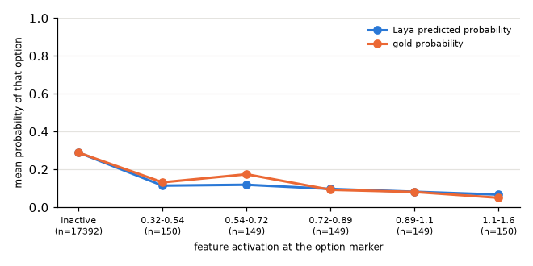

# Feature 8837

Critérios em que aparece: corr_error

**Interpretação (preencher):** 

---

## Maiores ativações

**tr_customer_service_000175 / needs_human** (noul, customer_service) | ativação 4.547 em `estado` | opções ['false', 'true'] | Laya: **true** [0.459, 0.541] | gabarito: **true**

```
[CLS]noul question: This conversation requires a human agent rather than automated handling.[SEP]
▸ [MASK] false: Automation can carry this to resolution.
▸ [MASK] true: A human must take over: judgement, authority or empathy is required.

[SEP]

{"account": {"lifetime_value_usd": 133, "prior_tickets_90d": 1, "seats": 40, "tenure_months": 8, "tier": "enterprise"}, "orders": [{"amount_usd": 149, "date":⟦ "⟧2026-01-04", "id": "A-23809", "status": "settled"}, {"amount_usd": 149, "date": "2026-01-20", "id": "A-52054", "status": "refunded"}], "thread": [{"role": "customer", "text": "I just opened my enterprise delivery and it is the completely wrong item. After the last issue with the missing shipment, I guess I shouldn't be surprised that this is happening again."}, {"role": "agent", "text": "I am very sorry to hear that you received the incorrect item. Could you please provide the order number and describe the item you received instead?"}, {"role": "customer", "text": "The order number is #88291. It was supposed to be the $149 hardware kit, but I got a box of cables instead. I need the correct items by Friday morning at the latest."}, {"role": "agent", "text": "Thank you for those details. I've noted the discrepancy regarding the hardware kit. Could you please send over a photo of the packing slip that was included in the box?"}, {"role": "customer", "text": "I've attached the photo to this message. I really hope we can get this resolved before my event starts."}]}[SEP]
```

**tr_security_incidents_000056 / disposition** (choice, security_incidents) | ativação 3.723 em `estado` | opções ['close_benign', 'contain', 'investigate', 'monitor'] | Laya: **contain** [0.312, 0.322, 0.114, 0.251] | gabarito: **monitor**

```
[CLS]choice question: How should this security alert be dispositioned?[SEP]
▸ [MASK] close_benign: Expected, explainable activity; close without analyst time.
▸ [MASK] contain: Contain the host or account immediately; do not wait for triage.
▸ [MASK] investigate: Warrants an analyst opening an investigation.
▸ [MASK] monitor: Not clearly malicious, but worth watching for recurrence.

[SEP]

{"alert": {"description": "a first-ever sign-in from an unfamiliar country", "evidence": "A sign-in for an unprivileged ci_runner originated from a new country at 22:10 UTC using MFA-protected credentials last rotated 700 days ago. The connection came from an allowlisted IP address while no scheduled change window was open.", "rule": "new_country_login"}, "context":⟦ {"⟧asset_criticality": "medium", "change_window_active": false, "source_on_allowlist": true}, "history": {"credential_rotation_days_ago": 700, "distinct_countries_30d": 1, "logins_30d": 1194, "prior_alerts_90d": 0}, "principal": {"mfa_enrolled": true, "name": "usr-billing-180", "privileges": ["repo:read"], "type": "ci_runner"}}[SEP]
```

**tr_customer_service_000146 / category** (choice, customer_service) | ativação 3.459 em `estado` | opções ['account', 'billing', 'delivery', 'refund', 'technical'] | Laya: **billing** [0.097, 0.544, 0.045, 0.255, 0.059] | gabarito: **billing**

```
[CLS]choice question: What is this customer conversation primarily about?[SEP]
▸ [MASK] account: Login, plan changes, profile or access management.
▸ [MASK] billing: A charge, invoice, subscription or payment problem.
▸ [MASK] delivery: Shipping, fulfilment or delivery of a physical item.
▸ [MASK] refund: The customer is explicitly asking for money back.
▸ [MASK] technical: The product or service is not working as expected.

[SEP]

{"account": {"lifetime_value_usd": 114, "prior_tickets_90d": 0, "seats": 12, "tenure_months": 2, "tier": "premium"}, "thread": [{"role": "customer", "text": "Good afternoon, could you please send me a copy of my most recent invoice? I’m on the Premium plan and have only been a customer for two months, so I need it for my records."}, {"role": "agent", "text": "Certainly, I can help with that. Which invoice are you looking for⟦—⟧the one from May or the one from June 2026?"}, {"role": "customer", "text": "I need the June 2026 invoice, please."}]}[SEP]
```

**tr_customer_service_000004 / action** (choice, customer_service) | ativação 3.406 em `estado` | opções ['answer_directly', 'close_no_action', 'escalate_to_human', 'execute_refund', 'request_information'] | Laya: **close_no_action** [0.099, 0.57, 0.044, 0.231, 0.056] | gabarito: **escalate_to_human**

```
[CLS]choice question: What should the assistant do next with this conversation?[SEP]
▸ [MASK] answer_directly: The assistant can resolve this itself with information it already has.
▸ [MASK] close_no_action: No further action is warranted; the matter is settled.
▸ [MASK] escalate_to_human: Hand off to a human agent with the appropriate authority.
▸ [MASK] execute_refund: Issue the refund or credit the customer is owed.
▸ [MASK] request_information: More detail is needed from the customer before anything can be done.

[SEP]

{"account": {"lifetime_value_usd": 3018, "prior_tickets_90d": 1, "seats": 1, "tenure_months": 60, "tier": "premium"}, "orders": [{"amount_usd": 147, "date":⟦ "⟧2026-02-10", "id": "A-12312", "status": "settled"}, {"amount_usd": 147, "date": "2026-02-24", "id": "A-70365", "status": "refunded"}], "thread": [{"role": "customer", "text": "I'm back again because I still can't get into my account, and honestly, after the last ticket didn't go anywhere, I'm just expecting more of the same login loops."}]}[SEP]
```

**tr_security_incidents_000241 / true_positive** (noul, security_incidents) | ativação 3.312 em `estado` | opções ['false', 'true'] | Laya: **false** [0.524, 0.476] | gabarito: **true**

```
[CLS]noul question: This alert reflects genuinely malicious or unauthorised activity.[SEP]
▸ [MASK] false: Benign activity, a misconfiguration, or a known false positive.
▸ [MASK] true: The underlying behaviour is malicious or unauthorised.

[SEP]

{"alert": {"description": "audit logging was turned off on a host", "evidence": "A service account disabled audit logging on the host, an action performed outside of any defined change window. While the activity originated from an allowlisted source, the account lacks MFA and has not rotated credentials in 180 days.", "rule": "disabled_logging"}, "context":⟦ {"⟧asset_criticality": "medium", "change_window_active": false, "source_on_allowlist": true}, "history": {"credential_rotation_days_ago": 180, "distinct_countries_30d": 3, "logins_30d": 613, "prior_alerts_90d": 0}, "principal": {"mfa_enrolled": false, "name": "adm-infra-357", "privileges": ["repo:read"], "type": "service_account"}}[SEP]
```

## Ativações medianas (faixa 40-60%, mediana 0.745)

**tr_customer_service_000207 / urgency** (score, customer_service) | ativação 0.844 em `estado` | opções ['0', '1', '2', '3'] | Laya: **1** [0.209, 0.383, 0.123, 0.285] | gabarito: **3**

```
[CLS]score question: How time-sensitive is this conversation?[SEP]
▸ [MASK] level 0: No time pressure; can wait indefinitely.
▸ [MASK] level 1: Routine; handle within the normal queue.
▸ [MASK] level 2: Elevated; should be handled within the same week.
▸ [MASK] level 3: Critical; requires action within the same day.

[SEP]

{"account": {"lifetime_value_usd": 17, "prior_tickets_90d": 0, "seats": 1, "tenure_months": 1, "tier": "premium"}, "orders": [{"amount_usd": 149, "date": "2026-01-08", "id": "A-46380⟦",⟧ "status": "settled"}], "thread": [{"role": "customer", "text": "I thought I could switch to the Basic plan, but my account still shows I'm on Premium and I'm being charged $149. I'm not sure what's happening."}, {"role": "agent", "text": "I’m sorry for the mix‑up. Just to double‑check, could you tell me the email address linked to your account and when you tried to make the change?"}, {"role": "customer", "text": "The email is jane.doe@example.com. I clicked the downgrade button in the dashboard yesterday evening, after being on Premium for a month."}, {"role": "agent", "text": "Got it, thank you. I see the downgrade request in the system, but it looks like the change didn’t finish processing. Have you received any confirmation email about the downgrade?"}, {"role": "customer", "text": "No, I didn’t get any email. The dashboard still says Premium, and my next payment of $149 is scheduled for tomorrow."}, {"role": "agent", "text": "Understood. I’ll look into why the request got stuck. Could you let me know if you made the change from a mobile app or the web portal?"}, {"role": "customer", "text": "I used the web portal on Chrome. I’m just hoping this can be sorted before the next charge hits."}]}[SEP]
```

**tr_security_incidents_000030 / severity** (score, security_incidents) | ativação 0.781 em `marcador` | opções ['0', '1', '2', '3', '4'] | Laya: **2** [0.071, 0.377, 0.43, 0.081, 0.042] | gabarito: **1**

```
[CLS]score question: How severe is the potential impact if this alert is real?[SEP]
▸ ⟦[MASK]⟧ level 0: Negligible: no access to anything sensitive.
▸ [MASK] level 1: Low: limited access, easily reversed.
▸ [MASK] level 2: Moderate: access to internal systems or non-public data.
▸ [MASK] level 3: High: access to production, secrets or customer data.
▸ [MASK] level 4: Critical: active compromise of crown-jewel systems.

[SEP]

{"alert": {"description": "a long-unused account became active", "evidence": "A successful logon to employee account JDOE was recorded at 2026-09-15 08:12:34 UTC from source IP 198.51.100.22, marking the first authentication event for this user in the past 180 days. The authentication occurred without multi‑factor verification and originated from a device not listed in the known asset inventory.", "rule": "dormant_account_use"}, "context": {"asset_criticality": "low", "change_window_active": false, "source_on_allowlist": false}, "history": {"credential_rotation_days_ago": 180, "distinct_countries_30d": 2, "logins_30d": 450, "prior_alerts_90d": 1}, "principal": {"mfa_enrolled": false, "name": "ci-infra-957", "privileges": ["repo:read"], "type": "employee"}}[SEP]
```

**tr_invoice_processing_000239 / disposition** (choice, invoice_processing) | ativação 0.813 em `estado` | opções ['approve', 'hold', 'manual_review', 'reject'] | Laya: **approve** [0.426, 0.219, 0.15, 0.204] | gabarito: **approve**

```
[CLS]choice question: How should this vendor invoice be dispositioned?[SEP]
▸ [MASK] approve: Matches the order and delivery; approve for payment.
▸ [MASK] hold: Something needs confirming before payment; hold pending clarification.
▸ [MASK] manual_review: A human in finance must review the discrepancy.
▸ [MASK] reject: Should not be paid: duplicate, unauthorised or materially wrong.

[SEP]

{"delivery": {"condition": "accepted with exceptions", "date": "2026-03-09", "received_qty": 25}, "invoice": {"currency": "USD", "id": "INV-2026-6058", "lines": [{"qty": 25, "sku": "SKU-229", "total_usd": 10799.0, "unit_usd": 431.96}], "total_usd": 10799.0, "vendor": "Kestrel Supply"}, "payment": {"days_until_due": -3, "discount_expires_in_days": null, "early_payment_discount_pct": null, "status": "overdue", "terms": "net 15"}, "purchase_order": {"freight_terms": "freight prepaid by vendor, not separately billable", "id": "PO-3159", "lines": [{"qty": 25, "unit_usd": 431.96}], "total_usd": 10799.0}, "vendor_history": {"disputes_12m": 2, "invoices_12m": 2, "prior_invoice_ids": ["INV⟦-⟧2026-6719", "INV-2026-4543", "INV-2026-1306"]}}[SEP]
```

**tr_customer_service_000087 / action** (choice, customer_service) | ativação 0.806 em `estado` | opções ['answer_directly', 'close_no_action', 'escalate_to_human', 'execute_refund', 'request_information'] | Laya: **close_no_action** [0.2, 0.288, 0.183, 0.174, 0.154] | gabarito: **escalate_to_human**

```
[CLS]choice question: What should the assistant do next with this conversation?[SEP]
▸ [MASK] answer_directly: The assistant can resolve this itself with information it already has.
▸ [MASK] close_no_action: No further action is warranted; the matter is settled.
▸ [MASK] escalate_to_human: Hand off to a human agent with the appropriate authority.
▸ [MASK] execute_refund: Issue the refund or credit the customer is owed.
▸ [MASK] request_information: More detail is needed from the customer before anything can be done.

[SEP]

{"account": {"lifetime_value_usd": 193, "prior_tickets_90d": 5, "seats": 1, "tenure_months": 5, "tier": "standard"}, "orders":⟦ [⟧{"amount_usd": 299, "date": "2026-01-09", "id": "A-83690", "status": "settled"}], "thread": [{"role": "customer", "text": "The new analytics dashboard stopped loading a week ago, and I’ve been sent around to different reps without any fix. I’m tired of hearing the same generic apologies."}, {"role": "agent", "text": "I’m really sorry you’re still seeing that issue. Can you let me know which browser and version you’re using, and whether you’ve tried clearing the cache?"}, {"role": "customer", "text": "I’m on Chrome 117, cleared everything, and it still just shows a spinning wheel. This has been happening since the last update."}, {"role": "agent", "text": "Got it, thanks. I’ll open a deeper look at the logs for your account. Do you recall the exact time you first noticed the dashboard freeze, or any error messages that appeared?"}, {"role": "customer", "text": "It started around 3 PM GMT on the 10th, and the only thing I see is ‘Failed to load data’. I’ve already tried re‑logging, no change."}, {"role": "agent", "text": "Understood. I’m flagging this to our UI team and will keep the ticket open while we investigate. Could you also confirm the account ID you’re using so I can tie the logs correctly?"}, {"role": "customer", "text": "The account ID is ACC‑9987; please let me know when you have any update, because I can’t keep working without those reports."}]}[SEP]
```

**tr_invoice_processing_000251 / discrepancy_severity** (score, invoice_processing) | ativação 0.815 em `estado` | opções ['0', '1', '2', '3'] | Laya: **0** [0.438, 0.207, 0.197, 0.159] | gabarito: **0**

```
[CLS]score question: How material is any discrepancy between the invoice, the order and the delivery?[SEP]
▸ [MASK] level 0: None: everything reconciles.
▸ [MASK] level 1: Trivial: rounding or a cosmetic difference.
▸ [MASK] level 2: Moderate: a real difference worth confirming.
▸ [MASK] level 3: Material: a large or unexplained difference.

[SEP]

{"delivery": {"condition": "accepted", "date": "2026-03-10", "received_qty": 100}, "invoice": {"currency": "USD", "id": "INV-2026-9735", "lines": [⟦{"⟧qty": 100, "sku": "SKU-295", "total_usd": 1399.0, "unit_usd": 13.99}], "total_usd": 1399.0, "vendor": "Northwind Components"}, "payment": {"days_until_due": 44, "discount_expires_in_days": 8, "early_payment_discount_pct": 2.0, "status": "scheduled", "terms": "net 45"}, "purchase_order": {"freight_terms": "freight prepaid by vendor, not separately billable", "id": "PO-7774", "lines": [{"qty": 100, "unit_usd": 13.99}], "total_usd": 1399.0}, "vendor_history": {"disputes_12m": 5, "invoices_12m": 33, "prior_invoice_ids": ["INV-2026-2207", "INV-2026-7969", "INV-2026-9437"]}}[SEP]
```

## Estatísticas (conjunto de descoberta, dev e teste)

**pred / error**

| split | decisões | ativas | ativas e Laya errou | taxa | lift | q (BH) | OR (CMH) | q (CMH) |
|---|---|---|---|---|---|---|---|---|
| discovery | 5100 | 1 | 1 | 1.000 | 1.57 | nan | nan | nan |
| dev | 900 | 1 | 1 | 1.000 | 1.52 | nan | nan | nan |
| test | 2000 | 4 | 3 | 0.750 | 1.18 | nan | nan | nan |

**corr / error**

| split | decisões | ativas | ativas e Laya errou | taxa | lift | q (BH) | OR (CMH) | q (CMH) |
|---|---|---|---|---|---|---|---|---|
| discovery | 5100 | 56 | 56 | 1.000 | 1.57 | 4.79e-11 | inf | 0.824 |
| dev | 900 | 11 | 11 | 1.000 | 1.52 | nan | nan | nan |
| test | 2000 | 31 | 30 | 0.968 | 1.52 | 5.76e-05 | 0.00 | 0.825 |

**state / error**

| split | decisões | ativas | ativas e Laya errou | taxa | lift | q (BH) | OR (CMH) | q (CMH) |
|---|---|---|---|---|---|---|---|---|
| discovery | 5100 | 4854 | 3099 | 0.638 | 1.00 | 0.463 | 0.95 | 0.834 |
| dev | 900 | 866 | 569 | 0.657 | 1.00 | 1 | 0.95 | 0.964 |
| test | 2000 | 1877 | 1199 | 0.639 | 1.00 | 0.945 | 0.99 | 0.989 |

Confusão mais sobre-representada (pred): `severity|0>1` (n=1, lift 2550.00, p=nan). Formato `pergunta|índice previsto>índice correto`.

Confusão mais sobre-representada (corr): `risk|1>0` (n=44, lift 74.21, p=0). Formato `pergunta|índice previsto>índice correto`.

Confusão mais sobre-representada (state): `duplicate|1>0` (n=216, lift 1.05, p=1.82e-05). Formato `pergunta|índice previsto>índice correto`.



