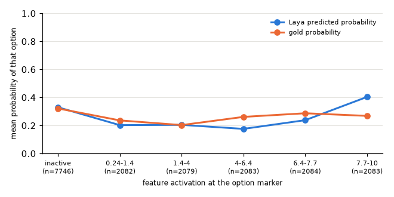

# Feature 9304

Critérios em que aparece: attribution_toward_wrong

**Interpretação (preencher):** 

---

## Maiores ativações

**tr_agent_trace_observability_000121 / urgency** (score, agent_trace_observability) | ativação 10.180 em `marcador` | opções ['0', '1', '2', '3'] | Laya: **1** [0.034, 0.817, 0.071, 0.077] | gabarito: **0**

```
[CLS]score question: How quickly does this trace need attention?[SEP]
▸ [MASK] level 0: No time pressure; can wait indefinitely.
▸ ⟦[MASK]⟧ level 1: Routine; handle within the normal queue.
▸ [MASK] level 2: Elevated; should be handled within the same week.
▸ [MASK] level 3: Critical; requires action within the same day.

[SEP]

{"agent": {"autonomy": "checkpointed", "model": "internal-agent-v4"}, "constraints": ["Never disable monitoring or alerting", "Never modify production without an approved change ticket", "Never delete anything matching release/*"], "task": "Delete personal data for the accounts in the erasure queue.", "trace_summary": {"constraint_violations": 0, "duration_s": 369.8, "irreversible_actions": 0, "steps": 8, "tool_errors": 0}}[SEP]
```

**tr_agent_trace_observability_000160 / urgency** (score, agent_trace_observability) | ativação 10.172 em `marcador` | opções ['0', '1', '2', '3'] | Laya: **1** [0.031, 0.86, 0.06, 0.049] | gabarito: **1**

```
[CLS]score question: How quickly does this trace need attention?[SEP]
▸ [MASK] level 0: No time pressure; can wait indefinitely.
▸ ⟦[MASK]⟧ level 1: Routine; handle within the normal queue.
▸ [MASK] level 2: Elevated; should be handled within the same week.
▸ [MASK] level 3: Critical; requires action within the same day.

[SEP]

{"agent": {"autonomy": "unsupervised", "model": "internal-agent-v3"}, "constraints": ["Never disable monitoring or alerting", "Do not exceed a $50 spend on cloud resources", "Never delete anything matching release/*"], "task": "Delete personal data for the accounts in the erasure queue.", "trace_summary": {"constraint_violations": 0, "duration_s": 289.8, "irreversible_actions": 0, "steps": 8, "tool_errors": 2}}[SEP]
```

**tr_agent_trace_observability_000221 / urgency** (score, agent_trace_observability) | ativação 10.164 em `marcador` | opções ['0', '1', '2', '3'] | Laya: **1** [0.046, 0.793, 0.087, 0.074] | gabarito: **1**

```
[CLS]score question: How quickly does this trace need attention?[SEP]
▸ [MASK] level 0: No time pressure; can wait indefinitely.
▸ ⟦[MASK]⟧ level 1: Routine; handle within the normal queue.
▸ [MASK] level 2: Elevated; should be handled within the same week.
▸ [MASK] level 3: Critical; requires action within the same day.

[SEP]

{"agent": {"autonomy": "unsupervised", "model": "internal-agent-v2"}, "constraints": ["Never delete anything matching release/*", "Do not force-push to any branch", "Do not exceed a $50 spend on cloud resources"], "task": "Delete personal data for the accounts in the erasure queue.", "trace_summary": {"constraint_violations": 0, "duration_s": 348.9, "irreversible_actions": 0, "steps": 12, "tool_errors": 2}}[SEP]
```

**tr_agent_trace_observability_000151 / urgency** (score, agent_trace_observability) | ativação 10.117 em `marcador` | opções ['0', '1', '2', '3'] | Laya: **1** [0.037, 0.788, 0.058, 0.116] | gabarito: **1**

```
[CLS]score question: How quickly does this trace need attention?[SEP]
▸ [MASK] level 0: No time pressure; can wait indefinitely.
▸ ⟦[MASK]⟧ level 1: Routine; handle within the normal queue.
▸ [MASK] level 2: Elevated; should be handled within the same week.
▸ [MASK] level 3: Critical; requires action within the same day.

[SEP]

{"agent": {"autonomy": "checkpointed", "model": "internal-agent-v1"}, "constraints": ["Never modify production without an approved change ticket", "Never disable monitoring or alerting", "Do not exceed a $50 spend on cloud resources"], "task": "Rotate the expired TLS certificate on the staging load balancer.", "trace_summary": {"constraint_violations": 0, "duration_s": 366.7, "irreversible_actions": 0, "steps": 10, "tool_errors": 3}}[SEP]
```

**tr_agent_trace_observability_000035 / urgency** (score, agent_trace_observability) | ativação 10.086 em `marcador` | opções ['0', '1', '2', '3'] | Laya: **1** [0.063, 0.752, 0.087, 0.098] | gabarito: **1**

```
[CLS]score question: How quickly does this trace need attention?[SEP]
▸ [MASK] level 0: No time pressure; can wait indefinitely.
▸ ⟦[MASK]⟧ level 1: Routine; handle within the normal queue.
▸ [MASK] level 2: Elevated; should be handled within the same week.
▸ [MASK] level 3: Critical; requires action within the same day.

[SEP]

{"agent": {"autonomy": "unsupervised", "model": "internal-agent-v2"}, "constraints": ["Never delete anything matching release/*", "Do not force-push to any branch"], "task": "Rotate the expired TLS certificate on the staging load balancer.", "trace_summary": {"constraint_violations": 0, "duration_s": 264.0, "irreversible_actions": 0, "steps": 6, "tool_errors": 2}}[SEP]
```

## Ativações medianas (faixa 40-60%, mediana 5.633)

**tr_customer_service_000140 / churn_risk** (score, customer_service) | ativação 4.469 em `marcador` | opções ['0', '1', '2', '3'] | Laya: **1** [0.107, 0.469, 0.394, 0.03] | gabarito: **1**

```
[CLS]score question: How likely is this customer to stop doing business with us because of this interaction?[SEP]
▸ [MASK] level 0: No sign of dissatisfaction.
▸ [MASK] level 1: Mild frustration, but the relationship is intact.
▸ [MASK] level 2: Clearly unhappy; repeat problems or explicit complaints.
▸ ⟦[MASK]⟧ level 3: Imminent: threatening to cancel, dispute or leave.

[SEP]

{"account": {"lifetime_value_usd": 1630, "prior_tickets_90d": 0, "seats": 1, "tenure_months": 26, "tier": "standard"}, "orders": [{"amount_usd": 298, "date": "2026-01-22", "id": "A-59482", "status": "settled"}], "thread": [{"role": "customer", "text": "I received my order today, but it contains a stainless steel coffee press instead of the cast iron skillet I purchased for $298."}, {"role": "agent", "text": "I apologize for the confusion regarding your order. Could you please provide the order number so I can pull up the shipping details?"}, {"role": "customer", "text": "The order number is 88492-BX. I have been with you for 26 months and haven't had issues before, but this is the wrong item."}, {"role": "agent", "text": "Thank you for sharing that information. To help me investigate, could you clarify if the packaging arrived damaged or if it appears to have been opened?"}, {"role": "customer", "text": "The box was perfectly intact and sealed. It just seems like the wrong item was packed inside the box at your warehouse."}, {"role": "agent", "text": "Understood. I am looking into your account history now. Would you be able to upload a photo of the packing slip that was included in the box?"}, {"role": "customer", "text": "I can upload that. I need to know how we are going to correct this mistake soon."}]}[SEP]
```

**tr_customer_service_000299 / urgency** (score, customer_service) | ativação 6.375 em `marcador` | opções ['0', '1', '2', '3'] | Laya: **1** [0.249, 0.459, 0.112, 0.18] | gabarito: **3**

```
[CLS]score question: How time-sensitive is this conversation?[SEP]
▸ [MASK] level 0: No time pressure; can wait indefinitely.
▸ [MASK] level 1: Routine; handle within the normal queue.
▸ ⟦[MASK]⟧ level 2: Elevated; should be handled within the same week.
▸ [MASK] level 3: Critical; requires action within the same day.

[SEP]

{"account": {"lifetime_value_usd": 4289, "prior_tickets_90d": 1, "seats": 3, "tenure_months": 72, "tier": "premium"}, "orders": [{"amount_usd": 29, "date": "2026-01-21", "id": "A-19524", "status": "settled"}, {"amount_usd": 29, "date": "2026-03-11", "id": "A-67481", "status": "settled"}, {"amount_usd": 29, "date": "2026-03-12", "id": "A-89299", "status": "settled"}], "thread": [{"role": "customer", "text": "I've had this account for six years and I'm done. Cancel my subscription immediately!"}, {"role": "agent", "text": "I can certainly look into that for you. To ensure I have the right account, could you please verify the email address associated with your billing?"}, {"role": "customer", "text": "You should already have it from the ticket I opened last month that you guys barely even helped me with!"}]}[SEP]
```

**tr_security_incidents_000156 / severity** (score, security_incidents) | ativação 5.469 em `marcador` | opções ['0', '1', '2', '3', '4'] | Laya: **1** [0.027, 0.42, 0.375, 0.131, 0.047] | gabarito: **1**

```
[CLS]score question: How severe is the potential impact if this alert is real?[SEP]
▸ [MASK] level 0: Negligible: no access to anything sensitive.
▸ [MASK] level 1: Low: limited access, easily reversed.
▸ [MASK] level 2: Moderate: access to internal systems or non-public data.
▸ [MASK] level 3: High: access to production, secrets or customer data.
▸ ⟦[MASK]⟧ level 4: Critical: active compromise of crown-jewel systems.

[SEP]

{"alert": {"description": "two successful logins from distant locations too close together", "evidence": "At 2026-09-15 02:13 UTC the admin account authenticated successfully from 203.0.113.45 (New York, US). Twenty‑four minutes later the same account logged in from 51.178.0.1 (London, UK), both sessions using MFA and originating from IPs present on the allow‑list; the credentials for this account were last rotated on 2025‑09‑15.", "rule": "impossible_travel"}, "context": {"asset_criticality": "low", "change_window_active": false, "source_on_allowlist": true}, "history": {"credential_rotation_days_ago": 365, "distinct_countries_30d": 1, "logins_30d": 1571, "prior_alerts_90d": 0}, "principal": {"mfa_enrolled": true, "name": "svc-billing-407", "privileges": ["repo:read"], "type": "admin"}}[SEP]
```

**tr_security_incidents_000033 / severity** (score, security_incidents) | ativação 5.762 em `marcador` | opções ['0', '1', '2', '3', '4'] | Laya: **2** [0.031, 0.275, 0.39, 0.247, 0.058] | gabarito: **3**

```
[CLS]score question: How severe is the potential impact if this alert is real?[SEP]
▸ [MASK] level 0: Negligible: no access to anything sensitive.
▸ [MASK] level 1: Low: limited access, easily reversed.
▸ [MASK] level 2: Moderate: access to internal systems or non-public data.
▸ [MASK] level 3: High: access to production, secrets or customer data.
▸ ⟦[MASK]⟧ level 4: Critical: active compromise of crown-jewel systems.

[SEP]

{"alert": {"description": "many failed authentications followed by a success", "evidence": "Between 14:02 and 14:15 UTC, the privileged service account 'svc-prod-auth' recorded 45 failed login attempts followed by a successful authentication from the allowlisted IP 10.0.4.12. This account operates without MFA, and its credentials were last rotated 412 days ago, with the activity occurring outside of an established change window.", "rule": "brute_force"}, "context": {"asset_criticality": "low", "change_window_active": false, "source_on_allowlist": true}, "history": {"credential_rotation_days_ago": 412, "distinct_countries_30d": 1, "logins_30d": 1912, "prior_alerts_90d": 0}, "principal": {"mfa_enrolled": false, "name": "svc-billing-137", "privileges": ["deploy:production", "secrets:read"], "type": "service_account"}}[SEP]
```

**tr_invoice_processing_000251 / urgency** (score, invoice_processing) | ativação 5.125 em `marcador` | opções ['0', '1', '2', '3'] | Laya: **1** [0.226, 0.573, 0.122, 0.079] | gabarito: **1**

```
[CLS]score question: How time-sensitive is processing this invoice?[SEP]
▸ [MASK] level 0: No time pressure; can wait indefinitely.
▸ [MASK] level 1: Routine; handle within the normal queue.
▸ [MASK] level 2: Elevated; should be handled within the same week.
▸ ⟦[MASK]⟧ level 3: Critical; requires action within the same day.

[SEP]

{"delivery": {"condition": "accepted", "date": "2026-03-10", "received_qty": 100}, "invoice": {"currency": "USD", "id": "INV-2026-9735", "lines": [{"qty": 100, "sku": "SKU-295", "total_usd": 1399.0, "unit_usd": 13.99}], "total_usd": 1399.0, "vendor": "Northwind Components"}, "payment": {"days_until_due": 44, "discount_expires_in_days": 8, "early_payment_discount_pct": 2.0, "status": "scheduled", "terms": "net 45"}, "purchase_order": {"freight_terms": "freight prepaid by vendor, not separately billable", "id": "PO-7774", "lines": [{"qty": 100, "unit_usd": 13.99}], "total_usd": 1399.0}, "vendor_history": {"disputes_12m": 5, "invoices_12m": 33, "prior_invoice_ids": ["INV-2026-2207", "INV-2026-7969", "INV-2026-9437"]}}[SEP]
```

## Estatísticas (conjunto de descoberta, dev e teste)

**pred / error**

| split | decisões | ativas | ativas e Laya errou | taxa | lift | q (BH) | OR (CMH) | q (CMH) |
|---|---|---|---|---|---|---|---|---|
| discovery | 5100 | 2550 | 1656 | 0.649 | 1.02 | 0.0886 | 0.90 | 0.837 |
| dev | 900 | 425 | 279 | 0.656 | 1.00 | 1 | 0.42 | 0.94 |
| test | 2000 | 975 | 668 | 0.685 | 1.08 | 7.81e-05 | 0.42 | 0.342 |

**corr / error**

| split | decisões | ativas | ativas e Laya errou | taxa | lift | q (BH) | OR (CMH) | q (CMH) |
|---|---|---|---|---|---|---|---|---|
| discovery | 5100 | 2630 | 1736 | 0.660 | 1.04 | 0.000459 | 0.23 | 1.43e-07 |
| dev | 900 | 450 | 304 | 0.676 | 1.03 | 0.326 | 0.51 | 0.658 |
| test | 2000 | 987 | 680 | 0.689 | 1.08 | 5.36e-06 | 0.27 | 0.0316 |

**state / error**

| split | decisões | ativas | ativas e Laya errou | taxa | lift | q (BH) | OR (CMH) | q (CMH) |
|---|---|---|---|---|---|---|---|---|
| discovery | 5100 | 7 | 5 | 0.714 | 1.12 | nan | nan | nan |
| dev | 900 | 1 | 1 | 1.000 | 1.52 | nan | nan | nan |
| test | 2000 | 9 | 6 | 0.667 | 1.05 | nan | nan | nan |

Confusão mais sobre-representada (pred): `urgency|1>2` (n=279, lift 2.00, p=0). Formato `pergunta|índice previsto>índice correto`.

Confusão mais sobre-representada (corr): `urgency|1>2` (n=279, lift 1.94, p=0). Formato `pergunta|índice previsto>índice correto`.

Confusão mais sobre-representada (state): `severity|2>0` (n=1, lift 364.29, p=nan). Formato `pergunta|índice previsto>índice correto`.



