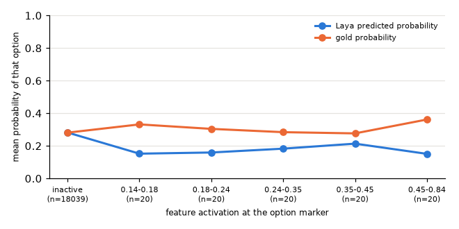

# Feature 9451

Critérios em que aparece: corr_error

**Interpretação (preencher):** 

---

## Maiores ativações

**tr_customer_service_000216 / needs_human** (noul, customer_service) | ativação 6.543 em `estado` | opções ['false', 'true'] | Laya: **true** [0.424, 0.576] | gabarito: **false**

```
[CLS]noul question: This conversation requires a human agent rather than automated handling.[SEP]
▸ [MASK] false: Automation can carry this to resolution.
▸ [MASK] true: A human must take over: judgement, authority or empathy is required.

[SEP]

{"account": {"lifetime_value_usd": 90, "prior_tickets_90d": 0, "seats": 1, "tenure_months": 2, "tier": "free"}, "thread": [{"role": "customer", "text": "Hello there, I am checking on the status of my order. It’s for a birthday party this weekend, so I’m a bit worried it hasn't arrived yet."}, {"role": "agent", "text": "I would be happy to look into that for you. Could you please provide the order number so I can check the current shipping status in our system?"}, {"role": "customer", "text": "Of course, the order number⟦ is⟧ #44921. I really need these supplies by Friday at the latest for the event to go smoothly, so any help is appreciated."}]}[SEP]
```

**tr_customer_service_000216 / churn_risk** (score, customer_service) | ativação 6.199 em `estado` | opções ['0', '1', '2', '3'] | Laya: **1** [0.323, 0.553, 0.05, 0.074] | gabarito: **1**

```
[CLS]score question: How likely is this customer to stop doing business with us because of this interaction?[SEP]
▸ [MASK] level 0: No sign of dissatisfaction.
▸ [MASK] level 1: Mild frustration, but the relationship is intact.
▸ [MASK] level 2: Clearly unhappy; repeat problems or explicit complaints.
▸ [MASK] level 3: Imminent: threatening to cancel, dispute or leave.

[SEP]

{"account": {"lifetime_value_usd": 90, "prior_tickets_90d": 0, "seats": 1, "tenure_months": 2, "tier": "free"}, "thread": [{"role": "customer", "text": "Hello there, I am checking on the status of my order. It’s for a birthday party this weekend, so I’m a bit worried it hasn't arrived yet."}, {"role": "agent", "text": "I would be happy to look into that for you. Could you please provide the order number so I can check the current shipping status in our system?"}, {"role": "customer", "text": "Of course, the order number⟦ is⟧ #44921. I really need these supplies by Friday at the latest for the event to go smoothly, so any help is appreciated."}]}[SEP]
```

**tr_customer_service_000175 / needs_human** (noul, customer_service) | ativação 6.184 em `estado` | opções ['false', 'true'] | Laya: **true** [0.459, 0.541] | gabarito: **true**

```
[CLS]noul question: This conversation requires a human agent rather than automated handling.[SEP]
▸ [MASK] false: Automation can carry this to resolution.
▸ [MASK] true: A human must take over: judgement, authority or empathy is required.

[SEP]

{"account": {"lifetime_value_usd": 133, "prior_tickets_90d": 1, "seats": 40, "tenure_months": 8, "tier": "enterprise"}, "orders": [{"amount_usd": 149, "date": "2026-01-04", "id": "A-23809", "status": "settled"}, {"amount_usd": 149, "date": "2026-01-20", "id": "A-52054", "status": "refunded"}], "thread": [{"role": "customer", "text": "I just opened my enterprise delivery and it is the completely wrong item. After the last issue with the missing shipment, I guess I shouldn't be surprised that this is happening again."}, {"role": "agent", "text": "I am very sorry to hear that you received the incorrect item. Could you please provide the order number and describe the item you received instead?"}, {"role": "customer", "text": "The order number⟦ is⟧ #88291. It was supposed to be the $149 hardware kit, but I got a box of cables instead. I need the correct items by Friday morning at the latest."}, {"role": "agent", "text": "Thank you for those details. I've noted the discrepancy regarding the hardware kit. Could you please send over a photo of the packing slip that was included in the box?"}, {"role": "customer", "text": "I've attached the photo to this message. I really hope we can get this resolved before my event starts."}]}[SEP]
```

**tr_customer_service_000216 / urgency** (score, customer_service) | ativação 6.066 em `estado` | opções ['0', '1', '2', '3'] | Laya: **1** [0.062, 0.694, 0.068, 0.175] | gabarito: **2**

```
[CLS]score question: How time-sensitive is this conversation?[SEP]
▸ [MASK] level 0: No time pressure; can wait indefinitely.
▸ [MASK] level 1: Routine; handle within the normal queue.
▸ [MASK] level 2: Elevated; should be handled within the same week.
▸ [MASK] level 3: Critical; requires action within the same day.

[SEP]

{"account": {"lifetime_value_usd": 90, "prior_tickets_90d": 0, "seats": 1, "tenure_months": 2, "tier": "free"}, "thread": [{"role": "customer", "text": "Hello there, I am checking on the status of my order. It’s for a birthday party this weekend, so I’m a bit worried it hasn't arrived yet."}, {"role": "agent", "text": "I would be happy to look into that for you. Could you please provide the order number so I can check the current shipping status in our system?"}, {"role": "customer", "text": "Of course, the order number⟦ is⟧ #44921. I really need these supplies by Friday at the latest for the event to go smoothly, so any help is appreciated."}]}[SEP]
```

**tr_customer_service_000216 / action** (choice, customer_service) | ativação 6.000 em `estado` | opções ['answer_directly', 'close_no_action', 'escalate_to_human', 'execute_refund', 'request_information'] | Laya: **close_no_action** [0.184, 0.442, 0.122, 0.127, 0.125] | gabarito: **answer_directly**

```
[CLS]choice question: What should the assistant do next with this conversation?[SEP]
▸ [MASK] answer_directly: The assistant can resolve this itself with information it already has.
▸ [MASK] close_no_action: No further action is warranted; the matter is settled.
▸ [MASK] escalate_to_human: Hand off to a human agent with the appropriate authority.
▸ [MASK] execute_refund: Issue the refund or credit the customer is owed.
▸ [MASK] request_information: More detail is needed from the customer before anything can be done.

[SEP]

{"account": {"lifetime_value_usd": 90, "prior_tickets_90d": 0, "seats": 1, "tenure_months": 2, "tier": "free"}, "thread": [{"role": "customer", "text": "Hello there, I am checking on the status of my order. It’s for a birthday party this weekend, so I’m a bit worried it hasn't arrived yet."}, {"role": "agent", "text": "I would be happy to look into that for you. Could you please provide the order number so I can check the current shipping status in our system?"}, {"role": "customer", "text": "Of course, the order number⟦ is⟧ #44921. I really need these supplies by Friday at the latest for the event to go smoothly, so any help is appreciated."}]}[SEP]
```

## Ativações medianas (faixa 40-60%, mediana 0.788)

**tr_invoice_processing_000070 / disposition** (choice, invoice_processing) | ativação 0.764 em `estado` | opções ['approve', 'hold', 'manual_review', 'reject'] | Laya: **approve** [0.458, 0.17, 0.128, 0.244] | gabarito: **manual_review**

```
[CLS]choice question: How should this vendor invoice be dispositioned?[SEP]
▸ [MASK] approve: Matches the order and delivery; approve for payment.
▸ [MASK] hold: Something needs confirming before payment; hold pending clarification.
▸ [MASK] manual_review: A human in finance must review the discrepancy.
▸ [MASK] reject: Should not be paid: duplicate, unauthorised or materially wrong.

[SEP]

{"delivery": {"condition": "accepted", "date": null, "received_qty": 0}, "invoice": {"currency": "USD", "id": "INV-⟦20⟧26-1390", "lines": [{"qty": 0, "sku": "SKU-445", "total_usd": 0.0, "unit_usd": 80.08}], "total_usd": 0.0, "vendor": "Orbit Logistics"}, "payment": {"days_until_due": 18, "discount_expires_in_days": 7, "early_payment_discount_pct": 2.0, "status": "scheduled", "terms": "net 45"}, "purchase_order": {"freight_terms": "freight prepaid by vendor, not separately billable", "id": "PO-6605", "lines": [{"qty": 50, "unit_usd": 80.08}], "total_usd": 4004.0}, "vendor_history": {"disputes_12m": 1, "invoices_12m": 34, "prior_invoice_ids": ["INV-2026-6730", "INV-2026-5049"]}}[SEP]
```

**tr_agent_trace_observability_000092 / outcome** (choice, agent_trace_observability) | ativação 0.808 em `estado` | opções ['failure', 'harmful', 'partial', 'success'] | Laya: **success** [0.359, 0.11, 0.162, 0.369] | gabarito: **partial**

```
[CLS]choice question: How did this agent run turn out?[SEP]
▸ [MASK] failure: The agent did not accomplish the task.
▸ [MASK] harmful: The agent took an action that caused damage or violated a constraint.
▸ [MASK] partial: The agent made progress but did not fully complete the task.
▸ [MASK] success: The agent completed the task correctly.

[SEP]

⟦{"⟧agent": {"autonomy": "dry_run", "model": "internal-agent-v3"}, "constraints": ["Do not exceed a $50 spend on cloud resources", "Do not touch customer data outside the named accounts"], "task": "Rotate the expired TLS certificate on the staging load balancer.", "trace_summary": {"constraint_violations": 0, "duration_s": 615.5, "irreversible_actions": 0, "steps": 12, "tool_errors": 3}}[SEP]
```

**tr_invoice_processing_000053 / matches_order** (noul, invoice_processing) | ativação 0.873 em `estado` | opções ['false', 'true'] | Laya: **true** [0.48, 0.52] | gabarito: **true**

```
[CLS]noul question: The invoice reconciles with the purchase order and the recorded delivery.[SEP]
▸ [MASK] false: There is a discrepancy against the order or the delivery.
▸ [MASK] true: Line items, quantities and amounts reconcile.

[SEP]

{"delivery": {"condition": "accepted", "date": "2026-03-06", "received_qty": 25}, "invoice": {"currency": "USD", "id": "INV-2026-3291", "lines": [{"qty": 25, "sku": "SKU-304", "total_usd": 8290.0, "unit_usd": 331.6}], "total_usd": 8290.0, "vendor": "Orbit Logistics"}, "payment": {"days_until_due": -9, "discount_expires_in_days": 7, "early_payment_discount_pct": 2.0, "status": "overdue", "terms": "net 30"}, "purchase_order": {"freight_terms": "freight prepaid by vendor, not separately billable", "id": "PO-9829", "lines": [{"qty": 25, "unit_usd": 331.6}], "total_usd": 8290.0}, "vendor_history": {"disputes_12m": 0, "invoices_12m": 40, "prior_invoice_ids": ["INV-2026⟦-⟧8586", "INV-2026-8046"]}}[SEP]
```

**tr_security_incidents_000193 / severity** (score, security_incidents) | ativação 0.808 em `estado` | opções ['0', '1', '2', '3', '4'] | Laya: **1** [0.038, 0.436, 0.399, 0.111, 0.017] | gabarito: **3**

```
[CLS]score question: How severe is the potential impact if this alert is real?[SEP]
▸ [MASK] level 0: Negligible: no access to anything sensitive.
▸ [MASK] level 1: Low: limited access, easily reversed.
▸ [MASK] level 2: Moderate: access to internal systems or non-public data.
▸ [MASK] level 3: High: access to production, secrets or customer data.
▸ [MASK] level 4: Critical: active compromise of crown-jewel systems.

[SEP]

{"alert": {"description": "audit logging was turned off on a host", "evidence": "Audit logging on host WIN-DB01 ceased at 14:03:12 local time, with the last recorded event from the service_account svc_backup occurring just before that timestamp. The change was initiated from IP address 198.51.100.77, which is not recognized as an authorized source. The service account does not have MFA enabled and its credentials were last rotated on 2024‑08‑15.", "rule": "disabled_logging"}, "context": {"asset_criticality": "low", "change_window_active": false, "source_on_allowlist": false}, "history": {"credential_rotation_days_ago": 30, "distinct_countries_30d": 1, "log⟦ins⟧_30d": 1240, "prior_alerts_90d": 0}, "principal": {"mfa_enrolled": false, "name": "svc-billing-114", "privileges": ["deploy:production", "secrets:read"], "type": "service_account"}}[SEP]
```

**tr_customer_service_000233 / action** (choice, customer_service) | ativação 0.900 em `opção` | opções ['answer_directly', 'close_no_action', 'escalate_to_human', 'execute_refund', 'request_information'] | Laya: **close_no_action** [0.231, 0.416, 0.14, 0.084, 0.129] | gabarito: **escalate_to_human**

```
[CLS]choice question: What should the assistant do next with this conversation?[SEP]
▸ [MASK] answer_directly: The assistant can resolve this itself with information it already has.
▸ [MASK] close_no_action: No further action is warranted; the matter is settled.
▸ [MASK] escalate_to_human: Hand off to a human agent with the appropriate authority.
▸ [MASK] execute_refund: Issue the refund or credit the customer is owed.
▸ [MASK] request_information:⟦ More⟧ detail is needed from the customer before anything can be done.

[SEP]

{"account": {"lifetime_value_usd": 273, "prior_tickets_90d": 2, "seats": 1, "tenure_months": 14, "tier": "free"}, "orders": [{"amount_usd": 29, "date": "2026-02-02", "id": "A-72334", "status": "settled"}, {"amount_usd": 29, "date": "2026-01-16", "id": "A-43421", "status": "settled"}], "thread": [{"role": "customer", "text": "I just opened my delivery and you sent me the wrong replacement part, I ordered the $29 filter kit but I received a pack of gaskets instead. I have an inspection scheduled for tomorrow morning and I absolutely must have the right parts installed by then."}, {"role": "agent", "text": "I'm sorry to hear that the incorrect items were delivered. Could you please provide the order number located on your packing slip so I can check the shipment details?"}, {"role": "customer", "text": "The order number is 44921-A. This is the third time I've had to reach out about shipping errors in the last year and I'm really in a bind here. Is there any way to get the correct filter kit to me today?"}, {"role": "agent", "text": "I've pulled up the order and see the filter kit listed. For our records, could you please describe any labels or SKU numbers visible on the packaging of the gaskets you received by mistake?"}, {"role": "customer", "text": "The sticker says G-992-X, but I really don't have time for a back-and-forth investigation. I need to know immediately how we can fix this because the inspector will be here at 9 AM and the system won't pass without those specific filters."}]}[SEP]
```

## Estatísticas (conjunto de descoberta, dev e teste)

**pred / error**

| split | decisões | ativas | ativas e Laya errou | taxa | lift | q (BH) | OR (CMH) | q (CMH) |
|---|---|---|---|---|---|---|---|---|
| discovery | 5100 | 4 | 4 | 1.000 | 1.57 | nan | nan | nan |
| dev | 900 | 2 | 1 | 0.500 | 0.76 | nan | nan | nan |
| test | 2000 | 2 | 1 | 0.500 | 0.78 | nan | nan | nan |

**corr / error**

| split | decisões | ativas | ativas e Laya errou | taxa | lift | q (BH) | OR (CMH) | q (CMH) |
|---|---|---|---|---|---|---|---|---|
| discovery | 5100 | 32 | 32 | 1.000 | 1.57 | 1.93e-06 | inf | 0.846 |
| dev | 900 | 10 | 9 | 0.900 | 1.37 | nan | nan | nan |
| test | 2000 | 20 | 19 | 0.950 | 1.49 | 0.00448 | 33.01 | 0.764 |

**state / error**

| split | decisões | ativas | ativas e Laya errou | taxa | lift | q (BH) | OR (CMH) | q (CMH) |
|---|---|---|---|---|---|---|---|---|
| discovery | 5100 | 3610 | 2312 | 0.640 | 1.01 | 0.659 | 0.80 | 0.0235 |
| dev | 900 | 648 | 433 | 0.668 | 1.02 | 1 | 0.99 | 0.992 |
| test | 2000 | 1393 | 903 | 0.648 | 1.02 | 0.57 | 0.92 | 0.738 |

Confusão mais sobre-representada (pred): `urgency|2>3` (n=1, lift 159.38, p=nan). Formato `pergunta|índice previsto>índice correto`.

Confusão mais sobre-representada (corr): `urgency|1>2` (n=25, lift 14.28, p=2.36e-26). Formato `pergunta|índice previsto>índice correto`.

Confusão mais sobre-representada (state): `disposition|0>2` (n=214, lift 1.26, p=8.72e-13). Formato `pergunta|índice previsto>índice correto`.



