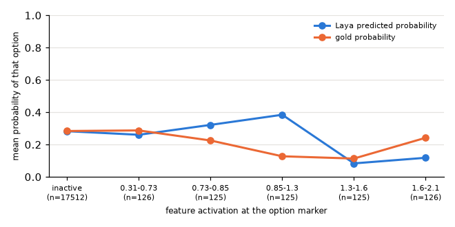

# Feature 9592

Critérios em que aparece: pred_error, corr_error_stratified

**Interpretação (preencher):** 

---

## Maiores ativações

**tr_security_incidents_000273 / true_positive** (noul, security_incidents) | ativação 4.297 em `opção` | opções ['false', 'true'] | Laya: **true** [0.271, 0.729] | gabarito: **true**

```
[CLS]noul question: This alert reflects genuinely malicious or unauthorised activity.[SEP]
▸ [MASK] false: Benign activity, a misconfiguration, or a known false positive.
▸ [MASK] true: The underlying behaviour⟦ is⟧ malicious or unauthorised.

[SEP]

{"alert": {"description": "an endpoint agent matched a known signature", "evidence": "Endpoint sensor on workstation WKS-07 detected a file named 'svchost64.dll' in C:\\Users\\temp that matched the known malware signature 'Trojan:Win32/Emotet.A' at 2026-09-15 08:17:02 UTC. The detection was generated by an unregistered source. The associated admin account, which has MFA enabled and was last rotated 14 days prior, was not in a scheduled change window.", "rule": "malware_signature"}, "context": {"asset_criticality": "medium", "change_window_active": false, "source_on_allowlist": false}, "history": {"credential_rotation_days_ago": 14, "distinct_countries_30d": 2, "logins_30d": 1414, "prior_alerts_90d": 0}, "principal": {"mfa_enrolled": true, "name": "adm-infra-828", "privileges": ["deploy:production", "secrets:read"], "type": "admin"}}[SEP]
```

**tr_security_incidents_000259 / true_positive** (noul, security_incidents) | ativação 3.973 em `opção` | opções ['false', 'true'] | Laya: **true** [0.33, 0.67] | gabarito: **false**

```
[CLS]noul question: This alert reflects genuinely malicious or unauthorised activity.[SEP]
▸ [MASK] false: Benign activity, a misconfiguration, or a known false positive.
▸ [MASK] true: The underlying behaviour⟦ is⟧ malicious or unauthorised.

[SEP]

{"alert": {"description": "an endpoint agent matched a known signature", "evidence": "Endpoint sensor on workstation WIN-3A7B9 detected file C:\\Users\\jdoe\\AppData\\Local\\Temp\\malicious.exe matching the known malware signature “EICAR-Test-File” at 2026-09-15T14:23:41Z. The execution was performed by employee user jdoe, who has no MFA enabled and whose password has not been changed for 365 days; the source IP 192.0.2.55 is on the allowlist.", "rule": "malware_signature"}, "context": {"asset_criticality": "medium", "change_window_active": false, "source_on_allowlist": true}, "history": {"credential_rotation_days_ago": 365, "distinct_countries_30d": 3, "logins_30d": 1458, "prior_alerts_90d": 0}, "principal": {"mfa_enrolled": false, "name": "ci-analytics-822", "privileges": ["repo:read"], "type": "employee"}}[SEP]
```

**tr_security_incidents_000196 / true_positive** (noul, security_incidents) | ativação 3.887 em `opção` | opções ['false', 'true'] | Laya: **true** [0.266, 0.734] | gabarito: **true**

```
[CLS]noul question: This alert reflects genuinely malicious or unauthorised activity.[SEP]
▸ [MASK] false: Benign activity, a misconfiguration, or a known false positive.
▸ [MASK] true: The underlying behaviour⟦ is⟧ malicious or unauthorised.

[SEP]

{"alert": {"description": "an unrecognised binary executed on a server", "evidence": "During an open change window, an unrecognized binary named 'svc_temp_6.exe' was executed on server WEB-PROD-01 by an unprivileged administrator account. The execution was initiated from an allowlisted source address using credentials that were last rotated 180 days ago.", "rule": "suspicious_process"}, "context": {"asset_criticality": "medium", "change_window_active": true, "source_on_allowlist": true}, "history": {"credential_rotation_days_ago": 180, "distinct_countries_30d": 4, "logins_30d": 5, "prior_alerts_90d": 25}, "principal": {"mfa_enrolled": true, "name": "adm-deploy-891", "privileges": ["repo:read"], "type": "admin"}}[SEP]
```

**tr_security_incidents_000216 / true_positive** (noul, security_incidents) | ativação 3.885 em `opção` | opções ['false', 'true'] | Laya: **true** [0.363, 0.637] | gabarito: **true**

```
[CLS]noul question: This alert reflects genuinely malicious or unauthorised activity.[SEP]
▸ [MASK] false: Benign activity, a misconfiguration, or a known false positive.
▸ [MASK] true: The underlying behaviour⟦ is⟧ malicious or unauthorised.

[SEP]

{"alert": {"description": "an unrecognised binary executed on a server", "evidence": "The privileged service account `svc_deployer` executed an unrecognized binary, `xc_update_v2`, on the production host at 04:15 UTC. This execution occurred outside of a scheduled change window using credentials that were last rotated 365 days ago.", "rule": "suspicious_process"}, "context": {"asset_criticality": "medium", "change_window_active": false, "source_on_allowlist": true}, "history": {"credential_rotation_days_ago": 365, "distinct_countries_30d": 2, "logins_30d": 178, "prior_alerts_90d": 1}, "principal": {"mfa_enrolled": false, "name": "svc-support-120", "privileges": ["deploy:production", "secrets:read"], "type": "service_account"}}[SEP]
```

**tr_security_incidents_000247 / true_positive** (noul, security_incidents) | ativação 3.852 em `opção` | opções ['false', 'true'] | Laya: **true** [0.314, 0.686] | gabarito: **true**

```
[CLS]noul question: This alert reflects genuinely malicious or unauthorised activity.[SEP]
▸ [MASK] false: Benign activity, a misconfiguration, or a known false positive.
▸ [MASK] true: The underlying behaviour⟦ is⟧ malicious or unauthorised.

[SEP]

{"alert": {"description": "an endpoint agent matched a known signature", "evidence": "An endpoint agent detected the file 'win_payload.exe' matching a known malware signature on a host associated with a shared mailbox. This activity occurred outside of any approved change window, and the credentials for this account have not been updated in 365 days.", "rule": "malware_signature"}, "context": {"asset_criticality": "medium", "change_window_active": false, "source_on_allowlist": false}, "history": {"credential_rotation_days_ago": 365, "distinct_countries_30d": 4, "logins_30d": 1034, "prior_alerts_90d": 8}, "principal": {"mfa_enrolled": true, "name": "svc-analytics-742", "privileges": ["repo:read"], "type": "shared_mailbox"}}[SEP]
```

## Ativações medianas (faixa 40-60%, mediana 0.772)

**tr_security_incidents_000029 / severity** (score, security_incidents) | ativação 0.762 em `estado` | opções ['0', '1', '2', '3', '4'] | Laya: **2** [0.024, 0.224, 0.464, 0.217, 0.071] | gabarito: **3**

```
[CLS]score question: How severe is the potential impact if this alert is real?[SEP]
▸ [MASK] level 0: Negligible: no access to anything sensitive.
▸ [MASK] level 1: Low: limited access, easily reversed.
▸ [MASK] level 2: Moderate: access to internal systems or non-public data.
▸ [MASK] level 3: High: access to production, secrets or customer data.
▸ [MASK] level 4: Critical: active compromise of crown-jewel systems.

[SEP]

{"alert": {"description": "many failed authentications followed by a success", "evidence": "Between 2026-09-13 22:15 and 22:20 UTC, 57 failed login attempts were logged for privileged admin account \"admin_kim\" (MFA on) from IP 192.0.2.77, followed by a successful authentication at 22:21 UTC. The activity took place within an open change window, the source is unrecognized, and the credentials for the account were last rotated 365 days ago.", "rule": "brute_force"}, "context": {"asset_criticality": "medium", "change_window_active": true, "source_on_allowlist": false}, "history": {"credential_rotation_days_ago": 365, "distinct_countries_30d": 2, "logins⟦_⟧30d": 1826, "prior_alerts_90d": 0}, "principal": {"mfa_enrolled": true, "name": "svc-analytics-152", "privileges": ["deploy:production", "secrets:read"], "type": "admin"}}[SEP]
```

**tr_customer_service_000298 / needs_human** (noul, customer_service) | ativação 0.725 em `opção` | opções ['false', 'true'] | Laya: **false** [0.516, 0.484] | gabarito: **false**

```
[CLS]noul question: This conversation requires a human agent rather than automated handling.[SEP]
▸ [MASK] false: Automation can carry this to resolution.
▸ [MASK] true: A human must take over: judgement, authority⟦ or⟧ empathy is required.

[SEP]

{"account": {"lifetime_value_usd": 58, "prior_tickets_90d": 0, "seats": 1, "tenure_months": 1, "tier": "enterprise"}, "thread": [{"role": "customer", "text": "The item arrived but it looks broken? I don't understand why it's shaped like this."}, {"role": "agent", "text": "I apologize for the confusion. Could you describe which specific part of the item appears to be damaged?"}, {"role": "customer", "text": "It's the main plastic casing, it's just kind of smashed in."}]}[SEP]
```

**tr_security_incidents_000298 / disposition** (choice, security_incidents) | ativação 0.780 em `estado` | opções ['close_benign', 'contain', 'investigate', 'monitor'] | Laya: **close_benign** [0.415, 0.202, 0.134, 0.249] | gabarito: **investigate**

```
[CLS]choice question: How should this security alert be dispositioned?[SEP]
▸ [MASK] close_benign: Expected, explainable activity; close without analyst time.
▸ [MASK] contain: Contain the host or account immediately; do not wait for triage.
▸ [MASK] investigate: Warrants an analyst opening an investigation.
▸ [MASK] monitor: Not clearly malicious, but worth watching for recurrence.

[SEP]

{"alert": {"description": "two successful logins from distant locations too close together", "evidence":⟦ "⟧Two successful logins for a privileged administrator account were observed from geographically distant locations within a timeframe that exceeds physical travel capabilities. The second access request originated from an unrecognized source 90 days after the credentials were last rotated.", "rule": "impossible_travel"}, "context": {"asset_criticality": "high", "change_window_active": false, "source_on_allowlist": false}, "history": {"credential_rotation_days_ago": 90, "distinct_countries_30d": 4, "logins_30d": 1464, "prior_alerts_90d": 0}, "principal": {"mfa_enrolled": true, "name": "adm-support-624", "privileges": ["deploy:production", "secrets:read"], "type": "admin"}}[SEP]
```

**tr_security_incidents_000240 / credential_compromise** (noul, security_incidents) | ativação 0.685 em `opção` | opções ['false', 'true'] | Laya: **true** [0.268, 0.732] | gabarito: **true**

```
[CLS]noul question: The evidence indicates a credential or account has been compromised.[SEP]
▸ [MASK] false: no, the statement does not hold
▸ [MASK] true:⟦ yes⟧, the statement holds

[SEP]

{"alert": {"description": "a security group was opened to the public internet", "evidence": "The shared mailbox account modified a security group to allow inbound traffic from 0.0.0.0/0 outside of a scheduled change window. The request originated from an unrecognized IP address, and the account's credentials have not been rotated in 700 days.", "rule": "config_drift"}, "context": {"asset_criticality": "medium", "change_window_active": false, "source_on_allowlist": false}, "history": {"credential_rotation_days_ago": 700, "distinct_countries_30d": 4, "logins_30d": 1860, "prior_alerts_90d": 0}, "principal": {"mfa_enrolled": true, "name": "adm-infra-625", "privileges": ["repo:read"], "type": "shared_mailbox"}}[SEP]
```

**tr_security_incidents_000292 / urgency** (score, security_incidents) | ativação 0.806 em `opção` | opções ['0', '1', '2', '3'] | Laya: **1** [0.038, 0.731, 0.098, 0.132] | gabarito: **2**

```
[CLS]score question: How quickly must a responder act on this alert?[SEP]
▸ [MASK] level 0: No time pressure; can wait indefinitely.
▸ [MASK] level 1: Routine; handle within the normal queue.
▸ [MASK] level 2⟦:⟧ Elevated; should be handled within the same week.
▸ [MASK] level 3: Critical; requires action within the same day.

[SEP]

{"alert": {"description": "audit logging was turned off on a host", "evidence": "Audit logging was disabled on the host at 14:22 UTC by an account with administrative privileges. This action occurred outside of a scheduled change window, and the account currently has MFA disabled.", "rule": "disabled_logging"}, "context": {"asset_criticality": "low", "change_window_active": false, "source_on_allowlist": true}, "history": {"credential_rotation_days_ago": 14, "distinct_countries_30d": 2, "logins_30d": 1755, "prior_alerts_90d": 8}, "principal": {"mfa_enrolled": false, "name": "adm-deploy-818", "privileges": ["deploy:production", "secrets:read"], "type": "admin"}}[SEP]
```

## Estatísticas (conjunto de descoberta, dev e teste)

**pred / error**

| split | decisões | ativas | ativas e Laya errou | taxa | lift | q (BH) | OR (CMH) | q (CMH) |
|---|---|---|---|---|---|---|---|---|
| discovery | 5100 | 138 | 128 | 0.928 | 1.46 | 2.06e-14 | 2.84 | 0.219 |
| dev | 900 | 16 | 15 | 0.938 | 1.43 | nan | nan | nan |
| test | 2000 | 50 | 43 | 0.860 | 1.35 | 0.00212 | 1.12 | 0.958 |

**corr / error**

| split | decisões | ativas | ativas e Laya errou | taxa | lift | q (BH) | OR (CMH) | q (CMH) |
|---|---|---|---|---|---|---|---|---|
| discovery | 5100 | 110 | 100 | 0.909 | 1.43 | 1.94e-10 | 6.84 | 0.000139 |
| dev | 900 | 12 | 11 | 0.917 | 1.40 | nan | nan | nan |
| test | 2000 | 41 | 34 | 0.829 | 1.30 | 0.0164 | 2.18 | 0.366 |

**state / error**

| split | decisões | ativas | ativas e Laya errou | taxa | lift | q (BH) | OR (CMH) | q (CMH) |
|---|---|---|---|---|---|---|---|---|
| discovery | 5100 | 1996 | 1273 | 0.638 | 1.00 | 0.992 | 1.10 | 0.394 |
| dev | 900 | 357 | 230 | 0.644 | 0.98 | 1 | 1.04 | 0.942 |
| test | 2000 | 807 | 537 | 0.665 | 1.04 | 0.352 | 1.44 | 0.0222 |

Confusão mais sobre-representada (pred): `outcome|0>1` (n=57, lift 36.96, p=0). Formato `pergunta|índice previsto>índice correto`.

Confusão mais sobre-representada (corr): `outcome|0>1` (n=57, lift 46.36, p=0). Formato `pergunta|índice previsto>índice correto`.

Confusão mais sobre-representada (state): `disposition|0>2` (n=175, lift 1.87, p=7.01e-28). Formato `pergunta|índice previsto>índice correto`.



