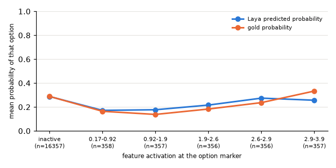

# Feature 9716

Critérios em que aparece: pred_error_stratified, corr_error_stratified, attribution_toward_correct

**Interpretação (preencher):** 

---

## Maiores ativações

**tr_security_incidents_000270 / urgency** (score, security_incidents) | ativação 5.207 em `opção` | opções ['0', '1', '2', '3'] | Laya: **1** [0.06, 0.467, 0.214, 0.258] | gabarito: **3**

```
[CLS]score question: How quickly must a responder act on this alert?[SEP]
▸ [MASK] level 0: No time pressure; can wait indefinitely.
▸ [MASK] level 1: Routine; handle within the normal queue.
▸ [MASK] level 2⟦:⟧ Elevated; should be handled within the same week.
▸ [MASK] level 3: Critical; requires action within the same day.

[SEP]

{"alert": {"description": "an endpoint agent matched a known signature", "evidence": "On 2026-09-15 at 14:32:07 UTC, the endpoint sensor on host WIN-34A9F reported the execution of C:\\Temp\\malicious.exe, whose hash (SHA‑256: a1b2c3d4…) matched a known malware signature. The event was generated by a contractor account with MFA enabled, and the credential for that account was last rotated 180 days prior.", "rule": "malware_signature"}, "context": {"asset_criticality": "crown_jewel", "change_window_active": false, "source_on_allowlist": false}, "history": {"credential_rotation_days_ago": 180, "distinct_countries_30d": 3, "logins_30d": 924, "prior_alerts_90d": 0}, "principal": {"mfa_enrolled": true, "name": "usr-infra-611", "privileges": ["repo:read"], "type": "contractor"}}[SEP]
```

**tr_security_incidents_000216 / urgency** (score, security_incidents) | ativação 5.145 em `opção` | opções ['0', '1', '2', '3'] | Laya: **1** [0.117, 0.431, 0.189, 0.263] | gabarito: **3**

```
[CLS]score question: How quickly must a responder act on this alert?[SEP]
▸ [MASK] level 0: No time pressure; can wait indefinitely.
▸ [MASK] level 1: Routine; handle within the normal queue.
▸ [MASK] level 2⟦:⟧ Elevated; should be handled within the same week.
▸ [MASK] level 3: Critical; requires action within the same day.

[SEP]

{"alert": {"description": "an unrecognised binary executed on a server", "evidence": "The privileged service account `svc_deployer` executed an unrecognized binary, `xc_update_v2`, on the production host at 04:15 UTC. This execution occurred outside of a scheduled change window using credentials that were last rotated 365 days ago.", "rule": "suspicious_process"}, "context": {"asset_criticality": "medium", "change_window_active": false, "source_on_allowlist": true}, "history": {"credential_rotation_days_ago": 365, "distinct_countries_30d": 2, "logins_30d": 178, "prior_alerts_90d": 1}, "principal": {"mfa_enrolled": false, "name": "svc-support-120", "privileges": ["deploy:production", "secrets:read"], "type": "service_account"}}[SEP]
```

**tr_security_incidents_000234 / urgency** (score, security_incidents) | ativação 5.109 em `opção` | opções ['0', '1', '2', '3'] | Laya: **1** [0.086, 0.697, 0.078, 0.14] | gabarito: **3**

```
[CLS]score question: How quickly must a responder act on this alert?[SEP]
▸ [MASK] level 0: No time pressure; can wait indefinitely.
▸ [MASK] level 1: Routine; handle within the normal queue.
▸ [MASK] level 2⟦:⟧ Elevated; should be handled within the same week.
▸ [MASK] level 3: Critical; requires action within the same day.

[SEP]

{"alert": {"description": "an unrecognised binary executed on a server", "evidence": "At 14:22 UTC, the unprivileged ci_runner service executed an unrecognized binary named 'sys_update_util' on production server SRV-PROD-04. The process originated from external IP 198.51.100.12 outside of a maintenance window using credentials that were last rotated 90 days ago.", "rule": "suspicious_process"}, "context": {"asset_criticality": "crown_jewel", "change_window_active": false, "source_on_allowlist": false}, "history": {"credential_rotation_days_ago": 90, "distinct_countries_30d": 4, "logins_30d": 1084, "prior_alerts_90d": 0}, "principal": {"mfa_enrolled": true, "name": "adm-billing-703", "privileges": ["repo:read"], "type": "ci_runner"}}[SEP]
```

**tr_security_incidents_000157 / urgency** (score, security_incidents) | ativação 5.086 em `opção` | opções ['0', '1', '2', '3'] | Laya: **1** [0.067, 0.725, 0.095, 0.114] | gabarito: **3**

```
[CLS]score question: How quickly must a responder act on this alert?[SEP]
▸ [MASK] level 0: No time pressure; can wait indefinitely.
▸ [MASK] level 1: Routine; handle within the normal queue.
▸ [MASK] level 2⟦:⟧ Elevated; should be handled within the same week.
▸ [MASK] level 3: Critical; requires action within the same day.

[SEP]

{"alert": {"description": "a first-ever sign-in from an unfamiliar country", "evidence": "A privileged employee account performed a successful sign‑in at 2026-09-16 08:45 UTC from 185.76.234.12, located in Moscow, Russia, which is a country with no prior login history for this principal. The authentication employed MFA, the source IP is not recognized in the asset inventory, and the password for the account was last changed on 2026‑09‑13.", "rule": "new_country_login"}, "context": {"asset_criticality": "crown_jewel", "change_window_active": false, "source_on_allowlist": false}, "history": {"credential_rotation_days_ago": 3, "distinct_countries_30d": 3, "logins_30d": 744, "prior_alerts_90d": 0}, "principal": {"mfa_enrolled": true, "name": "svc-billing-232", "privileges": ["deploy:production", "secrets:read"], "type": "employee"}}[SEP]
```

**tr_security_incidents_000076 / urgency** (score, security_incidents) | ativação 5.055 em `opção` | opções ['0', '1', '2', '3'] | Laya: **1** [0.092, 0.669, 0.121, 0.118] | gabarito: **3**

```
[CLS]score question: How quickly must a responder act on this alert?[SEP]
▸ [MASK] level 0: No time pressure; can wait indefinitely.
▸ [MASK] level 1: Routine; handle within the normal queue.
▸ [MASK] level 2⟦:⟧ Elevated; should be handled within the same week.
▸ [MASK] level 3: Critical; requires action within the same day.

[SEP]

{"alert": {"description": "an unusual volume of files read in a short window", "evidence": "Between 2026-09-15 02:00:00 and 02:05:12 UTC, the privileged admin account performed 3,842 file‑read operations on files under /var/www/html/ using the process \"wget\". The activity originated from an unrecognised source IP 192.0.2.77, the credentials for this account have not been rotated for 700 days, and no change window was defined.", "rule": "mass_download"}, "context": {"asset_criticality": "medium", "change_window_active": false, "source_on_allowlist": false}, "history": {"credential_rotation_days_ago": 700, "distinct_countries_30d": 1, "logins_30d": 282, "prior_alerts_90d": 0}, "principal": {"mfa_enrolled": true, "name": "svc-support-350", "privileges": ["deploy:production", "secrets:read"], "type": "admin"}}[SEP]
```

## Ativações medianas (faixa 40-60%, mediana 1.662)

**tr_security_incidents_000079 / disposition** (choice, security_incidents) | ativação 1.601 em `marcador` | opções ['close_benign', 'contain', 'investigate', 'monitor'] | Laya: **close_benign** [0.377, 0.165, 0.117, 0.341] | gabarito: **investigate**

```
[CLS]choice question: How should this security alert be dispositioned?[SEP]
▸ [MASK] close_benign: Expected, explainable activity; close without analyst time.
▸ ⟦[MASK]⟧ contain: Contain the host or account immediately; do not wait for triage.
▸ [MASK] investigate: Warrants an analyst opening an investigation.
▸ [MASK] monitor: Not clearly malicious, but worth watching for recurrence.

[SEP]

{"alert": {"description": "many failed authentications followed by a success", "evidence": "Between 2026-09-16T08:05:12Z and 08:12:47Z, the shared mailbox \"alerts@corp.com\" recorded 27 consecutive failed login attempts from allow‑listed IP 198.51.100.22, followed by a successful authentication at 08:13:04Z. MFA was active for this account, and the password was rotated 3 days prior to the event.", "rule": "brute_force"}, "context": {"asset_criticality": "medium", "change_window_active": false, "source_on_allowlist": true}, "history": {"credential_rotation_days_ago": 3, "distinct_countries_30d": 3, "logins_30d": 1029, "prior_alerts_90d": 0}, "principal": {"mfa_enrolled": true, "name": "svc-analytics-857", "privileges": ["repo:read"], "type": "shared_mailbox"}}[SEP]
```

**tr_security_incidents_000194 / disposition** (choice, security_incidents) | ativação 1.634 em `opção` | opções ['close_benign', 'contain', 'investigate', 'monitor'] | Laya: **close_benign** [0.436, 0.246, 0.083, 0.235] | gabarito: **investigate**

```
[CLS]choice question: How should this security alert be dispositioned?[SEP]
▸ [MASK] close_benign: Expected, explainable activity; close without analyst time⟦.⟧
▸ [MASK] contain: Contain the host or account immediately; do not wait for triage.
▸ [MASK] investigate: Warrants an analyst opening an investigation.
▸ [MASK] monitor: Not clearly malicious, but worth watching for recurrence.

[SEP]

{"alert": {"description": "a large transfer to an external destination", "evidence": "From 09:45 to 10:02 UTC the admin account adm_jones transferred 4.7 GB of data to external IP 172.16.200.12 over HTTPS (port 443). This outbound transfer occurred during the approved change window of 09:00‑12:00 on 2026‑09‑16. MFA is enabled for the admin account, and its credentials were last rotated 180 days ago.", "rule": "data_egress"}, "context": {"asset_criticality": "medium", "change_window_active": true, "source_on_allowlist": false}, "history": {"credential_rotation_days_ago": 180, "distinct_countries_30d": 2, "logins_30d": 8, "prior_alerts_90d": 3}, "principal": {"mfa_enrolled": true, "name": "ci-analytics-840", "privileges": ["deploy:production", "secrets:read"], "type": "admin"}}[SEP]
```

**tr_security_incidents_000068 / urgency** (score, security_incidents) | ativação 1.551 em `opção` | opções ['0', '1', '2', '3'] | Laya: **1** [0.042, 0.808, 0.07, 0.08] | gabarito: **3**

```
[CLS]score question: How quickly must a responder act on this alert?[SEP]
▸ [MASK] level 0: No time pressure; can wait indefinitely.
▸ [MASK] level 1: Rout⟦ine⟧; handle within the normal queue.
▸ [MASK] level 2: Elevated; should be handled within the same week.
▸ [MASK] level 3: Critical; requires action within the same day.

[SEP]

{"alert": {"description": "two successful logins from distant locations too close together", "evidence": "Two successful authentication events for the service account occurred 12 minutes apart from IP addresses located in London and Singapore. The account credentials have not been updated in 412 days.", "rule": "impossible_travel"}, "context": {"asset_criticality": "high", "change_window_active": false, "source_on_allowlist": false}, "history": {"credential_rotation_days_ago": 412, "distinct_countries_30d": 1, "logins_30d": 521, "prior_alerts_90d": 8}, "principal": {"mfa_enrolled": true, "name": "adm-analytics-682", "privileges": ["deploy:production", "secrets:read"], "type": "service_account"}}[SEP]
```

**tr_security_incidents_000160 / urgency** (score, security_incidents) | ativação 1.756 em `opção` | opções ['0', '1', '2', '3'] | Laya: **1** [0.103, 0.398, 0.231, 0.268] | gabarito: **3**

```
[CLS]score question: How quickly must a responder act on this alert?[SEP]
▸ [MASK] level 0: No time pressure; can wait indefinitely.
▸ [MASK] level 1: Routine; handle within the normal queue.
▸ [MASK] level 2: Elevated;⟦ should⟧ be handled within the same week.
▸ [MASK] level 3: Critical; requires action within the same day.

[SEP]

{"alert": {"description": "an endpoint agent matched a known signature", "evidence": "On 2026-09-15 09:18 UTC the endpoint host WIN-01A2B3C4 flagged a file located at C:\\Temp\\malicious.exe that matched a known malware signature (SHA‑256: a1b2c3d4e5f6…). The detection was generated by the endpoint agent for an administrator account (admin‑ops) that has MFA enabled. The admin’s password had been changed three days prior, on 2026‑09‑12.", "rule": "malware_signature"}, "context": {"asset_criticality": "crown_jewel", "change_window_active": false, "source_on_allowlist": false}, "history": {"credential_rotation_days_ago": 3, "distinct_countries_30d": 1, "logins_30d": 1481, "prior_alerts_90d": 1}, "principal": {"mfa_enrolled": true, "name": "usr-infra-911", "privileges": ["deploy:production", "secrets:read"], "type": "admin"}}[SEP]
```

**tr_security_incidents_000046 / disposition** (choice, security_incidents) | ativação 1.568 em `opção` | opções ['close_benign', 'contain', 'investigate', 'monitor'] | Laya: **close_benign** [0.424, 0.211, 0.101, 0.264] | gabarito: **investigate**

```
[CLS]choice question: How should this security alert be dispositioned?[SEP]
▸ [MASK] close_benign: Expected, explainable activity; close without analyst time⟦.⟧
▸ [MASK] contain: Contain the host or account immediately; do not wait for triage.
▸ [MASK] investigate: Warrants an analyst opening an investigation.
▸ [MASK] monitor: Not clearly malicious, but worth watching for recurrence.

[SEP]

{"alert": {"description": "a large transfer to an external destination", "evidence": "On 2026-09-15 09:22:03 UTC, a shared mailbox credential \"svc_mailbox\" initiated an outbound TCP session to 203.0.113.45:443, transferring approximately 1.3 TB of data over 38 minutes. The connection originated from the allowlisted IP 192.168.10.55, MFA was off for the account, and its password was last changed 14 days ago.", "rule": "data_egress"}, "context": {"asset_criticality": "medium", "change_window_active": false, "source_on_allowlist": true}, "history": {"credential_rotation_days_ago": 14, "distinct_countries_30d": 3, "logins_30d": 1058, "prior_alerts_90d": 8}, "principal": {"mfa_enrolled": false, "name": "svc-support-440", "privileges": ["deploy:production", "secrets:read"], "type": "shared_mailbox"}}[SEP]
```

## Estatísticas (conjunto de descoberta, dev e teste)

**pred / error**

| split | decisões | ativas | ativas e Laya errou | taxa | lift | q (BH) | OR (CMH) | q (CMH) |
|---|---|---|---|---|---|---|---|---|
| discovery | 5100 | 339 | 284 | 0.838 | 1.32 | 6.82e-16 | 2.97 | 2.95e-10 |
| dev | 900 | 61 | 54 | 0.885 | 1.35 | 0.00193 | 4.09 | 0.00651 |
| test | 2000 | 134 | 118 | 0.881 | 1.38 | 1.66e-09 | 3.38 | 0.000203 |

**corr / error**

| split | decisões | ativas | ativas e Laya errou | taxa | lift | q (BH) | OR (CMH) | q (CMH) |
|---|---|---|---|---|---|---|---|---|
| discovery | 5100 | 339 | 284 | 0.838 | 1.32 | 1.93e-16 | 6.83 | 5.35e-05 |
| dev | 900 | 56 | 49 | 0.875 | 1.33 | 0.000611 | 1.44 | 0.685 |
| test | 2000 | 134 | 118 | 0.881 | 1.38 | 4.32e-10 | 2.28 | 0.172 |

**state / error**

| split | decisões | ativas | ativas e Laya errou | taxa | lift | q (BH) | OR (CMH) | q (CMH) |
|---|---|---|---|---|---|---|---|---|
| discovery | 5100 | 127 | 84 | 0.661 | 1.04 | 0.856 | 1.50 | 0.142 |
| dev | 900 | 12 | 6 | 0.500 | 0.76 | nan | nan | nan |
| test | 2000 | 55 | 35 | 0.636 | 1.00 | 1 | 1.19 | 0.794 |

Confusão mais sobre-representada (pred): `urgency|1>3` (n=128, lift 6.59, p=0). Formato `pergunta|índice previsto>índice correto`.

Confusão mais sobre-representada (corr): `urgency|1>3` (n=130, lift 6.70, p=0). Formato `pergunta|índice previsto>índice correto`.

Confusão mais sobre-representada (state): `credential_compromise|1>0` (n=15, lift 6.85, p=2.61e-09). Formato `pergunta|índice previsto>índice correto`.



