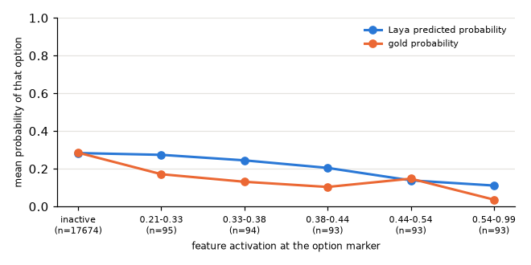

# Feature 9777

Critérios em que aparece: pred_error

**Interpretação (preencher):** 

---

## Maiores ativações

**tr_customer_service_000252 / action** (choice, customer_service) | ativação 1.632 em `estado` | opções ['answer_directly', 'close_no_action', 'escalate_to_human', 'execute_refund', 'request_information'] | Laya: **close_no_action** [0.227, 0.435, 0.19, 0.041, 0.107] | gabarito: **escalate_to_human**

```
[CLS]choice question: What should the assistant do next with this conversation?[SEP]
▸ [MASK] answer_directly: The assistant can resolve this itself with information it already has.
▸ [MASK] close_no_action: No further action is warranted; the matter is settled.
▸ [MASK] escalate_to_human: Hand off to a human agent with the appropriate authority.
▸ [MASK] execute_refund: Issue the refund or credit the customer is owed.
▸ [MASK] request_information: More detail is needed from the customer before anything can be done.

[SEP]

{"account": {"lifetime_value_usd": 3228, "prior_tickets_90d": 2, "seats": 1, "tenure_months": 49, "tier": "enterprise"}, "thread": [{"role": "customer", "text": "I’ve been paying for this enterprise account for 49 months, and now I’m locked out again. This is the third time this keeps happening,⟦ and⟧ I’m sick of wasting my time on these recurring login errors."}, {"role": "agent", "text": "I am sorry to hear you're experiencing this issue again. Could you please confirm if you are receiving a specific error code when you attempt to sign in?"}, {"role": "customer", "text": "There is no code, it just kicks me back to the landing page every single time I hit submit. Figure it out."}]}[SEP]
```

**tr_customer_service_000214 / action** (choice, customer_service) | ativação 1.507 em `estado` | opções ['answer_directly', 'close_no_action', 'escalate_to_human', 'execute_refund', 'request_information'] | Laya: **close_no_action** [0.238, 0.312, 0.201, 0.036, 0.213] | gabarito: **request_information**

```
[CLS]choice question: What should the assistant do next with this conversation?[SEP]
▸ [MASK] answer_directly: The assistant can resolve this itself with information it already has.
▸ [MASK] close_no_action: No further action is warranted; the matter is settled.
▸ [MASK] escalate_to_human: Hand off to a human agent with the appropriate authority.
▸ [MASK] execute_refund: Issue the refund or credit the customer is owed.
▸ [MASK] request_information: More detail is needed from the customer before anything can be done.

[SEP]

{"account": {"lifetime_value_usd": 820, "prior_tickets_90d": 2, "seats": 1, "tenure_months": 19, "tier": "standard"}, "thread": [{"role": "customer", "text": "The platform has been crawling at a snail's pace all day—queries that used to return in seconds now take minutes, and I need this fixed before my deadline tomorrow."}, {"role": "agent", "text": "⟦I⟧ understand how critical that is. Can you tell me which specific actions are lagging and if this slowdown is happening across all browsers?"}, {"role": "customer", "text": "Both the search bar and the analytics tab are sluggish, and it’s the same on Chrome and Firefox. I’ve been on the standard plan for 19 months and this is the first time I’ve seen anything this bad."}]}[SEP]
```

**tr_customer_service_000051 / category** (choice, customer_service) | ativação 1.458 em `estado` | opções ['account', 'billing', 'delivery', 'refund', 'technical'] | Laya: **billing** [0.024, 0.827, 0.009, 0.054, 0.086] | gabarito: **billing**

```
[CLS]choice question: What is this customer conversation primarily about?[SEP]
▸ [MASK] account: Login, plan changes, profile or access management.
▸ [MASK] billing: A charge, invoice, subscription or payment problem.
▸ [MASK] delivery: Shipping, fulfilment or delivery of a physical item.
▸ [MASK] refund: The customer is explicitly asking for money back.
▸ [MASK] technical: The product or service is not working as expected.

[SEP]

{"account": {"lifetime_value_usd": 2213, "prior_tickets_90d": 1, "seats": 1, "tenure_months": 60, "tier": "standard"}, "thread": [{"role": "customer", "text": "My bill is higher than expected again. This is the second time I've had to bring this up,⟦ and⟧ I'm honestly fed up. If this isn't fixed before my 2 PM deadline, I am canceling my account for good."}, {"role": "agent", "text": "I understand your frustration regarding the recurring billing concerns. Would you be able to provide the invoice number in question so I can review the charges?"}, {"role": "customer", "text": "It’s the most recent one. Can you please check your system instead of making me jump through these hoops while my deadline approaches?"}]}[SEP]
```

**tr_customer_service_000214 / churn_risk** (score, customer_service) | ativação 1.454 em `estado` | opções ['0', '1', '2', '3'] | Laya: **2** [0.052, 0.223, 0.685, 0.04] | gabarito: **2**

```
[CLS]score question: How likely is this customer to stop doing business with us because of this interaction?[SEP]
▸ [MASK] level 0: No sign of dissatisfaction.
▸ [MASK] level 1: Mild frustration, but the relationship is intact.
▸ [MASK] level 2: Clearly unhappy; repeat problems or explicit complaints.
▸ [MASK] level 3: Imminent: threatening to cancel, dispute or leave.

[SEP]

{"account": {"lifetime_value_usd": 820, "prior_tickets_90d": 2, "seats": 1, "tenure_months": 19, "tier": "standard"}, "thread": [{"role": "customer", "text": "The platform has been crawling at a snail's pace all day—queries that used to return in seconds now take minutes, and I need this fixed before my deadline tomorrow."}, {"role": "agent", "text": "⟦I⟧ understand how critical that is. Can you tell me which specific actions are lagging and if this slowdown is happening across all browsers?"}, {"role": "customer", "text": "Both the search bar and the analytics tab are sluggish, and it’s the same on Chrome and Firefox. I’ve been on the standard plan for 19 months and this is the first time I’ve seen anything this bad."}]}[SEP]
```

**tr_customer_service_000252 / category** (choice, customer_service) | ativação 1.450 em `estado` | opções ['account', 'billing', 'delivery', 'refund', 'technical'] | Laya: **technical** [0.288, 0.027, 0.021, 0.102, 0.561] | gabarito: **account**

```
[CLS]choice question: What is this customer conversation primarily about?[SEP]
▸ [MASK] account: Login, plan changes, profile or access management.
▸ [MASK] billing: A charge, invoice, subscription or payment problem.
▸ [MASK] delivery: Shipping, fulfilment or delivery of a physical item.
▸ [MASK] refund: The customer is explicitly asking for money back.
▸ [MASK] technical: The product or service is not working as expected.

[SEP]

{"account": {"lifetime_value_usd": 3228, "prior_tickets_90d": 2, "seats": 1, "tenure_months": 49, "tier": "enterprise"}, "thread": [{"role": "customer", "text": "I’ve been paying for this enterprise account for 49 months, and now I’m locked out again. This is the third time this keeps happening,⟦ and⟧ I’m sick of wasting my time on these recurring login errors."}, {"role": "agent", "text": "I am sorry to hear you're experiencing this issue again. Could you please confirm if you are receiving a specific error code when you attempt to sign in?"}, {"role": "customer", "text": "There is no code, it just kicks me back to the landing page every single time I hit submit. Figure it out."}]}[SEP]
```

## Ativações medianas (faixa 40-60%, mediana 0.500)

**tr_invoice_processing_000125 / disposition** (choice, invoice_processing) | ativação 0.460 em `estado` | opções ['approve', 'hold', 'manual_review', 'reject'] | Laya: **approve** [0.372, 0.179, 0.144, 0.306] | gabarito: **manual_review**

```
[CLS]choice question: How should this vendor invoice be dispositioned?[SEP]
▸ [MASK] approve: Matches the order and delivery; approve for payment.
▸ [MASK] hold: Something needs confirming before payment; hold pending clarification.
▸ [MASK] manual_review: A human in finance must review the discrepancy.
▸ [MASK] reject: Should not be paid: duplicate, unauthorised or materially wrong.

[SEP]

{"delivery": {"condition": "accepted with exceptions", "date": null, "received_qty": 0}, "invoice": {"currency": "USD", "id": "INV-2026-9806",⟦ "⟧lines": [{"qty": 50, "sku": "SKU-429", "total_usd": 7214.0, "unit_usd": 144.28}], "total_usd": 7214.0, "vendor": "Acme Fabrication"}, "payment": {"days_until_due": 27, "discount_expires_in_days": null, "early_payment_discount_pct": null, "status": "scheduled", "terms": "net 30"}, "purchase_order": {"freight_terms": "freight prepaid by vendor, not separately billable", "id": "PO-3759", "lines": [{"qty": 50, "unit_usd": 144.28}], "total_usd": 7214.0}, "vendor_history": {"disputes_12m": 0, "invoices_12m": 30, "prior_invoice_ids": ["INV-2026-3577", "INV-2026-6921", "INV-2026-4997"]}}[SEP]
```

**tr_invoice_processing_000197 / discrepancy_severity** (score, invoice_processing) | ativação 0.459 em `pergunta` | opções ['0', '1', '2', '3'] | Laya: **0** [0.437, 0.183, 0.211, 0.169] | gabarito: **3**

```
[CLS]score question⟦:⟧ How material is any discrepancy between the invoice, the order and the delivery?[SEP]
▸ [MASK] level 0: None: everything reconciles.
▸ [MASK] level 1: Trivial: rounding or a cosmetic difference.
▸ [MASK] level 2: Moderate: a real difference worth confirming.
▸ [MASK] level 3: Material: a large or unexplained difference.

[SEP]

{"delivery": {"condition": "accepted with exceptions", "date": "2026-03-20", "received_qty": 100}, "invoice": {"currency": "USD", "id": "INV-2026-2449", "lines": [{"qty": 100, "sku": "SKU-717", "total_usd": 14417.0, "unit_usd": 144.17}], "total_usd": 14417.0, "vendor": "Vantage Materials"}, "payment": {"days_until_due": 18, "discount_expires_in_days": null, "early_payment_discount_pct": null, "status": "scheduled", "terms": "net 30"}, "purchase_order": {"freight_terms": "freight prepaid by vendor, not separately billable", "id": "PO-3796", "lines": [{"qty": 100, "unit_usd": 144.17}], "total_usd": 14417.0}, "vendor_history": {"disputes_12m": 2, "invoices_12m": 25, "prior_invoice_ids": ["INV-2026-2449", "INV-2026-9332", "INV-2026-7430", "INV-2026-9715"]}}[SEP]
```

**tr_invoice_processing_000258 / discrepancy_severity** (score, invoice_processing) | ativação 0.496 em `pergunta` | opções ['0', '1', '2', '3'] | Laya: **0** [0.66, 0.131, 0.112, 0.096] | gabarito: **3**

```
[CLS]score question⟦:⟧ How material is any discrepancy between the invoice, the order and the delivery?[SEP]
▸ [MASK] level 0: None: everything reconciles.
▸ [MASK] level 1: Trivial: rounding or a cosmetic difference.
▸ [MASK] level 2: Moderate: a real difference worth confirming.
▸ [MASK] level 3: Material: a large or unexplained difference.

[SEP]

{"delivery": {"condition": "accepted", "date": null, "received_qty": 0}, "invoice": {"currency": "USD", "id": "INV-2026-5102", "lines": [{"qty": 0, "sku": "SKU-492", "total_usd": 0.0, "unit_usd": 71.37}], "total_usd": 0.0, "vendor": "Vantage Materials"}, "payment": {"days_until_due": 5, "discount_expires_in_days": null, "early_payment_discount_pct": null, "status": "scheduled", "terms": "net 15"}, "purchase_order": {"freight_terms": "freight prepaid by vendor, not separately billable", "id": "PO-8165", "lines": [{"qty": 50, "unit_usd": 71.37}], "total_usd": 3568.5}, "vendor_history": {"disputes_12m": 0, "invoices_12m": 51, "prior_invoice_ids": ["INV-2026-9720"]}}[SEP]
```

**tr_invoice_processing_000134 / discrepancy_severity** (score, invoice_processing) | ativação 0.494 em `estado` | opções ['0', '1', '2', '3'] | Laya: **0** [0.325, 0.258, 0.205, 0.212] | gabarito: **0**

```
[CLS]score question: How material is any discrepancy between the invoice, the order and the delivery?[SEP]
▸ [MASK] level 0: None: everything reconciles.
▸ [MASK] level 1: Trivial: rounding or a cosmetic difference.
▸ [MASK] level 2: Moderate: a real difference worth confirming.
▸ [MASK] level 3: Material: a large or unexplained difference.

[SEP]

⟦{"⟧delivery": {"condition": "accepted", "date": "2026-03-15", "received_qty": 10}, "invoice": {"currency": "USD", "id": "INV-2026-2470", "lines": [{"qty": 10, "sku": "SKU-529", "total_usd": 1797.7, "unit_usd": 179.77}], "total_usd": 1797.7, "vendor": "Pallas Industrial"}, "payment": {"days_until_due": 2, "discount_expires_in_days": 3, "early_payment_discount_pct": 2.0, "status": "scheduled", "terms": "net 30"}, "purchase_order": {"freight_terms": "freight prepaid by vendor, not separately billable", "id": null, "lines": [{"qty": 10, "unit_usd": 179.77}], "total_usd": 1797.7}, "vendor_history": {"disputes_12m": 0, "invoices_12m": 43, "prior_invoice_ids": ["INV-2026-2034"]}}[SEP]
```

**tr_invoice_processing_000129 / disposition** (choice, invoice_processing) | ativação 0.479 em `estado` | opções ['approve', 'hold', 'manual_review', 'reject'] | Laya: **approve** [0.543, 0.162, 0.109, 0.186] | gabarito: **hold**

```
[CLS]choice question: How should this vendor invoice be dispositioned?[SEP]
▸ [MASK] approve: Matches the order and delivery; approve for payment.
▸ [MASK] hold: Something needs confirming before payment; hold pending clarification.
▸ [MASK] manual_review: A human in finance must review the discrepancy.
▸ [MASK] reject: Should not be paid: duplicate, unauthorised or materially wrong.

[SEP]

{"delivery": {"condition": "accepted", "date": "2026-03-28", "received_qty": 10}, "invoice": {"currency": "EUR", "id": "INV-2026-8563", "lines": [{"qty": 10, "sku": "SKU-495", "total_usd": 988.4, "unit_usd": 98.84}], "total_usd": 988.4, "vendor": "Kestrel Supply"}, "payment": {"days_until_due": 0, "discount_expires_in_days": 1, "early_payment_discount_pct": 2.0, "status": "scheduled", "terms": "net 60"},⟦ "⟧purchase_order": {"freight_terms": "freight prepaid by vendor, not separately billable", "id": "PO-1536", "lines": [{"qty": 10, "unit_usd": 98.84}], "total_usd": 988.4}, "vendor_history": {"disputes_12m": 0, "invoices_12m": 9, "prior_invoice_ids": ["INV-2026-7035", "INV-2026-7348", "INV-2026-2760"]}}[SEP]
```

## Estatísticas (conjunto de descoberta, dev e teste)

**pred / error**

| split | decisões | ativas | ativas e Laya errou | taxa | lift | q (BH) | OR (CMH) | q (CMH) |
|---|---|---|---|---|---|---|---|---|
| discovery | 5100 | 64 | 63 | 0.984 | 1.55 | 1.2e-10 | 2.78 | 0.622 |
| dev | 900 | 8 | 8 | 1.000 | 1.52 | nan | nan | nan |
| test | 2000 | 31 | 29 | 0.935 | 1.47 | 0.000833 | 1.09 | 0.968 |

**corr / error**

| split | decisões | ativas | ativas e Laya errou | taxa | lift | q (BH) | OR (CMH) | q (CMH) |
|---|---|---|---|---|---|---|---|---|
| discovery | 5100 | 45 | 44 | 0.978 | 1.54 | 1.48e-07 | 3.14 | 0.582 |
| dev | 900 | 4 | 4 | 1.000 | 1.52 | nan | nan | nan |
| test | 2000 | 13 | 11 | 0.846 | 1.33 | nan | nan | nan |

**state / error**

| split | decisões | ativas | ativas e Laya errou | taxa | lift | q (BH) | OR (CMH) | q (CMH) |
|---|---|---|---|---|---|---|---|---|
| discovery | 5100 | 1770 | 1104 | 0.624 | 0.98 | 0.476 | 0.93 | 0.47 |
| dev | 900 | 365 | 231 | 0.633 | 0.96 | 1 | 0.77 | 0.369 |
| test | 2000 | 718 | 470 | 0.655 | 1.03 | 0.722 | 1.02 | 0.954 |

Confusão mais sobre-representada (pred): `outcome|0>1` (n=34, lift 47.53, p=0). Formato `pergunta|índice previsto>índice correto`.

Confusão mais sobre-representada (corr): `outcome|0>1` (n=31, lift 61.64, p=0). Formato `pergunta|índice previsto>índice correto`.

Confusão mais sobre-representada (state): `urgency|1>2` (n=156, lift 1.61, p=7.64e-14). Formato `pergunta|índice previsto>índice correto`.



