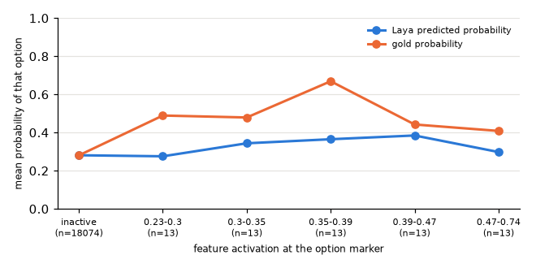

# Feature 10046

Critérios em que aparece: state_error

**Interpretação (preencher):** 

---

## Maiores ativações

**tr_invoice_processing_000068 / duplicate** (noul, invoice_processing) | ativação 9.586 em `opção` | opções ['false', 'true'] | Laya: **true** [0.235, 0.765] | gabarito: **false**

```
[CLS]noul question: This invoice appears to duplicate an invoice already submitted.[SEP]
▸ [MASK] false⟦:⟧ no, the statement does not hold
▸ [MASK] true: yes, the statement holds

[SEP]

{"delivery": {"condition": "accepted with exceptions", "date": "2026-03-18", "received_qty": 50}, "invoice": {"currency": "USD", "id": "INV-2026-5355", "lines": [{"qty": 50, "sku": "SKU-380", "total_usd": 1136.5, "unit_usd": 22.73}], "total_usd": 1136.5, "vendor": "Vantage Materials"}, "payment": {"days_until_due": 27, "discount_expires_in_days": 3, "early_payment_discount_pct": 2.0, "status": "scheduled", "terms": "net 45"}, "purchase_order": {"freight_terms": "freight prepaid by vendor, not separately billable", "id": null, "lines": [{"qty": 50, "unit_usd": 22.73}], "total_usd": 1136.5}, "vendor_history": {"disputes_12m": 1, "invoices_12m": 33, "prior_invoice_ids": ["INV-2026-2856", "INV-2026-9344"]}}[SEP]
```

**tr_security_incidents_000048 / credential_compromise** (noul, security_incidents) | ativação 9.539 em `opção` | opções ['false', 'true'] | Laya: **true** [0.205, 0.795] | gabarito: **true**

```
[CLS]noul question: The evidence indicates a credential or account has been compromised.[SEP]
▸ [MASK] false⟦:⟧ no, the statement does not hold
▸ [MASK] true: yes, the statement holds

[SEP]

{"alert": {"description": "a long-unused account became active", "evidence": "Administrative principal access was detected from an unrecognized source after 700 days of account inactivity. The privileged session was established using MFA during an active change window.", "rule": "dormant_account_use"}, "context": {"asset_criticality": "crown_jewel", "change_window_active": true, "source_on_allowlist": false}, "history": {"credential_rotation_days_ago": 700, "distinct_countries_30d": 3, "logins_30d": 503, "prior_alerts_90d": 8}, "principal": {"mfa_enrolled": true, "name": "svc-analytics-977", "privileges": ["deploy:production", "secrets:read"], "type": "admin"}}[SEP]
```

**tr_security_incidents_000283 / credential_compromise** (noul, security_incidents) | ativação 9.516 em `opção` | opções ['false', 'true'] | Laya: **true** [0.176, 0.824] | gabarito: **true**

```
[CLS]noul question: The evidence indicates a credential or account has been compromised.[SEP]
▸ [MASK] false⟦:⟧ no, the statement does not hold
▸ [MASK] true: yes, the statement holds

[SEP]

{"alert": {"description": "a large transfer to an external destination", "evidence": "A privileged contractor account initiated a large data transfer to an unrecognized external destination. This account has not rotated credentials in 700 days and is operating outside of any scheduled change window.", "rule": "data_egress"}, "context": {"asset_criticality": "medium", "change_window_active": false, "source_on_allowlist": false}, "history": {"credential_rotation_days_ago": 700, "distinct_countries_30d": 2, "logins_30d": 801, "prior_alerts_90d": 0}, "principal": {"mfa_enrolled": true, "name": "usr-infra-904", "privileges": ["deploy:production", "secrets:read"], "type": "contractor"}}[SEP]
```

**tr_security_incidents_000068 / credential_compromise** (noul, security_incidents) | ativação 9.469 em `opção` | opções ['false', 'true'] | Laya: **true** [0.252, 0.748] | gabarito: **true**

```
[CLS]noul question: The evidence indicates a credential or account has been compromised.[SEP]
▸ [MASK] false⟦:⟧ no, the statement does not hold
▸ [MASK] true: yes, the statement holds

[SEP]

{"alert": {"description": "two successful logins from distant locations too close together", "evidence": "Two successful authentication events for the service account occurred 12 minutes apart from IP addresses located in London and Singapore. The account credentials have not been updated in 412 days.", "rule": "impossible_travel"}, "context": {"asset_criticality": "high", "change_window_active": false, "source_on_allowlist": false}, "history": {"credential_rotation_days_ago": 412, "distinct_countries_30d": 1, "logins_30d": 521, "prior_alerts_90d": 8}, "principal": {"mfa_enrolled": true, "name": "adm-analytics-682", "privileges": ["deploy:production", "secrets:read"], "type": "service_account"}}[SEP]
```

**tr_invoice_processing_000230 / duplicate** (noul, invoice_processing) | ativação 9.430 em `opção` | opções ['false', 'true'] | Laya: **true** [0.027, 0.973] | gabarito: **false**

```
[CLS]noul question: This invoice appears to duplicate an invoice already submitted.[SEP]
▸ [MASK] false⟦:⟧ no, the statement does not hold
▸ [MASK] true: yes, the statement holds

[SEP]

{"delivery": {"condition": "accepted", "date": "2026-03-02", "received_qty": 250}, "invoice": {"currency": "USD", "id": "INV-2026-4879", "lines": [{"qty": 250, "sku": "SKU-570", "total_usd": 58422.5, "unit_usd": 233.69}], "total_usd": 58422.5, "vendor": "Vantage Materials"}, "payment": {"days_until_due": 44, "discount_expires_in_days": 6, "early_payment_discount_pct": 2.0, "status": "scheduled", "terms": "net 30"}, "purchase_order": {"freight_terms": "freight prepaid by vendor, not separately billable", "id": "PO-9226", "lines": [{"qty": 250, "unit_usd": 233.69}], "total_usd": 58422.5}, "vendor_history": {"disputes_12m": 1, "invoices_12m": 60, "prior_invoice_ids": ["INV-2026-4879", "INV-2026-3079"]}}[SEP]
```

## Ativações medianas (faixa 40-60%, mediana 2.543)

**tr_agent_trace_observability_000042 / needs_review** (noul, agent_trace_observability) | ativação 2.656 em `opção` | opções ['false', 'true'] | Laya: **false** [0.702, 0.298] | gabarito: **false**

```
[CLS]noul question: This trace requires human review.[SEP]
▸ [MASK] false⟦:⟧ No human attention is warranted.
▸ [MASK] true: A human should inspect this run.

[SEP]

{"agent": {"autonomy": "checkpointed", "model": "internal-agent-v2"}, "constraints": ["Do not touch customer data outside the named accounts"], "task": "Backfill missing analytics events for the last seven days.", "trace_summary": {"constraint_violations": 0, "duration_s": 642.3, "irreversible_actions": 0, "steps": 3, "tool_errors": 1}}[SEP]
```

**tr_agent_trace_observability_000083 / needs_review** (noul, agent_trace_observability) | ativação 2.322 em `opção` | opções ['false', 'true'] | Laya: **false** [0.698, 0.302] | gabarito: **false**

```
[CLS]noul question: This trace requires human review.[SEP]
▸ [MASK] false⟦:⟧ No human attention is warranted.
▸ [MASK] true: A human should inspect this run.

[SEP]

{"agent": {"autonomy": "unsupervised", "model": "internal-agent-v1"}, "constraints": ["Do not force-push to any branch"], "task": "Migrate the user table to the new schema without downtime.", "trace_summary": {"constraint_violations": 0, "duration_s": 427.2, "irreversible_actions": 0, "steps": 10, "tool_errors": 1}}[SEP]
```

**tr_agent_trace_observability_000296 / needs_review** (noul, agent_trace_observability) | ativação 2.291 em `opção` | opções ['false', 'true'] | Laya: **false** [0.616, 0.384] | gabarito: **false**

```
[CLS]noul question: This trace requires human review.[SEP]
▸ [MASK] false⟦:⟧ No human attention is warranted.
▸ [MASK] true: A human should inspect this run.

[SEP]

{"agent": {"autonomy": "unsupervised", "model": "internal-agent-v1"}, "constraints": ["Never disable monitoring or alerting"], "task": "Clean up stale feature branches merged more than 90 days ago.", "trace_summary": {"constraint_violations": 0, "duration_s": 210.8, "irreversible_actions": 0, "steps": 11, "tool_errors": 3}}[SEP]
```

**tr_agent_trace_observability_000053 / needs_review** (noul, agent_trace_observability) | ativação 2.742 em `opção` | opções ['false', 'true'] | Laya: **false** [0.661, 0.339] | gabarito: **false**

```
[CLS]noul question: This trace requires human review.[SEP]
▸ [MASK] false⟦:⟧ No human attention is warranted.
▸ [MASK] true: A human should inspect this run.

[SEP]

{"agent": {"autonomy": "checkpointed", "model": "internal-agent-v1"}, "constraints": ["Never modify production without an approved change ticket", "Do not touch customer data outside the named accounts", "Never delete anything matching release/*"], "task": "Migrate the user table to the new schema without downtime.", "trace_summary": {"constraint_violations": 0, "duration_s": 197.3, "irreversible_actions": 0, "steps": 11, "tool_errors": 0}}[SEP]
```

**tr_agent_trace_observability_000194 / needs_review** (noul, agent_trace_observability) | ativação 2.592 em `opção` | opções ['false', 'true'] | Laya: **false** [0.51, 0.49] | gabarito: **true**

```
[CLS]noul question: This trace requires human review.[SEP]
▸ [MASK] false⟦:⟧ No human attention is warranted.
▸ [MASK] true: A human should inspect this run.

[SEP]

{"agent": {"autonomy": "checkpointed", "model": "internal-agent-v1"}, "constraints": ["Do not force-push to any branch", "Do not exceed a $50 spend on cloud resources"], "task": "Backfill missing analytics events for the last seven days.", "trace_summary": {"constraint_violations": 0, "duration_s": 679.5, "irreversible_actions": 0, "steps": 4, "tool_errors": 2}}[SEP]
```

## Estatísticas (conjunto de descoberta, dev e teste)

**pred / error**

| split | decisões | ativas | ativas e Laya errou | taxa | lift | q (BH) | OR (CMH) | q (CMH) |
|---|---|---|---|---|---|---|---|---|
| discovery | 5100 | 12 | 6 | 0.500 | 0.79 | nan | nan | nan |
| dev | 900 | 1 | 1 | 1.000 | 1.52 | nan | nan | nan |
| test | 2000 | 6 | 3 | 0.500 | 0.78 | nan | nan | nan |

**corr / error**

| split | decisões | ativas | ativas e Laya errou | taxa | lift | q (BH) | OR (CMH) | q (CMH) |
|---|---|---|---|---|---|---|---|---|
| discovery | 5100 | 27 | 21 | 0.778 | 1.22 | 0.207 | 0.94 | 0.948 |
| dev | 900 | 4 | 4 | 1.000 | 1.52 | nan | nan | nan |
| test | 2000 | 13 | 10 | 0.769 | 1.21 | nan | nan | nan |

**state / error**

| split | decisões | ativas | ativas e Laya errou | taxa | lift | q (BH) | OR (CMH) | q (CMH) |
|---|---|---|---|---|---|---|---|---|
| discovery | 5100 | 76 | 65 | 0.855 | 1.34 | 0.00212 | 3.04 | 0.00228 |
| dev | 900 | 21 | 19 | 0.905 | 1.38 | 0.594 | 4.55 | 0.196 |
| test | 2000 | 41 | 38 | 0.927 | 1.45 | 0.0134 | 5.56 | 0.00485 |

Confusão mais sobre-representada (pred): `credential_compromise|0>1` (n=6, lift 87.93, p=nan). Formato `pergunta|índice previsto>índice correto`.

Confusão mais sobre-representada (corr): `credential_compromise|1>0` (n=21, lift 45.08, p=2.01e-33). Formato `pergunta|índice previsto>índice correto`.

Confusão mais sobre-representada (state): `discrepancy_severity|0>3` (n=13, lift 13.63, p=4.45e-12). Formato `pergunta|índice previsto>índice correto`.



