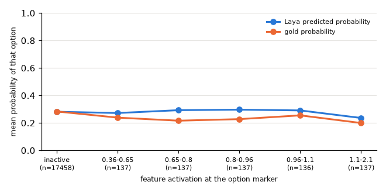

# Feature 10221

Critérios em que aparece: pred_error, corr_error_stratified

**Interpretação (preencher):** 

---

## Maiores ativações

**tr_customer_service_000187 / urgency** (score, customer_service) | ativação 6.652 em `estado` | opções ['0', '1', '2', '3'] | Laya: **1** [0.153, 0.49, 0.108, 0.248] | gabarito: **3**

```
[CLS]score question: How time-sensitive is this conversation?[SEP]
▸ [MASK] level 0: No time pressure; can wait indefinitely.
▸ [MASK] level 1: Routine; handle within the normal queue.
▸ [MASK] level 2: Elevated; should be handled within the same week.
▸ [MASK] level 3: Critical; requires action within the same day.

[SEP]

{"account": {"lifetime_value_usd": 1666, "prior_tickets_90d": 0, "seats": 1, "tenure_months": 49,⟦ "⟧tier": "standard"}, "orders": [{"amount_usd": 447, "date": "2026-01-13", "id": "A-73036", "status": "settled"}, {"amount_usd": 447, "date": "2026-01-14", "id": "A-19724", "status": "refunded"}], "thread": [{"role": "customer", "text": "The seat allocation tool is a joke—my team can’t add anyone new and you keep throwing error code 502 at us!"}, {"role": "agent", "text": "I’m sorry the seat manager is failing you. Can you tell me exactly which action triggers the 502 response, and if you see any additional message details?"}, {"role": "customer", "text": "Every time I click ‘Add seat’ after typing the email it just crashes; I’ve tried it on Chrome and Firefox, same garbage."}, {"role": "agent", "text": "Thanks for the specifics. To investigate further, could you share the email addresses you attempted to add and the timestamps of those attempts?"}, {"role": "customer", "text": "We tried john.smith@company.com at 10:15 AM and lisa.brown@company.com at 10:17 AM today, and both blew up. This is delaying a project worth thousands."}, {"role": "agent", "text": "I’ve noted those details. While I can’t fix it instantly, I’ll forward this to our engineering squad. Meanwhile, could you confirm whether any other admin users are experiencing the same issue?"}, {"role": "customer", "text": "All of our admins get the same error, so it’s clearly a system problem—not just my account."}]}[SEP]
```

**tr_customer_service_000261 / urgency** (score, customer_service) | ativação 6.547 em `estado` | opções ['0', '1', '2', '3'] | Laya: **1** [0.165, 0.444, 0.1, 0.29] | gabarito: **3**

```
[CLS]score question: How time-sensitive is this conversation?[SEP]
▸ [MASK] level 0: No time pressure; can wait indefinitely.
▸ [MASK] level 1: Routine; handle within the normal queue.
▸ [MASK] level 2: Elevated; should be handled within the same week.
▸ [MASK] level 3: Critical; requires action within the same day.

[SEP]

{"account": {"lifetime_value_usd": 244, "prior_tickets_90d": 1, "seats": 40, "tenure_months": 5,⟦ "⟧tier": "premium"}, "orders": [{"amount_usd": 57, "date": "2026-02-23", "id": "A-35156", "status": "refunded"}, {"amount_usd": 57, "date": "2026-01-11", "id": "A-26925", "status": "pending"}, {"amount_usd": 57, "date": "2026-01-04", "id": "A-63187", "status": "failed"}], "thread": [{"role": "customer", "text": "I’ve been paying for the $57 Premium plan for five months now, and the reporting feature is still completely broken. I opened a ticket about this weeks ago and was told it’d be fixed, but nothing has changed. If this isn't working by my presentation tomorrow morning, I’m canceling my subscription and moving to a competitor."}, {"role": "agent", "text": "I understand how critical that reporting feature is for your upcoming presentation. To help me look into this further, could you please clarify if you're seeing a specific error message or if the data simply isn't loading when you attempt to run the report?"}, {"role": "customer", "text": "It just hangs on a white screen every single time. I don't have time for more 'clarifications'—I need someone to actually look at why my account is failing before I lose my client."}]}[SEP]
```

**tr_customer_service_000084 / needs_human** (noul, customer_service) | ativação 6.492 em `estado` | opções ['false', 'true'] | Laya: **true** [0.443, 0.557] | gabarito: **true**

```
[CLS]noul question: This conversation requires a human agent rather than automated handling.[SEP]
▸ [MASK] false: Automation can carry this to resolution.
▸ [MASK] true: A human must take over: judgement, authority or empathy is required.

[SEP]

{"account": {"lifetime_value_usd": 228, "prior_tickets_90d": 1, "seats": 12, "tenure_months": 5,⟦ "⟧tier": "premium"}, "orders": [{"amount_usd": 49, "date": "2026-02-23", "id": "A-33356", "status": "settled"}, {"amount_usd": 49, "date": "2026-03-08", "id": "A-82014", "status": "pending"}, {"amount_usd": 49, "date": "2026-02-05", "id": "A-73657", "status": "settled"}], "thread": [{"role": "customer", "text": "I've been waiting for my refund for the $49 I was charged on my premium plan, and this is the second time you've said it'll be processed and nothing happened. I'm fed up and I'm ready to cancel my subscription if this isn't sorted right now."}, {"role": "agent", "text": "I’m sorry you’ve had to deal with this again. Could you please share the ticket number you received previously so I can pull up the details and see where the hold‑up is?"}, {"role": "customer", "text": "The ticket was #123456, and I need that money back today—otherwise I'm pulling my account and moving to a competitor."}]}[SEP]
```

**tr_customer_service_000187 / action** (choice, customer_service) | ativação 6.387 em `estado` | opções ['answer_directly', 'close_no_action', 'escalate_to_human', 'execute_refund', 'request_information'] | Laya: **close_no_action** [0.18, 0.236, 0.198, 0.226, 0.161] | gabarito: **escalate_to_human**

```
[CLS]choice question: What should the assistant do next with this conversation?[SEP]
▸ [MASK] answer_directly: The assistant can resolve this itself with information it already has.
▸ [MASK] close_no_action: No further action is warranted; the matter is settled.
▸ [MASK] escalate_to_human: Hand off to a human agent with the appropriate authority.
▸ [MASK] execute_refund: Issue the refund or credit the customer is owed.
▸ [MASK] request_information: More detail is needed from the customer before anything can be done.

[SEP]

{"account": {"lifetime_value_usd": 1666, "prior_tickets_90d": 0, "seats": 1, "tenure_months": 49,⟦ "⟧tier": "standard"}, "orders": [{"amount_usd": 447, "date": "2026-01-13", "id": "A-73036", "status": "settled"}, {"amount_usd": 447, "date": "2026-01-14", "id": "A-19724", "status": "refunded"}], "thread": [{"role": "customer", "text": "The seat allocation tool is a joke—my team can’t add anyone new and you keep throwing error code 502 at us!"}, {"role": "agent", "text": "I’m sorry the seat manager is failing you. Can you tell me exactly which action triggers the 502 response, and if you see any additional message details?"}, {"role": "customer", "text": "Every time I click ‘Add seat’ after typing the email it just crashes; I’ve tried it on Chrome and Firefox, same garbage."}, {"role": "agent", "text": "Thanks for the specifics. To investigate further, could you share the email addresses you attempted to add and the timestamps of those attempts?"}, {"role": "customer", "text": "We tried john.smith@company.com at 10:15 AM and lisa.brown@company.com at 10:17 AM today, and both blew up. This is delaying a project worth thousands."}, {"role": "agent", "text": "I’ve noted those details. While I can’t fix it instantly, I’ll forward this to our engineering squad. Meanwhile, could you confirm whether any other admin users are experiencing the same issue?"}, {"role": "customer", "text": "All of our admins get the same error, so it’s clearly a system problem—not just my account."}]}[SEP]
```

**tr_customer_service_000278 / urgency** (score, customer_service) | ativação 6.312 em `estado` | opções ['0', '1', '2', '3'] | Laya: **1** [0.228, 0.417, 0.094, 0.261] | gabarito: **2**

```
[CLS]score question: How time-sensitive is this conversation?[SEP]
▸ [MASK] level 0: No time pressure; can wait indefinitely.
▸ [MASK] level 1: Routine; handle within the normal queue.
▸ [MASK] level 2: Elevated; should be handled within the same week.
▸ [MASK] level 3: Critical; requires action within the same day.

[SEP]

{"account": {"lifetime_value_usd": 15, "prior_tickets_90d": 5, "seats": 1, "tenure_months": 1,⟦ "⟧tier": "standard"}, "orders": [{"amount_usd": 9, "date": "2026-02-06", "id": "A-62464", "status": "settled"}, {"amount_usd": 9, "date": "2026-02-03", "id": "A-26499", "status": "pending"}, {"amount_usd": 9, "date": "2026-03-25", "id": "A-56006", "status": "failed"}], "thread": [{"role": "customer", "text": "I’m incredibly frustrated. I’ve been trying to get my $9 refund for a month now and have opened five separate tickets with zero success. I need this cleared up before my deadline on Wednesday."}, {"role": "agent", "text": "I hear your frustration regarding the delay. I see you’ve reached out several times recently; could you confirm the date of your most recent correspondence regarding this charge?"}, {"role": "customer", "text": "I sent the last follow-up yesterday. This is my first month as a standard customer, and honestly, the lack of support is making this a terrible experience."}, {"role": "agent", "text": "I apologize for the lack of progress thus far. I am looking through the five tickets you mentioned to identify which department has the pending request; could you verify the email address associated with those specific submissions?"}, {"role": "customer", "text": "It’s the same email address I’m using right now. Please look into this; I really need that money back before my deadline."}]}[SEP]
```

## Ativações medianas (faixa 40-60%, mediana 0.935)

**tr_customer_service_000127 / needs_human** (noul, customer_service) | ativação 0.965 em `marcador` | opções ['false', 'true'] | Laya: **true** [0.437, 0.563] | gabarito: **true**

```
[CLS]noul question: This conversation requires a human agent rather than automated handling.[SEP]
▸ ⟦[MASK]⟧ false: Automation can carry this to resolution.
▸ [MASK] true: A human must take over: judgement, authority or empathy is required.

[SEP]

{"account": {"lifetime_value_usd": 283, "prior_tickets_90d": 1, "seats": 1, "tenure_months": 3, "tier": "premium"}, "orders": [{"amount_usd": 38, "date": "2026-03-03", "id": "A-56312", "status": "failed"}, {"amount_usd": 38, "date": "2026-01-05", "id": "A-75782", "status": "failed"}], "thread": [{"role": "customer", "text": "I’m still seeing the same sluggishness in the dashboard, even after the last ticket where you promised a fix. It’s really holding us up."}, {"role": "agent", "text": "I’m sorry you’re experiencing that. Could you tell me which parts of the dashboard are loading slowly?"}, {"role": "customer", "text": "The main analytics view takes ages to render, and with our deadline coming up I can’t afford the delay."}]}[SEP]
```

**tr_customer_service_000292 / urgency** (score, customer_service) | ativação 0.839 em `estado` | opções ['0', '1', '2', '3'] | Laya: **1** [0.051, 0.445, 0.154, 0.351] | gabarito: **2**

```
[CLS]score question: How time-sensitive is this conversation?[SEP]
▸ [MASK] level 0: No time pressure; can wait indefinitely.
▸ [MASK] level 1: Routine; handle within the normal queue.
▸ [MASK] level 2: Elevated; should be handled within the same week.
▸ [MASK] level 3: Critical; requires action within the same day.

[SEP]

{"account": {"lifetime_value_usd": 5437, "prior_tickets_90d": 2, "seats": 5, "tenure_months": 72, "tier": "enterprise"}, "orders": [{"amount_usd": 38, "date": "2026-01-27", "id": "A-73191", "status": "pending"}, {"amount_usd": 38, "date": "2026-02-19", "id": "A-99477", "status": "pending"}], "thread": [{"role": "customer", "text": "I am looking to downgrade this Enterprise account to a lower tier, but the $38 credit that was promised in previous correspondence is still not appearing on my balance."}, {"role":⟦ "⟧agent", "text": "I see you've been a partner with us for 72 months. To ensure I have the right context, could you tell me which department you were speaking with regarding that credit?"}, {"role": "customer", "text": "I spoke with billing twice and was told it would be applied, and I have a hard deadline to get this finalized before my next budget cycle closes this Friday."}, {"role": "agent", "text": "I understand the urgency of that Friday deadline. Do you happen to have the ticket numbers for those two previous conversations where the credit was discussed?"}, {"role": "customer", "text": "The ticket numbers are 8821 and 9044, and I need the account balance to accurately reflect the $38 reduction before the downgrade is processed."}]}[SEP]
```

**tr_customer_service_000249 / needs_human** (noul, customer_service) | ativação 0.970 em `estado` | opções ['false', 'true'] | Laya: **true** [0.45, 0.55] | gabarito: **true**

```
[CLS]noul question: This conversation requires a human agent rather than automated handling.[SEP]
▸ [MASK] false: Automation can carry this to resolution.
▸ [MASK] true: A human must take over: judgement, authority or empathy is required.

[SEP]

{"account": {"lifetime_value_usd": 1754, "prior_tickets_90d": 0, "seats": 1, "tenure_months": 72, "tier": "enterprise"}, "orders": [{"amount_usd": 149, "date": "2026-03-28⟦",⟧ "id": "A-39092", "status": "failed"}, {"amount_usd": 149, "date": "2026-03-23", "id": "A-25972", "status": "failed"}, {"amount_usd": 149, "date": "2026-01-10", "id": "A-78104", "status": "failed"}], "thread": [{"role": "customer", "text": "We've been trying to pull a full export of our account data for weeks now, and the portal keeps timing out—our deadline is this Friday and we can't afford any more delays."}, {"role": "agent", "text": "I’m sorry to hear you’re experiencing this; could you let me know which export format you selected and whether you’re using the bulk download option?"}, {"role": "customer", "text": "It’s the CSV export from the admin console, and I’ve tried both the single‑file and the zip‑bundle options, but each attempt aborts after about 10 minutes."}, {"role": "agent", "text": "Thanks for confirming that. Do you see any error codes or messages in the download dialog when it stops?"}, {"role": "customer", "text": "Just a generic “download failed” notice—no error code, and it happens regardless of browser or network, which is why I’m stuck."}]}[SEP]
```

**tr_customer_service_000251 / action** (choice, customer_service) | ativação 1.055 em `opção` | opções ['answer_directly', 'close_no_action', 'escalate_to_human', 'execute_refund', 'request_information'] | Laya: **close_no_action** [0.185, 0.289, 0.139, 0.174, 0.213] | gabarito: **request_information**

```
[CLS]choice question: What should the assistant do next with this conversation?[SEP]
▸ [MASK] answer_direct⟦ly⟧: The assistant can resolve this itself with information it already has.
▸ [MASK] close_no_action: No further action is warranted; the matter is settled.
▸ [MASK] escalate_to_human: Hand off to a human agent with the appropriate authority.
▸ [MASK] execute_refund: Issue the refund or credit the customer is owed.
▸ [MASK] request_information: More detail is needed from the customer before anything can be done.

[SEP]

{"account": {"lifetime_value_usd": 173, "prior_tickets_90d": 0, "seats": 3, "tenure_months": 2, "tier": "enterprise"}, "orders": [{"amount_usd": 38, "date": "2026-02-05", "id": "A-71684", "status": "settled"}], "thread": [{"role": "customer", "text": "Our team’s been dealing with extremely slow load times on the dashboard for the past few days; everything feels laggy, and it’s hampering our workflow."}, {"role": "agent", "text": "I understand how frustrating that can be; can you tell me if the slowdown occurs on specific pages or across the entire platform?"}, {"role": "customer", "text": "It’s pretty much everywhere—reports, the analytics view, even the basic settings page takes ages to render."}, {"role": "agent", "text": "Got it. Have you noticed any pattern, like the issue worsening at certain times of day or after particular actions?"}, {"role": "customer", "text": "It seems constant, though it does feel a bit worse during our peak usage windows around 10 AM UTC."}, {"role": "agent", "text": "Thanks for that detail. Are you accessing the service via a VPN or any corporate proxy that might affect latency?"}, {"role": "customer", "text": "We use our standard corporate VPN, which we’ve used without problems before, so I’m not sure if that’s a factor."}]}[SEP]
```

**tr_customer_service_000240 / churn_risk** (score, customer_service) | ativação 0.977 em `estado` | opções ['0', '1', '2', '3'] | Laya: **1** [0.246, 0.284, 0.232, 0.238] | gabarito: **1**

```
[CLS]score question: How likely is this customer to stop doing business with us because of this interaction?[SEP]
▸ [MASK] level 0: No sign of dissatisfaction.
▸ [MASK] level 1: Mild frustration, but the relationship is intact.
▸ [MASK] level 2: Clearly unhappy; repeat problems or explicit complaints.
▸ [MASK] level 3: Imminent: threatening to cancel, dispute or leave.

[SEP]

{"account": {"lifetime_value_usd": 363, "prior_tickets_90d": 0, "seats": 1, "tenure_months": 5, "tier": "standard"}, "thread": [{"role": "customer", "text": "I’d like to move my account from the Premium tier to⟦ the⟧ Standard tier, effective as of the 15th of next month."}, {"role": "agent", "text": "I understand you want to downgrade to Standard on that date. Could you confirm the email associated with the account so we can pull up the details?"}, {"role": "customer", "text": "The email is jane.doe@example.com, and I’ve been on the Premium plan for the past five months."}, {"role": "agent", "text": "Got it, Jane. Just to be clear, are there any additional services or add‑ons you’d like to keep after the downgrade?"}, {"role": "customer", "text": "No, I only need the core features that come with Standard. I also need to make sure my billing reflects the change by the deadline."}, {"role": "agent", "text": "Understood. To proceed, could you let me know if there are any outstanding invoices or credit balances we should account for before the switch?"}, {"role": "customer", "text": "There are no pending invoices; the last payment was processed last week. Please confirm the downgrade will be in place by the 15th."}]}[SEP]
```

## Estatísticas (conjunto de descoberta, dev e teste)

**pred / error**

| split | decisões | ativas | ativas e Laya errou | taxa | lift | q (BH) | OR (CMH) | q (CMH) |
|---|---|---|---|---|---|---|---|---|
| discovery | 5100 | 152 | 140 | 0.921 | 1.45 | 4.81e-15 | 3.02 | 0.00309 |
| dev | 900 | 27 | 24 | 0.889 | 1.35 | 0.0668 | 1.42 | 0.822 |
| test | 2000 | 69 | 62 | 0.899 | 1.41 | 7.68e-06 | 2.38 | 0.289 |

**corr / error**

| split | decisões | ativas | ativas e Laya errou | taxa | lift | q (BH) | OR (CMH) | q (CMH) |
|---|---|---|---|---|---|---|---|---|
| discovery | 5100 | 128 | 116 | 0.906 | 1.42 | 9.07e-12 | 32.46 | 1.65e-11 |
| dev | 900 | 31 | 28 | 0.903 | 1.38 | 0.00542 | 29.05 | 0.0151 |
| test | 2000 | 58 | 51 | 0.879 | 1.38 | 0.000105 | 4.17 | 0.00716 |

**state / error**

| split | decisões | ativas | ativas e Laya errou | taxa | lift | q (BH) | OR (CMH) | q (CMH) |
|---|---|---|---|---|---|---|---|---|
| discovery | 5100 | 1939 | 1265 | 0.652 | 1.03 | 0.265 | 1.60 | 2.62e-09 |
| dev | 900 | 361 | 252 | 0.698 | 1.06 | 0.7 | 1.61 | 0.0779 |
| test | 2000 | 742 | 485 | 0.654 | 1.03 | 0.739 | 1.38 | 0.0404 |

Confusão mais sobre-representada (pred): `action|1>2` (n=44, lift 11.81, p=1.92e-37). Formato `pergunta|índice previsto>índice correto`.

Confusão mais sobre-representada (corr): `needs_human|1>0` (n=49, lift 30.51, p=0). Formato `pergunta|índice previsto>índice correto`.

Confusão mais sobre-representada (state): `duplicate|1>0` (n=178, lift 2.17, p=1.44e-42). Formato `pergunta|índice previsto>índice correto`.



