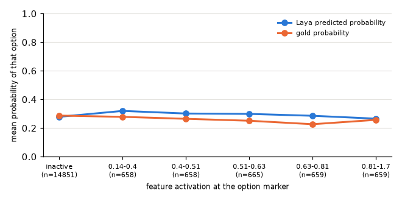

# Feature 10340

Critérios em que aparece: attribution_toward_wrong

**Interpretação (preencher):** 

---

## Maiores ativações

**tr_customer_service_000191 / needs_human** (noul, customer_service) | ativação 3.434 em `estado` | opções ['false', 'true'] | Laya: **true** [0.469, 0.531] | gabarito: **true**

```
[CLS]noul question: This conversation requires a human agent rather than automated handling.[SEP]
▸ [MASK] false: Automation can carry this to resolution.
▸ [MASK] true: A human must take over: judgement, authority or empathy is required.

[SEP]

{"account": {"lifetime_value_usd": 35, "prior_tickets_90d": 5, "seats": 1, "tenure_months": 1, "tier": "standard"}, "thread": [{"role": "customer", "text": "I’m done with this login nonsense. I’ve only been on the standard plan for a month, and already I can’t get into my dashboard. I’ve opened five tickets already that never got resolved, and I’m ready to cancel."}, {"role": "agent", "text": "I hear your frustration. Can you tell me the exact message you see when you attempt to sign in and the browser you’re using?"}, {"role": "customer", "text": "It just loops⟦ back⟧ to the login page with no error, even after clearing cookies. I’ve tried Chrome and Firefox, same thing."}]}[SEP]
```

**tr_customer_service_000299 / needs_human** (noul, customer_service) | ativação 3.154 em `estado` | opções ['false', 'true'] | Laya: **true** [0.423, 0.577] | gabarito: **true**

```
[CLS]noul question: This conversation requires a human agent rather than automated handling.[SEP]
▸ [MASK] false: Automation can carry this to resolution.
▸ [MASK] true: A human must take over: judgement, authority or empathy is required.

[SEP]

{"account": {"lifetime_value_usd": 4289, "prior_tickets_90d": 1, "seats": 3, "tenure_months": 72, "tier": "premium"}, "orders": [{"amount_usd": 29, "date": "2026-01-21", "id": "A-19524",⟦ "⟧status": "settled"}, {"amount_usd": 29, "date": "2026-03-11", "id": "A-67481", "status": "settled"}, {"amount_usd": 29, "date": "2026-03-12", "id": "A-89299", "status": "settled"}], "thread": [{"role": "customer", "text": "I've had this account for six years and I'm done. Cancel my subscription immediately!"}, {"role": "agent", "text": "I can certainly look into that for you. To ensure I have the right account, could you please verify the email address associated with your billing?"}, {"role": "customer", "text": "You should already have it from the ticket I opened last month that you guys barely even helped me with!"}]}[SEP]
```

**tr_customer_service_000248 / needs_human** (noul, customer_service) | ativação 2.857 em `estado` | opções ['false', 'true'] | Laya: **true** [0.497, 0.503] | gabarito: **true**

```
[CLS]noul question: This conversation requires a human agent rather than automated handling.[SEP]
▸ [MASK] false: Automation can carry this to resolution.
▸ [MASK] true: A human must take over: judgement, authority or empathy is required.

[SEP]

{"account": {"lifetime_value_usd": 5956, "prior_tickets_90d": 0, "seats": 1, "tenure_months": 72, "tier": "standard"}, "orders": [{"amount_usd": 19, "date": "2026-02-20", "id": "A-97410", "status": "pending"}], "thread": [{"role": "customer", "text": "I just opened my package and I'm quite puzzled, I ordered the matte black frame but the one in the box is a very bright glossy silver."}, {"role": "agent", "text": "I appreciate you reaching out about this discrepancy. Could you let me know if the SKU number printed on the external packaging matches your order confirmation?"}, {"role": "customer", "text": "Let's see... the box says SKU-992, but I'm looking at the email I got when I ordered it and that says I should have received SKU-995."}, {"role": "agent", "text": "Thank you for checking that. Besides the color being incorrect, does the frame appear to be the correct size that you requested, or is that different as well?"}, {"role": "customer", "text": "The size seems to be the 11x14 I wanted, it's just the finish that's totally wrong and won't work for where I wanted to hang it."}, {"role": "agent", "text": "I understand. To help me document this correctly for our warehouse team, could you describe any other labels or markings you see on the inner protective wrapping?"}, {"role": "customer", "text": "There aren't really any other labels on the inside, just the clear plastic sleeve, so I'm still trying to figure out how I ended up with silver instead⟦ of⟧ black."}]}[SEP]
```

**tr_customer_service_000017 / urgency** (score, customer_service) | ativação 2.832 em `estado` | opções ['0', '1', '2', '3'] | Laya: **1** [0.119, 0.459, 0.178, 0.244] | gabarito: **3**

```
[CLS]score question: How time-sensitive is this conversation?[SEP]
▸ [MASK] level 0: No time pressure; can wait indefinitely.
▸ [MASK] level 1: Routine; handle within the normal queue.
▸ [MASK] level 2: Elevated; should be handled within the same week.
▸ [MASK] level 3: Critical; requires action within the same day.

[SEP]

{"account": {"lifetime_value_usd": 228, "prior_tickets_90d": 3, "seats": 1, "tenure_months": 11, "tier": "premium"}, "orders": [{"amount_usd": 29, "date": "2026-03-25", "id": "A-17351", "status": "settled"}, {"amount_usd": 29, "date": "2026-02-18", "id": "A-55118", "status": "settled"}], "thread": [{"role": "customer", "text": "My payment for the $29 subscription failed this morning. I have a presentation tomorrow morning at 9:00 AM that requires this access, so I need this cleared up immediately."}, {"role": "agent", "text": "I see the status of your account. Before we look into the billing error, could you confirm if the payment method on file has expired or if you have recently updated your banking information?"}, {"role": "customer", "text": "The card is current and active. I have had three previous tickets regarding billing glitches that were supposedly addressed, yet here I am again with the same issue."}, {"role": "agent", "text": "I acknowledge your frustration regarding the previous tickets. To investigate this specific failure, could you provide the transaction reference ID shown in your payment history?"}, {"role": "customer", "text": "I am looking at my bank portal now, but I don't see a⟦ reference⟧ ID generated for this attempt. How are we going to fix this before my deadline tomorrow?"}]}[SEP]
```

**tr_customer_service_000191 / needs_human** (noul, customer_service) | ativação 2.768 em `estado` | opções ['false', 'true'] | Laya: **true** [0.469, 0.531] | gabarito: **true**

```
[CLS]noul question: This conversation requires a human agent rather than automated handling.[SEP]
▸ [MASK] false: Automation can carry this to resolution.
▸ [MASK] true: A human must take over: judgement, authority or empathy is required.

[SEP]

{"account": {"lifetime_value_usd": 35, "prior_tickets_90d": 5, "seats": 1, "tenure_months": 1, "tier": "standard"}, "thread": [{"role": "customer", "text": "I’m done with this login nonsense. I’ve only been on the standard plan for a month, and already I can’t get into my dashboard. I’ve opened five tickets already that never got resolved, and I’m ready to cancel."}, {"role": "agent", "text": "I hear your frustration. Can you tell me the exact message you see when you attempt to sign in and the browser you’re using?"}, {"role": "customer", "text": "It just loops back to the login page with⟦ no⟧ error, even after clearing cookies. I’ve tried Chrome and Firefox, same thing."}]}[SEP]
```

## Ativações medianas (faixa 40-60%, mediana 0.698)

**tr_invoice_processing_000278 / urgency** (score, invoice_processing) | ativação 0.704 em `estado` | opções ['0', '1', '2', '3'] | Laya: **1** [0.21, 0.53, 0.159, 0.1] | gabarito: **2**

```
[CLS]score question: How time-sensitive is processing this invoice?[SEP]
▸ [MASK] level 0: No time pressure; can wait indefinitely.
▸ [MASK] level 1: Routine; handle within the normal queue.
▸ [MASK] level 2: Elevated; should be handled within the same week.
▸ [MASK] level 3: Critical; requires action within the same day.

[SEP]

{"delivery": {"condition": "accepted", "date": "2026-03-20", "received_qty": 25}, "invoice": {"currency": "USD", "id": "INV-2026-7761", "lines": [{"qty": 25, "sku": "SKU-466", "total_usd": 8533.⟦0⟧, "unit_usd": 341.32}], "total_usd": 8533.0, "vendor": "Vantage Materials"}, "payment": {"days_until_due": 5, "discount_expires_in_days": null, "early_payment_discount_pct": null, "status": "scheduled", "terms": "net 45"}, "purchase_order": {"freight_terms": "freight prepaid by vendor, not separately billable", "id": "PO-3755", "lines": [{"qty": 25, "unit_usd": 341.32}], "total_usd": 8533.0}, "vendor_history": {"disputes_12m": 5, "invoices_12m": 51, "prior_invoice_ids": ["INV-2026-2143", "INV-2026-9910"]}}[SEP]
```

**tr_invoice_processing_000187 / urgency** (score, invoice_processing) | ativação 0.674 em `estado` | opções ['0', '1', '2', '3'] | Laya: **1** [0.232, 0.479, 0.188, 0.1] | gabarito: **1**

```
[CLS]score question: How time-sensitive is processing this invoice?[SEP]
▸ [MASK] level 0: No time pressure; can wait indefinitely.
▸ [MASK] level 1: Routine; handle within the normal queue.
▸ [MASK] level 2: Elevated; should be handled within the same week.
▸ [MASK] level 3: Critical; requires action within the same day.

[SEP]

{"delivery": {"condition": "accepted with exceptions", "date": "2026-03-23", "received_qty": 1000}, "invoice": {"currency": "USD", "id": "INV-2026-9934", "⟦lines⟧": [{"qty": 1000, "sku": "SKU-841", "total_usd": 111730.0, "unit_usd": 111.73}], "total_usd": 111730.0, "vendor": "Acme Fabrication"}, "payment": {"days_until_due": 44, "discount_expires_in_days": null, "early_payment_discount_pct": null, "status": "scheduled", "terms": "net 30"}, "purchase_order": {"freight_terms": "freight prepaid by vendor, not separately billable", "id": null, "lines": [{"qty": 1000, "unit_usd": 111.73}], "total_usd": 111730.0}, "vendor_history": {"disputes_12m": 2, "invoices_12m": 33, "prior_invoice_ids": ["INV-2026-9102"]}}[SEP]
```

**tr_customer_service_000200 / needs_human** (noul, customer_service) | ativação 0.778 em `estado` | opções ['false', 'true'] | Laya: **true** [0.401, 0.599] | gabarito: **false**

```
[CLS]noul question: This conversation requires a human agent rather than automated handling.[SEP]
▸ [MASK] false: Automation can carry this to resolution.
▸ [MASK] true: A human must take over: judgement, authority or empathy is required.

[SEP]

{"account": {"lifetime_value_usd": 1072, "prior_tickets_90d": 0, "seats": 12, "tenure_months": 41, "tier": "premium"}, "orders": [{"amount_usd": 29, "date": "2026-03-18", "id": "A-98366", "status": "refunded"}, {"amount_usd": 29, "date": "2026-03-25", "id": "A-11332", "status": "settled"}, {"amount_usd": 29, "date": "2026-03-18", "id": "A-35045", "status": "failed"}], "thread": [{"role": "customer", "text": "I can't believe you just charged me $29 this month! I've been on the premium plan for over three years and never saw this price before. This is unacceptable!"}, {"role": "agent", "text": "I’m sorry you’re seeing an unexpected charge. Could you confirm the email address linked to your account so I can look into the billing details?"}, {"role": "customer", "text": "Fine. It’s john.doe@example.com. I’ve been paying the same amount for 41 months, and now this random jump appears on my statement. I need an explanation,⟦ not⟧ a generic apology."}, {"role": "agent", "text": "Thank you for confirming. I’ll pull up the recent invoices. Just to be sure, are you referring to the $29.00 charge labeled as “Premium Plan Renewal” on your latest bill?"}, {"role": "customer", "text": "Yes, that’s the one. I want to know why it’s higher now and what I’m supposed to do about it. Please tell me what’s going on."}]}[SEP]
```

**tr_invoice_processing_000236 / urgency** (score, invoice_processing) | ativação 0.637 em `estado` | opções ['0', '1', '2', '3'] | Laya: **1** [0.206, 0.583, 0.143, 0.068] | gabarito: **1**

```
[CLS]score question: How time-sensitive is processing this invoice?[SEP]
▸ [MASK] level 0: No time pressure; can wait indefinitely.
▸ [MASK] level 1: Routine; handle within the normal queue.
▸ [MASK] level 2: Elevated; should be handled within the same week.
▸ [MASK] level 3: Critical; requires action within the same day.

[SEP]

{"delivery": {"condition": "accepted", "date": "2026-03-12", "received_qty": 100}, "invoice": {"currency": "USD", "id": "INV-2026-1634", "lines": [{"qty": 100, "sku": "SKU-778", "total_usd": 10547.0, "unit_usd": 105.47}], "total_usd": 10547.0, "vendor": "Vantage Materials"}, "payment": {"days_until_due": 11, "discount_expires_in_days": null, "early_payment_discount_pct": null, "status": "scheduled", "terms": "net 30"}, "purchase_order": {"freight_terms": "freight prepaid by vendor, not separately billable", "id": "PO-9952", "lines": [{"qty": 100, "unit_usd": 105.47}], "total_usd": 10547.⟦0⟧}, "vendor_history": {"disputes_12m": 0, "invoices_12m": 23, "prior_invoice_ids": ["INV-2026-7453", "INV-2026-1696", "INV-2026-9853"]}}[SEP]
```

**tr_invoice_processing_000135 / disposition** (choice, invoice_processing) | ativação 0.702 em `estado` | opções ['approve', 'hold', 'manual_review', 'reject'] | Laya: **approve** [0.388, 0.232, 0.16, 0.221] | gabarito: **manual_review**

```
[CLS]choice question: How should this vendor invoice be dispositioned?[SEP]
▸ [MASK] approve: Matches the order and delivery; approve for payment.
▸ [MASK] hold: Something needs confirming before payment; hold pending clarification.
▸ [MASK] manual_review: A human in finance must review the discrepancy.
▸ [MASK] reject: Should not be paid: duplicate, unauthorised or materially wrong.

[SEP]

{"delivery": {"condition": "accepted with exceptions", "date": "2026-03-24", "received_qty": 10}, "invoice": {"currency": "USD", "id": "INV-2026-3267", "lines": [{"qty": 10, "sku": "SKU-451", "total_usd": 2383.7, "unit_usd": 238.37}], "total_usd": 2383.7, "vendor": "Vantage Materials"}, "payment": {"days_until_due": 5, "discount_expires_in_days": null, "early_payment_discount_pct": null, "status": "scheduled", "terms": "net 15"}, "purchase_order": {"freight_terms": "freight prepaid by vendor, not separately billable", "id": "PO-9358", "lines":⟦ [⟧{"qty": 10, "unit_usd": 280.43}], "total_usd": 2804.3}, "vendor_history": {"disputes_12m": 1, "invoices_12m": 12, "prior_invoice_ids": ["INV-2026-5018"]}}[SEP]
```

## Estatísticas (conjunto de descoberta, dev e teste)

**pred / error**

| split | decisões | ativas | ativas e Laya errou | taxa | lift | q (BH) | OR (CMH) | q (CMH) |
|---|---|---|---|---|---|---|---|---|
| discovery | 5100 | 997 | 665 | 0.667 | 1.05 | 0.0467 | 0.92 | 0.634 |
| dev | 900 | 192 | 123 | 0.641 | 0.98 | 0.87 | 0.67 | 0.346 |
| test | 2000 | 397 | 278 | 0.700 | 1.10 | 0.00873 | 0.77 | 0.387 |

**corr / error**

| split | decisões | ativas | ativas e Laya errou | taxa | lift | q (BH) | OR (CMH) | q (CMH) |
|---|---|---|---|---|---|---|---|---|
| discovery | 5100 | 831 | 499 | 0.600 | 0.94 | 0.028 | 1.72 | 0.0184 |
| dev | 900 | 166 | 97 | 0.584 | 0.89 | 0.0599 | 0.38 | 0.207 |
| test | 2000 | 314 | 195 | 0.621 | 0.97 | 0.609 | 1.18 | 0.699 |

**state / error**

| split | decisões | ativas | ativas e Laya errou | taxa | lift | q (BH) | OR (CMH) | q (CMH) |
|---|---|---|---|---|---|---|---|---|
| discovery | 5100 | 4063 | 2581 | 0.635 | 1.00 | 0.95 | 1.11 | 0.382 |
| dev | 900 | 745 | 482 | 0.647 | 0.99 | 0.993 | 0.81 | 0.634 |
| test | 2000 | 1653 | 1059 | 0.641 | 1.01 | 0.906 | 1.27 | 0.242 |

Confusão mais sobre-representada (pred): `urgency|1>2` (n=191, lift 3.50, p=0). Formato `pergunta|índice previsto>índice correto`.

Confusão mais sobre-representada (corr): `discrepancy_severity|0>2` (n=65, lift 6.14, p=0). Formato `pergunta|índice previsto>índice correto`.

Confusão mais sobre-representada (state): `duplicate|1>0` (n=213, lift 1.24, p=4.86e-18). Formato `pergunta|índice previsto>índice correto`.



