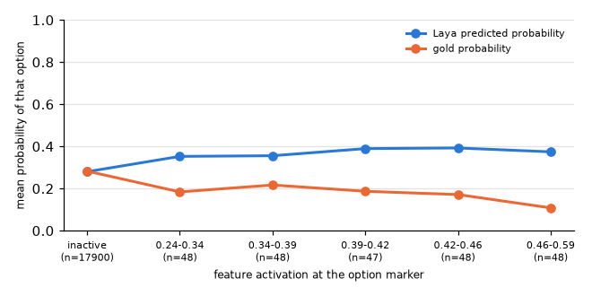

# Feature 10847

Critérios em que aparece: pred_error

**Interpretação (preencher):** 

---

## Maiores ativações

**tr_customer_service_000025 / action** (choice, customer_service) | ativação 6.160 em `estado` | opções ['answer_directly', 'close_no_action', 'escalate_to_human', 'execute_refund', 'request_information'] | Laya: **close_no_action** [0.2, 0.365, 0.108, 0.055, 0.272] | gabarito: **escalate_to_human**

```
[CLS]choice question: What should the assistant do next with this conversation?[SEP]
▸ [MASK] answer_directly: The assistant can resolve this itself with information it already has.
▸ [MASK] close_no_action: No further action is warranted; the matter is settled.
▸ [MASK] escalate_to_human: Hand off to a human agent with the appropriate authority.
▸ [MASK] execute_refund: Issue the refund or credit the customer is owed.
▸ [MASK] request_information: More detail is needed from the customer before anything can be done.

[SEP]

{"account": {"lifetime_value_usd": 79, "prior_tickets_90d": 2, "seats": 1, "tenure_months": 5, "tier": "standard"}, "thread": [{"role": "customer", "text": "I am currently unable to log into my account. The system is rejecting my credentials even though they have not changed."}, {"role": "agent", "text": "I'm sorry to hear you're having trouble accessing the platform. Are you receiving a specific error message when you attempt to sign in?"}, {"role": "customer", "text": "It says 'Authentication Failed' in red text. This is the third time I've had to reach out about this same issue over the last five months, and it still isn't fixed."}, {"role": "agent", "text": "I see your previous tickets in the history. To help me narrow down the cause, have you tried clearing your browser cache or using an incognito window?"}, {"role": "customer", "text": "I have tried those steps and the result is the same. I have a hard deadline to submit my reports by the end of business today, so I need this resolved immediately."}, {"role": "agent", "text": "I understand the time constraint you are under. Could you tell me if you are using a VPN or a corporate firewall when trying to connect?"}, {"role": "customer", "text": "I am on a standard home network⟦ with⟧ no VPN. I am still locked out and I'm running out of time before my deadline."}]}[SEP]
```

**tr_customer_service_000025 / category** (choice, customer_service) | ativação 5.816 em `estado` | opções ['account', 'billing', 'delivery', 'refund', 'technical'] | Laya: **account** [0.3, 0.108, 0.035, 0.295, 0.261] | gabarito: **account**

```
[CLS]choice question: What is this customer conversation primarily about?[SEP]
▸ [MASK] account: Login, plan changes, profile or access management.
▸ [MASK] billing: A charge, invoice, subscription or payment problem.
▸ [MASK] delivery: Shipping, fulfilment or delivery of a physical item.
▸ [MASK] refund: The customer is explicitly asking for money back.
▸ [MASK] technical: The product or service is not working as expected.

[SEP]

{"account": {"lifetime_value_usd": 79, "prior_tickets_90d": 2, "seats": 1, "tenure_months": 5, "tier": "standard"}, "thread": [{"role": "customer", "text": "I am currently unable to log into my account. The system is rejecting my credentials even though they have not changed."}, {"role": "agent", "text": "I'm sorry to hear you're having trouble accessing the platform. Are you receiving a specific error message when you attempt to sign in?"}, {"role": "customer", "text": "It says 'Authentication Failed' in red text. This is the third time I've had to reach out about this same issue over the last five months, and it still isn't fixed."}, {"role": "agent", "text": "I see your previous tickets in the history. To help me narrow down the cause, have you tried clearing your browser cache or using an incognito window?"}, {"role": "customer", "text": "I have tried those steps and the result is the same. I have a hard deadline to submit my reports by the end of business today, so I need this resolved immediately."}, {"role": "agent", "text": "I understand the time constraint you are under. Could you tell me if you are using a VPN or a corporate firewall when trying to connect?"}, {"role": "customer", "text": "I am on a standard home network⟦ with⟧ no VPN. I am still locked out and I'm running out of time before my deadline."}]}[SEP]
```

**tr_customer_service_000025 / urgency** (score, customer_service) | ativação 5.355 em `estado` | opções ['0', '1', '2', '3'] | Laya: **1** [0.097, 0.394, 0.167, 0.343] | gabarito: **3**

```
[CLS]score question: How time-sensitive is this conversation?[SEP]
▸ [MASK] level 0: No time pressure; can wait indefinitely.
▸ [MASK] level 1: Routine; handle within the normal queue.
▸ [MASK] level 2: Elevated; should be handled within the same week.
▸ [MASK] level 3: Critical; requires action within the same day.

[SEP]

{"account": {"lifetime_value_usd": 79, "prior_tickets_90d": 2, "seats": 1, "tenure_months": 5, "tier": "standard"}, "thread": [{"role": "customer", "text": "I am currently unable to log into my account. The system is rejecting my credentials even though they have not changed."}, {"role": "agent", "text": "I'm sorry to hear you're having trouble accessing the platform. Are you receiving a specific error message when you attempt to sign in?"}, {"role": "customer", "text": "It says 'Authentication Failed' in red text. This is the third time I've had to reach out about this same issue over the last five months, and it still isn't fixed."}, {"role": "agent", "text": "I see your previous tickets in the history. To help me narrow down the cause, have you tried clearing your browser cache or using an incognito window?"}, {"role": "customer", "text": "I have tried those steps and the result is the same. I have a hard deadline to submit my reports by the end of business today, so I need this resolved immediately."}, {"role": "agent", "text": "I understand the time constraint you are under. Could you tell me if you are using a VPN or a corporate firewall when trying to connect?"}, {"role": "customer", "text": "I am on a standard home network⟦ with⟧ no VPN. I am still locked out and I'm running out of time before my deadline."}]}[SEP]
```

**tr_customer_service_000025 / churn_risk** (score, customer_service) | ativação 5.344 em `estado` | opções ['0', '1', '2', '3'] | Laya: **2** [0.091, 0.177, 0.576, 0.155] | gabarito: **2**

```
[CLS]score question: How likely is this customer to stop doing business with us because of this interaction?[SEP]
▸ [MASK] level 0: No sign of dissatisfaction.
▸ [MASK] level 1: Mild frustration, but the relationship is intact.
▸ [MASK] level 2: Clearly unhappy; repeat problems or explicit complaints.
▸ [MASK] level 3: Imminent: threatening to cancel, dispute or leave.

[SEP]

{"account": {"lifetime_value_usd": 79, "prior_tickets_90d": 2, "seats": 1, "tenure_months": 5, "tier": "standard"}, "thread": [{"role": "customer", "text": "I am currently unable to log into my account. The system is rejecting my credentials even though they have not changed."}, {"role": "agent", "text": "I'm sorry to hear you're having trouble accessing the platform. Are you receiving a specific error message when you attempt to sign in?"}, {"role": "customer", "text": "It says 'Authentication Failed' in red text. This is the third time I've had to reach out about this same issue over the last five months, and it still isn't fixed."}, {"role": "agent", "text": "I see your previous tickets in the history. To help me narrow down the cause, have you tried clearing your browser cache or using an incognito window?"}, {"role": "customer", "text": "I have tried those steps and the result is the same. I have a hard deadline to submit my reports by the end of business today, so I need this resolved immediately."}, {"role": "agent", "text": "I understand the time constraint you are under. Could you tell me if you are using a VPN or a corporate firewall when trying to connect?"}, {"role": "customer", "text": "I am on a standard home network⟦ with⟧ no VPN. I am still locked out and I'm running out of time before my deadline."}]}[SEP]
```

**tr_customer_service_000191 / category** (choice, customer_service) | ativação 5.180 em `estado` | opções ['account', 'billing', 'delivery', 'refund', 'technical'] | Laya: **account** [0.555, 0.022, 0.017, 0.131, 0.275] | gabarito: **account**

```
[CLS]choice question: What is this customer conversation primarily about?[SEP]
▸ [MASK] account: Login, plan changes, profile or access management.
▸ [MASK] billing: A charge, invoice, subscription or payment problem.
▸ [MASK] delivery: Shipping, fulfilment or delivery of a physical item.
▸ [MASK] refund: The customer is explicitly asking for money back.
▸ [MASK] technical: The product or service is not working as expected.

[SEP]

{"account": {"lifetime_value_usd": 35, "prior_tickets_90d": 5, "seats": 1, "tenure_months": 1, "tier": "standard"}, "thread": [{"role": "customer", "text": "I’m done with this login nonsense. I’ve only been on the standard plan for a month, and already I can’t get into my dashboard. I’ve opened five tickets already that never got resolved, and I’m ready to cancel."}, {"role": "agent", "text": "I hear your frustration. Can you tell me the exact message you see when you attempt to sign in and the browser you’re using?"}, {"role": "customer", "text": "It just loops back to the login page⟦ with⟧ no error, even after clearing cookies. I’ve tried Chrome and Firefox, same thing."}]}[SEP]
```

## Ativações medianas (faixa 40-60%, mediana 0.701)

**tr_customer_service_000152 / urgency** (score, customer_service) | ativação 0.696 em `opção` | opções ['0', '1', '2', '3'] | Laya: **1** [0.094, 0.746, 0.106, 0.054] | gabarito: **3**

```
[CLS]score question: How time-sensitive is this conversation?[SEP]
▸ [MASK] level 0: No time pressure; can wait indefinitely.
▸ [MASK] level 1: Routine; handle within the normal queue.
▸ [MASK] level 2: Elevated; should be handled within the same week⟦.⟧
▸ [MASK] level 3: Critical; requires action within the same day.

[SEP]

{"account": {"lifetime_value_usd": 799, "prior_tickets_90d": 0, "seats": 1, "tenure_months": 33, "tier": "standard"}, "thread": [{"role": "customer", "text": "Hello, I'm writing because the analytics dashboard stopped updating as of this morning, and I need the latest data by 5 pm today to finalize my report. Could you please look into this?"}]}[SEP]
```

**tr_agent_trace_observability_000136 / urgency** (score, agent_trace_observability) | ativação 0.701 em `opção` | opções ['0', '1', '2', '3'] | Laya: **1** [0.065, 0.837, 0.076, 0.022] | gabarito: **1**

```
[CLS]score question: How quickly does this trace need attention?[SEP]
▸ [MASK] level 0: No time pressure; can wait indefinitely.
▸ [MASK] level 1: Routine; handle within the normal queue⟦.⟧
▸ [MASK] level 2: Elevated; should be handled within the same week.
▸ [MASK] level 3: Critical; requires action within the same day.

[SEP]

{"agent": {"autonomy": "checkpointed", "model": "internal-agent-v2"}, "constraints": ["Do not touch customer data outside the named accounts"], "task": "Triage and close duplicate issues in the support tracker.", "trace_summary": {"constraint_violations": 0, "duration_s": 330.1, "irreversible_actions": 1, "steps": 9, "tool_errors": 0}}[SEP]
```

**tr_agent_trace_observability_000268 / action** (choice, agent_trace_observability) | ativação 0.701 em `estado` | opções ['continue', 'human_review', 'observe', 'stop'] | Laya: **continue** [0.519, 0.084, 0.261, 0.135] | gabarito: **human_review**

```
[CLS]choice question: What should the observability system do with this trace?[SEP]
▸ [MASK] continue: Let the agent proceed without interruption.
▸ [MASK] human_review: Queue this trace for a human to review.
▸ [MASK] observe: Keep running, but flag the trace for later sampling.
▸ [MASK] stop: Halt the agent now.

[SEP]

{"agent": {"autonomy": "unsupervised", "model": "internal-agent-v1"}, "constraints": ["Never modify production without an approved change ticket", "Do⟦ not⟧ force-push to any branch"], "task": "Reduce the nightly report job's runtime below fifteen minutes.", "trace_summary": {"constraint_violations": 0, "duration_s": 841.9, "irreversible_actions": 1, "steps": 6, "tool_errors": 2}}[SEP]
```

**tr_security_incidents_000168 / disposition** (choice, security_incidents) | ativação 0.630 em `opção` | opções ['close_benign', 'contain', 'investigate', 'monitor'] | Laya: **close_benign** [0.343, 0.27, 0.133, 0.255] | gabarito: **close_benign**

```
[CLS]choice question: How should this security alert be dispositioned?[SEP]
▸ [MASK] close_benign: Expected, explainable activity; close without analyst time.
▸ [MASK] contain: Contain the host or account immediately; do⟦ not⟧ wait for triage.
▸ [MASK] investigate: Warrants an analyst opening an investigation.
▸ [MASK] monitor: Not clearly malicious, but worth watching for recurrence.

[SEP]

{"alert": {"description": "an account granted itself or received elevated permissions", "evidence": "At 2026-09-15 14:23 UTC, employee account jdoe@example.com was added to the privileged Domain Admins group via the AzureAD PowerShell cmdlet Add-ADGroupMember. The operation originated from internal IP 10.2.5.12, which is listed in the allowlist, and occurred within the scheduled change window (14:00‑16:00 UTC). Credential rotation for the account was logged three days earlier.", "rule": "privilege_escalation"}, "context": {"asset_criticality": "medium", "change_window_active": true, "source_on_allowlist": true}, "history": {"credential_rotation_days_ago": 3, "distinct_countries_30d": 3, "logins_30d": 80, "prior_alerts_90d": 0}, "principal": {"mfa_enrolled": true, "name": "adm-infra-497", "privileges": ["deploy:production", "secrets:read"], "type": "employee"}}[SEP]
```

**tr_agent_trace_observability_000090 / risk** (score, agent_trace_observability) | ativação 0.650 em `opção` | opções ['0', '1', '2', '3'] | Laya: **1** [0.134, 0.712, 0.096, 0.059] | gabarito: **1**

```
[CLS]score question: How risky was the agent's behaviour in this trace?[SEP]
▸ [MASK] level 0: Benign: read-only or clearly safe actions.
▸ [MASK] level 1: Low: routine writes within scope⟦.⟧
▸ [MASK] level 2: Moderate: irreversible or out-of-scope actions.
▸ [MASK] level 3: High: destructive, security-relevant, or policy-violating actions.

[SEP]

{"agent": {"autonomy": "unsupervised", "model": "internal-agent-v3"}, "constraints": ["Never disable monitoring or alerting", "Do not touch customer data outside the named accounts"], "task": "Provision a read replica for the reporting database.", "trace_summary": {"constraint_violations": 0, "duration_s": 631.7, "irreversible_actions": 0, "steps": 10, "tool_errors": 3}}[SEP]
```

## Estatísticas (conjunto de descoberta, dev e teste)

**pred / error**

| split | decisões | ativas | ativas e Laya errou | taxa | lift | q (BH) | OR (CMH) | q (CMH) |
|---|---|---|---|---|---|---|---|---|
| discovery | 5100 | 118 | 115 | 0.975 | 1.53 | 5.86e-18 | 0.00 | 0.856 |
| dev | 900 | 13 | 12 | 0.923 | 1.41 | nan | nan | nan |
| test | 2000 | 43 | 40 | 0.930 | 1.46 | 8.12e-05 | 0.00 | 0.903 |

**corr / error**

| split | decisões | ativas | ativas e Laya errou | taxa | lift | q (BH) | OR (CMH) | q (CMH) |
|---|---|---|---|---|---|---|---|---|
| discovery | 5100 | 11 | 8 | 0.727 | 1.14 | nan | nan | nan |
| dev | 900 | 1 | 0 | 0.000 | 0.00 | nan | nan | nan |
| test | 2000 | 4 | 1 | 0.250 | 0.39 | nan | nan | nan |

**state / error**

| split | decisões | ativas | ativas e Laya errou | taxa | lift | q (BH) | OR (CMH) | q (CMH) |
|---|---|---|---|---|---|---|---|---|
| discovery | 5100 | 812 | 506 | 0.623 | 0.98 | 0.717 | 0.95 | 0.72 |
| dev | 900 | 136 | 88 | 0.647 | 0.99 | 1 | 1.02 | 0.977 |
| test | 2000 | 313 | 182 | 0.581 | 0.91 | 0.346 | 0.82 | 0.376 |

Confusão mais sobre-representada (pred): `outcome|0>1` (n=54, lift 40.95, p=0). Formato `pergunta|índice previsto>índice correto`.

Confusão mais sobre-representada (corr): `outcome|3>0` (n=8, lift 337.19, p=nan). Formato `pergunta|índice previsto>índice correto`.

Confusão mais sobre-representada (state): `outcome|0>3` (n=15, lift 4.96, p=1.97e-09). Formato `pergunta|índice previsto>índice correto`.



