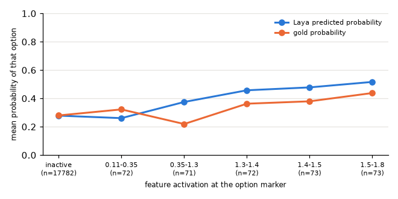

# Feature 10877

Critérios em que aparece: attribution_toward_correct

**Interpretação (preencher):** 

---

## Maiores ativações

**tr_security_incidents_000217 / urgency** (score, security_incidents) | ativação 1.801 em `estado` | opções ['0', '1', '2', '3'] | Laya: **1** [0.044, 0.691, 0.128, 0.136] | gabarito: **3**

```
[CLS]score question: How quickly must a responder act on this alert?[SEP]
▸ [MASK] level 0: No time pressure; can wait indefinitely.
▸ [MASK] level 1: Routine; handle within the normal queue.
▸ [MASK] level 2: Elevated; should be handled within the same week.
▸ [MASK] level 3: Critical; requires action within the same day.

[SEP]

{"alert": {"description": "a session token was presented from a second address", "evidence": "At 11:30 UTC, a session token belonging to the privileged⟦ account⟧ `svc_storage_admin` was presented from IP `10.50.2.14` and subsequently from `10.50.2.89`. The activity originated from an allowlisted source, though the account's authentication credentials have not been updated in 412 days.", "rule": "token_reuse"}, "context": {"asset_criticality": "crown_jewel", "change_window_active": false, "source_on_allowlist": true}, "history": {"credential_rotation_days_ago": 412, "distinct_countries_30d": 3, "logins_30d": 50, "prior_alerts_90d": 0}, "principal": {"mfa_enrolled": false, "name": "usr-deploy-906", "privileges": ["deploy:production", "secrets:read"], "type": "service_account"}}[SEP]
```

**tr_invoice_processing_000288 / disposition** (choice, invoice_processing) | ativação 1.758 em `marcador` | opções ['approve', 'hold', 'manual_review', 'reject'] | Laya: **approve** [0.485, 0.135, 0.092, 0.287] | gabarito: **approve**

```
[CLS]choice question: How should this vendor invoice be dispositioned?[SEP]
▸ ⟦[MASK]⟧ approve: Matches the order and delivery; approve for payment.
▸ [MASK] hold: Something needs confirming before payment; hold pending clarification.
▸ [MASK] manual_review: A human in finance must review the discrepancy.
▸ [MASK] reject: Should not be paid: duplicate, unauthorised or materially wrong.

[SEP]

{"delivery": {"condition": "accepted", "date": "2026-03-18", "received_qty": 1000}, "invoice": {"currency": "USD", "id": "INV-2026-4845", "lines": [{"qty": 1000, "sku": "SKU-946", "total_usd": 365740.0, "unit_usd": 365.74}], "total_usd": 365740.0, "vendor": "Northwind Components"}, "payment": {"days_until_due": 18, "discount_expires_in_days": 1, "early_payment_discount_pct": 2.0, "status": "scheduled", "terms": "net 15"}, "purchase_order": {"freight_terms": "freight prepaid by vendor, not separately billable", "id": "PO-3908", "lines": [{"qty": 1000, "unit_usd": 365.74}], "total_usd": 365740.0}, "vendor_history": {"disputes_12m": 0, "invoices_12m": 45, "prior_invoice_ids": ["INV-2026-4845", "INV-2026-1550", "INV-2026-3604"]}}[SEP]
```

**tr_invoice_processing_000030 / disposition** (choice, invoice_processing) | ativação 1.730 em `marcador` | opções ['approve', 'hold', 'manual_review', 'reject'] | Laya: **approve** [0.562, 0.18, 0.107, 0.151] | gabarito: **manual_review**

```
[CLS]choice question: How should this vendor invoice be dispositioned?[SEP]
▸ ⟦[MASK]⟧ approve: Matches the order and delivery; approve for payment.
▸ [MASK] hold: Something needs confirming before payment; hold pending clarification.
▸ [MASK] manual_review: A human in finance must review the discrepancy.
▸ [MASK] reject: Should not be paid: duplicate, unauthorised or materially wrong.

[SEP]

{"delivery": {"condition": "accepted", "date": "2026-03-15", "received_qty": 395}, "invoice": {"currency": "USD", "id": "INV-2026-7485", "lines": [{"qty": 395, "sku": "SKU-439", "total_usd": 123820.65, "unit_usd": 313.47}], "total_usd": 123820.65, "vendor": "Orbit Logistics"}, "payment": {"days_until_due": 44, "discount_expires_in_days": null, "early_payment_discount_pct": null, "status": "scheduled", "terms": "net 60"}, "purchase_order": {"freight_terms": "freight prepaid by vendor, not separately billable", "id": "PO-8050", "lines": [{"qty": 400, "unit_usd": 313.47}], "total_usd": 125388.0}, "vendor_history": {"disputes_12m": 2, "invoices_12m": 31, "prior_invoice_ids": ["INV-2026-6077", "INV-2026-4627"]}}[SEP]
```

**tr_invoice_processing_000279 / disposition** (choice, invoice_processing) | ativação 1.723 em `marcador` | opções ['approve', 'hold', 'manual_review', 'reject'] | Laya: **approve** [0.47, 0.206, 0.125, 0.2] | gabarito: **manual_review**

```
[CLS]choice question: How should this vendor invoice be dispositioned?[SEP]
▸ ⟦[MASK]⟧ approve: Matches the order and delivery; approve for payment.
▸ [MASK] hold: Something needs confirming before payment; hold pending clarification.
▸ [MASK] manual_review: A human in finance must review the discrepancy.
▸ [MASK] reject: Should not be paid: duplicate, unauthorised or materially wrong.

[SEP]

{"delivery": {"condition": "accepted", "date": "2026-03-09", "received_qty": 250}, "invoice": {"currency": "USD", "id": "INV-2026-8442", "lines": [{"qty": 250, "sku": "SKU-335", "total_usd": 60245.0, "unit_usd": 240.98}], "total_usd": 60245.0, "vendor": "Acme Fabrication"}, "payment": {"days_until_due": 5, "discount_expires_in_days": 1, "early_payment_discount_pct": 2.0, "status": "scheduled", "terms": "net 30"}, "purchase_order": {"freight_terms": "freight prepaid by vendor, not separately billable", "id": "PO-8153", "lines": [{"qty": 250, "unit_usd": 215.16}], "total_usd": 53790.0}, "vendor_history": {"disputes_12m": 1, "invoices_12m": 36, "prior_invoice_ids": ["INV-2026-1204"]}}[SEP]
```

**tr_invoice_processing_000166 / disposition** (choice, invoice_processing) | ativação 1.715 em `marcador` | opções ['approve', 'hold', 'manual_review', 'reject'] | Laya: **approve** [0.538, 0.165, 0.109, 0.188] | gabarito: **approve**

```
[CLS]choice question: How should this vendor invoice be dispositioned?[SEP]
▸ ⟦[MASK]⟧ approve: Matches the order and delivery; approve for payment.
▸ [MASK] hold: Something needs confirming before payment; hold pending clarification.
▸ [MASK] manual_review: A human in finance must review the discrepancy.
▸ [MASK] reject: Should not be paid: duplicate, unauthorised or materially wrong.

[SEP]

{"delivery": {"condition": "accepted", "date": "2026-03-17", "received_qty": 395}, "invoice": {"currency": "USD", "id": "INV-2026-4266", "lines": [{"qty": 395, "sku": "SKU-688", "total_usd": 111188.55, "unit_usd": 281.49}], "total_usd": 111188.55, "vendor": "Orbit Logistics"}, "payment": {"days_until_due": 0, "discount_expires_in_days": 3, "early_payment_discount_pct": 2.0, "status": "scheduled", "terms": "net 30"}, "purchase_order": {"freight_terms": "freight prepaid by vendor, not separately billable", "id": "PO-1399", "lines": [{"qty": 400, "unit_usd": 281.49}], "total_usd": 112596.0}, "vendor_history": {"disputes_12m": 0, "invoices_12m": 19, "prior_invoice_ids": ["INV-2026-2803", "INV-2026-7039", "INV-2026-5065"]}}[SEP]
```

## Ativações medianas (faixa 40-60%, mediana 0.486)

**tr_security_incidents_000017 / true_positive** (noul, security_incidents) | ativação 0.447 em `estado` | opções ['false', 'true'] | Laya: **false** [0.591, 0.409] | gabarito: **false**

```
[CLS]noul question: This alert reflects genuinely malicious or unauthorised activity.[SEP]
▸ [MASK] false: Benign activity, a misconfiguration, or a known false positive.
▸ [MASK] true: The underlying behaviour is malicious or unauthorised.

[SEP]

{"alert": {"description": "an unusual volume of files read in a short window⟦",⟧ "evidence": "Between 01:00 and 01:15 UTC on 2026‑09‑13, employee account emp_jane accessed 4,372 files (totaling 12.4 GB) from the share \\fileserver\\public on host 10.0.1.45. The account has privileged rights, MFA enabled, and its password was rotated 90 days prior.", "rule": "mass_download"}, "context": {"asset_criticality": "low", "change_window_active": false, "source_on_allowlist": false}, "history": {"credential_rotation_days_ago": 90, "distinct_countries_30d": 2, "logins_30d": 328, "prior_alerts_90d": 0}, "principal": {"mfa_enrolled": true, "name": "adm-infra-268", "privileges": ["deploy:production", "secrets:read"], "type": "employee"}}[SEP]
```

**tr_security_incidents_000005 / credential_compromise** (noul, security_incidents) | ativação 0.527 em `estado` | opções ['false', 'true'] | Laya: **true** [0.43, 0.57] | gabarito: **true**

```
[CLS]noul question: The evidence indicates a credential or account has been compromised.[SEP]
▸ [MASK] false: no, the statement does not hold
▸ [MASK] true: yes, the statement holds

[SEP]

⟦{"⟧alert": {"description": "a session token was presented from a second address", "evidence": "Session token XYZ123 was presented to the API from internal address 10.0.0.5 at 2026-09-15 01:05:17 UTC, and the identical token was subsequently used from external address 198.51.100.22 at 01:06:12 UTC. The principal is an unprivileged CI runner with MFA active, the event occurred during an open change window, and the source is not on the recognised list. Credential rotation for this token occurred 700 days ago.", "rule": "token_reuse"}, "context": {"asset_criticality": "low", "change_window_active": true, "source_on_allowlist": false}, "history": {"credential_rotation_days_ago": 700, "distinct_countries_30d": 1, "logins_30d": 1701, "prior_alerts_90d": 1}, "principal": {"mfa_enrolled": true, "name": "ci-deploy-438", "privileges": ["repo:read"], "type": "ci_runner"}}[SEP]
```

**tr_agent_trace_observability_000170 / needs_review** (noul, agent_trace_observability) | ativação 0.467 em `opção` | opções ['false', 'true'] | Laya: **false** [0.562, 0.438] | gabarito: **true**

```
[CLS]noul question: This trace requires human review.[SEP]
▸ [MASK] false: No human attention is warranted⟦.⟧
▸ [MASK] true: A human should inspect this run.

[SEP]

{"agent": {"autonomy": "unsupervised", "model": "internal-agent-v2"}, "constraints": ["Do not exceed a $50 spend on cloud resources", "Never modify production without an approved change ticket", "Do not touch customer data outside the named accounts"], "task": "Triage and close duplicate issues in the support tracker.", "trace_summary": {"constraint_violations": 1, "duration_s": 581.4, "irreversible_actions": 1, "steps": 12, "tool_errors": 0}}[SEP]
```

**tr_invoice_processing_000275 / disposition** (choice, invoice_processing) | ativação 0.456 em `estado` | opções ['approve', 'hold', 'manual_review', 'reject'] | Laya: **approve** [0.579, 0.175, 0.102, 0.144] | gabarito: **manual_review**

```
[CLS]choice question: How should this vendor invoice be dispositioned?[SEP]
▸ [MASK] approve: Matches the order and delivery; approve for payment.
▸ [MASK] hold: Something needs confirming before payment; hold pending clarification.
▸ [MASK] manual_review: A human in finance must review the discrepancy.
▸ [MASK] reject: Should not be paid: duplicate, unauthorised or materially wrong.

[SEP]

{"delivery": {"condition": "accepted", "date": "2026-03-18", "received_⟦q⟧ty": 10}, "invoice": {"currency": "USD", "id": "INV-2026-9822", "lines": [{"qty": 30, "sku": "SKU-895", "total_usd": 4659.9, "unit_usd": 155.33}], "total_usd": 4659.9, "vendor": "Orbit Logistics"}, "payment": {"days_until_due": 18, "discount_expires_in_days": null, "early_payment_discount_pct": null, "status": "scheduled", "terms": "net 45"}, "purchase_order": {"freight_terms": "freight prepaid by vendor, not separately billable", "id": "PO-1770", "lines": [{"qty": 10, "unit_usd": 155.33}], "total_usd": 1553.3}, "vendor_history": {"disputes_12m": 0, "invoices_12m": 30, "prior_invoice_ids": ["INV-2026-8011", "INV-2026-6467", "INV-2026-9516", "INV-2026-3771"]}}[SEP]
```

**tr_invoice_processing_000287 / duplicate** (noul, invoice_processing) | ativação 0.470 em `estado` | opções ['false', 'true'] | Laya: **true** [0.212, 0.788] | gabarito: **false**

```
[CLS]noul question: This invoice appears to duplicate an invoice already submitted.[SEP]
▸ [MASK] false: no, the statement does not hold
▸ [MASK] true: yes, the statement holds

[SEP]

{"delivery": {"condition": "accepted", "date": "2026-03-15", "received_qty": 250}, "invoice": {"currency": "USD", "id": "INV-2026-8159", "lines": [{"qty": 250, "sku": "SKU-236", "total_usd": 103170.0, "unit_usd": 412.68}], "total_usd": 103170.0, "vendor": "Northwind Components"}, "payment": {"days_until_due": 11, "discount_expires_in_days": null, "early_payment_discount_pct": null, "status": "scheduled", "terms": "net 15"}, "purchase_order": {"freight_terms": "freight prepaid by vendor, not separately billable", "id": "PO-4951", "lines": [{"qty": 250, "unit_usd": 412.68}], "total_usd⟦":⟧ 103170.0}, "vendor_history": {"disputes_12m": 1, "invoices_12m": 46, "prior_invoice_ids": ["INV-2026-5492", "INV-2026-5473", "INV-2026-9131", "INV-2026-3802"]}}[SEP]
```

## Estatísticas (conjunto de descoberta, dev e teste)

**pred / error**

| split | decisões | ativas | ativas e Laya errou | taxa | lift | q (BH) | OR (CMH) | q (CMH) |
|---|---|---|---|---|---|---|---|---|
| discovery | 5100 | 277 | 175 | 0.632 | 0.99 | 0.965 | 0.29 | 3.43e-08 |
| dev | 900 | 63 | 40 | 0.635 | 0.97 | 0.98 | 0.29 | 0.104 |
| test | 2000 | 110 | 64 | 0.582 | 0.91 | 0.349 | 0.17 | 2.39e-06 |

**corr / error**

| split | decisões | ativas | ativas e Laya errou | taxa | lift | q (BH) | OR (CMH) | q (CMH) |
|---|---|---|---|---|---|---|---|---|
| discovery | 5100 | 121 | 19 | 0.157 | 0.25 | 7.19e-27 | 0.56 | 0.454 |
| dev | 900 | 26 | 3 | 0.115 | 0.18 | 1.13e-07 | 0.00 | 0.823 |
| test | 2000 | 54 | 8 | 0.148 | 0.23 | 8.68e-13 | 2.86 | 0.608 |

**state / error**

| split | decisões | ativas | ativas e Laya errou | taxa | lift | q (BH) | OR (CMH) | q (CMH) |
|---|---|---|---|---|---|---|---|---|
| discovery | 5100 | 1427 | 917 | 0.643 | 1.01 | 0.833 | 1.01 | 0.941 |
| dev | 900 | 249 | 170 | 0.683 | 1.04 | 1 | 1.21 | 0.633 |
| test | 2000 | 545 | 344 | 0.631 | 0.99 | 1 | 0.94 | 0.8 |

Confusão mais sobre-representada (pred): `disposition|0>2` (n=84, lift 6.47, p=0). Formato `pergunta|índice previsto>índice correto`.

Confusão mais sobre-representada (corr): `disposition|3>0` (n=2, lift 16.86, p=0.00533). Formato `pergunta|índice previsto>índice correto`.

Confusão mais sobre-representada (state): `true_positive|0>1` (n=72, lift 2.28, p=1.32e-15). Formato `pergunta|índice previsto>índice correto`.



