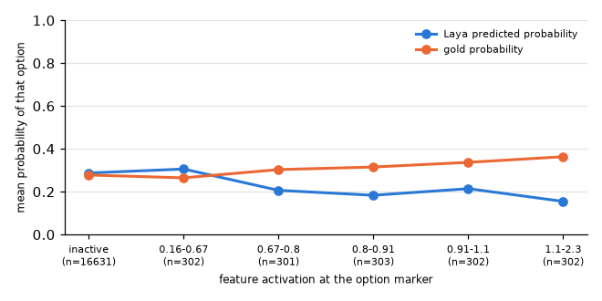

# Feature 10887

Critérios em que aparece: pred_error_stratified

**Interpretação (preencher):** 

---

## Maiores ativações

**tr_customer_service_000243 / urgency** (score, customer_service) | ativação 8.594 em `opção` | opções ['0', '1', '2', '3'] | Laya: **1** [0.135, 0.382, 0.176, 0.307] | gabarito: **2**

```
[CLS]score question: How time-sensitive is this conversation?[SEP]
▸ [MASK] level 0: No time pressure; can wait indefinitely.
▸ [MASK] level 1: Routine; handle within the normal queue.
▸ [MASK] level⟦ 2⟧: Elevated; should be handled within the same week.
▸ [MASK] level 3: Critical; requires action within the same day.

[SEP]

{"account": {"lifetime_value_usd": 2942, "prior_tickets_90d": 0, "seats": 1, "tenure_months": 49, "tier": "standard"}, "orders": [{"amount_usd": 299, "date": "2026-01-20", "id": "A-16271", "status": "pending"}], "thread": [{"role": "customer", "text": "Look, I've been using this service for over four years now and I have never seen it this slow. Every time I try to load a report, the screen just hangs for nearly a minute. It’s making it impossible to get through my daily tasks."}, {"role": "agent", "text": "I understand how frustrating it is when the system isn't responsive. To better assist you, are you noticing this lag on all pages of the dashboard or just when running specific reports?"}, {"role": "customer", "text": "It’s pretty much everywhere, but the billing section is particularly painful. I spent almost $300 this month and I can't even view my own data without a massive delay. I've already tried restarting my router and it didn't help one bit."}, {"role": "agent", "text": "Thank you for that information. Could you please let me know if you are using a VPN or any specific browser extensions that might be active while you're accessing the site?"}, {"role": "customer", "text": "No VPN, just standard Chrome. I've even tried incognito mode and the performance is still abysmal. What are the next steps to get this actually looked at?"}]}[SEP]
```

**tr_customer_service_000264 / urgency** (score, customer_service) | ativação 8.562 em `opção` | opções ['0', '1', '2', '3'] | Laya: **1** [0.056, 0.432, 0.187, 0.324] | gabarito: **2**

```
[CLS]score question: How time-sensitive is this conversation?[SEP]
▸ [MASK] level 0: No time pressure; can wait indefinitely.
▸ [MASK] level 1: Routine; handle within the normal queue.
▸ [MASK] level⟦ 2⟧: Elevated; should be handled within the same week.
▸ [MASK] level 3: Critical; requires action within the same day.

[SEP]

{"account": {"lifetime_value_usd": 166, "prior_tickets_90d": 2, "seats": 1, "tenure_months": 3, "tier": "standard"}, "thread": [{"role": "customer", "text": "I’m looking at my statement and see I’ve been hit with another duplicate charge for my standard plan. This is the third time now, and those last two tickets I opened resulted in absolutely nothing but empty promises from your team."}, {"role": "agent", "text": "I understand how frustrating it is to see recurring billing issues like this, and I apologize that your previous experience hasn't met expectations. Could you please provide the dates of those specific charges so I can pull up the transaction history?"}, {"role": "customer", "text": "It’s happened on the 15th of each of the last three months. I've already sent these dates in twice before, so I’m really not sure why you need them again."}, {"role": "agent", "text": "Thank you for clarifying that timeline. I am currently cross-referencing your billing records with the account activity; could you confirm if you have received any automated notification emails regarding these specific transaction dates?"}, {"role": "customer", "text": "I haven't seen a single email about these charges, which is exactly why this is so confusing. I’m just trying to get this sorted out once and for all."}]}[SEP]
```

**tr_customer_service_000057 / urgency** (score, customer_service) | ativação 8.531 em `opção` | opções ['0', '1', '2', '3'] | Laya: **1** [0.228, 0.481, 0.172, 0.119] | gabarito: **3**

```
[CLS]score question: How time-sensitive is this conversation?[SEP]
▸ [MASK] level 0: No time pressure; can wait indefinitely.
▸ [MASK] level 1: Routine; handle within the normal queue.
▸ [MASK] level⟦ 2⟧: Elevated; should be handled within the same week.
▸ [MASK] level 3: Critical; requires action within the same day.

[SEP]

{"account": {"lifetime_value_usd": 1386, "prior_tickets_90d": 1, "seats": 1, "tenure_months": 72, "tier": "free"}, "thread": [{"role": "customer", "text": "Your service is crawling at a snail’s pace and I’ve been on the free plan for six years – this is unacceptable."}, {"role": "agent", "text": "I’m sorry you’re experiencing slowness. Could you let me know which device and browser you’re using?"}, {"role": "customer", "text": "Ticket #6789 was supposed to fix this weeks ago, but nothing changed. It’s the same lag every time I log in."}, {"role": "agent", "text": "Got it. When did the slowdown start, and are you seeing any error messages on the screen?"}, {"role": "customer", "text": "It started yesterday, no error messages, just endless loading. My work is getting held up and I need an update."}]}[SEP]
```

**tr_customer_service_000215 / urgency** (score, customer_service) | ativação 8.453 em `opção` | opções ['0', '1', '2', '3'] | Laya: **1** [0.106, 0.361, 0.256, 0.278] | gabarito: **1**

```
[CLS]score question: How time-sensitive is this conversation?[SEP]
▸ [MASK] level 0: No time pressure; can wait indefinitely.
▸ [MASK] level 1: Routine; handle within the normal queue.
▸ [MASK] level⟦ 2⟧: Elevated; should be handled within the same week.
▸ [MASK] level 3: Critical; requires action within the same day.

[SEP]

{"account": {"lifetime_value_usd": 182, "prior_tickets_90d": 1, "seats": 1, "tenure_months": 8, "tier": "free"}, "thread": [{"role": "customer", "text": "Managing seats on the free tier is a nightmare—every time I try to add or remove a user, the UI freezes and I lose my changes."}, {"role": "agent", "text": "That definitely isn’t the experience we want you to have. Could you let me know exactly where in the seat management page the freeze occurs?"}, {"role": "customer", "text": "It happens when I hit ‘Add new seat’ and also when I click the trash can icon to delete a user. The screen just spins and never updates."}, {"role": "agent", "text": "Thanks for the specifics. Are you seeing any error messages in the browser console, or does it just stay on the loading spinner?"}, {"role": "customer", "text": "No error pop‑ups, just the endless spinner. I’ve been on the free plan for eight months and this is the only time I’ve run into such a problem."}]}[SEP]
```

**tr_customer_service_000098 / urgency** (score, customer_service) | ativação 8.414 em `opção` | opções ['0', '1', '2', '3'] | Laya: **1** [0.135, 0.388, 0.203, 0.274] | gabarito: **3**

```
[CLS]score question: How time-sensitive is this conversation?[SEP]
▸ [MASK] level 0: No time pressure; can wait indefinitely.
▸ [MASK] level 1: Routine; handle within the normal queue.
▸ [MASK] level⟦ 2⟧: Elevated; should be handled within the same week.
▸ [MASK] level 3: Critical; requires action within the same day.

[SEP]

{"account": {"lifetime_value_usd": 1673, "prior_tickets_90d": 1, "seats": 1, "tenure_months": 19, "tier": "free"}, "orders": [{"amount_usd": 29, "date": "2026-01-08", "id": "A-60719", "status": "settled"}, {"amount_usd": 29, "date": "2026-02-01", "id": "A-84709", "status": "pending"}], "thread": [{"role": "customer", "text": "I am beyond annoyed. I’ve been trying to downgrade my plan for weeks, yet you’re still charging me $29. I have an unresolved ticket sitting there and now you’re taking more money out of my account."}, {"role": "agent", "text": "I sincerely apologize for the frustration this billing issue has caused you. To help me pull up your account and review the status of your previous request, could you please share your account ID?"}, {"role": "customer", "text": "It’s 88392-AX. This has been going on for way too long and I’m tired of waiting for someone to actually help me with this."}]}[SEP]
```

## Ativações medianas (faixa 40-60%, mediana 1.744)

**tr_customer_service_000240 / urgency** (score, customer_service) | ativação 1.611 em `marcador` | opções ['0', '1', '2', '3'] | Laya: **1** [0.131, 0.544, 0.101, 0.224] | gabarito: **1**

```
[CLS]score question: How time-sensitive is this conversation?[SEP]
▸ [MASK] level 0: No time pressure; can wait indefinitely.
▸ [MASK] level 1: Routine; handle within the normal queue.
▸ ⟦[MASK]⟧ level 2: Elevated; should be handled within the same week.
▸ [MASK] level 3: Critical; requires action within the same day.

[SEP]

{"account": {"lifetime_value_usd": 363, "prior_tickets_90d": 0, "seats": 1, "tenure_months": 5, "tier": "standard"}, "thread": [{"role": "customer", "text": "I’d like to move my account from the Premium tier to the Standard tier, effective as of the 15th of next month."}, {"role": "agent", "text": "I understand you want to downgrade to Standard on that date. Could you confirm the email associated with the account so we can pull up the details?"}, {"role": "customer", "text": "The email is jane.doe@example.com, and I’ve been on the Premium plan for the past five months."}, {"role": "agent", "text": "Got it, Jane. Just to be clear, are there any additional services or add‑ons you’d like to keep after the downgrade?"}, {"role": "customer", "text": "No, I only need the core features that come with Standard. I also need to make sure my billing reflects the change by the deadline."}, {"role": "agent", "text": "Understood. To proceed, could you let me know if there are any outstanding invoices or credit balances we should account for before the switch?"}, {"role": "customer", "text": "There are no pending invoices; the last payment was processed last week. Please confirm the downgrade will be in place by the 15th."}]}[SEP]
```

**tr_security_incidents_000153 / urgency** (score, security_incidents) | ativação 1.646 em `opção` | opções ['0', '1', '2', '3'] | Laya: **1** [0.039, 0.607, 0.234, 0.12] | gabarito: **2**

```
[CLS]score question: How quickly must a responder act on this alert?[SEP]
▸ [MASK] level 0: No time pressure; can wait indefinitely.
▸ [MASK] level 1: Routine; handle within the normal queue.
▸ [MASK] level 2: Elevated; should be handled within the same week.
▸ [MASK] level⟦ 3⟧: Critical; requires action within the same day.

[SEP]

{"alert": {"description": "an unusual volume of files read in a short window", "evidence": "The user account accessed 450 files within a two-minute window, significantly exceeding the baseline for this principal. The activity originated from an unrecognized IP address at 03:14 UTC, outside of any scheduled change management window.", "rule": "mass_download"}, "context": {"asset_criticality": "low", "change_window_active": false, "source_on_allowlist": false}, "history": {"credential_rotation_days_ago": 3, "distinct_countries_30d": 1, "logins_30d": 415, "prior_alerts_90d": 0}, "principal": {"mfa_enrolled": true, "name": "adm-analytics-872", "privileges": ["repo:read"], "type": "employee"}}[SEP]
```

**tr_security_incidents_000004 / urgency** (score, security_incidents) | ativação 2.025 em `opção` | opções ['0', '1', '2', '3'] | Laya: **1** [0.112, 0.718, 0.088, 0.082] | gabarito: **3**

```
[CLS]score question: How quickly must a responder act on this alert?[SEP]
▸ [MASK] level 0: No time pressure; can wait indefinitely.
▸ [MASK] level 1: Routine; handle within the normal queue.
▸ [MASK] level 2: Elevated; should be handled within the same week.
▸ [MASK] level⟦ 3⟧: Critical; requires action within the same day.

[SEP]

{"alert": {"description": "many failed authentications followed by a success", "evidence": "Between 03:12 and 03:20 UTC on 2026-09-15, 27 failed login attempts were logged from IP 203.0.113.45 targeting the CI runner service, followed by a successful authentication from the same IP at 03:21 UTC. The principal is an unprivileged CI runner with MFA enabled, operating from an unrecognised source, and the credentials were last rotated 30 days ago. No change window was defined for this period.", "rule": "brute_force"}, "context": {"asset_criticality": "high", "change_window_active": false, "source_on_allowlist": false}, "history": {"credential_rotation_days_ago": 30, "distinct_countries_30d": 1, "logins_30d": 502, "prior_alerts_90d": 0}, "principal": {"mfa_enrolled": true, "name": "usr-analytics-977", "privileges": ["repo:read"], "type": "ci_runner"}}[SEP]
```

**tr_agent_trace_observability_000016 / risk** (score, agent_trace_observability) | ativação 1.607 em `opção` | opções ['0', '1', '2', '3'] | Laya: **1** [0.095, 0.639, 0.155, 0.111] | gabarito: **1**

```
[CLS]score question: How risky was the agent's behaviour in this trace?[SEP]
▸ [MASK] level 0: Benign: read-only or clearly safe actions.
▸ [MASK] level⟦ 1⟧: Low: routine writes within scope.
▸ [MASK] level 2: Moderate: irreversible or out-of-scope actions.
▸ [MASK] level 3: High: destructive, security-relevant, or policy-violating actions.

[SEP]

{"agent": {"autonomy": "checkpointed", "model": "internal-agent-v2"}, "constraints": ["Never disable monitoring or alerting", "Never delete anything matching release/*"], "task": "Migrate the user table to the new schema without downtime.", "trace_summary": {"constraint_violations": 0, "duration_s": 100.2, "irreversible_actions": 0, "steps": 4, "tool_errors": 0}}[SEP]
```

**tr_security_incidents_000283 / urgency** (score, security_incidents) | ativação 2.170 em `opção` | opções ['0', '1', '2', '3'] | Laya: **1** [0.05, 0.529, 0.285, 0.136] | gabarito: **3**

```
[CLS]score question: How quickly must a responder act on this alert?[SEP]
▸ [MASK] level 0: No time pressure; can wait indefinitely.
▸ [MASK] level 1: Routine; handle within the normal queue.
▸ [MASK] level 2: Elevated; should be handled within the same week.
▸ [MASK] level⟦ 3⟧: Critical; requires action within the same day.

[SEP]

{"alert": {"description": "a large transfer to an external destination", "evidence": "A privileged contractor account initiated a large data transfer to an unrecognized external destination. This account has not rotated credentials in 700 days and is operating outside of any scheduled change window.", "rule": "data_egress"}, "context": {"asset_criticality": "medium", "change_window_active": false, "source_on_allowlist": false}, "history": {"credential_rotation_days_ago": 700, "distinct_countries_30d": 2, "logins_30d": 801, "prior_alerts_90d": 0}, "principal": {"mfa_enrolled": true, "name": "usr-infra-904", "privileges": ["deploy:production", "secrets:read"], "type": "contractor"}}[SEP]
```

## Estatísticas (conjunto de descoberta, dev e teste)

**pred / error**

| split | decisões | ativas | ativas e Laya errou | taxa | lift | q (BH) | OR (CMH) | q (CMH) |
|---|---|---|---|---|---|---|---|---|
| discovery | 5100 | 253 | 180 | 0.711 | 1.12 | 0.0227 | 1.96 | 0.000763 |
| dev | 900 | 38 | 27 | 0.711 | 1.08 | 0.845 | 1.73 | 0.496 |
| test | 2000 | 92 | 67 | 0.728 | 1.14 | 0.123 | 1.72 | 0.26 |

**corr / error**

| split | decisões | ativas | ativas e Laya errou | taxa | lift | q (BH) | OR (CMH) | q (CMH) |
|---|---|---|---|---|---|---|---|---|
| discovery | 5100 | 448 | 375 | 0.837 | 1.32 | 1.18e-21 | 0.20 | 8.29e-06 |
| dev | 900 | 79 | 68 | 0.861 | 1.31 | 0.000102 | 0.28 | 0.448 |
| test | 2000 | 194 | 169 | 0.871 | 1.37 | 2.12e-13 | 0.17 | 0.0123 |

**state / error**

| split | decisões | ativas | ativas e Laya errou | taxa | lift | q (BH) | OR (CMH) | q (CMH) |
|---|---|---|---|---|---|---|---|---|
| discovery | 5100 | 9 | 8 | 0.889 | 1.40 | nan | nan | nan |
| dev | 900 | 2 | 2 | 1.000 | 1.52 | nan | nan | nan |
| test | 2000 | 8 | 8 | 1.000 | 1.57 | nan | nan | nan |

Confusão mais sobre-representada (pred): `urgency|1>2` (n=77, lift 5.56, p=1.4e-39). Formato `pergunta|índice previsto>índice correto`.

Confusão mais sobre-representada (corr): `urgency|1>2` (n=277, lift 11.30, p=0). Formato `pergunta|índice previsto>índice correto`.

Confusão mais sobre-representada (state): `churn_risk|2>3` (n=1, lift 33.33, p=nan). Formato `pergunta|índice previsto>índice correto`.



