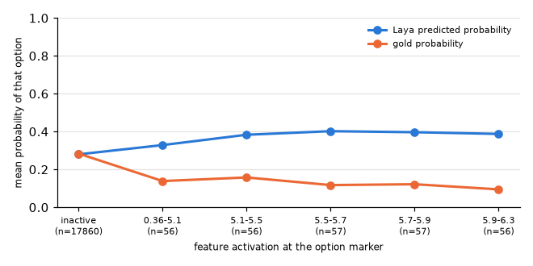

# Feature 10960

Critérios em que aparece: pred_error_stratified, attribution_toward_correct

**Interpretação (preencher):** 

---

## Maiores ativações

**tr_security_incidents_000112 / disposition** (choice, security_incidents) | ativação 12.398 em `opção` | opções ['close_benign', 'contain', 'investigate', 'monitor'] | Laya: **close_benign** [0.398, 0.207, 0.106, 0.289] | gabarito: **investigate**

```
[CLS]choice question: How should this security alert be dispositioned?[SEP]
▸ [MASK] close⟦_⟧benign: Expected, explainable activity; close without analyst time.
▸ [MASK] contain: Contain the host or account immediately; do not wait for triage.
▸ [MASK] investigate: Warrants an analyst opening an investigation.
▸ [MASK] monitor: Not clearly malicious, but worth watching for recurrence.

[SEP]

{"alert": {"description": "a large transfer to an external destination", "evidence": "On 2026-09-16 02:11:43 UTC the admin user \"svc_admin\" initiated an SMB transfer of 3.74 GB from the host \"srv-data01\" to external destination 198.51.100.77, targeting the directory \\shared\\exports. The credentials used were last rotated 412 days ago and the activity occurred outside any scheduled change window.", "rule": "data_egress"}, "context": {"asset_criticality": "crown_jewel", "change_window_active": false, "source_on_allowlist": false}, "history": {"credential_rotation_days_ago": 412, "distinct_countries_30d": 1, "logins_30d": 475, "prior_alerts_90d": 8}, "principal": {"mfa_enrolled": true, "name": "ci-support-676", "privileges": ["repo:read"], "type": "admin"}}[SEP]
```

**tr_security_incidents_000271 / disposition** (choice, security_incidents) | ativação 12.383 em `opção` | opções ['close_benign', 'contain', 'investigate', 'monitor'] | Laya: **close_benign** [0.362, 0.195, 0.118, 0.326] | gabarito: **investigate**

```
[CLS]choice question: How should this security alert be dispositioned?[SEP]
▸ [MASK] close⟦_⟧benign: Expected, explainable activity; close without analyst time.
▸ [MASK] contain: Contain the host or account immediately; do not wait for triage.
▸ [MASK] investigate: Warrants an analyst opening an investigation.
▸ [MASK] monitor: Not clearly malicious, but worth watching for recurrence.

[SEP]

{"alert": {"description": "a large transfer to an external destination", "evidence": "At 2026-09-16 02:15:44 UTC, a data transfer of 2.3 GB was observed from the internal server srv-data01 to external IP 203.0.113.45 over TCP port 443. The transfer was initiated by a service_account lacking MFA, whose password was refreshed 14 days earlier.", "rule": "data_egress"}, "context": {"asset_criticality": "low", "change_window_active": false, "source_on_allowlist": false}, "history": {"credential_rotation_days_ago": 14, "distinct_countries_30d": 2, "logins_30d": 1659, "prior_alerts_90d": 1}, "principal": {"mfa_enrolled": false, "name": "usr-billing-416", "privileges": ["repo:read"], "type": "service_account"}}[SEP]
```

**tr_security_incidents_000208 / disposition** (choice, security_incidents) | ativação 12.312 em `opção` | opções ['close_benign', 'contain', 'investigate', 'monitor'] | Laya: **close_benign** [0.448, 0.227, 0.091, 0.233] | gabarito: **investigate**

```
[CLS]choice question: How should this security alert be dispositioned?[SEP]
▸ [MASK] close⟦_⟧benign: Expected, explainable activity; close without analyst time.
▸ [MASK] contain: Contain the host or account immediately; do not wait for triage.
▸ [MASK] investigate: Warrants an analyst opening an investigation.
▸ [MASK] monitor: Not clearly malicious, but worth watching for recurrence.

[SEP]

{"alert": {"description": "a large transfer to an external destination", "evidence": "At 04:03 UTC on 2026-09-15, a service account named svc_backup transferred 4.8 GB of data to external IP 198.51.100.77 over port 443 using the process rsync.exe. The transfer completed in 7 minutes and originated from an unrecognised host in the DMZ. The event took place during an open change window.", "rule": "data_egress"}, "context": {"asset_criticality": "low", "change_window_active": true, "source_on_allowlist": false}, "history": {"credential_rotation_days_ago": 30, "distinct_countries_30d": 3, "logins_30d": 873, "prior_alerts_90d": 3}, "principal": {"mfa_enrolled": false, "name": "ci-support-613", "privileges": ["deploy:production", "secrets:read"], "type": "service_account"}}[SEP]
```

**tr_security_incidents_000106 / disposition** (choice, security_incidents) | ativação 12.289 em `opção` | opções ['close_benign', 'contain', 'investigate', 'monitor'] | Laya: **close_benign** [0.352, 0.301, 0.128, 0.219] | gabarito: **close_benign**

```
[CLS]choice question: How should this security alert be dispositioned?[SEP]
▸ [MASK] close⟦_⟧benign: Expected, explainable activity; close without analyst time.
▸ [MASK] contain: Contain the host or account immediately; do not wait for triage.
▸ [MASK] investigate: Warrants an analyst opening an investigation.
▸ [MASK] monitor: Not clearly malicious, but worth watching for recurrence.

[SEP]

{"alert": {"description": "a long-unused account became active", "evidence": "At 14:22 UTC, the contractor account 'c-smith' successfully authenticated from an allowlisted source despite being inactive for 120 days. Multi-factor authentication was verified during the session, which took place during a scheduled change window. The account's credentials were last rotated 30 days prior to this access.", "rule": "dormant_account_use"}, "context": {"asset_criticality": "low", "change_window_active": true, "source_on_allowlist": true}, "history": {"credential_rotation_days_ago": 30, "distinct_countries_30d": 1, "logins_30d": 1999, "prior_alerts_90d": 0}, "principal": {"mfa_enrolled": true, "name": "svc-infra-357", "privileges": ["repo:read"], "type": "contractor"}}[SEP]
```

**tr_security_incidents_000263 / disposition** (choice, security_incidents) | ativação 12.266 em `opção` | opções ['close_benign', 'contain', 'investigate', 'monitor'] | Laya: **close_benign** [0.424, 0.201, 0.073, 0.302] | gabarito: **investigate**

```
[CLS]choice question: How should this security alert be dispositioned?[SEP]
▸ [MASK] close⟦_⟧benign: Expected, explainable activity; close without analyst time.
▸ [MASK] contain: Contain the host or account immediately; do not wait for triage.
▸ [MASK] investigate: Warrants an analyst opening an investigation.
▸ [MASK] monitor: Not clearly malicious, but worth watching for recurrence.

[SEP]

{"alert": {"description": "a large transfer to an external destination", "evidence": "At 14:22 UTC on 2026-09-15, the shared mailbox finance_shared transferred 2.4 GB of data to external IP 203.0.113.45 over HTTPS from host WIN02. The transfer was initiated by an unprivileged account using MFA, and no change window was defined at that time.", "rule": "data_egress"}, "context": {"asset_criticality": "crown_jewel", "change_window_active": false, "source_on_allowlist": true}, "history": {"credential_rotation_days_ago": 90, "distinct_countries_30d": 3, "logins_30d": 714, "prior_alerts_90d": 8}, "principal": {"mfa_enrolled": true, "name": "adm-infra-592", "privileges": ["repo:read"], "type": "shared_mailbox"}}[SEP]
```

## Ativações medianas (faixa 40-60%, mediana 3.734)

**tr_security_incidents_000274 / disposition** (choice, security_incidents) | ativação 4.621 em `marcador` | opções ['close_benign', 'contain', 'investigate', 'monitor'] | Laya: **close_benign** [0.451, 0.17, 0.158, 0.221] | gabarito: **contain**

```
[CLS]choice question: How should this security alert be dispositioned?[SEP]
▸ ⟦[MASK]⟧ close_benign: Expected, explainable activity; close without analyst time.
▸ [MASK] contain: Contain the host or account immediately; do not wait for triage.
▸ [MASK] investigate: Warrants an analyst opening an investigation.
▸ [MASK] monitor: Not clearly malicious, but worth watching for recurrence.

[SEP]

{"alert": {"description": "two successful logins from distant locations too close together", "evidence": "Successful logins were recorded for admin user 'jdoe' from IP 203.0.113.45 (New York, USA) at 2026-09-15 02:05:10 UTC and from IP 198.51.100.22 (Sydney, AU) at 2026-09-15 02:18:43 UTC, a 13‑minute interval. Both sessions used MFA and originated from an unrecognized source. The account’s credentials had not been refreshed for 180 days and no change window was defined.", "rule": "impossible_travel"}, "context": {"asset_criticality": "crown_jewel", "change_window_active": false, "source_on_allowlist": false}, "history": {"credential_rotation_days_ago": 180, "distinct_countries_30d": 1, "logins_30d": 1701, "prior_alerts_90d": 1}, "principal": {"mfa_enrolled": true, "name": "adm-support-968", "privileges": ["deploy:production", "secrets:read"], "type": "admin"}}[SEP]
```

**tr_security_incidents_000116 / disposition** (choice, security_incidents) | ativação 5.234 em `marcador` | opções ['close_benign', 'contain', 'investigate', 'monitor'] | Laya: **close_benign** [0.287, 0.254, 0.204, 0.255] | gabarito: **investigate**

```
[CLS]choice question: How should this security alert be dispositioned?[SEP]
▸ ⟦[MASK]⟧ close_benign: Expected, explainable activity; close without analyst time.
▸ [MASK] contain: Contain the host or account immediately; do not wait for triage.
▸ [MASK] investigate: Warrants an analyst opening an investigation.
▸ [MASK] monitor: Not clearly malicious, but worth watching for recurrence.

[SEP]

{"alert": {"description": "a large transfer to an external destination", "evidence": "Between 2026-09-16 04:55:12 UTC and 04:57:03 UTC an admin account transferred 4.2 GB of data to external endpoint 185.53.177.22 over HTTPS (port 443) using the rsync process. The transfer occurred while a change window was open, the source host is unrecognised, and the admin’s credentials have not been rotated for 700 days.", "rule": "data_egress"}, "context": {"asset_criticality": "high", "change_window_active": true, "source_on_allowlist": false}, "history": {"credential_rotation_days_ago": 700, "distinct_countries_30d": 3, "logins_30d": 690, "prior_alerts_90d": 8}, "principal": {"mfa_enrolled": true, "name": "ci-infra-262", "privileges": ["repo:read"], "type": "admin"}}[SEP]
```

**tr_security_incidents_000042 / disposition** (choice, security_incidents) | ativação 4.098 em `marcador` | opções ['close_benign', 'contain', 'investigate', 'monitor'] | Laya: **close_benign** [0.328, 0.217, 0.235, 0.22] | gabarito: **close_benign**

```
[CLS]choice question: How should this security alert be dispositioned?[SEP]
▸ ⟦[MASK]⟧ close_benign: Expected, explainable activity; close without analyst time.
▸ [MASK] contain: Contain the host or account immediately; do not wait for triage.
▸ [MASK] investigate: Warrants an analyst opening an investigation.
▸ [MASK] monitor: Not clearly malicious, but worth watching for recurrence.

[SEP]

{"alert": {"description": "many failed authentications followed by a success", "evidence": "Between 02:13:05 and 02:14:57 UTC on 2026‑09‑15, 27 failed login attempts were recorded for the admin account \"alice_admin\" from source IP 198.51.100.23, followed by a successful authentication at 02:15:12 using MFA. The source IP is listed in the allowed‑list, the account’s password was last rotated on 2026‑08‑16 (30 days ago), and a change window was active at the time of the events.", "rule": "brute_force"}, "context": {"asset_criticality": "medium", "change_window_active": true, "source_on_allowlist": true}, "history": {"credential_rotation_days_ago": 30, "distinct_countries_30d": 4, "logins_30d": 1098, "prior_alerts_90d": 1}, "principal": {"mfa_enrolled": true, "name": "adm-billing-243", "privileges": ["deploy:production", "secrets:read"], "type": "admin"}}[SEP]
```

**tr_security_incidents_000139 / disposition** (choice, security_incidents) | ativação 4.754 em `marcador` | opções ['close_benign', 'contain', 'investigate', 'monitor'] | Laya: **close_benign** [0.338, 0.257, 0.172, 0.234] | gabarito: **investigate**

```
[CLS]choice question: How should this security alert be dispositioned?[SEP]
▸ ⟦[MASK]⟧ close_benign: Expected, explainable activity; close without analyst time.
▸ [MASK] contain: Contain the host or account immediately; do not wait for triage.
▸ [MASK] investigate: Warrants an analyst opening an investigation.
▸ [MASK] monitor: Not clearly malicious, but worth watching for recurrence.

[SEP]

{"alert": {"description": "audit logging was turned off on a host", "evidence": "Audit logging was disabled on host 10.0.0.5 at 04:12:33 UTC on 2026-09-16 by the privileged admin account admin_jdoe via a PowerShell script that modified the registry key HKLM\\System\\CurrentControlSet\\Services\\EventLog\\Security\\Start. The change occurred during an open change‑window and came from an unrecognised source IP 198.51.100.23; the admin’s credentials were last rotated 14 days ago.", "rule": "disabled_logging"}, "context": {"asset_criticality": "crown_jewel", "change_window_active": true, "source_on_allowlist": false}, "history": {"credential_rotation_days_ago": 14, "distinct_countries_30d": 1, "logins_30d": 1447, "prior_alerts_90d": 0}, "principal": {"mfa_enrolled": true, "name": "svc-billing-253", "privileges": ["deploy:production", "secrets:read"], "type": "admin"}}[SEP]
```

**tr_security_incidents_000039 / disposition** (choice, security_incidents) | ativação 5.551 em `marcador` | opções ['close_benign', 'contain', 'investigate', 'monitor'] | Laya: **close_benign** [0.309, 0.204, 0.193, 0.294] | gabarito: **contain**

```
[CLS]choice question: How should this security alert be dispositioned?[SEP]
▸ ⟦[MASK]⟧ close_benign: Expected, explainable activity; close without analyst time.
▸ [MASK] contain: Contain the host or account immediately; do not wait for triage.
▸ [MASK] investigate: Warrants an analyst opening an investigation.
▸ [MASK] monitor: Not clearly malicious, but worth watching for recurrence.

[SEP]

{"alert": {"description": "an endpoint agent matched a known signature", "evidence": "At 2026-09-15 14:23:07 UTC the endpoint agent on host WIN-01 flagged the file C:\\Temp\\malware.exe (SHA1=3a5b7c9d4e) as matching the known malware_signature. The detection was logged under the privileged service account svc_backup, which has MFA disabled and whose password was last rotated 14 days prior. The source identifier for the event is on the allowlist.", "rule": "malware_signature"}, "context": {"asset_criticality": "high", "change_window_active": false, "source_on_allowlist": true}, "history": {"credential_rotation_days_ago": 14, "distinct_countries_30d": 3, "logins_30d": 304, "prior_alerts_90d": 8}, "principal": {"mfa_enrolled": false, "name": "adm-infra-473", "privileges": ["deploy:production", "secrets:read"], "type": "service_account"}}[SEP]
```

## Estatísticas (conjunto de descoberta, dev e teste)

**pred / error**

| split | decisões | ativas | ativas e Laya errou | taxa | lift | q (BH) | OR (CMH) | q (CMH) |
|---|---|---|---|---|---|---|---|---|
| discovery | 5100 | 214 | 192 | 0.897 | 1.41 | 2.23e-17 | 5.47 | 4.01e-11 |
| dev | 900 | 38 | 33 | 0.868 | 1.32 | 0.0516 | 4.03 | 0.0974 |
| test | 2000 | 82 | 79 | 0.963 | 1.51 | 2.55e-11 | 22.72 | 1.29e-08 |

**corr / error**

| split | decisões | ativas | ativas e Laya errou | taxa | lift | q (BH) | OR (CMH) | q (CMH) |
|---|---|---|---|---|---|---|---|---|
| discovery | 5100 | 28 | 6 | 0.214 | 0.34 | 2.14e-05 | 2.44 | 0.184 |
| dev | 900 | 5 | 0 | 0.000 | 0.00 | nan | nan | nan |
| test | 2000 | 7 | 4 | 0.571 | 0.90 | nan | nan | nan |

**state / error**

| split | decisões | ativas | ativas e Laya errou | taxa | lift | q (BH) | OR (CMH) | q (CMH) |
|---|---|---|---|---|---|---|---|---|
| discovery | 5100 | 128 | 93 | 0.727 | 1.14 | 0.189 | 1.81 | 0.0218 |
| dev | 900 | 13 | 11 | 0.846 | 1.29 | nan | nan | nan |
| test | 2000 | 40 | 27 | 0.675 | 1.06 | 1 | 1.22 | 0.794 |

Confusão mais sobre-representada (pred): `disposition|0>2` (n=155, lift 15.46, p=0). Formato `pergunta|índice previsto>índice correto`.

Confusão mais sobre-representada (corr): `disposition|3>0` (n=3, lift 109.29, p=1.47e-06). Formato `pergunta|índice previsto>índice correto`.

Confusão mais sobre-representada (state): `credential_compromise|0>1` (n=9, lift 12.37, p=1.95e-08). Formato `pergunta|índice previsto>índice correto`.



