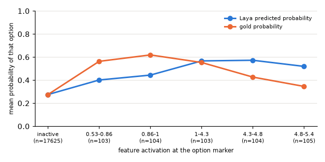

# Feature 10985

Critérios em que aparece: attribution_toward_correct

**Interpretação (preencher):** 

---

## Maiores ativações

**tr_security_incidents_000227 / true_positive** (noul, security_incidents) | ativação 11.062 em `opção` | opções ['false', 'true'] | Laya: **false** [0.566, 0.434] | gabarito: **true**

```
[CLS]noul question: This alert reflects genuinely malicious or unauthorised activity.[SEP]
▸ [MASK] false⟦:⟧ Benign activity, a misconfiguration, or a known false positive.
▸ [MASK] true: The underlying behaviour is malicious or unauthorised.

[SEP]

{"alert": {"description": "a large transfer to an external destination", "evidence": "A transfer of 4.2 GB of data was initiated to an unrecognized external IP address at 03:40 UTC. This activity was performed by a shared mailbox account that currently has MFA disabled.", "rule": "data_egress"}, "context": {"asset_criticality": "low", "change_window_active": false, "source_on_allowlist": false}, "history": {"credential_rotation_days_ago": 30, "distinct_countries_30d": 4, "logins_30d": 1619, "prior_alerts_90d": 1}, "principal": {"mfa_enrolled": false, "name": "svc-support-910", "privileges": ["repo:read"], "type": "shared_mailbox"}}[SEP]
```

**tr_security_incidents_000108 / true_positive** (noul, security_incidents) | ativação 11.047 em `opção` | opções ['false', 'true'] | Laya: **true** [0.419, 0.581] | gabarito: **true**

```
[CLS]noul question: This alert reflects genuinely malicious or unauthorised activity.[SEP]
▸ [MASK] false⟦:⟧ Benign activity, a misconfiguration, or a known false positive.
▸ [MASK] true: The underlying behaviour is malicious or unauthorised.

[SEP]

{"alert": {"description": "a large transfer to an external destination", "evidence": "A transfer of approximately 2.3 TB was recorded from internal address 10.12.45.78 to external destination 203.0.113.45 over TCP port 443, beginning at 2026-09-15 02:14 UTC and completing at 03:01 UTC. The activity originated from a shared_mailbox account with privileged rights, MFA enabled, and a password last rotated 90 days ago, occurring outside any defined change window.", "rule": "data_egress"}, "context": {"asset_criticality": "medium", "change_window_active": false, "source_on_allowlist": false}, "history": {"credential_rotation_days_ago": 90, "distinct_countries_30d": 1, "logins_30d": 1708, "prior_alerts_90d": 3}, "principal": {"mfa_enrolled": true, "name": "usr-support-496", "privileges": ["deploy:production", "secrets:read"], "type": "shared_mailbox"}}[SEP]
```

**tr_security_incidents_000263 / true_positive** (noul, security_incidents) | ativação 11.023 em `opção` | opções ['false', 'true'] | Laya: **true** [0.367, 0.633] | gabarito: **true**

```
[CLS]noul question: This alert reflects genuinely malicious or unauthorised activity.[SEP]
▸ [MASK] false⟦:⟧ Benign activity, a misconfiguration, or a known false positive.
▸ [MASK] true: The underlying behaviour is malicious or unauthorised.

[SEP]

{"alert": {"description": "a large transfer to an external destination", "evidence": "At 14:22 UTC on 2026-09-15, the shared mailbox finance_shared transferred 2.4 GB of data to external IP 203.0.113.45 over HTTPS from host WIN02. The transfer was initiated by an unprivileged account using MFA, and no change window was defined at that time.", "rule": "data_egress"}, "context": {"asset_criticality": "crown_jewel", "change_window_active": false, "source_on_allowlist": true}, "history": {"credential_rotation_days_ago": 90, "distinct_countries_30d": 3, "logins_30d": 714, "prior_alerts_90d": 8}, "principal": {"mfa_enrolled": true, "name": "adm-infra-592", "privileges": ["repo:read"], "type": "shared_mailbox"}}[SEP]
```

**tr_security_incidents_000052 / true_positive** (noul, security_incidents) | ativação 10.969 em `opção` | opções ['false', 'true'] | Laya: **true** [0.472, 0.528] | gabarito: **true**

```
[CLS]noul question: This alert reflects genuinely malicious or unauthorised activity.[SEP]
▸ [MASK] false⟦:⟧ Benign activity, a misconfiguration, or a known false positive.
▸ [MASK] true: The underlying behaviour is malicious or unauthorised.

[SEP]

{"alert": {"description": "an unusual volume of files read in a short window", "evidence": "An administrative account with multi-factor authentication enabled performed a high volume of file read operations from an unrecognized source address. This activity occurred outside of any established change window using credentials that have remained unchanged for 412 days.", "rule": "mass_download"}, "context": {"asset_criticality": "medium", "change_window_active": false, "source_on_allowlist": false}, "history": {"credential_rotation_days_ago": 412, "distinct_countries_30d": 2, "logins_30d": 1820, "prior_alerts_90d": 25}, "principal": {"mfa_enrolled": true, "name": "svc-billing-706", "privileges": ["deploy:production", "secrets:read"], "type": "admin"}}[SEP]
```

**tr_security_incidents_000210 / true_positive** (noul, security_incidents) | ativação 10.953 em `opção` | opções ['false', 'true'] | Laya: **false** [0.625, 0.375] | gabarito: **true**

```
[CLS]noul question: This alert reflects genuinely malicious or unauthorised activity.[SEP]
▸ [MASK] false⟦:⟧ Benign activity, a misconfiguration, or a known false positive.
▸ [MASK] true: The underlying behaviour is malicious or unauthorised.

[SEP]

{"alert": {"description": "an account granted itself or received elevated permissions", "evidence": "At 14:22 UTC, service account `svc-prod-access` performed a self-assignment of the 'Owner' role from unrecognized IP address 198.51.100.12. This action occurred outside of an approved change window using credentials that were last rotated 365 days ago.", "rule": "privilege_escalation"}, "context": {"asset_criticality": "medium", "change_window_active": false, "source_on_allowlist": false}, "history": {"credential_rotation_days_ago": 365, "distinct_countries_30d": 2, "logins_30d": 577, "prior_alerts_90d": 0}, "principal": {"mfa_enrolled": false, "name": "adm-analytics-333", "privileges": ["repo:read"], "type": "service_account"}}[SEP]
```

## Ativações medianas (faixa 40-60%, mediana 3.037)

**tr_security_incidents_000208 / true_positive** (noul, security_incidents) | ativação 3.020 em `pergunta` | opções ['false', 'true'] | Laya: **false** [0.531, 0.469] | gabarito: **true**

```
[CLS]noul question: This alert reflects genuinely malicious or unauthorised activity.⟦[SEP]⟧
▸ [MASK] false: Benign activity, a misconfiguration, or a known false positive.
▸ [MASK] true: The underlying behaviour is malicious or unauthorised.

[SEP]

{"alert": {"description": "a large transfer to an external destination", "evidence": "At 04:03 UTC on 2026-09-15, a service account named svc_backup transferred 4.8 GB of data to external IP 198.51.100.77 over port 443 using the process rsync.exe. The transfer completed in 7 minutes and originated from an unrecognised host in the DMZ. The event took place during an open change window.", "rule": "data_egress"}, "context": {"asset_criticality": "low", "change_window_active": true, "source_on_allowlist": false}, "history": {"credential_rotation_days_ago": 30, "distinct_countries_30d": 3, "logins_30d": 873, "prior_alerts_90d": 3}, "principal": {"mfa_enrolled": false, "name": "ci-support-613", "privileges": ["deploy:production", "secrets:read"], "type": "service_account"}}[SEP]
```

**tr_security_incidents_000066 / true_positive** (noul, security_incidents) | ativação 2.988 em `pergunta` | opções ['false', 'true'] | Laya: **true** [0.448, 0.552] | gabarito: **false**

```
[CLS]noul question: This alert reflects genuinely malicious or unauthorised activity⟦.⟧[SEP]
▸ [MASK] false: Benign activity, a misconfiguration, or a known false positive.
▸ [MASK] true: The underlying behaviour is malicious or unauthorised.

[SEP]

{"alert": {"description": "audit logging was turned off on a host", "evidence": "Audit logging was disabled on the host at 02:15 UTC. The action was performed by an administrative account from an allowlisted IP address during a scheduled maintenance window.", "rule": "disabled_logging"}, "context": {"asset_criticality": "crown_jewel", "change_window_active": true, "source_on_allowlist": true}, "history": {"credential_rotation_days_ago": 180, "distinct_countries_30d": 2, "logins_30d": 350, "prior_alerts_90d": 1}, "principal": {"mfa_enrolled": true, "name": "svc-analytics-653", "privileges": ["deploy:production", "secrets:read"], "type": "admin"}}[SEP]
```

**tr_security_incidents_000162 / true_positive** (noul, security_incidents) | ativação 3.295 em `pergunta` | opções ['false', 'true'] | Laya: **false** [0.685, 0.315] | gabarito: **true**

```
[CLS]noul question: This alert reflects genuinely malicious or unauthorised activity⟦.⟧[SEP]
▸ [MASK] false: Benign activity, a misconfiguration, or a known false positive.
▸ [MASK] true: The underlying behaviour is malicious or unauthorised.

[SEP]

{"alert": {"description": "a first-ever sign-in from an unfamiliar country", "evidence": "An administrative account accessed the system from an unrecognized IP address located in a country with no prior login history. The credentials for this principal have not been updated in 700 days.", "rule": "new_country_login"}, "context": {"asset_criticality": "medium", "change_window_active": false, "source_on_allowlist": false}, "history": {"credential_rotation_days_ago": 700, "distinct_countries_30d": 1, "logins_30d": 1674, "prior_alerts_90d": 1}, "principal": {"mfa_enrolled": true, "name": "svc-support-499", "privileges": ["repo:read"], "type": "admin"}}[SEP]
```

**tr_security_incidents_000219 / true_positive** (noul, security_incidents) | ativação 2.848 em `pergunta` | opções ['false', 'true'] | Laya: **false** [0.527, 0.473] | gabarito: **false**

```
[CLS]noul question: This alert reflects genuinely malicious or unauthorised activity⟦.⟧[SEP]
▸ [MASK] false: Benign activity, a misconfiguration, or a known false positive.
▸ [MASK] true: The underlying behaviour is malicious or unauthorised.

[SEP]

{"alert": {"description": "a long-unused account became active", "evidence": "The privileged administrator account `admin_svc_04` authenticated from the unrecognized IP address 198.51.100.42 during an active system change window. This session marks the first activity for the account in over six months, utilizing MFA-protected credentials that were last rotated 180 days ago.", "rule": "dormant_account_use"}, "context": {"asset_criticality": "medium", "change_window_active": true, "source_on_allowlist": false}, "history": {"credential_rotation_days_ago": 180, "distinct_countries_30d": 3, "logins_30d": 832, "prior_alerts_90d": 1}, "principal": {"mfa_enrolled": true, "name": "adm-analytics-257", "privileges": ["deploy:production", "secrets:read"], "type": "admin"}}[SEP]
```

**tr_security_incidents_000280 / true_positive** (noul, security_incidents) | ativação 2.826 em `pergunta` | opções ['false', 'true'] | Laya: **false** [0.67, 0.33] | gabarito: **false**

```
[CLS]noul question: This alert reflects genuinely malicious or unauthorised activity.⟦[SEP]⟧
▸ [MASK] false: Benign activity, a misconfiguration, or a known false positive.
▸ [MASK] true: The underlying behaviour is malicious or unauthorised.

[SEP]

{"alert": {"description": "a session token was presented from a second address", "evidence": "Session token \"f9d2a1c3\" associated with shared_mailbox@example.com was first used from IP 198.51.100.22 at 2026-09-16 02:11 UTC and then presented again from IP 198.51.100.55 at 2026-09-16 02:13 UTC. Both source IPs are on the allowlist; the token holder's credentials were last rotated 412 days ago and no change window was active.", "rule": "token_reuse"}, "context": {"asset_criticality": "low", "change_window_active": false, "source_on_allowlist": true}, "history": {"credential_rotation_days_ago": 412, "distinct_countries_30d": 4, "logins_30d": 1529, "prior_alerts_90d": 3}, "principal": {"mfa_enrolled": true, "name": "ci-analytics-679", "privileges": ["repo:read"], "type": "shared_mailbox"}}[SEP]
```

## Estatísticas (conjunto de descoberta, dev e teste)

**pred / error**

| split | decisões | ativas | ativas e Laya errou | taxa | lift | q (BH) | OR (CMH) | q (CMH) |
|---|---|---|---|---|---|---|---|---|
| discovery | 5100 | 257 | 132 | 0.514 | 0.81 | 0.000147 | nan | nan |
| dev | 900 | 43 | 21 | 0.488 | 0.74 | 0.124 | nan | nan |
| test | 2000 | 100 | 49 | 0.490 | 0.77 | 0.00693 | nan | nan |

**corr / error**

| split | decisões | ativas | ativas e Laya errou | taxa | lift | q (BH) | OR (CMH) | q (CMH) |
|---|---|---|---|---|---|---|---|---|
| discovery | 5100 | 257 | 132 | 0.514 | 0.81 | 8.03e-05 | nan | nan |
| dev | 900 | 43 | 21 | 0.488 | 0.74 | 0.0468 | nan | nan |
| test | 2000 | 100 | 49 | 0.490 | 0.77 | 0.00448 | nan | nan |

**state / error**

| split | decisões | ativas | ativas e Laya errou | taxa | lift | q (BH) | OR (CMH) | q (CMH) |
|---|---|---|---|---|---|---|---|---|
| discovery | 5100 | 60 | 32 | 0.533 | 0.84 | 0.391 | 1.23 | 0.631 |
| dev | 900 | 5 | 2 | 0.400 | 0.61 | nan | nan | nan |
| test | 2000 | 19 | 8 | 0.421 | 0.66 | nan | nan | nan |

Confusão mais sobre-representada (pred): `true_positive|0>1` (n=113, lift 19.84, p=0). Formato `pergunta|índice previsto>índice correto`.

Confusão mais sobre-representada (corr): `true_positive|0>1` (n=113, lift 19.84, p=0). Formato `pergunta|índice previsto>índice correto`.

Confusão mais sobre-representada (state): `true_positive|0>1` (n=16, lift 12.04, p=7.63e-14). Formato `pergunta|índice previsto>índice correto`.



