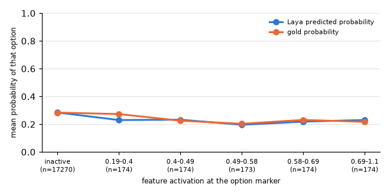

# Feature 11013

Critérios em que aparece: pred_error_stratified

**Interpretação (preencher):** 

---

## Maiores ativações

**tr_security_incidents_000073 / severity** (score, security_incidents) | ativação 3.018 em `opção` | opções ['0', '1', '2', '3', '4'] | Laya: **1** [0.049, 0.459, 0.347, 0.093, 0.052] | gabarito: **1**

```
[CLS]score question: How severe is the potential impact if this alert is real?[SEP]
▸ [MASK] level 0: Negligible: no access to anything sensitive.
▸ [MASK] level 1: Low: limited access, easily reversed.
▸ [MASK] level 2: Moderate: access to internal systems or non-public data.
▸ [MASK] level 3: High: access to production, secrets⟦ or⟧ customer data.
▸ [MASK] level 4: Critical: active compromise of crown-jewel systems.

[SEP]

{"alert": {"description": "an endpoint agent matched a known signature", "evidence": "An endpoint agent on `ci-executor-04` identified a file matching signature `WORM_RS_A` during a scheduled change window. The associated unprivileged `ci_runner` principal accessed the system from the allowlisted source 10.50.2.1 using credentials rotated 3 days ago.", "rule": "malware_signature"}, "context": {"asset_criticality": "low", "change_window_active": true, "source_on_allowlist": true}, "history": {"credential_rotation_days_ago": 3, "distinct_countries_30d": 4, "logins_30d": 731, "prior_alerts_90d": 0}, "principal": {"mfa_enrolled": true, "name": "adm-billing-719", "privileges": ["repo:read"], "type": "ci_runner"}}[SEP]
```

**tr_security_incidents_000241 / severity** (score, security_incidents) | ativação 2.988 em `opção` | opções ['0', '1', '2', '3', '4'] | Laya: **2** [0.087, 0.408, 0.429, 0.059, 0.018] | gabarito: **2**

```
[CLS]score question: How severe is the potential impact if this alert is real?[SEP]
▸ [MASK] level 0: Negligible: no access to anything sensitive.
▸ [MASK] level 1: Low: limited access, easily reversed.
▸ [MASK] level 2: Moderate: access to internal systems or non-public data.
▸ [MASK] level 3: High: access to production, secrets⟦ or⟧ customer data.
▸ [MASK] level 4: Critical: active compromise of crown-jewel systems.

[SEP]

{"alert": {"description": "audit logging was turned off on a host", "evidence": "A service account disabled audit logging on the host, an action performed outside of any defined change window. While the activity originated from an allowlisted source, the account lacks MFA and has not rotated credentials in 180 days.", "rule": "disabled_logging"}, "context": {"asset_criticality": "medium", "change_window_active": false, "source_on_allowlist": true}, "history": {"credential_rotation_days_ago": 180, "distinct_countries_30d": 3, "logins_30d": 613, "prior_alerts_90d": 0}, "principal": {"mfa_enrolled": false, "name": "adm-infra-357", "privileges": ["repo:read"], "type": "service_account"}}[SEP]
```

**tr_security_incidents_000229 / severity** (score, security_incidents) | ativação 2.973 em `opção` | opções ['0', '1', '2', '3', '4'] | Laya: **3** [0.016, 0.121, 0.28, 0.298, 0.284] | gabarito: **4**

```
[CLS]score question: How severe is the potential impact if this alert is real?[SEP]
▸ [MASK] level 0: Negligible: no access to anything sensitive.
▸ [MASK] level 1: Low: limited access, easily reversed.
▸ [MASK] level 2: Moderate: access to internal systems or non-public data.
▸ [MASK] level 3: High: access to production, secrets⟦ or⟧ customer data.
▸ [MASK] level 4: Critical: active compromise of crown-jewel systems.

[SEP]

{"alert": {"description": "a large transfer to an external destination", "evidence": "A privileged CI runner transferred 12.8 GB of data to the external destination archive-ext.net (93.184.216.34) starting at 22:15 UTC. This outbound activity occurred outside of any change window using credentials that were last updated 365 days ago.", "rule": "data_egress"}, "context": {"asset_criticality": "crown_jewel", "change_window_active": false, "source_on_allowlist": false}, "history": {"credential_rotation_days_ago": 365, "distinct_countries_30d": 2, "logins_30d": 1351, "prior_alerts_90d": 3}, "principal": {"mfa_enrolled": true, "name": "svc-infra-840", "privileges": ["deploy:production", "secrets:read"], "type": "ci_runner"}}[SEP]
```

**tr_security_incidents_000072 / severity** (score, security_incidents) | ativação 2.967 em `opção` | opções ['0', '1', '2', '3', '4'] | Laya: **1** [0.092, 0.372, 0.32, 0.109, 0.106] | gabarito: **2**

```
[CLS]score question: How severe is the potential impact if this alert is real?[SEP]
▸ [MASK] level 0: Negligible: no access to anything sensitive.
▸ [MASK] level 1: Low: limited access, easily reversed.
▸ [MASK] level 2: Moderate: access to internal systems or non-public data.
▸ [MASK] level 3: High: access to production, secrets⟦ or⟧ customer data.
▸ [MASK] level 4: Critical: active compromise of crown-jewel systems.

[SEP]

{"alert": {"description": "an unrecognised binary executed on a server", "evidence": "The unrecognised binary `svc_init.bin` was executed by an unprivileged admin principal on server `srv-prod-09` at 14:22 UTC. This execution originated from the unrecognised IP 198.51.100.12 outside of a change window using credentials last rotated 90 days ago.", "rule": "suspicious_process"}, "context": {"asset_criticality": "medium", "change_window_active": false, "source_on_allowlist": false}, "history": {"credential_rotation_days_ago": 90, "distinct_countries_30d": 1, "logins_30d": 1141, "prior_alerts_90d": 1}, "principal": {"mfa_enrolled": true, "name": "ci-infra-555", "privileges": ["repo:read"], "type": "admin"}}[SEP]
```

**tr_security_incidents_000294 / severity** (score, security_incidents) | ativação 2.941 em `opção` | opções ['0', '1', '2', '3', '4'] | Laya: **2** [0.036, 0.365, 0.438, 0.109, 0.052] | gabarito: **2**

```
[CLS]score question: How severe is the potential impact if this alert is real?[SEP]
▸ [MASK] level 0: Negligible: no access to anything sensitive.
▸ [MASK] level 1: Low: limited access, easily reversed.
▸ [MASK] level 2: Moderate: access to internal systems or non-public data.
▸ [MASK] level 3: High: access to production, secrets⟦ or⟧ customer data.
▸ [MASK] level 4: Critical: active compromise of crown-jewel systems.

[SEP]

{"alert": {"description": "audit logging was turned off on a host", "evidence": "The audit logging service was disabled on the host at 02:14 UTC during an active change window. The operation was performed by the shared mailbox account 'svc_archive', which accessed the system from an unrecognized IP address.", "rule": "disabled_logging"}, "context": {"asset_criticality": "medium", "change_window_active": true, "source_on_allowlist": false}, "history": {"credential_rotation_days_ago": 90, "distinct_countries_30d": 1, "logins_30d": 1770, "prior_alerts_90d": 8}, "principal": {"mfa_enrolled": true, "name": "adm-support-964", "privileges": ["repo:read"], "type": "shared_mailbox"}}[SEP]
```

## Ativações medianas (faixa 40-60%, mediana 0.675)

**tr_security_incidents_000192 / credential_compromise** (noul, security_incidents) | ativação 0.712 em `pergunta` | opções ['false', 'true'] | Laya: **true** [0.149, 0.851] | gabarito: **true**

```
[CLS]noul question: The evidence indicates a credential⟦ or⟧ account has been compromised.[SEP]
▸ [MASK] false: no, the statement does not hold
▸ [MASK] true: yes, the statement holds

[SEP]

{"alert": {"description": "an unusual volume of files read in a short window", "evidence": "Between 02:15 and 02:20 UTC the privileged contractor account C12345 accessed 487 files on \\srv-data\\share via SMB, averaging about 95 files per minute. The source IP for these accesses was 203.0.113.45, which is not listed in the approved corporate address range. MFA was recorded as enabled for this account.", "rule": "mass_download"}, "context": {"asset_criticality": "high", "change_window_active": false, "source_on_allowlist": false}, "history": {"credential_rotation_days_ago": 365, "distinct_countries_30d": 3, "logins_30d": 1271, "prior_alerts_90d": 3}, "principal": {"mfa_enrolled": true, "name": "svc-billing-478", "privileges": ["deploy:production", "secrets:read"], "type": "contractor"}}[SEP]
```

**tr_security_incidents_000086 / severity** (score, security_incidents) | ativação 0.623 em `opção` | opções ['0', '1', '2', '3', '4'] | Laya: **3** [0.018, 0.122, 0.337, 0.382, 0.14] | gabarito: **3**

```
[CLS]score question: How severe is the potential impact if this alert is real?[SEP]
▸ [MASK] level⟦ 0⟧: Negligible: no access to anything sensitive.
▸ [MASK] level 1: Low: limited access, easily reversed.
▸ [MASK] level 2: Moderate: access to internal systems or non-public data.
▸ [MASK] level 3: High: access to production, secrets or customer data.
▸ [MASK] level 4: Critical: active compromise of crown-jewel systems.

[SEP]

{"alert": {"description": "a large transfer to an external destination", "evidence": "The privileged shared mailbox account initiated a data transfer of 4.2GB to an external destination at 14:22 UTC. Although the source IP is present on the internal allowlist, this egress volume exceeds the daily baseline for this account, which last rotated its credentials 90 days ago.", "rule": "data_egress"}, "context": {"asset_criticality": "high", "change_window_active": false, "source_on_allowlist": true}, "history": {"credential_rotation_days_ago": 90, "distinct_countries_30d": 1, "logins_30d": 1156, "prior_alerts_90d": 8}, "principal": {"mfa_enrolled": true, "name": "ci-billing-330", "privileges": ["deploy:production", "secrets:read"], "type": "shared_mailbox"}}[SEP]
```

**tr_customer_service_000029 / action** (choice, customer_service) | ativação 0.676 em `estado` | opções ['answer_directly', 'close_no_action', 'escalate_to_human', 'execute_refund', 'request_information'] | Laya: **close_no_action** [0.193, 0.403, 0.094, 0.066, 0.243] | gabarito: **escalate_to_human**

```
[CLS]choice question: What should the assistant do next with this conversation?[SEP]
▸ [MASK] answer_directly: The assistant can resolve this itself with information it already has.
▸ [MASK] close_no_action: No further action is warranted; the matter is settled.
▸ [MASK] escalate_to_human: Hand off to a human agent with the appropriate authority.
▸ [MASK] execute_refund: Issue the refund or credit the customer is owed.
▸ [MASK] request_information: More detail is needed from the customer before anything can be done.

[SEP]

{"account": {"lifetime_value_usd": 5176, "prior_tickets_90d": 1, "seats": 1, "tenure_months": 72, "tier": "standard"}, "thread": [{"role": "customer", "text": "I am beyond frustrated right now. I've been a loyal customer for six years and I requested a downgrade from the Standard plan weeks ago. I was told it was taken care of, but I just got hit with another full-price bill."}, {"role": "agent", "text": "I am very sorry to hear that the downgrade wasn't processed as expected, especially given your long history with us. I can certainly understand why seeing that charge is upsetting."}, {"role⟦":⟧ "customer", "text": "This is the second time I've had to open a ticket for this exact same issue. The last agent promised me it was resolved, yet here I am again wasting my time because your system won't update my status."}, {"role": "agent", "text": "I see your previous interaction in our logs. To assist me in investigating why the change didn't take effect, could you let me know if you received a confirmation email after your last conversation regarding the plan change?"}, {"role": "customer", "text": "I never received any confirmation, which is why I'm so annoyed. I shouldn't have to keep chasing you guys down to stop charging me for features I am no longer using."}]}[SEP]
```

**tr_security_incidents_000070 / severity** (score, security_incidents) | ativação 0.667 em `opção` | opções ['0', '1', '2', '3', '4'] | Laya: **2** [0.061, 0.359, 0.402, 0.141, 0.037] | gabarito: **2**

```
[CLS]score question: How severe is the potential impact if this alert is real?[SEP]
▸ [MASK] level 0: Negligible: no access to anything sensitive.
▸ [MASK] level 1: Low: limited access, easily reversed.
▸ [MASK] level 2: Moderate: access to internal systems or non-public data.
▸ [MASK] level 3: High: access to production, secrets or customer data⟦.⟧
▸ [MASK] level 4: Critical: active compromise of crown-jewel systems.

[SEP]

{"alert": {"description": "an account granted itself or received elevated permissions", "evidence": "An unprivileged contractor account received a modification to its permission set, granting elevated access from an unrecognized source. This action occurred outside of a change window on an account where MFA is enabled and credentials were last rotated 90 days ago.", "rule": "privilege_escalation"}, "context": {"asset_criticality": "low", "change_window_active": false, "source_on_allowlist": false}, "history": {"credential_rotation_days_ago": 90, "distinct_countries_30d": 3, "logins_30d": 1448, "prior_alerts_90d": 0}, "principal": {"mfa_enrolled": true, "name": "usr-deploy-759", "privileges": ["repo:read"], "type": "contractor"}}[SEP]
```

**tr_security_incidents_000124 / severity** (score, security_incidents) | ativação 0.654 em `marcador` | opções ['0', '1', '2', '3', '4'] | Laya: **2** [0.042, 0.275, 0.385, 0.256, 0.041] | gabarito: **3**

```
[CLS]score question: How severe is the potential impact if this alert is real?[SEP]
▸ [MASK] level 0: Negligible: no access to anything sensitive.
▸ [MASK] level 1: Low: limited access, easily reversed.
▸ [MASK] level 2: Moderate: access to internal systems or non-public data.
▸ [MASK] level 3: High: access to production, secrets or customer data.
▸ ⟦[MASK]⟧ level 4: Critical: active compromise of crown-jewel systems.

[SEP]

{"alert": {"description": "an account granted itself or received elevated permissions", "evidence": "At 14:22 UTC, the administrative user 'admin_root_01' modified its own permission set to include 'AdministratorAccess' via an unrecognized source address. This action occurred outside of any scheduled change window using MFA-authenticated credentials rotated 30 days ago.", "rule": "privilege_escalation"}, "context": {"asset_criticality": "medium", "change_window_active": false, "source_on_allowlist": false}, "history": {"credential_rotation_days_ago": 30, "distinct_countries_30d": 2, "logins_30d": 1308, "prior_alerts_90d": 1}, "principal": {"mfa_enrolled": true, "name": "svc-deploy-762", "privileges": ["deploy:production", "secrets:read"], "type": "admin"}}[SEP]
```

## Estatísticas (conjunto de descoberta, dev e teste)

**pred / error**

| split | decisões | ativas | ativas e Laya errou | taxa | lift | q (BH) | OR (CMH) | q (CMH) |
|---|---|---|---|---|---|---|---|---|
| discovery | 5100 | 200 | 146 | 0.730 | 1.15 | 0.0111 | 2.08 | 0.00267 |
| dev | 900 | 32 | 22 | 0.688 | 1.05 | 0.996 | 1.66 | 0.494 |
| test | 2000 | 81 | 57 | 0.704 | 1.10 | 0.34 | 1.34 | 0.677 |

**corr / error**

| split | decisões | ativas | ativas e Laya errou | taxa | lift | q (BH) | OR (CMH) | q (CMH) |
|---|---|---|---|---|---|---|---|---|
| discovery | 5100 | 182 | 128 | 0.703 | 1.11 | 0.0794 | 1.18 | 0.739 |
| dev | 900 | 29 | 19 | 0.655 | 1.00 | 1 | 0.79 | 0.851 |
| test | 2000 | 85 | 61 | 0.718 | 1.13 | 0.175 | 1.25 | 0.812 |

**state / error**

| split | decisões | ativas | ativas e Laya errou | taxa | lift | q (BH) | OR (CMH) | q (CMH) |
|---|---|---|---|---|---|---|---|---|
| discovery | 5100 | 626 | 388 | 0.620 | 0.97 | 0.683 | 1.11 | 0.484 |
| dev | 900 | 115 | 70 | 0.609 | 0.93 | 1 | 1.03 | 0.965 |
| test | 2000 | 232 | 153 | 0.659 | 1.04 | 0.906 | 1.39 | 0.168 |

Confusão mais sobre-representada (pred): `severity|2>3` (n=50, lift 15.36, p=0). Formato `pergunta|índice previsto>índice correto`.

Confusão mais sobre-representada (corr): `severity|2>3` (n=32, lift 10.80, p=6.33e-26). Formato `pergunta|índice previsto>índice correto`.

Confusão mais sobre-representada (state): `credential_compromise|1>0` (n=34, lift 3.15, p=1.91e-10). Formato `pergunta|índice previsto>índice correto`.



