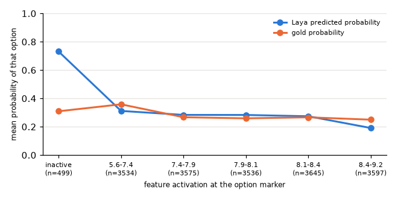

# Feature 11133

Critérios em que aparece: attribution_toward_correct

**Interpretação (preencher):** 

---

## Maiores ativações

**tr_customer_service_000097 / urgency** (score, customer_service) | ativação 9.188 em `marcador` | opções ['0', '1', '2', '3'] | Laya: **1** [0.346, 0.362, 0.113, 0.179] | gabarito: **1**

```
[CLS]score question: How time-sensitive is this conversation?[SEP]
▸ [MASK] level 0: No time pressure; can wait indefinitely.
▸ [MASK] level 1: Routine; handle within the normal queue.
▸ [MASK] level 2: Elevated; should be handled within the same week.
▸ ⟦[MASK]⟧ level 3: Critical; requires action within the same day.

[SEP]

{"account": {"lifetime_value_usd": 3319, "prior_tickets_90d": 0, "seats": 1, "tenure_months": 41, "tier": "free"}, "thread": [{"role": "customer", "text": "Hi, I was told a refund was coming my way a while ago, but I don't see anything in my account. I've been using this free plan for years and I'm just not sure where to look for this credit."}, {"role": "agent", "text": "Hello. I would be happy to look into the status of your refund. Could you please provide the reference number for the original refund request you were given?"}, {"role": "customer", "text": "I’m sorry, I don't actually have a reference number. I just had a chat with someone a few weeks back and they said it was processed."}, {"role": "agent", "text": "Thank you for clarifying that. Since I cannot locate the request without a reference number, could you please tell me the approximate date of that previous interaction?"}, {"role": "customer", "text": "It would have been sometime in mid-October, I believe. I'm just confused because I thought it would show up automatically."}, {"role": "agent", "text": "I see. To help me locate that specific conversation, could you confirm the email address associated with your account?"}, {"role": "customer", "text": "It's the same one I'm messaging from now. I just want to know if it's still coming or if I need to do something else."}]}[SEP]
```

**tr_customer_service_000078 / churn_risk** (score, customer_service) | ativação 9.180 em `marcador` | opções ['0', '1', '2', '3'] | Laya: **2** [0.162, 0.311, 0.359, 0.168] | gabarito: **2**

```
[CLS]score question: How likely is this customer to stop doing business with us because of this interaction?[SEP]
▸ [MASK] level 0: No sign of dissatisfaction.
▸ [MASK] level 1: Mild frustration, but the relationship is intact.
▸ [MASK] level 2: Clearly unhappy; repeat problems or explicit complaints.
▸ ⟦[MASK]⟧ level 3: Imminent: threatening to cancel, dispute or leave.

[SEP]

{"account": {"lifetime_value_usd": 1592, "prior_tickets_90d": 0, "seats": 12, "tenure_months": 60, "tier": "premium"}, "orders": [{"amount_usd": 598, "date": "2026-01-10", "id": "A-12739", "status": "refunded"}, {"amount_usd": 598, "date": "2026-03-19", "id": "A-59410", "status": "failed"}, {"amount_usd": 598, "date": "2026-01-16", "id": "A-91127", "status": "failed"}], "thread": [{"role": "customer", "text": "Hello, I am a long-time premium member and my latest order of $598 just arrived with significant damage to the exterior packaging and the item itself. I have an event this Friday and really need this resolved."}, {"role": "agent", "text": "I am very sorry to hear that your order arrived in that condition. To help me understand the extent of the damage, could you please describe exactly what looks broken?"}, {"role": "customer", "text": "The glass display is completely shattered, and there is a deep dent on the base unit. It looks like it was crushed during transit."}, {"role": "agent", "text": "Thank you for those details. Would you be able to upload a few clear photographs of the damage to this chat so I can review them?"}, {"role": "customer", "text": "I have taken photos of the unit from several angles. Please let me know if there's anything else you need from me before the end of the day."}]}[SEP]
```

**tr_customer_service_000097 / urgency** (score, customer_service) | ativação 9.125 em `marcador` | opções ['0', '1', '2', '3'] | Laya: **1** [0.346, 0.362, 0.113, 0.179] | gabarito: **1**

```
[CLS]score question: How time-sensitive is this conversation?[SEP]
▸ [MASK] level 0: No time pressure; can wait indefinitely.
▸ [MASK] level 1: Routine; handle within the normal queue.
▸ ⟦[MASK]⟧ level 2: Elevated; should be handled within the same week.
▸ [MASK] level 3: Critical; requires action within the same day.

[SEP]

{"account": {"lifetime_value_usd": 3319, "prior_tickets_90d": 0, "seats": 1, "tenure_months": 41, "tier": "free"}, "thread": [{"role": "customer", "text": "Hi, I was told a refund was coming my way a while ago, but I don't see anything in my account. I've been using this free plan for years and I'm just not sure where to look for this credit."}, {"role": "agent", "text": "Hello. I would be happy to look into the status of your refund. Could you please provide the reference number for the original refund request you were given?"}, {"role": "customer", "text": "I’m sorry, I don't actually have a reference number. I just had a chat with someone a few weeks back and they said it was processed."}, {"role": "agent", "text": "Thank you for clarifying that. Since I cannot locate the request without a reference number, could you please tell me the approximate date of that previous interaction?"}, {"role": "customer", "text": "It would have been sometime in mid-October, I believe. I'm just confused because I thought it would show up automatically."}, {"role": "agent", "text": "I see. To help me locate that specific conversation, could you confirm the email address associated with your account?"}, {"role": "customer", "text": "It's the same one I'm messaging from now. I just want to know if it's still coming or if I need to do something else."}]}[SEP]
```

**tr_customer_service_000097 / urgency** (score, customer_service) | ativação 9.125 em `marcador` | opções ['0', '1', '2', '3'] | Laya: **1** [0.346, 0.362, 0.113, 0.179] | gabarito: **1**

```
[CLS]score question: How time-sensitive is this conversation?[SEP]
▸ [MASK] level 0: No time pressure; can wait indefinitely.
▸ ⟦[MASK]⟧ level 1: Routine; handle within the normal queue.
▸ [MASK] level 2: Elevated; should be handled within the same week.
▸ [MASK] level 3: Critical; requires action within the same day.

[SEP]

{"account": {"lifetime_value_usd": 3319, "prior_tickets_90d": 0, "seats": 1, "tenure_months": 41, "tier": "free"}, "thread": [{"role": "customer", "text": "Hi, I was told a refund was coming my way a while ago, but I don't see anything in my account. I've been using this free plan for years and I'm just not sure where to look for this credit."}, {"role": "agent", "text": "Hello. I would be happy to look into the status of your refund. Could you please provide the reference number for the original refund request you were given?"}, {"role": "customer", "text": "I’m sorry, I don't actually have a reference number. I just had a chat with someone a few weeks back and they said it was processed."}, {"role": "agent", "text": "Thank you for clarifying that. Since I cannot locate the request without a reference number, could you please tell me the approximate date of that previous interaction?"}, {"role": "customer", "text": "It would have been sometime in mid-October, I believe. I'm just confused because I thought it would show up automatically."}, {"role": "agent", "text": "I see. To help me locate that specific conversation, could you confirm the email address associated with your account?"}, {"role": "customer", "text": "It's the same one I'm messaging from now. I just want to know if it's still coming or if I need to do something else."}]}[SEP]
```

**tr_customer_service_000087 / urgency** (score, customer_service) | ativação 9.117 em `marcador` | opções ['0', '1', '2', '3'] | Laya: **1** [0.227, 0.325, 0.165, 0.283] | gabarito: **3**

```
[CLS]score question: How time-sensitive is this conversation?[SEP]
▸ [MASK] level 0: No time pressure; can wait indefinitely.
▸ ⟦[MASK]⟧ level 1: Routine; handle within the normal queue.
▸ [MASK] level 2: Elevated; should be handled within the same week.
▸ [MASK] level 3: Critical; requires action within the same day.

[SEP]

{"account": {"lifetime_value_usd": 193, "prior_tickets_90d": 5, "seats": 1, "tenure_months": 5, "tier": "standard"}, "orders": [{"amount_usd": 299, "date": "2026-01-09", "id": "A-83690", "status": "settled"}], "thread": [{"role": "customer", "text": "The new analytics dashboard stopped loading a week ago, and I’ve been sent around to different reps without any fix. I’m tired of hearing the same generic apologies."}, {"role": "agent", "text": "I’m really sorry you’re still seeing that issue. Can you let me know which browser and version you’re using, and whether you’ve tried clearing the cache?"}, {"role": "customer", "text": "I’m on Chrome 117, cleared everything, and it still just shows a spinning wheel. This has been happening since the last update."}, {"role": "agent", "text": "Got it, thanks. I’ll open a deeper look at the logs for your account. Do you recall the exact time you first noticed the dashboard freeze, or any error messages that appeared?"}, {"role": "customer", "text": "It started around 3 PM GMT on the 10th, and the only thing I see is ‘Failed to load data’. I’ve already tried re‑logging, no change."}, {"role": "agent", "text": "Understood. I’m flagging this to our UI team and will keep the ticket open while we investigate. Could you also confirm the account ID you’re using so I can tie the logs correctly?"}, {"role": "customer", "text": "The account ID is ACC‑9987; please let me know when you have any update, because I can’t keep working without those reports."}]}[SEP]
```

## Ativações medianas (faixa 40-60%, mediana 5.695)

**tr_security_incidents_000194 / credential_compromise** (noul, security_incidents) | ativação 6.551 em `marcador` | opções ['false', 'true'] | Laya: **true** [0.178, 0.822] | gabarito: **false**

```
[CLS]noul question: The evidence indicates a credential or account has been compromised.[SEP]
▸ ⟦[MASK]⟧ false: no, the statement does not hold
▸ [MASK] true: yes, the statement holds

[SEP]

{"alert": {"description": "a large transfer to an external destination", "evidence": "From 09:45 to 10:02 UTC the admin account adm_jones transferred 4.7 GB of data to external IP 172.16.200.12 over HTTPS (port 443). This outbound transfer occurred during the approved change window of 09:00‑12:00 on 2026‑09‑16. MFA is enabled for the admin account, and its credentials were last rotated 180 days ago.", "rule": "data_egress"}, "context": {"asset_criticality": "medium", "change_window_active": true, "source_on_allowlist": false}, "history": {"credential_rotation_days_ago": 180, "distinct_countries_30d": 2, "logins_30d": 8, "prior_alerts_90d": 3}, "principal": {"mfa_enrolled": true, "name": "ci-analytics-840", "privileges": ["deploy:production", "secrets:read"], "type": "admin"}}[SEP]
```

**tr_invoice_processing_000088 / matches_order** (noul, invoice_processing) | ativação 6.668 em `marcador` | opções ['false', 'true'] | Laya: **true** [0.483, 0.517] | gabarito: **false**

```
[CLS]noul question: The invoice reconciles with the purchase order and the recorded delivery.[SEP]
▸ [MASK] false: There is a discrepancy against the order or the delivery.
▸ ⟦[MASK]⟧ true: Line items, quantities and amounts reconcile.

[SEP]

{"delivery": {"condition": "accepted with exceptions", "date": "2026-03-27", "received_qty": 25}, "invoice": {"currency": "USD", "id": "INV-2026-2129", "lines": [{"qty": 45, "sku": "SKU-699", "total_usd": 2321.55, "unit_usd": 51.59}], "total_usd": 2321.55, "vendor": "Vantage Materials"}, "payment": {"days_until_due": 44, "discount_expires_in_days": 7, "early_payment_discount_pct": 2.0, "status": "scheduled", "terms": "net 60"}, "purchase_order": {"freight_terms": "freight prepaid by vendor, not separately billable", "id": "PO-2831", "lines": [{"qty": 25, "unit_usd": 51.59}], "total_usd": 1289.75}, "vendor_history": {"disputes_12m": 0, "invoices_12m": 5, "prior_invoice_ids": ["INV-2026-4325", "INV-2026-3895"]}}[SEP]
```

**tr_customer_service_000090 / needs_human** (noul, customer_service) | ativação 7.059 em `marcador` | opções ['false', 'true'] | Laya: **true** [0.457, 0.543] | gabarito: **true**

```
[CLS]noul question: This conversation requires a human agent rather than automated handling.[SEP]
▸ ⟦[MASK]⟧ false: Automation can carry this to resolution.
▸ [MASK] true: A human must take over: judgement, authority or empathy is required.

[SEP]

{"account": {"lifetime_value_usd": 2058, "prior_tickets_90d": 5, "seats": 1, "tenure_months": 33, "tier": "standard"}, "thread": [{"role": "customer", "text": "The unit I received arrived with a cracked screen, which is unacceptable given I’ve been a subscriber for almost three years. I need a replacement before the 5 PM deadline tomorrow for my upcoming presentation."}, {"role": "agent", "text": "I’m sorry about the damage. Could you attach a photo of the crack so we can verify the condition?"}, {"role": "customer", "text": "I’ll upload the pictures right after this message. Please let me know if we can expedite a replacement to meet my deadline."}]}[SEP]
```

**tr_invoice_processing_000222 / matches_order** (noul, invoice_processing) | ativação 6.789 em `marcador` | opções ['false', 'true'] | Laya: **true** [0.477, 0.523] | gabarito: **false**

```
[CLS]noul question: The invoice reconciles with the purchase order and the recorded delivery.[SEP]
▸ [MASK] false: There is a discrepancy against the order or the delivery.
▸ ⟦[MASK]⟧ true: Line items, quantities and amounts reconcile.

[SEP]

{"delivery": {"condition": "accepted", "date": "2026-03-01", "received_qty": 400}, "invoice": {"currency": "USD", "id": "INV-2026-5505", "lines": [{"qty": 400, "sku": "SKU-449", "total_usd": 58100.0, "unit_usd": 145.25}], "total_usd": 58100.0, "vendor": "Orbit Logistics"}, "payment": {"days_until_due": 18, "discount_expires_in_days": null, "early_payment_discount_pct": null, "status": "scheduled", "terms": "net 30"}, "purchase_order": {"freight_terms": "freight prepaid by vendor, not separately billable", "id": "PO-8387", "lines": [{"qty": 400, "unit_usd": 103.75}], "total_usd": 41500.0}, "vendor_history": {"disputes_12m": 0, "invoices_12m": 31, "prior_invoice_ids": ["INV-2026-4436", "INV-2026-7279", "INV-2026-9184"]}}[SEP]
```

**tr_agent_trace_observability_000075 / outcome** (choice, agent_trace_observability) | ativação 5.801 em `pergunta` | opções ['failure', 'harmful', 'partial', 'success'] | Laya: **success** [0.331, 0.119, 0.169, 0.381] | gabarito: **success**

```
[CLS]⟦choice⟧ question: How did this agent run turn out?[SEP]
▸ [MASK] failure: The agent did not accomplish the task.
▸ [MASK] harmful: The agent took an action that caused damage or violated a constraint.
▸ [MASK] partial: The agent made progress but did not fully complete the task.
▸ [MASK] success: The agent completed the task correctly.

[SEP]

{"agent": {"autonomy": "unsupervised", "model": "internal-agent-v4"}, "constraints": ["Do not touch customer data outside the named accounts", "Do not exceed a $50 spend on cloud resources", "Do not force-push to any branch"], "task": "Rotate the expired TLS certificate on the staging load balancer.", "trace_summary": {"constraint_violations": 0, "duration_s": 596.9, "irreversible_actions": 0, "steps": 9, "tool_errors": 1}}[SEP]
```

## Estatísticas (conjunto de descoberta, dev e teste)

**pred / error**

| split | decisões | ativas | ativas e Laya errou | taxa | lift | q (BH) | OR (CMH) | q (CMH) |
|---|---|---|---|---|---|---|---|---|
| discovery | 5100 | 4655 | 2941 | 0.632 | 0.99 | 0.0594 | nan | nan |
| dev | 900 | 803 | 516 | 0.643 | 0.98 | 0.0672 | nan | nan |
| test | 2000 | 1817 | 1149 | 0.632 | 0.99 | 0.285 | nan | nan |

**corr / error**

| split | decisões | ativas | ativas e Laya errou | taxa | lift | q (BH) | OR (CMH) | q (CMH) |
|---|---|---|---|---|---|---|---|---|
| discovery | 5100 | 4930 | 3216 | 0.652 | 1.03 | 1.76e-35 | nan | nan |
| dev | 900 | 874 | 587 | 0.672 | 1.02 | 1.02e-06 | nan | nan |
| test | 2000 | 1934 | 1266 | 0.655 | 1.03 | 3.11e-17 | nan | nan |

**state / error**

| split | decisões | ativas | ativas e Laya errou | taxa | lift | q (BH) | OR (CMH) | q (CMH) |
|---|---|---|---|---|---|---|---|---|
| discovery | 5100 | 2421 | 1560 | 0.644 | 1.01 | 0.571 | 0.91 | 0.38 |
| dev | 900 | 412 | 274 | 0.665 | 1.01 | 1 | 1.02 | 0.973 |
| test | 2000 | 934 | 602 | 0.645 | 1.01 | 0.928 | 1.02 | 0.953 |

Confusão mais sobre-representada (pred): `urgency|1>3` (n=292, lift 1.10, p=1.15e-12). Formato `pergunta|índice previsto>índice correto`.

Confusão mais sobre-representada (corr): `urgency|1>3` (n=292, lift 1.03, p=3.72e-05). Formato `pergunta|índice previsto>índice correto`.

Confusão mais sobre-representada (state): `action|0>1` (n=113, lift 2.00, p=5.83e-30). Formato `pergunta|índice previsto>índice correto`.



