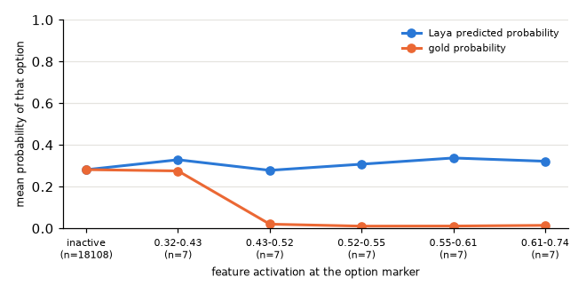

# Feature 11267

Critérios em que aparece: pred_error

**Interpretação (preencher):** 

---

## Maiores ativações

**tr_security_incidents_000165 / true_positive** (noul, security_incidents) | ativação 2.836 em `estado` | opções ['false', 'true'] | Laya: **true** [0.464, 0.536] | gabarito: **true**

```
[CLS]noul question: This alert reflects genuinely malicious or unauthorised activity.[SEP]
▸ [MASK] false: Benign activity, a misconfiguration, or a known false positive.
▸ [MASK] true: The underlying behaviour is malicious or unauthorised.

[SEP]

{"alert": {"description": "an unusual volume of files read in a short window", "evidence": "At 2026-09-15 02:14 UTC the contractor account jdoe_contractor accessed 1,274 files on the share \\srv-files\\projects⟦\\⟧ within a three‑minute window. The request originated from IP 203.0.113.58, which is not present in the approved asset list. MFA was used for the login and the password was last rotated 365 days ago.", "rule": "mass_download"}, "context": {"asset_criticality": "medium", "change_window_active": false, "source_on_allowlist": false}, "history": {"credential_rotation_days_ago": 365, "distinct_countries_30d": 1, "logins_30d": 1502, "prior_alerts_90d": 0}, "principal": {"mfa_enrolled": true, "name": "usr-support-273", "privileges": ["repo:read"], "type": "contractor"}}[SEP]
```

**tr_security_incidents_000165 / disposition** (choice, security_incidents) | ativação 2.451 em `estado` | opções ['close_benign', 'contain', 'investigate', 'monitor'] | Laya: **close_benign** [0.501, 0.158, 0.111, 0.231] | gabarito: **investigate**

```
[CLS]choice question: How should this security alert be dispositioned?[SEP]
▸ [MASK] close_benign: Expected, explainable activity; close without analyst time.
▸ [MASK] contain: Contain the host or account immediately; do not wait for triage.
▸ [MASK] investigate: Warrants an analyst opening an investigation.
▸ [MASK] monitor: Not clearly malicious, but worth watching for recurrence.

[SEP]

{"alert": {"description": "an unusual volume of files read in a short window", "evidence": "At 2026-09-15 02:14 UTC the contractor account jdoe_contractor accessed 1,274 files on the share \\srv-files\\projects⟦\\⟧ within a three‑minute window. The request originated from IP 203.0.113.58, which is not present in the approved asset list. MFA was used for the login and the password was last rotated 365 days ago.", "rule": "mass_download"}, "context": {"asset_criticality": "medium", "change_window_active": false, "source_on_allowlist": false}, "history": {"credential_rotation_days_ago": 365, "distinct_countries_30d": 1, "logins_30d": 1502, "prior_alerts_90d": 0}, "principal": {"mfa_enrolled": true, "name": "usr-support-273", "privileges": ["repo:read"], "type": "contractor"}}[SEP]
```

**tr_security_incidents_000165 / severity** (score, security_incidents) | ativação 2.426 em `estado` | opções ['0', '1', '2', '3', '4'] | Laya: **2** [0.063, 0.286, 0.354, 0.155, 0.143] | gabarito: **2**

```
[CLS]score question: How severe is the potential impact if this alert is real?[SEP]
▸ [MASK] level 0: Negligible: no access to anything sensitive.
▸ [MASK] level 1: Low: limited access, easily reversed.
▸ [MASK] level 2: Moderate: access to internal systems or non-public data.
▸ [MASK] level 3: High: access to production, secrets or customer data.
▸ [MASK] level 4: Critical: active compromise of crown-jewel systems.

[SEP]

{"alert": {"description": "an unusual volume of files read in a short window", "evidence": "At 2026-09-15 02:14 UTC the contractor account jdoe_contractor accessed 1,274 files on the share \\srv-files\\projects⟦\\⟧ within a three‑minute window. The request originated from IP 203.0.113.58, which is not present in the approved asset list. MFA was used for the login and the password was last rotated 365 days ago.", "rule": "mass_download"}, "context": {"asset_criticality": "medium", "change_window_active": false, "source_on_allowlist": false}, "history": {"credential_rotation_days_ago": 365, "distinct_countries_30d": 1, "logins_30d": 1502, "prior_alerts_90d": 0}, "principal": {"mfa_enrolled": true, "name": "usr-support-273", "privileges": ["repo:read"], "type": "contractor"}}[SEP]
```

**tr_security_incidents_000165 / urgency** (score, security_incidents) | ativação 2.373 em `estado` | opções ['0', '1', '2', '3'] | Laya: **1** [0.104, 0.607, 0.143, 0.146] | gabarito: **2**

```
[CLS]score question: How quickly must a responder act on this alert?[SEP]
▸ [MASK] level 0: No time pressure; can wait indefinitely.
▸ [MASK] level 1: Routine; handle within the normal queue.
▸ [MASK] level 2: Elevated; should be handled within the same week.
▸ [MASK] level 3: Critical; requires action within the same day.

[SEP]

{"alert": {"description": "an unusual volume of files read in a short window", "evidence": "At 2026-09-15 02:14 UTC the contractor account jdoe_contractor accessed 1,274 files on the share \\srv-files\\projects⟦\\⟧ within a three‑minute window. The request originated from IP 203.0.113.58, which is not present in the approved asset list. MFA was used for the login and the password was last rotated 365 days ago.", "rule": "mass_download"}, "context": {"asset_criticality": "medium", "change_window_active": false, "source_on_allowlist": false}, "history": {"credential_rotation_days_ago": 365, "distinct_countries_30d": 1, "logins_30d": 1502, "prior_alerts_90d": 0}, "principal": {"mfa_enrolled": true, "name": "usr-support-273", "privileges": ["repo:read"], "type": "contractor"}}[SEP]
```

**tr_security_incidents_000165 / credential_compromise** (noul, security_incidents) | ativação 2.318 em `estado` | opções ['false', 'true'] | Laya: **true** [0.158, 0.842] | gabarito: **false**

```
[CLS]noul question: The evidence indicates a credential or account has been compromised.[SEP]
▸ [MASK] false: no, the statement does not hold
▸ [MASK] true: yes, the statement holds

[SEP]

{"alert": {"description": "an unusual volume of files read in a short window", "evidence": "At 2026-09-15 02:14 UTC the contractor account jdoe_contractor accessed 1,274 files on the share \\srv-files\\projects⟦\\⟧ within a three‑minute window. The request originated from IP 203.0.113.58, which is not present in the approved asset list. MFA was used for the login and the password was last rotated 365 days ago.", "rule": "mass_download"}, "context": {"asset_criticality": "medium", "change_window_active": false, "source_on_allowlist": false}, "history": {"credential_rotation_days_ago": 365, "distinct_countries_30d": 1, "logins_30d": 1502, "prior_alerts_90d": 0}, "principal": {"mfa_enrolled": true, "name": "usr-support-273", "privileges": ["repo:read"], "type": "contractor"}}[SEP]
```

## Ativações medianas (faixa 40-60%, mediana 0.379)

**tr_invoice_processing_000076 / discrepancy_severity** (score, invoice_processing) | ativação 0.386 em `opção` | opções ['0', '1', '2', '3'] | Laya: **0** [0.332, 0.242, 0.246, 0.18] | gabarito: **3**

```
[CLS]score question: How material is any discrepancy between the invoice, the order and the delivery?[SEP]
▸ [MASK] level 0: None⟦:⟧ everything reconciles.
▸ [MASK] level 1: Trivial: rounding or a cosmetic difference.
▸ [MASK] level 2: Moderate: a real difference worth confirming.
▸ [MASK] level 3: Material: a large or unexplained difference.

[SEP]

{"delivery": {"condition": "accepted", "date": "2026-03-03", "received_qty": 50}, "invoice": {"currency": "USD", "id": "INV-2026-7325", "lines": [{"qty": 50, "sku": "SKU-282", "total_usd": 24438.5, "unit_usd": 488.77}], "total_usd": 24438.5, "vendor": "Pallas Industrial"}, "payment": {"days_until_due": 11, "discount_expires_in_days": null, "early_payment_discount_pct": null, "status": "scheduled", "terms": "net 30"}, "purchase_order": {"freight_terms": "freight prepaid by vendor, not separately billable", "id": "PO-3572", "lines": [{"qty": 50, "unit_usd": 436.4}], "total_usd": 21820.0}, "vendor_history": {"disputes_12m": 0, "invoices_12m": 20, "prior_invoice_ids": ["INV-2026-6186", "INV-2026-6194", "INV-2026-8302"]}}[SEP]
```

**tr_security_incidents_000200 / severity** (score, security_incidents) | ativação 0.348 em `estado` | opções ['0', '1', '2', '3', '4'] | Laya: **1** [0.047, 0.399, 0.366, 0.156, 0.032] | gabarito: **2**

```
[CLS]score question: How severe is the potential impact if this alert is real?[SEP]
▸ [MASK] level 0: Negligible: no access to anything sensitive.
▸ [MASK] level 1: Low: limited access, easily reversed.
▸ [MASK] level 2: Moderate: access to internal systems or non-public data.
▸ [MASK] level 3: High: access to production, secrets or customer data.
▸ [MASK] level 4: Critical: active compromise of crown-jewel systems.

[SEP]

{"alert": {"description": "many failed authentications followed by a success", "evidence": "Service account 'svc_account_2' recorded 48 failed authentication attempts followed by a successful login at 22:10 UTC from an unrecognized network origin. The account operates without MFA and has not undergone credential rotation in the past 90 days.", "rule": "brute_force"}, "context": {"asset_criticality": "medium", "change_window_active": false, "source_on_allowlist": false}, "history⟦":⟧ {"credential_rotation_days_ago": 90, "distinct_countries_30d": 3, "logins_30d": 938, "prior_alerts_90d": 3}, "principal": {"mfa_enrolled": false, "name": "svc-deploy-730", "privileges": ["repo:read"], "type": "service_account"}}[SEP]
```

**tr_invoice_processing_000110 / discrepancy_severity** (score, invoice_processing) | ativação 0.386 em `opção` | opções ['0', '1', '2', '3'] | Laya: **0** [0.392, 0.244, 0.204, 0.16] | gabarito: **0**

```
[CLS]score question: How material is any discrepancy between the invoice, the order and the delivery?[SEP]
▸ [MASK] level 0: None⟦:⟧ everything reconciles.
▸ [MASK] level 1: Trivial: rounding or a cosmetic difference.
▸ [MASK] level 2: Moderate: a real difference worth confirming.
▸ [MASK] level 3: Material: a large or unexplained difference.

[SEP]

{"delivery": {"condition": "accepted", "date": "2026-03-01", "received_qty": 400}, "invoice": {"currency": "USD", "id": "INV-2026-3749", "lines": [{"qty": 400, "sku": "SKU-775", "total_usd": 98092.0, "unit_usd": 245.23}], "total_usd": 98092.0, "vendor": "Pallas Industrial"}, "payment": {"days_until_due": -3, "discount_expires_in_days": null, "early_payment_discount_pct": null, "status": "overdue", "terms": "net 45"}, "purchase_order": {"freight_terms": "freight prepaid by vendor, not separately billable", "id": "PO-4329", "lines": [{"qty": 400, "unit_usd": 245.23}], "total_usd": 98092.0}, "vendor_history": {"disputes_12m": 0, "invoices_12m": 48, "prior_invoice_ids": ["INV-2026-9469", "INV-2026-8195", "INV-2026-6930", "INV-2026-5533"]}}[SEP]
```

**tr_security_incidents_000120 / severity** (score, security_incidents) | ativação 0.354 em `estado` | opções ['0', '1', '2', '3', '4'] | Laya: **2** [0.075, 0.328, 0.388, 0.112, 0.098] | gabarito: **3**

```
[CLS]score question: How severe is the potential impact if this alert is real?[SEP]
▸ [MASK] level 0: Negligible: no access to anything sensitive.
▸ [MASK] level 1: Low: limited access, easily reversed.
▸ [MASK] level 2: Moderate: access to internal systems or non-public data.
▸ [MASK] level 3: High: access to production, secrets or customer data.
▸ [MASK] level 4: Critical: active compromise of crown-jewel systems.

[SEP]

{"alert": {"description": "an endpoint agent matched a known signature", "evidence": "The endpoint agent on CI runner host 'runner-7x2' identified a signature match for 'malware.linux.syslog' during an active session. This connection originated from an unrecognized IP address (203.0.113.88) using unprivileged credentials that were last rotated 90 days ago.", "rule": "malware_signature"}, "context": {"asset_criticality": "high", "change_window_active": false, "source_on_allowlist": false}, "history⟦":⟧ {"credential_rotation_days_ago": 90, "distinct_countries_30d": 1, "logins_30d": 1882, "prior_alerts_90d": 8}, "principal": {"mfa_enrolled": true, "name": "usr-billing-642", "privileges": ["repo:read"], "type": "ci_runner"}}[SEP]
```

**tr_invoice_processing_000023 / discrepancy_severity** (score, invoice_processing) | ativação 0.361 em `opção` | opções ['0', '1', '2', '3'] | Laya: **0** [0.429, 0.238, 0.207, 0.126] | gabarito: **0**

```
[CLS]score question: How material is any discrepancy between the invoice, the order and the delivery?[SEP]
▸ [MASK] level 0: None⟦:⟧ everything reconciles.
▸ [MASK] level 1: Trivial: rounding or a cosmetic difference.
▸ [MASK] level 2: Moderate: a real difference worth confirming.
▸ [MASK] level 3: Material: a large or unexplained difference.

[SEP]

{"delivery": {"condition": "accepted with exceptions", "date": "2026-03-25", "received_qty": 250}, "invoice": {"currency": "USD", "id": "INV-2026-8598", "lines": [{"qty": 250, "sku": "SKU-575", "total_usd": 31660.0, "unit_usd": 126.64}], "total_usd": 31660.0, "vendor": "Northwind Components"}, "payment": {"days_until_due": 5, "discount_expires_in_days": null, "early_payment_discount_pct": null, "status": "scheduled", "terms": "net 60"}, "purchase_order": {"freight_terms": "freight prepaid by vendor, not separately billable", "id": "PO-4453", "lines": [{"qty": 250, "unit_usd": 126.64}], "total_usd": 31660.0}, "vendor_history": {"disputes_12m": 0, "invoices_12m": 12, "prior_invoice_ids": ["INV-2026-3394", "INV-2026-7717", "INV-2026-6892", "INV-2026-2732"]}}[SEP]
```

## Estatísticas (conjunto de descoberta, dev e teste)

**pred / error**

| split | decisões | ativas | ativas e Laya errou | taxa | lift | q (BH) | OR (CMH) | q (CMH) |
|---|---|---|---|---|---|---|---|---|
| discovery | 5100 | 25 | 24 | 0.960 | 1.51 | 0.000941 | 0.35 | 0.648 |
| dev | 900 | 3 | 3 | 1.000 | 1.52 | nan | nan | nan |
| test | 2000 | 8 | 8 | 1.000 | 1.57 | nan | nan | nan |

**corr / error**

| split | decisões | ativas | ativas e Laya errou | taxa | lift | q (BH) | OR (CMH) | q (CMH) |
|---|---|---|---|---|---|---|---|---|
| discovery | 5100 | 3 | 2 | 0.667 | 1.05 | nan | nan | nan |
| dev | 900 | 0 | 0 | nan | nan | nan | nan | nan |
| test | 2000 | 0 | 0 | nan | nan | nan | nan | nan |

**state / error**

| split | decisões | ativas | ativas e Laya errou | taxa | lift | q (BH) | OR (CMH) | q (CMH) |
|---|---|---|---|---|---|---|---|---|
| discovery | 5100 | 794 | 498 | 0.627 | 0.99 | 0.839 | 1.20 | 0.128 |
| dev | 900 | 159 | 101 | 0.635 | 0.97 | 1 | 1.06 | 0.916 |
| test | 2000 | 309 | 203 | 0.657 | 1.03 | 0.892 | 1.41 | 0.122 |

Confusão mais sobre-representada (pred): `action|1>2` (n=11, lift 17.95, p=4.11e-12). Formato `pergunta|índice previsto>índice correto`.

Confusão mais sobre-representada (corr): `credential_compromise|1>0` (n=2, lift 38.64, p=nan). Formato `pergunta|índice previsto>índice correto`.

Confusão mais sobre-representada (state): `credential_compromise|1>0` (n=41, lift 2.99, p=4.13e-12). Formato `pergunta|índice previsto>índice correto`.



