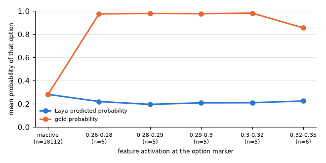

# Feature 11357

Critérios em que aparece: corr_error

**Interpretação (preencher):** 

---

## Maiores ativações

**tr_customer_service_000078 / action** (choice, customer_service) | ativação 2.980 em `estado` | opções ['answer_directly', 'close_no_action', 'escalate_to_human', 'execute_refund', 'request_information'] | Laya: **execute_refund** [0.151, 0.199, 0.213, 0.32, 0.116] | gabarito: **request_information**

```
[CLS]choice question: What should the assistant do next with this conversation?[SEP]
▸ [MASK] answer_directly: The assistant can resolve this itself with information it already has.
▸ [MASK] close_no_action: No further action is warranted; the matter is settled.
▸ [MASK] escalate_to_human: Hand off to a human agent with the appropriate authority.
▸ [MASK] execute_refund: Issue the refund or credit the customer is owed.
▸ [MASK] request_information: More detail is needed from the customer before anything can be done.

[SEP]

{"account": {"lifetime_value_usd": 1592, "prior_tickets_90d": 0, "seats": 12, "tenure_months": 60, "tier": "premium"}, "orders": [{"amount_usd": 598, "date": "2026-01-10", "id": "A-12739", "status": "refunded"}, {"amount_usd": 598, "date": "2026-03-19", "id": "A-59410", "status": "failed"}, {"amount_usd": 598, "date": "2026-01-16", "id": "A-91127", "status": "failed"}], "thread": [{"role": "customer", "text": "Hello, I am a long-time premium member and my latest order of $598 just arrived with significant damage to the exterior packaging⟦ and⟧ the item itself. I have an event this Friday and really need this resolved."}, {"role": "agent", "text": "I am very sorry to hear that your order arrived in that condition. To help me understand the extent of the damage, could you please describe exactly what looks broken?"}, {"role": "customer", "text": "The glass display is completely shattered, and there is a deep dent on the base unit. It looks like it was crushed during transit."}, {"role": "agent", "text": "Thank you for those details. Would you be able to upload a few clear photographs of the damage to this chat so I can review them?"}, {"role": "customer", "text": "I have taken photos of the unit from several angles. Please let me know if there's anything else you need from me before the end of the day."}]}[SEP]
```

**tr_security_incidents_000102 / credential_compromise** (noul, security_incidents) | ativação 2.779 em `estado` | opções ['false', 'true'] | Laya: **true** [0.163, 0.837] | gabarito: **false**

```
[CLS]noul question: The evidence indicates a credential or account has been compromised.[SEP]
▸ [MASK] false: no, the statement does not hold
▸ [MASK] true: yes, the statement holds

[SEP]

{"alert": {"description": "a long-unused account became active", "evidence": "The employee account \"e12345\" generated a successful interactive logon from IP 10.12.45.8 at 2026-09-15T03:41:27Z. The source host (hostname \"WORKSTN-12\") is listed in the approved allowlist⟦ and⟧ MFA verification succeeded. The account's password was last rotated on 2026-09-01 (14 days prior).", "rule": "dormant_account_use"}, "context": {"asset_criticality": "medium", "change_window_active": false, "source_on_allowlist": true}, "history": {"credential_rotation_days_ago": 14, "distinct_countries_30d": 2, "logins_30d": 1715, "prior_alerts_90d": 0}, "principal": {"mfa_enrolled": true, "name": "usr-deploy-604", "privileges": ["repo:read"], "type": "employee"}}[SEP]
```

**tr_customer_service_000078 / category** (choice, customer_service) | ativação 2.729 em `estado` | opções ['account', 'billing', 'delivery', 'refund', 'technical'] | Laya: **refund** [0.131, 0.138, 0.069, 0.477, 0.185] | gabarito: **delivery**

```
[CLS]choice question: What is this customer conversation primarily about?[SEP]
▸ [MASK] account: Login, plan changes, profile or access management.
▸ [MASK] billing: A charge, invoice, subscription or payment problem.
▸ [MASK] delivery: Shipping, fulfilment or delivery of a physical item.
▸ [MASK] refund: The customer is explicitly asking for money back.
▸ [MASK] technical: The product or service is not working as expected.

[SEP]

{"account": {"lifetime_value_usd": 1592, "prior_tickets_90d": 0, "seats": 12, "tenure_months": 60, "tier": "premium"}, "orders": [{"amount_usd": 598, "date": "2026-01-10", "id": "A-12739", "status": "refunded"}, {"amount_usd": 598, "date": "2026-03-19", "id": "A-59410", "status": "failed"}, {"amount_usd": 598, "date": "2026-01-16", "id": "A-91127", "status": "failed"}], "thread": [{"role": "customer", "text": "Hello, I am a long-time premium member and my latest order of $598 just arrived with significant damage to the exterior packaging⟦ and⟧ the item itself. I have an event this Friday and really need this resolved."}, {"role": "agent", "text": "I am very sorry to hear that your order arrived in that condition. To help me understand the extent of the damage, could you please describe exactly what looks broken?"}, {"role": "customer", "text": "The glass display is completely shattered, and there is a deep dent on the base unit. It looks like it was crushed during transit."}, {"role": "agent", "text": "Thank you for those details. Would you be able to upload a few clear photographs of the damage to this chat so I can review them?"}, {"role": "customer", "text": "I have taken photos of the unit from several angles. Please let me know if there's anything else you need from me before the end of the day."}]}[SEP]
```

**tr_security_incidents_000102 / true_positive** (noul, security_incidents) | ativação 2.600 em `estado` | opções ['false', 'true'] | Laya: **false** [0.651, 0.349] | gabarito: **false**

```
[CLS]noul question: This alert reflects genuinely malicious or unauthorised activity.[SEP]
▸ [MASK] false: Benign activity, a misconfiguration, or a known false positive.
▸ [MASK] true: The underlying behaviour is malicious or unauthorised.

[SEP]

{"alert": {"description": "a long-unused account became active", "evidence": "The employee account \"e12345\" generated a successful interactive logon from IP 10.12.45.8 at 2026-09-15T03:41:27Z. The source host (hostname \"WORKSTN-12\") is listed in the approved allowlist⟦ and⟧ MFA verification succeeded. The account's password was last rotated on 2026-09-01 (14 days prior).", "rule": "dormant_account_use"}, "context": {"asset_criticality": "medium", "change_window_active": false, "source_on_allowlist": true}, "history": {"credential_rotation_days_ago": 14, "distinct_countries_30d": 2, "logins_30d": 1715, "prior_alerts_90d": 0}, "principal": {"mfa_enrolled": true, "name": "usr-deploy-604", "privileges": ["repo:read"], "type": "employee"}}[SEP]
```

**tr_customer_service_000078 / churn_risk** (score, customer_service) | ativação 2.475 em `estado` | opções ['0', '1', '2', '3'] | Laya: **2** [0.162, 0.311, 0.359, 0.168] | gabarito: **2**

```
[CLS]score question: How likely is this customer to stop doing business with us because of this interaction?[SEP]
▸ [MASK] level 0: No sign of dissatisfaction.
▸ [MASK] level 1: Mild frustration, but the relationship is intact.
▸ [MASK] level 2: Clearly unhappy; repeat problems or explicit complaints.
▸ [MASK] level 3: Imminent: threatening to cancel, dispute or leave.

[SEP]

{"account": {"lifetime_value_usd": 1592, "prior_tickets_90d": 0, "seats": 12, "tenure_months": 60, "tier": "premium"}, "orders": [{"amount_usd": 598, "date": "2026-01-10", "id": "A-12739", "status": "refunded"}, {"amount_usd": 598, "date": "2026-03-19", "id": "A-59410", "status": "failed"}, {"amount_usd": 598, "date": "2026-01-16", "id": "A-91127", "status": "failed"}], "thread": [{"role": "customer", "text": "Hello, I am a long-time premium member and my latest order of $598 just arrived with significant damage to the exterior packaging⟦ and⟧ the item itself. I have an event this Friday and really need this resolved."}, {"role": "agent", "text": "I am very sorry to hear that your order arrived in that condition. To help me understand the extent of the damage, could you please describe exactly what looks broken?"}, {"role": "customer", "text": "The glass display is completely shattered, and there is a deep dent on the base unit. It looks like it was crushed during transit."}, {"role": "agent", "text": "Thank you for those details. Would you be able to upload a few clear photographs of the damage to this chat so I can review them?"}, {"role": "customer", "text": "I have taken photos of the unit from several angles. Please let me know if there's anything else you need from me before the end of the day."}]}[SEP]
```

## Ativações medianas (faixa 40-60%, mediana 0.625)

**tr_security_incidents_000076 / true_positive** (noul, security_incidents) | ativação 0.683 em `estado` | opções ['false', 'true'] | Laya: **false** [0.55, 0.45] | gabarito: **true**

```
[CLS]noul question: This alert reflects genuinely malicious or unauthorised activity.[SEP]
▸ [MASK] false: Benign activity, a misconfiguration, or a known false positive.
▸ [MASK] true: The underlying behaviour is malicious or unauthorised.

[SEP]

{"alert": {"description": "an unusual volume of files read in a short window", "evidence": "Between 2026-09-15 02:00:00 and 02:05:12 UTC, the privileged admin account performed 3,842 file‑read operations on files under /var/www/html/ using the process \"wget\". The activity originated from an unrecognised source IP 192.0.2.77, the credentials for this account have not been rotated for 700 days, and no change window was defined.", "rule": "mass_download"}, "context": {"asset_criticality": "medium", "change_window_active": false, "source_on_allowlist": false}, "history": {"credential_rotation_days_ago": 700, "distinct_countries_30d": 1, "logins_30d": 282, "prior_alerts_90d": 0}, "principal": {"mfa_enrolled": true, "name": "svc-support-350", "privileges": ["deploy:production⟦",⟧ "secrets:read"], "type": "admin"}}[SEP]
```

**tr_agent_trace_observability_000109 / needs_review** (noul, agent_trace_observability) | ativação 0.641 em `estado` | opções ['false', 'true'] | Laya: **false** [0.679, 0.321] | gabarito: **true**

```
[CLS]noul question: This trace requires human review.[SEP]
▸ [MASK] false: No human attention is warranted.
▸ [MASK] true: A human should inspect this run.

[SEP]

{"agent": {"autonomy": "unsupervised", "model": "internal-agent-v1"}, "constraints": ["Never modify production without an approved change ticket", "Do not touch customer data outside the named accounts", "Do not force-push to any branch"], "task": "Delete personal data for the accounts in the erasure queue.", "trace_summary": {"constraint_violations": 1,⟦ "⟧duration_s": 604.3, "irreversible_actions": 1, "steps": 9, "tool_errors": 3}}[SEP]
```

**tr_customer_service_000068 / needs_human** (noul, customer_service) | ativação 0.625 em `estado` | opções ['false', 'true'] | Laya: **true** [0.42, 0.58] | gabarito: **true**

```
[CLS]noul question: This conversation requires a human agent rather than automated handling.[SEP]
▸ [MASK] false: Automation can carry this to resolution.
▸ [MASK] true: A human must take over: judgement, authority or empathy is required.

[SEP]

{"account": {"lifetime_value_usd": 1781, "prior_tickets_90d": 1⟦,⟧ "seats": 1, "tenure_months": 19, "tier": "standard"}, "orders": [{"amount_usd": 999, "date": "2026-03-09", "id": "A-22295", "status": "pending"}, {"amount_usd": 999, "date": "2026-03-17", "id": "A-32594", "status": "refunded"}, {"amount_usd": 999, "date": "2026-03-04", "id": "A-42545", "status": "refunded"}], "thread": [{"role": "customer", "text": "Hello, I’ve been on the standard plan for about 19 months now (roughly $999 total) and I’m experiencing unusually slow performance across the board. I opened a ticket a while back that never got resolved, and I really need this sorted out before my project deadline this Friday."}, {"role": "agent", "text": "I’m sorry to hear that you’re still seeing slow speeds. Could you let me know when the slowdown first became noticeable and which specific features or tasks are most affected?"}, {"role": "customer", "text": "It started about two days ago, especially when I try to load the dashboard or run the monthly reports—everything takes double the usual time. With the deadline looming, any insight you can share would be appreciated."}]}[SEP]
```

**tr_agent_trace_observability_000222 / outcome** (choice, agent_trace_observability) | ativação 0.552 em `estado` | opções ['failure', 'harmful', 'partial', 'success'] | Laya: **failure** [0.607, 0.096, 0.179, 0.118] | gabarito: **harmful**

```
[CLS]choice question: How did this agent run turn out?[SEP]
▸ [MASK] failure: The agent did not accomplish the task.
▸ [MASK] harmful: The agent took an action that caused damage or violated a constraint.
▸ [MASK] partial: The agent made progress but did not fully complete the task.
▸ [MASK] success: The agent completed the task correctly.

[SEP]

{"agent": {"autonomy": "checkpointed", "model": "internal-agent-v3"}, "constraints": ["Never modify production without an approved change ticket"], "task": "Migrate the user table to the new schema without downtime.", "trace_summary": {"constraint_violations": 1, "duration_s": 635.2⟦,⟧ "irreversible_actions": 1, "steps": 12, "tool_errors": 3}}[SEP]
```

**tr_security_incidents_000088 / disposition** (choice, security_incidents) | ativação 0.641 em `opção` | opções ['close_benign', 'contain', 'investigate', 'monitor'] | Laya: **monitor** [0.316, 0.266, 0.098, 0.32] | gabarito: **contain**

```
[CLS]choice question: How should this security alert be dispositioned?[SEP]
▸ [MASK] close_benign: Expected⟦,⟧ explainable activity; close without analyst time.
▸ [MASK] contain: Contain the host or account immediately; do not wait for triage.
▸ [MASK] investigate: Warrants an analyst opening an investigation.
▸ [MASK] monitor: Not clearly malicious, but worth watching for recurrence.

[SEP]

{"alert": {"description": "audit logging was turned off on a host", "evidence": "Audit logging was disabled on host host-12.internal at 2026-09-14T18:47:19Z, as indicated by the stop of the auditd process. The change was initiated by admin user \"admin_jane\" (unprivileged) from an unrecognized source IP 198.51.100.22.", "rule": "disabled_logging"}, "context": {"asset_criticality": "crown_jewel", "change_window_active": false, "source_on_allowlist": false}, "history": {"credential_rotation_days_ago": 90, "distinct_countries_30d": 3, "logins_30d": 381, "prior_alerts_90d": 1}, "principal": {"mfa_enrolled": true, "name": "adm-infra-272", "privileges": ["repo:read"], "type": "admin"}}[SEP]
```

## Estatísticas (conjunto de descoberta, dev e teste)

**pred / error**

| split | decisões | ativas | ativas e Laya errou | taxa | lift | q (BH) | OR (CMH) | q (CMH) |
|---|---|---|---|---|---|---|---|---|
| discovery | 5100 | 0 | 0 | nan | nan | nan | nan | nan |
| dev | 900 | 0 | 0 | nan | nan | nan | nan | nan |
| test | 2000 | 0 | 0 | nan | nan | nan | nan | nan |

**corr / error**

| split | decisões | ativas | ativas e Laya errou | taxa | lift | q (BH) | OR (CMH) | q (CMH) |
|---|---|---|---|---|---|---|---|---|
| discovery | 5100 | 26 | 26 | 1.000 | 1.57 | 2.68e-05 | inf | 0.834 |
| dev | 900 | 5 | 5 | 1.000 | 1.52 | nan | nan | nan |
| test | 2000 | 17 | 17 | 1.000 | 1.57 | nan | nan | nan |

**state / error**

| split | decisões | ativas | ativas e Laya errou | taxa | lift | q (BH) | OR (CMH) | q (CMH) |
|---|---|---|---|---|---|---|---|---|
| discovery | 5100 | 2303 | 1492 | 0.648 | 1.02 | 0.385 | 1.26 | 0.00487 |
| dev | 900 | 442 | 285 | 0.645 | 0.98 | 1 | 0.95 | 0.892 |
| test | 2000 | 947 | 623 | 0.658 | 1.03 | 0.472 | 1.32 | 0.0545 |

Confusão mais sobre-representada (corr): `duplicate|1>0` (n=26, lift 23.61, p=4.42e-37). Formato `pergunta|índice previsto>índice correto`.

Confusão mais sobre-representada (state): `matches_order|1>0` (n=92, lift 1.85, p=3.99e-17). Formato `pergunta|índice previsto>índice correto`.



