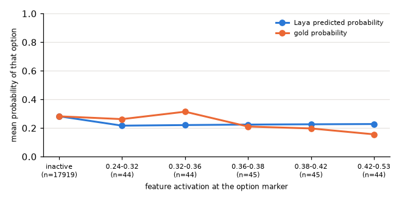

# Feature 11712

Critérios em que aparece: corr_error

**Interpretação (preencher):** 

---

## Maiores ativações

**tr_customer_service_000264 / needs_human** (noul, customer_service) | ativação 2.271 em `estado` | opções ['false', 'true'] | Laya: **true** [0.422, 0.578] | gabarito: **true**

```
[CLS]noul question: This conversation requires a human agent rather than automated handling.[SEP]
▸ [MASK] false: Automation can carry this to resolution.
▸ [MASK] true: A human must take over: judgement, authority or empathy is required.

[SEP]

{"account": {"lifetime_value_usd": 166, "prior_tickets_90d": 2, "seats": 1, "tenure_months": 3, "tier": "standard"}, "thread": [{"role": "customer", "text": "I’m looking at my statement and see I’ve been hit with another duplicate charge for my standard plan. This is the third time now, and those last two tickets I opened resulted in absolutely nothing but empty promises from your team."}, {"role": "agent", "text": "I understand how frustrating it is to see recurring billing issues like this, and I apologize that your previous experience hasn't⟦ met⟧ expectations. Could you please provide the dates of those specific charges so I can pull up the transaction history?"}, {"role": "customer", "text": "It’s happened on the 15th of each of the last three months. I've already sent these dates in twice before, so I’m really not sure why you need them again."}, {"role": "agent", "text": "Thank you for clarifying that timeline. I am currently cross-referencing your billing records with the account activity; could you confirm if you have received any automated notification emails regarding these specific transaction dates?"}, {"role": "customer", "text": "I haven't seen a single email about these charges, which is exactly why this is so confusing. I’m just trying to get this sorted out once and for all."}]}[SEP]
```

**tr_customer_service_000264 / urgency** (score, customer_service) | ativação 2.121 em `estado` | opções ['0', '1', '2', '3'] | Laya: **1** [0.056, 0.432, 0.187, 0.324] | gabarito: **2**

```
[CLS]score question: How time-sensitive is this conversation?[SEP]
▸ [MASK] level 0: No time pressure; can wait indefinitely.
▸ [MASK] level 1: Routine; handle within the normal queue.
▸ [MASK] level 2: Elevated; should be handled within the same week.
▸ [MASK] level 3: Critical; requires action within the same day.

[SEP]

{"account": {"lifetime_value_usd": 166, "prior_tickets_90d": 2, "seats": 1, "tenure_months": 3, "tier": "standard"}, "thread": [{"role": "customer", "text": "I’m looking at my statement and see I’ve been hit with another duplicate charge for my standard plan. This is the third time now, and those last two tickets I opened resulted in absolutely nothing but empty promises from your team."}, {"role": "agent", "text": "I understand how frustrating it is to see recurring billing issues like this, and I apologize that your previous experience hasn't⟦ met⟧ expectations. Could you please provide the dates of those specific charges so I can pull up the transaction history?"}, {"role": "customer", "text": "It’s happened on the 15th of each of the last three months. I've already sent these dates in twice before, so I’m really not sure why you need them again."}, {"role": "agent", "text": "Thank you for clarifying that timeline. I am currently cross-referencing your billing records with the account activity; could you confirm if you have received any automated notification emails regarding these specific transaction dates?"}, {"role": "customer", "text": "I haven't seen a single email about these charges, which is exactly why this is so confusing. I’m just trying to get this sorted out once and for all."}]}[SEP]
```

**tr_customer_service_000264 / churn_risk** (score, customer_service) | ativação 2.078 em `estado` | opções ['0', '1', '2', '3'] | Laya: **2** [0.099, 0.225, 0.484, 0.192] | gabarito: **2**

```
[CLS]score question: How likely is this customer to stop doing business with us because of this interaction?[SEP]
▸ [MASK] level 0: No sign of dissatisfaction.
▸ [MASK] level 1: Mild frustration, but the relationship is intact.
▸ [MASK] level 2: Clearly unhappy; repeat problems or explicit complaints.
▸ [MASK] level 3: Imminent: threatening to cancel, dispute or leave.

[SEP]

{"account": {"lifetime_value_usd": 166, "prior_tickets_90d": 2, "seats": 1, "tenure_months": 3, "tier": "standard"}, "thread": [{"role": "customer", "text": "I’m looking at my statement and see I’ve been hit with another duplicate charge for my standard plan. This is the third time now, and those last two tickets I opened resulted in absolutely nothing but empty promises from your team."}, {"role": "agent", "text": "I understand how frustrating it is to see recurring billing issues like this, and I apologize that your previous experience hasn't⟦ met⟧ expectations. Could you please provide the dates of those specific charges so I can pull up the transaction history?"}, {"role": "customer", "text": "It’s happened on the 15th of each of the last three months. I've already sent these dates in twice before, so I’m really not sure why you need them again."}, {"role": "agent", "text": "Thank you for clarifying that timeline. I am currently cross-referencing your billing records with the account activity; could you confirm if you have received any automated notification emails regarding these specific transaction dates?"}, {"role": "customer", "text": "I haven't seen a single email about these charges, which is exactly why this is so confusing. I’m just trying to get this sorted out once and for all."}]}[SEP]
```

**tr_customer_service_000007 / churn_risk** (score, customer_service) | ativação 1.914 em `estado` | opções ['0', '1', '2', '3'] | Laya: **1** [0.198, 0.49, 0.278, 0.035] | gabarito: **1**

```
[CLS]score question: How likely is this customer to stop doing business with us because of this interaction?[SEP]
▸ [MASK] level 0: No sign of dissatisfaction.
▸ [MASK] level 1: Mild frustration, but the relationship is intact.
▸ [MASK] level 2: Clearly unhappy; repeat problems or explicit complaints.
▸ [MASK] level 3: Imminent: threatening to cancel, dispute or leave.

[SEP]

{"account": {"lifetime_value_usd": 46, "prior_tickets_90d": 0, "seats": 1, "tenure_months": 1, "tier": "premium"}, "thread": [{"role": "customer", "text": "I'm trying to use the new collaboration feature I just paid for, but the invite link doesn't seem to do anything when my partner clicks it, am I missing a step?"}, {"role": "agent", "text": "I'd like to help you get that working. When your partner clicks the link, what exactly do they see on their screen?"}, {"role": "customer", "text": "They just see a blank white page, and I thought this was supposed to be a simple process for premium users."}, {"role": "agent", "text": "I see. Have you tried generating a new link to see if the same issue persists, or does it happen with every invite you send?"}, {"role": "customer", "text": "I tried creating three different links and they all lead to the same blank page,⟦ so⟧ I'm really confused about what the problem is."}]}[SEP]
```

**tr_customer_service_000206 / action** (choice, customer_service) | ativação 1.908 em `estado` | opções ['answer_directly', 'close_no_action', 'escalate_to_human', 'execute_refund', 'request_information'] | Laya: **close_no_action** [0.213, 0.356, 0.132, 0.096, 0.202] | gabarito: **escalate_to_human**

```
[CLS]choice question: What should the assistant do next with this conversation?[SEP]
▸ [MASK] answer_directly: The assistant can resolve this itself with information it already has.
▸ [MASK] close_no_action: No further action is warranted; the matter is settled.
▸ [MASK] escalate_to_human: Hand off to a human agent with the appropriate authority.
▸ [MASK] execute_refund: Issue the refund or credit the customer is owed.
▸ [MASK] request_information: More detail is needed from the customer before anything can be done.

[SEP]

{"account": {"lifetime_value_usd": 152, "prior_tickets_90d": 3, "seats": 1, "tenure_months": 5, "tier": "standard"}, "orders": [{"amount_usd": 297, "date": "2026-03-11", "id": "A-35334", "status": "settled"}], "thread": [{"role": "customer", "text": "I just got an email saying my $297 payment failed, but I don't understand why because I haven't changed any of my bank settings."}, {"role": "agent", "text": "I can certainly look into that billing notification for you. Have you recently updated any of the security features on your credit card, such as a new expiration date or CVV?"}, {"role": "customer", "text": "No, everything is exactly the same as it was when it worked two months ago. This same thing happened back in June and then it⟦ just⟧ started working again for no reason."}, {"role": "agent", "text": "I see that we've had a few intermittent issues with this account in the past. Are you getting a specific error message when you try to manually process the payment through the 'Pay Now' button?"}, {"role": "customer", "text": "It just gives me a red box that says 'Transaction Denied' and tells me to contact my administrator, but I am the administrator."}, {"role": "agent", "text": "That is definitely confusing. Could you tell me if you are trying to process this through a VPN or a restricted corporate network, as that can sometimes trigger a decline?"}, {"role": "customer", "text": "I'm just using my home Wi-Fi like I always do, so I don't think it's a network problem on my end."}]}[SEP]
```

## Ativações medianas (faixa 40-60%, mediana 0.535)

**tr_customer_service_000028 / category** (choice, customer_service) | ativação 0.654 em `estado` | opções ['account', 'billing', 'delivery', 'refund', 'technical'] | Laya: **billing** [0.154, 0.632, 0.017, 0.114, 0.082] | gabarito: **billing**

```
[CLS]choice question: What is this customer conversation primarily about?[SEP]
▸ [MASK] account: Login, plan changes, profile or access management.
▸ [MASK] billing: A charge, invoice, subscription or payment problem.
▸ [MASK] delivery: Shipping, fulfilment or delivery of a physical item.
▸ [MASK] refund: The customer is explicitly asking for money back.
▸ [MASK] technical: The product or service is not working as expected.

[SEP]

{"account": {"lifetime_value_usd": 53, "prior_tickets_90d": 1, "seats": 1, "tenure_months": 2, "tier": "free"}, "orders": [{"amount_usd": 297, "date": "2026-02-24", "id": "A-62944", "status":⟦ "⟧settled"}], "thread": [{"role": "customer", "text": "Hello! I'm writing because I'm a bit confused about my recent statement. I've been on the free plan for about two months now, but I noticed a charge for $297 labeled as seat management. I had a similar issue resolved previously, but it seems to have cropped up again."}, {"role": "agent", "text": "Thank you for reaching out to us. I would be more than happy to look into these seat management charges for you. To get started, could you please confirm the email address associated with your account?"}, {"role": "customer", "text": "Of course, it's linked to my primary email. I'm just concerned because I haven't intentionally added any new users, and I'd like to understand why the system is triggering this billing amount for a free account."}, {"role": "agent", "text": "I appreciate you providing that. To help me narrow down the cause, could you tell me if you've recently modified any sharing permissions or added any guest contributors to your projects?"}, {"role": "customer", "text": "I did share a read-only link with a colleague last week, but I didn't think that counted as a paid seat. I'd appreciate it if you could check if that action was what caused the $297 charge to appear."}]}[SEP]
```

**tr_customer_service_000291 / urgency** (score, customer_service) | ativação 0.624 em `opção` | opções ['0', '1', '2', '3'] | Laya: **1** [0.067, 0.754, 0.09, 0.09] | gabarito: **2**

```
[CLS]score question: How time-sensitive is this conversation?[SEP]
▸ [MASK] level 0: No time pressure; can wait indefinitely.
▸ [MASK] level 1: Routine; handle⟦ within⟧ the normal queue.
▸ [MASK] level 2: Elevated; should be handled within the same week.
▸ [MASK] level 3: Critical; requires action within the same day.

[SEP]

{"account": {"lifetime_value_usd": 403, "prior_tickets_90d": 1, "seats": 1, "tenure_months": 5, "tier": "standard"}, "thread": [{"role": "customer", "text": "My recent order, number 992-BX, has not arrived by the scheduled date of Tuesday and the tracking hasn't updated."}, {"role": "agent", "text": "I can look into that for you. Could you please provide the email address associated with your standard plan account?"}, {"role": "customer", "text": "The email is j.smith@example.com. I'm checking back because when I had a delay last month, the ticket was only partially addressed and I still haven't seen the full resolution."}, {"role": "agent", "text": "I see that prior ticket in our records. To help me narrow this down, has the tracking status changed at all in the last 24 hours?"}, {"role": "customer", "text": "The tracking has stayed at 'Processing' since Monday morning, so I would like to know the current location of the package."}]}[SEP]
```

**tr_customer_service_000297 / urgency** (score, customer_service) | ativação 0.722 em `opção` | opções ['0', '1', '2', '3'] | Laya: **1** [0.134, 0.615, 0.173, 0.078] | gabarito: **2**

```
[CLS]score question: How time-sensitive is this conversation?[SEP]
▸ [MASK] level 0: No time pressure; can wait indefinitely.
▸ [MASK] level 1: Routine; handle within the normal queue.
▸ [MASK] level 2: Elevated; should be handled within the same week.
▸ [MASK] level 3: Critical;⟦ requires⟧ action within the same day.

[SEP]

{"account": {"lifetime_value_usd": 581, "prior_tickets_90d": 2, "seats": 40, "tenure_months": 11, "tier": "enterprise"}, "orders": [{"amount_usd": 299, "date": "2026-03-03", "id": "A-90996", "status": "settled"}], "thread": [{"role": "customer", "text": "I just opened the box and the hardware is cracked, but I'm not sure if this happened during shipping or if it was like this already? I have a hard deadline this Friday and really need this working."}, {"role": "agent", "text": "I'm sorry to hear about the damage. To help me look into this, could you please provide your order number and upload a few photos of the packaging?"}, {"role": "customer", "text": "I think I sent photos in my last two tickets, but I can't remember if they actually saw them. Where do I upload them again?"}]}[SEP]
```

**tr_invoice_processing_000025 / discrepancy_severity** (score, invoice_processing) | ativação 0.461 em `marcador` | opções ['0', '1', '2', '3'] | Laya: **0** [0.435, 0.239, 0.186, 0.14] | gabarito: **3**

```
[CLS]score question: How material is any discrepancy between the invoice, the order and the delivery?[SEP]
▸ [MASK] level 0: None: everything reconciles.
▸ [MASK] level 1: Trivial: rounding or a cosmetic difference.
▸ ⟦[MASK]⟧ level 2: Moderate: a real difference worth confirming.
▸ [MASK] level 3: Material: a large or unexplained difference.

[SEP]

{"delivery": {"condition": "accepted with exceptions", "date": "2026-03-21", "received_qty": 100}, "invoice": {"currency": "USD", "id": "INV-2026-4404", "lines": [{"qty": 100, "sku": "SKU-745", "total_usd": 29286.0, "unit_usd": 292.86}], "total_usd": 29286.0, "vendor": "Orbit Logistics"}, "payment": {"days_until_due": 18, "discount_expires_in_days": null, "early_payment_discount_pct": null, "status": "scheduled", "terms": "net 15"}, "purchase_order": {"freight_terms": "freight prepaid by vendor, not separately billable", "id": "PO-4009", "lines": [{"qty": 100, "unit_usd": 292.86}], "total_usd": 29286.0}, "vendor_history": {"disputes_12m": 2, "invoices_12m": 1, "prior_invoice_ids": ["INV-2026-4404"]}}[SEP]
```

**tr_agent_trace_observability_000000 / outcome** (choice, agent_trace_observability) | ativação 0.524 em `pergunta` | opções ['failure', 'harmful', 'partial', 'success'] | Laya: **success** [0.323, 0.134, 0.205, 0.339] | gabarito: **partial**

```
[CLS]choice question: How did this agent run⟦ turn⟧ out?[SEP]
▸ [MASK] failure: The agent did not accomplish the task.
▸ [MASK] harmful: The agent took an action that caused damage or violated a constraint.
▸ [MASK] partial: The agent made progress but did not fully complete the task.
▸ [MASK] success: The agent completed the task correctly.

[SEP]

{"agent": {"autonomy": "checkpointed", "model": "internal-agent-v4"}, "constraints": ["Do not touch customer data outside the named accounts"], "task": "Delete personal data for the accounts in the erasure queue.", "trace_summary": {"constraint_violations": 0, "duration_s": 128.5, "irreversible_actions": 0, "steps": 7, "tool_errors": 1}}[SEP]
```

## Estatísticas (conjunto de descoberta, dev e teste)

**pred / error**

| split | decisões | ativas | ativas e Laya errou | taxa | lift | q (BH) | OR (CMH) | q (CMH) |
|---|---|---|---|---|---|---|---|---|
| discovery | 5100 | 5 | 5 | 1.000 | 1.57 | nan | nan | nan |
| dev | 900 | 2 | 2 | 1.000 | 1.52 | nan | nan | nan |
| test | 2000 | 4 | 4 | 1.000 | 1.57 | nan | nan | nan |

**corr / error**

| split | decisões | ativas | ativas e Laya errou | taxa | lift | q (BH) | OR (CMH) | q (CMH) |
|---|---|---|---|---|---|---|---|---|
| discovery | 5100 | 53 | 53 | 1.000 | 1.57 | 1.83e-10 | nan | nan |
| dev | 900 | 12 | 12 | 1.000 | 1.52 | nan | nan | nan |
| test | 2000 | 14 | 14 | 1.000 | 1.57 | nan | nan | nan |

**state / error**

| split | decisões | ativas | ativas e Laya errou | taxa | lift | q (BH) | OR (CMH) | q (CMH) |
|---|---|---|---|---|---|---|---|---|
| discovery | 5100 | 355 | 199 | 0.561 | 0.88 | 0.0386 | 0.83 | 0.279 |
| dev | 900 | 69 | 43 | 0.623 | 0.95 | 1 | 1.10 | 0.896 |
| test | 2000 | 153 | 92 | 0.601 | 0.94 | 0.841 | 0.96 | 0.921 |

Confusão mais sobre-representada (pred): `discrepancy_severity|2>0` (n=5, lift 1020.00, p=nan). Formato `pergunta|índice previsto>índice correto`.

Confusão mais sobre-representada (corr): `discrepancy_severity|0>2` (n=52, lift 76.98, p=0). Formato `pergunta|índice previsto>índice correto`.

Confusão mais sobre-representada (state): `action|1>2` (n=19, lift 2.18, p=0.000913). Formato `pergunta|índice previsto>índice correto`.



