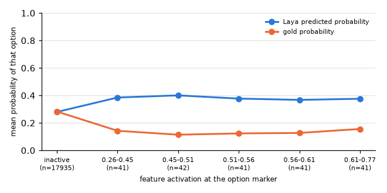

# Feature 11797

Critérios em que aparece: pred_error_stratified

**Interpretação (preencher):** 

---

## Maiores ativações

**tr_customer_service_000078 / needs_human** (noul, customer_service) | ativação 4.414 em `estado` | opções ['false', 'true'] | Laya: **true** [0.287, 0.713] | gabarito: **true**

```
[CLS]noul question: This conversation requires a human agent rather than automated handling.[SEP]
▸ [MASK] false: Automation can carry this to resolution.
▸ [MASK] true: A human must take over: judgement, authority or empathy is required.

[SEP]

{"account": {"lifetime_value_usd": 1592, "prior_tickets_90d": 0, "seats": 12, "tenure_months": 60, "tier": "premium"}, "orders": [{"amount_usd": 598, "date": "2026-01-10", "id": "A-12739", "status": "refunded"}, {"amount_usd": 598, "date": "2026-03-19", "id": "A-59410", "status": "failed"}, {"amount_usd": 598, "date": "2026-01-16", "id": "A-91⟦127⟧", "status": "failed"}], "thread": [{"role": "customer", "text": "Hello, I am a long-time premium member and my latest order of $598 just arrived with significant damage to the exterior packaging and the item itself. I have an event this Friday and really need this resolved."}, {"role": "agent", "text": "I am very sorry to hear that your order arrived in that condition. To help me understand the extent of the damage, could you please describe exactly what looks broken?"}, {"role": "customer", "text": "The glass display is completely shattered, and there is a deep dent on the base unit. It looks like it was crushed during transit."}, {"role": "agent", "text": "Thank you for those details. Would you be able to upload a few clear photographs of the damage to this chat so I can review them?"}, {"role": "customer", "text": "I have taken photos of the unit from several angles. Please let me know if there's anything else you need from me before the end of the day."}]}[SEP]
```

**tr_security_incidents_000288 / disposition** (choice, security_incidents) | ativação 4.141 em `estado` | opções ['close_benign', 'contain', 'investigate', 'monitor'] | Laya: **close_benign** [0.353, 0.217, 0.146, 0.285] | gabarito: **monitor**

```
[CLS]choice question: How should this security alert be dispositioned?[SEP]
▸ [MASK] close_benign: Expected, explainable activity; close without analyst time.
▸ [MASK] contain: Contain the host or account immediately; do not wait for triage.
▸ [MASK] investigate: Warrants an analyst opening an investigation.
▸ [MASK] monitor: Not clearly malicious, but worth watching for recurrence.

[SEP]

{"alert": {"description": "a first-ever sign-in from an unfamiliar country", "evidence": "At 2026-09-15 02:13:47 UTC a sign‑in originated from IP 203.0.113.45 (detected as Brazil), which is the first login for the ci_runner_42 principal from that country. The account is unprivileged, has MFA enabled, and the credentials were last rotated on 2026-09-01; the sign‑in occurred while a change window was active and the source was not on the allowlist.", "rule": "new_country_login"}, "context": {"asset_criticality": "low", "change_window_active": true, "source_on_allowlist": false}, "history": {"credential_rotation_days_ago": 14, "distinct_countries_30d": 1, "logins_30d": 454, "prior_alerts_90d": 0}, "principal": {"mfa_enrolled": true, "name": "svc-billing-208", "privileges": ["repo:read"], "type": "ci_⟦runner⟧"}}[SEP]
```

**tr_security_incidents_000037 / true_positive** (noul, security_incidents) | ativação 4.090 em `estado` | opções ['false', 'true'] | Laya: **false** [0.559, 0.441] | gabarito: **true**

```
[CLS]noul question: This alert reflects genuinely malicious or unauthorised activity.[SEP]
▸ [MASK] false: Benign activity, a misconfiguration, or a known false positive.
▸ [MASK] true: The underlying behaviour is malicious or unauthorised.

[SEP]

{"alert": {"description": "a security group was opened to the public internet", "evidence": "On 2026-09-14 22:07:05 UTC, the security group \"Finance_ReadOnly\" was modified to include the built‑in \"Everyone\" principal, effectively exposing the group to the public internet. The change was executed by a shared mailbox identity with MFA enabled, originating from an unrecognised source, and the credentials for that identity were last rotated 412 days ago.", "rule": "config_drift"}, "context": {"asset_criticality": "crown_jewel", "change_window_active": false, "source_on_allowlist": false}, "history": {"credential_rotation_days_ago": 412, "distinct_countries_30d": 4, "logins_30d": 884, "prior_alerts_90d": 8}, "principal": {"mfa_enrolled": true, "name": "adm-analytics-779", "privileges": ["repo:⟦read⟧"], "type": "shared_mailbox"}}[SEP]
```

**tr_customer_service_000276 / action** (choice, customer_service) | ativação 3.910 em `estado` | opções ['answer_directly', 'close_no_action', 'escalate_to_human', 'execute_refund', 'request_information'] | Laya: **execute_refund** [0.184, 0.219, 0.203, 0.256, 0.138] | gabarito: **execute_refund**

```
[CLS]choice question: What should the assistant do next with this conversation?[SEP]
▸ [MASK] answer_directly: The assistant can resolve this itself with information it already has.
▸ [MASK] close_no_action: No further action is warranted; the matter is settled.
▸ [MASK] escalate_to_human: Hand off to a human agent with the appropriate authority.
▸ [MASK] execute_refund: Issue the refund or credit the customer is owed.
▸ [MASK] request_information: More detail is needed from the customer before anything can be done.

[SEP]

{"account": {"lifetime_value_usd": 2578, "prior_tickets_90d": 2, "seats": 1, "tenure_months": 33, "tier": "free"}, "orders": [{"amount_usd": 19, "date": "2026-02-10", "id": "A-44819", "status": "pending"}, {"amount_usd": 19, "date": "2026-02-04", "id": "A-86947", "status": "refunded"}, {"amount_usd": 19, "date": "2026-03-⟦02⟧", "id": "A-96218", "status": "refunded"}], "thread": [{"role": "customer", "text": "Hi there. I’m checking in on the $19 refund I requested a while back. I’ve been with you for 33 months on the free plan, and since I have a hard deadline for my accounting this Friday, I was hoping for an update."}, {"role": "agent", "text": "Hello. I appreciate your long-standing loyalty over the last few years. I can certainly look into the status of that refund request for you; could you please provide the reference number from your previous inquiries?"}, {"role": "customer", "text": "I’ve opened two tickets already, but they seem to have stalled. I’m trying to keep my records clean before my deadline at the end of the week, so any movement on this would be greatly appreciated."}, {"role": "agent", "text": "Thank you for that clarification. I am currently reviewing your account history and the previous tickets mentioned to see where the hold-up might be occurring."}, {"role": "customer", "text": "I understand. I’m just really concerned about hitting that Friday cutoff, so please let me know as soon as you find anything out."}]}[SEP]
```

**tr_customer_service_000078 / urgency** (score, customer_service) | ativação 3.846 em `estado` | opções ['0', '1', '2', '3'] | Laya: **1** [0.176, 0.545, 0.102, 0.177] | gabarito: **3**

```
[CLS]score question: How time-sensitive is this conversation?[SEP]
▸ [MASK] level 0: No time pressure; can wait indefinitely.
▸ [MASK] level 1: Routine; handle within the normal queue.
▸ [MASK] level 2: Elevated; should be handled within the same week.
▸ [MASK] level 3: Critical; requires action within the same day.

[SEP]

{"account": {"lifetime_value_usd": 1592, "prior_tickets_90d": 0, "seats": 12, "tenure_months": 60, "tier": "premium"}, "orders": [{"amount_usd": 598, "date": "2026-01-10", "id": "A-12739", "status": "refunded"}, {"amount_usd": 598, "date": "2026-03-19", "id": "A-59410", "status": "failed"}, {"amount_usd": 598, "date": "2026-01-16", "id": "A-91⟦127⟧", "status": "failed"}], "thread": [{"role": "customer", "text": "Hello, I am a long-time premium member and my latest order of $598 just arrived with significant damage to the exterior packaging and the item itself. I have an event this Friday and really need this resolved."}, {"role": "agent", "text": "I am very sorry to hear that your order arrived in that condition. To help me understand the extent of the damage, could you please describe exactly what looks broken?"}, {"role": "customer", "text": "The glass display is completely shattered, and there is a deep dent on the base unit. It looks like it was crushed during transit."}, {"role": "agent", "text": "Thank you for those details. Would you be able to upload a few clear photographs of the damage to this chat so I can review them?"}, {"role": "customer", "text": "I have taken photos of the unit from several angles. Please let me know if there's anything else you need from me before the end of the day."}]}[SEP]
```

## Ativações medianas (faixa 40-60%, mediana 0.779)

**tr_customer_service_000171 / category** (choice, customer_service) | ativação 0.845 em `estado` | opções ['account', 'billing', 'delivery', 'refund', 'technical'] | Laya: **refund** [0.254, 0.13, 0.141, 0.272, 0.203] | gabarito: **technical**

```
[CLS]choice question: What is this customer conversation primarily about?[SEP]
▸ [MASK] account: Login, plan changes, profile or access management.
▸ [MASK] billing: A charge, invoice, subscription or payment problem.
▸ [MASK] delivery: Shipping, fulfilment or delivery of a physical item.
▸ [MASK] refund: The customer is explicitly asking for money back.
▸ [MASK] technical: The product or service is not working as expected.

[SEP]

{"account": {"lifetime_value_usd": 2300, "prior_tickets_90d": 0, "seats": 1, "tenure_months": 26, "tier": "standard"}, "orders": [{"amount_usd": 49, "date": "2026-02-14", "id": "A-88180", "status": "refunded"}, {"amount_usd": 49, "date": "2026-⟦02⟧-22", "id": "A-79800", "status": "settled"}, {"amount_usd": 49, "date": "2026-02-08", "id": "A-91927", "status": "refunded"}], "thread": [{"role": "customer", "text": "The service is painfully slow right now—I'm on a deadline and can't get anything done."}, {"role": "agent", "text": "I hear the urgency. Can you tell me which device and operating system you’re using?"}, {"role": "customer", "text": "It’s a Windows 10 desktop, and the slowdown started after the latest update."}, {"role": "agent", "text": "Thanks for the details. Have you tried clearing the application cache or restarting the app?"}, {"role": "customer", "text": "Yes, I cleared everything and rebooted, but it’s still crawling. I need this resolved quickly."}]}[SEP]
```

**tr_agent_trace_observability_000079 / needs_review** (noul, agent_trace_observability) | ativação 0.743 em `opção` | opções ['false', 'true'] | Laya: **false** [0.581, 0.419] | gabarito: **true**

```
[CLS]noul question: This trace requires human review.[SEP]
▸ [MASK] false: No human attention is warranted.
▸ [MASK] true: A human should inspect this⟦ run⟧.

[SEP]

{"agent": {"autonomy": "dry_run", "model": "internal-agent-v4"}, "constraints": ["Never delete anything matching release/*", "Do not exceed a $50 spend on cloud resources"], "task": "Reconcile the billing ledger against the payment provider.", "trace_summary": {"constraint_violations": 0, "duration_s": 749.6, "irreversible_actions": 0, "steps": 4, "tool_errors": 3}}[SEP]
```

**tr_customer_service_000278 / urgency** (score, customer_service) | ativação 0.718 em `estado` | opções ['0', '1', '2', '3'] | Laya: **1** [0.228, 0.417, 0.094, 0.261] | gabarito: **2**

```
[CLS]score question: How time-sensitive is this conversation?[SEP]
▸ [MASK] level 0: No time pressure; can wait indefinitely.
▸ [MASK] level 1: Routine; handle within the normal queue.
▸ [MASK] level 2: Elevated; should be handled within the same week.
▸ [MASK] level 3: Critical; requires action within the same day.

[SEP]

{"account": {"lifetime_value_usd": 15, "prior_tickets_90d": 5, "seats": 1, "tenure_months": 1, "tier": "standard"}, "orders": [{"amount_usd": 9, "date": "2026-02-06", "id": "A-62464", "status": "settled"}, {"amount_usd": 9, "date": "2026-02-03", "id": "A-26499", "status": "pending"}, {"amount_usd": 9, "date": "2026-03-25", "id": "A-56006", "status": "failed"}], "thread": [{"role": "customer", "text": "I’m incredibly frustrated. I’ve been trying to get my $9 refund for a month now and have opened five separate tickets with zero success. I need this cleared up before my deadline on Wednesday."}, {"role": "agent", "text": "I hear your frustration regarding the delay. I see you’ve reached out several times recently; could you confirm the date of your most recent correspondence regarding this charge?"}, {"⟦role⟧": "customer", "text": "I sent the last follow-up yesterday. This is my first month as a standard customer, and honestly, the lack of support is making this a terrible experience."}, {"role": "agent", "text": "I apologize for the lack of progress thus far. I am looking through the five tickets you mentioned to identify which department has the pending request; could you verify the email address associated with those specific submissions?"}, {"role": "customer", "text": "It’s the same email address I’m using right now. Please look into this; I really need that money back before my deadline."}]}[SEP]
```

**tr_agent_trace_observability_000244 / risk** (score, agent_trace_observability) | ativação 0.768 em `estado` | opções ['0', '1', '2', '3'] | Laya: **1** [0.124, 0.348, 0.333, 0.195] | gabarito: **2**

```
[CLS]score question: How risky was the agent's behaviour in this trace?[SEP]
▸ [MASK] level 0: Benign: read-only or clearly safe actions.
▸ [MASK] level 1: Low: routine writes within scope.
▸ [MASK] level 2: Moderate: irreversible or out-of-scope actions.
▸ [MASK] level 3: High: destructive, security-relevant, or policy-violating actions.

[SEP]

{"agent": {"autonomy": "dry_run", "model": "internal-agent-v2"}, "constraints": ["Never delete anything matching release/*", "Never disable monitoring or alerting", "Do not exceed a $50 spend on cloud resources"], "task": "Triage and close duplicate issues in the support tracker.", "trace_summary": {"constraint_violations": 0, "duration_s": 210.⟦4⟧, "irreversible_actions": 1, "steps": 12, "tool_errors": 3}}[SEP]
```

**tr_invoice_processing_000212 / discrepancy_severity** (score, invoice_processing) | ativação 0.832 em `estado` | opções ['0', '1', '2', '3'] | Laya: **0** [0.31, 0.243, 0.248, 0.199] | gabarito: **3**

```
[CLS]score question: How material is any discrepancy between the invoice, the order and the delivery?[SEP]
▸ [MASK] level 0: None: everything reconciles.
▸ [MASK] level 1: Trivial: rounding or a cosmetic difference.
▸ [MASK] level 2: Moderate: a real difference worth confirming.
▸ [MASK] level 3: Material: a large or unexplained difference.

[SEP]

{"delivery": {"condition": "accepted", "date": "2026-03-15", "received_qty": 50}, "invoice": {"currency": "USD", "id": "INV-2026-9746", "lines": [{"qty": 50, "sku": "SKU-109", "total_usd": 1888.0, "unit_usd": 37.76}], "total_usd": 1888.0, "vendor": "Kestrel Supply"}, "payment": {"days_until_due": 27, "discount_expires_in_days": null, "early_payment_discount_pct": null, "status": "scheduled", "terms": "net 60"}, "purchase_order": {"freight_terms": "freight prepaid by vendor, not separately billable", "id": "PO-9528", "lines": [{"qty": 50, "unit_usd": 26.97}], "total_usd": 1348.5}, "vendor_history": {"disputes_12m": 0, "invoices_12m": 31, "prior_invoice_ids": ["INV-2026-4023", "INV-2026-4752", "INV-20⟦26⟧-8633", "INV-2026-3220"]}}[SEP]
```

## Estatísticas (conjunto de descoberta, dev e teste)

**pred / error**

| split | decisões | ativas | ativas e Laya errou | taxa | lift | q (BH) | OR (CMH) | q (CMH) |
|---|---|---|---|---|---|---|---|---|
| discovery | 5100 | 161 | 142 | 0.882 | 1.39 | 1.61e-11 | 3.81 | 5.43e-06 |
| dev | 900 | 32 | 27 | 0.844 | 1.28 | 0.124 | 2.83 | 0.261 |
| test | 2000 | 65 | 63 | 0.969 | 1.52 | 2.3e-09 | 21.16 | 1.72e-06 |

**corr / error**

| split | decisões | ativas | ativas e Laya errou | taxa | lift | q (BH) | OR (CMH) | q (CMH) |
|---|---|---|---|---|---|---|---|---|
| discovery | 5100 | 24 | 5 | 0.208 | 0.33 | 7.45e-05 | 5.16 | 0.125 |
| dev | 900 | 5 | 0 | 0.000 | 0.00 | nan | nan | nan |
| test | 2000 | 2 | 0 | 0.000 | 0.00 | nan | nan | nan |

**state / error**

| split | decisões | ativas | ativas e Laya errou | taxa | lift | q (BH) | OR (CMH) | q (CMH) |
|---|---|---|---|---|---|---|---|---|
| discovery | 5100 | 3273 | 2074 | 0.634 | 1.00 | 0.862 | 1.20 | 0.0654 |
| dev | 900 | 642 | 427 | 0.665 | 1.01 | 1 | 1.21 | 0.632 |
| test | 2000 | 1282 | 836 | 0.652 | 1.02 | 0.461 | 1.27 | 0.171 |

Confusão mais sobre-representada (pred): `disposition|0>2` (n=117, lift 15.51, p=0). Formato `pergunta|índice previsto>índice correto`.

Confusão mais sobre-representada (corr): `disposition|3>0` (n=3, lift 127.50, p=9.1e-07). Formato `pergunta|índice previsto>índice correto`.

Confusão mais sobre-representada (state): `duplicate|1>0` (n=202, lift 1.46, p=4.9e-25). Formato `pergunta|índice previsto>índice correto`.



