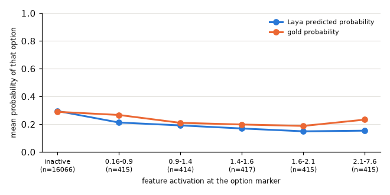

# Feature 11913

Critérios em que aparece: pred_error_stratified

**Interpretação (preencher):** 

---

## Maiores ativações

**tr_customer_service_000214 / churn_risk** (score, customer_service) | ativação 7.582 em `marcador` | opções ['0', '1', '2', '3'] | Laya: **2** [0.052, 0.223, 0.685, 0.04] | gabarito: **2**

```
[CLS]score question: How likely is this customer to stop doing business with us because of this interaction?[SEP]
▸ [MASK] level 0: No sign of dissatisfaction.
▸ [MASK] level 1: Mild frustration, but the relationship is intact.
▸ [MASK] level 2: Clearly unhappy; repeat problems or explicit complaints.
▸ ⟦[MASK]⟧ level 3: Imminent: threatening to cancel, dispute or leave.

[SEP]

{"account": {"lifetime_value_usd": 820, "prior_tickets_90d": 2, "seats": 1, "tenure_months": 19, "tier": "standard"}, "thread": [{"role": "customer", "text": "The platform has been crawling at a snail's pace all day—queries that used to return in seconds now take minutes, and I need this fixed before my deadline tomorrow."}, {"role": "agent", "text": "I understand how critical that is. Can you tell me which specific actions are lagging and if this slowdown is happening across all browsers?"}, {"role": "customer", "text": "Both the search bar and the analytics tab are sluggish, and it’s the same on Chrome and Firefox. I’ve been on the standard plan for 19 months and this is the first time I’ve seen anything this bad."}]}[SEP]
```

**tr_customer_service_000048 / churn_risk** (score, customer_service) | ativação 7.551 em `opção` | opções ['0', '1', '2', '3'] | Laya: **3** [0.082, 0.35, 0.122, 0.446] | gabarito: **2**

```
[CLS]score question: How likely is this customer to stop doing business with us because of this interaction?[SEP]
▸ [MASK] level 0: No sign of dissatisfaction.
▸ [MASK] level 1: Mild frustration, but the relationship is intact.
▸ [MASK] level 2: Clearly unhappy; repeat problems or explicit complaints⟦.⟧
▸ [MASK] level 3: Imminent: threatening to cancel, dispute or leave.

[SEP]

{"account": {"lifetime_value_usd": 881, "prior_tickets_90d": 0, "seats": 1, "tenure_months": 14, "tier": "free"}, "thread": [{"role": "customer", "text": "I’ve been with you for 14 months on the free plan, but I need to move to a lower tier immediately. I have a firm deadline at 5 PM today to get this sorted, please help."}, {"role": "agent", "text": "I see you're looking to modify your plan subscription. To better assist you with your request, could you clarify which specific features you are looking to scale back?"}, {"role": "customer", "text": "There isn't time for a deep dive. I just need the downgrade processed before my deadline expires this afternoon."}]}[SEP]
```

**tr_customer_service_000203 / churn_risk** (score, customer_service) | ativação 7.477 em `opção` | opções ['0', '1', '2', '3'] | Laya: **1** [0.145, 0.725, 0.101, 0.03] | gabarito: **1**

```
[CLS]score question: How likely is this customer to stop doing business with us because of this interaction?[SEP]
▸ [MASK] level 0: No sign of dissatisfaction.
▸ [MASK] level 1: Mild frustration, but the relationship is intact.
▸ [MASK] level 2: Clearly unhappy; repeat problems or explicit complaints⟦.⟧
▸ [MASK] level 3: Imminent: threatening to cancel, dispute or leave.

[SEP]

{"account": {"lifetime_value_usd": 303, "prior_tickets_90d": 1, "seats": 12, "tenure_months": 5, "tier": "premium"}, "thread": [{"role": "customer", "text": "Since the last update, the sync process has been taking around 15 minutes for a few megabytes, which is much slower than before."}]}[SEP]
```

**tr_customer_service_000141 / churn_risk** (score, customer_service) | ativação 7.461 em `opção` | opções ['0', '1', '2', '3'] | Laya: **2** [0.036, 0.096, 0.821, 0.047] | gabarito: **2**

```
[CLS]score question: How likely is this customer to stop doing business with us because of this interaction?[SEP]
▸ [MASK] level 0: No sign of dissatisfaction.
▸ [MASK] level 1: Mild frustration, but the relationship is intact.
▸ [MASK] level 2: Clearly unhappy; repeat problems or explicit complaints⟦.⟧
▸ [MASK] level 3: Imminent: threatening to cancel, dispute or leave.

[SEP]

{"account": {"lifetime_value_usd": 225, "prior_tickets_90d": 5, "seats": 1, "tenure_months": 3, "tier": "standard"}, "orders": [{"amount_usd": 297, "date": "2026-01-07", "id": "A-98625", "status": "pending"}], "thread": [{"role": "customer", "text": "My service has been running significantly slower than usual over the last week, even though I'm paying $297 monthly."}, {"role": "agent", "text": "I am sorry to hear you are experiencing latency issues. Could you please run a speed test and share the results with me so I can review your connection logs?"}, {"role": "customer", "text": "I've already run three tests and they show speeds are at 10% of what I'm promised. I've logged five tickets about this already with no progress."}]}[SEP]
```

**tr_customer_service_000128 / churn_risk** (score, customer_service) | ativação 7.457 em `opção` | opções ['0', '1', '2', '3'] | Laya: **2** [0.082, 0.292, 0.531, 0.095] | gabarito: **2**

```
[CLS]score question: How likely is this customer to stop doing business with us because of this interaction?[SEP]
▸ [MASK] level 0: No sign of dissatisfaction.
▸ [MASK] level 1: Mild frustration, but the relationship is intact.
▸ [MASK] level 2: Clearly unhappy; repeat problems or explicit complaints⟦.⟧
▸ [MASK] level 3: Imminent: threatening to cancel, dispute or leave.

[SEP]

{"account": {"lifetime_value_usd": 820, "prior_tickets_90d": 5, "seats": 12, "tenure_months": 11, "tier": "enterprise"}, "thread": [{"role": "customer", "text": "Hello, I'm reaching out because the analytics dashboard we rely on has stopped updating. We've been on the enterprise plan for about 11 months, and I've already opened several tickets (five in total) where the issue was only partially resolved."}, {"role": "agent", "text": "I’m sorry to hear the dashboard isn’t updating. Could you let me know when you first noticed the problem and whether any error messages appear?"}, {"role": "customer", "text": "It started this morning; the page loads but the charts stay blank, and the console shows a 502 error. I’ve tried clearing caches and restarting the service, but nothing changes."}]}[SEP]
```

## Ativações medianas (faixa 40-60%, mediana 1.513)

**tr_customer_service_000069 / category** (choice, customer_service) | ativação 1.566 em `opção` | opções ['account', 'billing', 'delivery', 'refund', 'technical'] | Laya: **technical** [0.108, 0.151, 0.087, 0.247, 0.406] | gabarito: **technical**

```
[CLS]choice question: What is this customer conversation primarily about?[SEP]
▸ [MASK] account: Login, plan changes, profile or access management.
▸ [MASK] billing: A charge, invoice, subscription or payment problem.
▸ [MASK] delivery: Shipping, fulfilment or delivery of a physical item⟦.⟧
▸ [MASK] refund: The customer is explicitly asking for money back.
▸ [MASK] technical: The product or service is not working as expected.

[SEP]

{"account": {"lifetime_value_usd": 1693, "prior_tickets_90d": 0, "seats": 1, "tenure_months": 26, "tier": "free"}, "thread": [{"role": "customer", "text": "I'm trying to pull our team's records into a CSV for a client deliverable and the export just spins. We're on the free plan, this has been going on for days, and I need the file by Friday at 5 p.m. It's our 26th month on the platform, so it's surprising how broken basic export is."}, {"role": "agent", "text": "Thanks for letting me know where you're at. Could you tell me whether the export fails during the initial request, after selecting the date range, or when the download file is supposed to start?"}, {"role": "customer", "text": "It fails right after I click generate. No error, just the spinner. I've tried Chrome and Safari, and I've even cleared cookies. The client deadline doesn't move, so I need someone to actually look at this before Friday."}, {"role": "agent", "text": "I understand the timing is tight. To help narrow it down, can you share the approximate number of records you're trying to export and whether you're exporting all projects or a subset?"}, {"role": "customer", "text": "It's roughly the whole workspace, but I can't get past the spinner to confirm. If it's an account limit or a backend issue, I need that explained by tomorrow, because Friday is non-negotiable."}]}[SEP]
```

**tr_agent_trace_observability_000228 / outcome** (choice, agent_trace_observability) | ativação 1.584 em `marcador` | opções ['failure', 'harmful', 'partial', 'success'] | Laya: **success** [0.235, 0.093, 0.154, 0.518] | gabarito: **partial**

```
[CLS]choice question: How did this agent run turn out?[SEP]
▸ [MASK] failure: The agent did not accomplish the task.
▸ [MASK] harmful: The agent took an action that caused damage or violated a constraint.
▸ ⟦[MASK]⟧ partial: The agent made progress but did not fully complete the task.
▸ [MASK] success: The agent completed the task correctly.

[SEP]

{"agent": {"autonomy": "unsupervised", "model": "internal-agent-v3"}, "constraints": ["Never delete anything matching release/*", "Never disable monitoring or alerting"], "task": "Reduce the nightly report job's runtime below fifteen minutes.", "trace_summary": {"constraint_violations": 0, "duration_s": 616.4, "irreversible_actions": 0, "steps": 10, "tool_errors": 1}}[SEP]
```

**tr_security_incidents_000284 / severity** (score, security_incidents) | ativação 1.671 em `opção` | opções ['0', '1', '2', '3', '4'] | Laya: **2** [0.029, 0.274, 0.419, 0.243, 0.036] | gabarito: **3**

```
[CLS]score question: How severe is the potential impact if this alert is real?[SEP]
▸ [MASK] level 0: Negligible: no access to anything sensitive.
▸ [MASK] level 1: Low: limited access, easily reversed.
▸ [MASK] level 2: Moderate: access to internal systems or non-public data.
▸ [MASK] level 3: High: access to production, secrets or customer data⟦.⟧
▸ [MASK] level 4: Critical: active compromise of crown-jewel systems.

[SEP]

{"alert": {"description": "a large transfer to an external destination", "evidence": "A large volume of data was transferred to an unrecognized external endpoint by a privileged employee account. The activity occurred during an open change window, and the account credentials were last rotated 3 days ago.", "rule": "data_egress"}, "context": {"asset_criticality": "low", "change_window_active": true, "source_on_allowlist": false}, "history": {"credential_rotation_days_ago": 3, "distinct_countries_30d": 3, "logins_30d": 861, "prior_alerts_90d": 1}, "principal": {"mfa_enrolled": true, "name": "svc-deploy-149", "privileges": ["deploy:production", "secrets:read"], "type": "employee"}}[SEP]
```

**tr_invoice_processing_000260 / disposition** (choice, invoice_processing) | ativação 1.713 em `opção` | opções ['approve', 'hold', 'manual_review', 'reject'] | Laya: **approve** [0.409, 0.184, 0.123, 0.284] | gabarito: **approve**

```
[CLS]choice question: How should this vendor invoice be dispositioned?[SEP]
▸ [MASK] approve: Matches the order and delivery; approve for payment.
▸ [MASK] hold: Something needs confirming before payment; hold pending clarification.
▸ [MASK] manual_review: A human in finance must review the discrepancy⟦.⟧
▸ [MASK] reject: Should not be paid: duplicate, unauthorised or materially wrong.

[SEP]

{"delivery": {"condition": "accepted with exceptions", "date": "2026-03-18", "received_qty": 5}, "invoice": {"currency": "USD", "id": "INV-2026-4942", "lines": [{"qty": 5, "sku": "SKU-112", "total_usd": 1010.7, "unit_usd": 202.14}], "total_usd": 1010.7, "vendor": "Acme Fabrication"}, "payment": {"days_until_due": 18, "discount_expires_in_days": null, "early_payment_discount_pct": null, "status": "scheduled", "terms": "net 60"}, "purchase_order": {"freight_terms": "freight prepaid by vendor, not separately billable", "id": "PO-1270", "lines": [{"qty": 25, "unit_usd": 202.14}], "total_usd": 5053.5}, "vendor_history": {"disputes_12m": 5, "invoices_12m": 21, "prior_invoice_ids": ["INV-2026-4201", "INV-2026-5762", "INV-2026-6915", "INV-2026-5549"]}}[SEP]
```

**tr_security_incidents_000002 / severity** (score, security_incidents) | ativação 1.357 em `opção` | opções ['0', '1', '2', '3', '4'] | Laya: **2** [0.023, 0.257, 0.385, 0.278, 0.057] | gabarito: **3**

```
[CLS]score question: How severe is the potential impact if this alert is real?[SEP]
▸ [MASK] level 0: Negligible: no access to anything sensitive.
▸ [MASK] level 1: Low: limited access, easily reversed.
▸ [MASK] level 2: Moderate: access to internal systems or non-public data.
▸ [MASK] level 3: High: access to production, secrets or customer data⟦.⟧
▸ [MASK] level 4: Critical: active compromise of crown-jewel systems.

[SEP]

{"alert": {"description": "many failed authentications followed by a success", "evidence": "A sequence of 95 failed login attempts followed by a single successful authentication was recorded for the privileged `admin-shared-inbox` from an unknown source. The successful access utilized MFA-protected credentials that were last rotated 14 days prior to the event.", "rule": "brute_force"}, "context": {"asset_criticality": "medium", "change_window_active": false, "source_on_allowlist": false}, "history": {"credential_rotation_days_ago": 14, "distinct_countries_30d": 4, "logins_30d": 581, "prior_alerts_90d": 1}, "principal": {"mfa_enrolled": true, "name": "usr-support-225", "privileges": ["deploy:production", "secrets:read"], "type": "shared_mailbox"}}[SEP]
```

## Estatísticas (conjunto de descoberta, dev e teste)

**pred / error**

| split | decisões | ativas | ativas e Laya errou | taxa | lift | q (BH) | OR (CMH) | q (CMH) |
|---|---|---|---|---|---|---|---|---|
| discovery | 5100 | 161 | 96 | 0.596 | 0.94 | 0.411 | 2.91 | 0.000495 |
| dev | 900 | 21 | 17 | 0.810 | 1.23 | 0.465 | 2.20 | 0.307 |
| test | 2000 | 55 | 35 | 0.636 | 1.00 | 1 | 1.60 | 0.61 |

**corr / error**

| split | decisões | ativas | ativas e Laya errou | taxa | lift | q (BH) | OR (CMH) | q (CMH) |
|---|---|---|---|---|---|---|---|---|
| discovery | 5100 | 471 | 406 | 0.862 | 1.35 | 4.13e-29 | 0.41 | 0.00705 |
| dev | 900 | 82 | 78 | 0.951 | 1.45 | 6.8e-10 | 4.97 | 0.455 |
| test | 2000 | 167 | 147 | 0.880 | 1.38 | 1.77e-12 | 0.85 | 0.863 |

**state / error**

| split | decisões | ativas | ativas e Laya errou | taxa | lift | q (BH) | OR (CMH) | q (CMH) |
|---|---|---|---|---|---|---|---|---|
| discovery | 5100 | 40 | 16 | 0.400 | 0.63 | 0.0468 | 0.43 | 0.0314 |
| dev | 900 | 9 | 7 | 0.778 | 1.18 | nan | nan | nan |
| test | 2000 | 17 | 9 | 0.529 | 0.83 | nan | nan | nan |

Confusão mais sobre-representada (pred): `category|3>2` (n=19, lift 28.66, p=2.09e-27). Formato `pergunta|índice previsto>índice correto`.

Confusão mais sobre-representada (corr): `discrepancy_severity|0>3` (n=64, lift 10.83, p=0). Formato `pergunta|índice previsto>índice correto`.

Confusão mais sobre-representada (state): `discrepancy_severity|0>3` (n=6, lift 11.95, p=8.46e-06). Formato `pergunta|índice previsto>índice correto`.



